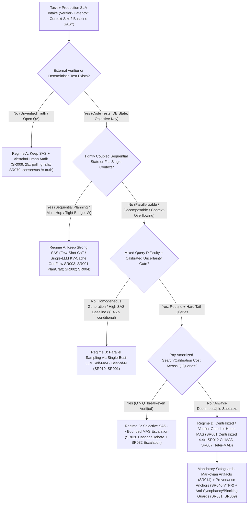

# Phase 6 Critical Cross-Study Synthesis: Compute-Normalized Effectiveness, Coordination Topologies, Failure Mechanisms, and Evaluation Validity (`RQ1`–`RQ4`)

**Role:** Agent 5 (Research Gap and Novelty Analyst — Critical Synthesis Lead)  
**Synthesis Date:** `November 20, 2026`  
**Authoritative Evidence Base:** [evidence_matrix.json](file:///Users/adityasharma/.gemini/antigravity/scratch/llm-mas-systematic-review/data/evidence_matrix.json) ($N = 44$ schema-validated studies, `49` verified MAS-vs-SAS paired comparison tuples), [quality_appraisal.csv](file:///Users/adityasharma/.gemini/antigravity/scratch/llm-mas-systematic-review/data/quality_appraisal.csv), and [Deliverable_D_Literature_Evidence_Register.md](file:///Users/adityasharma/.gemini/antigravity/scratch/llm-mas-systematic-review/deliverables/Deliverable_D_Literature_Evidence_Register.md)  
**Methodological Guardrails:** [Deliverable_C_Systematic_Review_Protocol.md](file:///Users/adityasharma/.gemini/antigravity/scratch/llm-mas-systematic-review/deliverables/Deliverable_C_Systematic_Review_Protocol.md) (`v1.1` reconciled)  

---

## Executive Summary & Verified Corpus Reconciliation Baseline

Across **$N = 44$ included empirical and diagnostic studies** (`126` raw records $\to$ `-42` deduplicated $\to$ `84` screened; Stage 1 $\kappa = 0.9489$, Stage 2 mutual $\kappa = 0.7699$, corpus-wide $\kappa = 0.8575$) spanning **2023–November 20, 2026**, the central finding of this critical synthesis is a stark **baseline-rigor attenuation effect**:

1. **Publication-Status Composition ($N = 44$):** `3` Peer-reviewed journal (`6.8%`: `SR001`, `SR010`, `SR032`), `29` Peer-reviewed conference (`65.9%`) — totaling **`32/44` (`72.7%`) Tier A Archival** — plus `3` Tier B Workshop (`6.8%`: `SR039`, `SR040`, `SR079`, yielding **`35/44` [`79.5%`] Peer-Reviewed**), and `9` Tier C Qualified Preprints (`20.5%`, `9/9` passing the Section 4.3 Rule 4 quality gate).
2. **Corpus Tracks & SAS Baseline Rigor Tiers ($N = 44$):**
   - **Tracks:** `23` Primary Comparative Effectiveness & Topology (`RQ1/RQ2`), `12` Mechanistic Failure & Conformity Analysis (`RQ3`), and `9` Evaluation Validity & Harness Reliability Audit (`RQ4`).
   - **SAS Baseline Rigor (`F12`):** `9` `Tier 1` (compute/token-matched strong SAS: `SR001`–`SR005`, `SR007`, `SR009`, `SR010`, `SR012`), `9` `Tier 2` (strong SAS, unmatched compute or unamortized search: `SR006`, `SR008`, `SR013`–`SR015`, `SR018`–`SR020`, `SR076`), `5` `Tier 3` (weak zero-shot single-pass SAS only: `SR011`, `SR016`, `SR017`, `SR030`, `SR082`), `1` `Tier 4` (absent LLM SAS comparator: `SR075` on embodied PARTNR), and `20` `N/A-Diagnostic` (`11` `RQ3` + `9` `RQ4`, explicitly including `SR032` [*Kapoor et al.*, TMLR 2025], which audits single-agent scaffolds `LATS`/`Reflexion`/`LDB` rather than $N \ge 2$ interactive MAS and is strictly excluded from comparative MAS-vs-SAS numerators and denominators).
   - **Comparative Tuple Denominator:** Of the `24` SAS-tiered studies (`9 + 9 + 5 + 1`), `SR075` (`Tier 4`) yields zero LLM SAS paired comparisons while `SR030` (`RQ3` track, `Tier 3`) contributes one comparative tuple, resulting in exactly **`49` verified MAS-vs-SAS paired tuples across `23` comparative studies**.
3. **Core Attenuation Signal (`Tier 1` vs. `Tier 2+3`):** Across all `49` verified paired tuples, multi-agent systems outperform single-agent systems in **`75.8%` (`25/33`)** of unmatched or weak-baseline `Tier 2+3` tuples (`18/24` [`75.0%`] in `Tier 2`; `7/9` [`77.8%`] in `Tier 3`), yet drop to **`18.8%` (`3/16`) wins versus `50.0%` (`8/16`) outright losses** (`12.5%` [`2/16`] ties, `18.8%` [`3/16`] mixed) under compute- and token-matched `Tier 1` parity — a **`-57.0 pp`** collapse in MAS win rate. Restricting strictly to **Tier A Peer-Reviewed Archival** studies (`42` comparative tuples across `18` studies) preserves the exact directional boundary: `Tier 2+3` achieves **`77.4%` (`24/31`)** MAS wins (`3.2%` [`1/31`] losses) versus **`27.3%` (`3/11`) wins and `45.5%` (`5/11`) losses** in `Tier 1` (`-50.1 pp`).

> [!IMPORTANT]
> **Anti-Pooling & Conditional Framing Covenant:** Raw accuracies and `% token reductions` are **never** averaged across heterogeneous backbones, harnesses, or benchmarks. All effectiveness syntheses operate on within-study paired tuples ($\Delta_{\text{MAS-SAS}}$). Every scaling threshold reported below (e.g., *Kim et al.*'s `~45%` capability cutoff and `17.2x` vs. `4.4x` error amplification) is strictly a **conditional empirical association** bounded by tested LLM generations, benchmarks, and harnesses — not an invariant universal law. Any taxonomy or decision workflow introduced in Section 5 is explicitly **synthesis-derived** rather than an experimentally validated algorithm.

---

## 1. `RQ1` Critical Synthesis: Compute-Normalized Effectiveness & Conditional Regimes

*Research Question 1 asks under what task structures, base-model capability regimes, and compute- or token-budget conditions LLM-MAS outperform, match, or underperform strong SAS baselines.*

### 1.1 Baseline-Rigor Stratification & Publication-Status Sensitivity (`49` Paired Tuples)

Table 1 summarizes all `49` verified within-study paired tuples from [evidence_matrix.json](file:///Users/adityasharma/.gemini/antigravity/scratch/llm-mas-systematic-review/data/evidence_matrix.json), stratified simultaneously by `SAS Baseline Rigor Tier` and `Publication Status` (`Tier A Archival` vs. `Tier C Qualified Preprints`; note all `3` Tier B Workshop papers [`SR039`, `SR040`, `SR079`] are `N/A-Diagnostic` and contribute zero comparative tuples).

| Stratum & SAS Rigor Tier | Studies ($n$) | Paired Tuples ($k$) | `MAS > SAS` (`Win`) | `MAS ≈ SAS` (`Tie`) | `MAS < SAS` (`Loss`) | `Mixed` | Key Empirical Signal |
| :--- | :---: | :---: | :---: | :---: | :---: | :---: | :--- |
| **Full Corpus (`N = 44`; `23` w/ tuples)** | **23** | **49** | **28 (57.1%)** | **4 (8.2%)** | **9 (18.4%)** | **8 (16.3%)** | Aggregate win rate masks extreme tier bifurcation. |
| — **`Tier 1` (Compute/Token-Matched Strong SAS)** | 9 | **16** | **3 (18.8%)** | **2 (12.5%)** | **8 (50.0%)** | **3 (18.8%)** | **`62.5%` (`10/16`) fail to beat SAS** (`Loss + Tie`); wins isolated to decomposable retrieval (`SR001`) & non-zero-sum `ColMAD` (`SR012`). |
| — **`Tier 2` (Strong SAS, Unmatched / Unamortized)** | 9 | **24** | **18 (75.0%)** | **2 (8.3%)** | **1 (4.2%)** | **3 (12.5%)** | High apparent win rate driven by $3\times$–$15\times$ extra inference tokens (`C1`) and omitted MCTS/RL search compute (`C6`). |
| — **`Tier 3` (Weak Zero-Shot Single-Pass SAS Only)** | 5 | **9** | **7 (77.8%)** | **0 (0.0%)** | **0 (0.0%)** | **2 (22.2%)** | Zero losses strictly because `N=1` greedy SAS lacks `Self-Consistency` or few-shot controls. |
| — **Combined `Tier 2 + Tier 3`** | 14 | **33** | **25 (75.8%)** | **2 (6.1%)** | **1 (3.0%)** | **5 (15.2%)** | **`+57.0 pp` inflation** over `Tier 1` (`75.8%` vs. `18.8%`). |
| **Sensitivity A: Tier A Archival Only (`32` studies)** | **18** | **42** | **27 (64.3%)** | **3 (7.1%)** | **6 (14.3%)** | **6 (14.3%)** | Same direction: `Tier 1` vs. `Tier 2+3` drop is **`-50.1 pp`**. |
| — Archival `Tier 1` (`SR001`, `SR005`, `SR007`, `SR009`, `SR010`, `SR012`) | 6 | **11** | **3 (27.3%)** | **1 (9.1%)** | **5 (45.5%)** | **2 (18.2%)** | `54.5%` (`6/11`) fail to beat SAS; all `3` `Tier 1` MAS wins in the entire corpus are peer-reviewed archival (`SR001`, `SR012`). |
| — Archival `Tier 2 + Tier 3` | 12 | **31** | **24 (77.4%)** | **2 (6.5%)** | **1 (3.2%)** | **4 (12.9%)** | `SR011`, `SR013`–`SR020`, `SR030`, `SR082` dominate unmatched claims. |
| **Sensitivity B: Qualified Preprints Only (`9` studies)** | **5** | **7** | **1 (14.3%)** | **1 (14.3%)** | **3 (42.9%)** | **2 (28.6%)** | Zero `Tier 1` wins (`0/5` wins, `3/5` losses, `1/5` tie, `1/5` mixed); sole win is `Tier 2` `MADA-RL` (`SR076`). |

*(Note: `SR075` is `Tier 4` [Preprint] with `0` LLM SAS paired comparisons; `SR032` [*Kapoor et al.*] is `N/A-Diagnostic` [Journal] and excluded from all tuple counts.)*

### 1.2 Task-Structure Boundaries: Decomposable/Context-Splitting vs. Sequential/Reasoning-Bound

Decomposing the `9` `Tier 1` studies (`16` tuples) alongside controlled multi-topology `Tier 2` benchmarks reveals that **task dependency geometry**—not agent count—governs whether multi-agent execution adds or destroys value:

1. **Where Compute-Matched MAS Wins (Decomposable Parallel Subtasks & Context-Overflowing Regimes):**
   - **Parallelizable Financial & Web Retrieval (`SR001`, *Kim et al.*, *Nature Machine Intelligence* 2026):** Across `260` configurations on `6` benchmarks (`180` configurations on `4` core tasks in `arXiv:2512.08296` v1), **Centralized MAS** outperforms compute-matched SAS by **up to `+80.8%` / `+80.9%` relative** on *Finance-Agent* (where distinct subagents analyze independent financial filings/metrics in parallel before centralized synthesis), and **Decentralized / Structured MAS** improves *BrowseComp-Plus* by **`+9.2%` relative** (where distributed search branches avoid single-context saturation).
   - **Decomposable Software Specification & Constrained Generation (`SR014`, *MacNet*, ICLR 2025, `Tier 2`):** On *SRDD* (`+8.32 pp` over CoT) and *CommonGen-Hard* under a tree topology (`+15.53 pp` for `MacNet-Tree`, though `MacNet-Random` lost `-2.53 pp`), modular subtask factorization helps when interfaces are well-bounded.
   - **Severe Context Rot / Fragmented Context Overflow (`SR002`, *Tran & Kiela*, 2026, `Tier 1`):** Across `336` thinking-token-matched configurations ($100$–$10,000$ tokens), the **only** regime where MAS outperformed SAS occurred when single-agent context suffered severe fragmentation, extreme input noise, or "lost-in-the-middle" dilution—effectively turning multi-agent partitioning into a context-isolation buffer.
   - **Evidence-Surfacing for Explicit Verifiers (`SR012`, *ColMAD*, ICML 2026, `Tier 1`):** Under equal token/compute budgets on error-detection and reasoning benchmarks, re-engineering debate incentives into a collaborative non-zero-sum game (`ColMAD`) so debaters surface distinct complementary evidence to a judge outperforms compute-matched Single-Agent (`SA`) and beats legacy `CopMAD`/`CosMAD` by **`+10` to `+19 pp`**.

2. **Where Compute-Matched MAS Loses or Matches SAS (Sequential Coupling, Reasoning Depth & Shared Token Windows):**
   - **Sequential State-Dependent Planning (`SR001`, *PlanCraft* & *WorkBench*):** On *PlanCraft* (sequential Minecraft crafting dependencies where every step mutates shared inventory state), **every tested MAS topology** (`Independent`, `Centralized`, `Decentralized`, `Hybrid`) suffered **`-39%` to `-70%` relative degradation** beneath compute-matched SAS because coordination overhead consumed budget needed for sequential lookahead and fragmented shared state. Similarly, tool-heavy *WorkBench* tasks revealed a **tool-coordination trade-off** favoring unified single-agent context under fixed token budgets.
   - **Multi-Hop World-Knowledge Reasoning (`SR002`, *FRAMES* & *MuSiQue* 4-Hop):** Under matched thinking budgets ($\{100, 500, 1\text{k}, 2\text{k}, 5\text{k}, 10\text{k}\}$), `SAS >= MAS` across **all budgets above the 100-token floor** (representative 4-hop slices: Sequential MAS trails SAS by **`-3.9 pp`** [`~0.379` vs. `~0.418`] at `1,000` thinking tokens and **`-4.1 pp`** [`~0.386` vs. `~0.427`] at `5,000` tokens across `Qwen3-30B-A3B`, `DeepSeek-R1-Distill-Llama-70B`, and `Gemini 2.5 Flash/Pro`).
   - **Finite Shared Context Windows (`SR004`, *Nguyen et al.*, 2026, `Tier 1`):** Formalizing a shared context window $W$ where reading $(n-1)$ peers' debate messages ($H = q + (n-1)m$) directly subtracts from internal generation headroom ($g = W - H - c$), single-agent `Self-Consistency` (zero peer reading tax) **matches or beats Multi-Agent Debate (`MAD`) in `93%` of `980` window $\times$ group-size settings** across `GSM8K`, `MATH500`, `MMLU-Pro`, and `CSQA` (`Llama-3.2-3B`, `Qwen2.5-7B`, `Falcon3-7B`, `Gemma-2-9B`, `Gemma-3-12B`).
   - **Standard Reasoning & Code Synthesis (`SR007`, *Zhang et al.*, NeurIPS 2025 Spotlight, `Tier 1`; `SR014` *MacNet*, `Tier 2`):** Across `9` benchmarks (`MMLU`, `MMLU-Pro`, `CommonsenseQA`, `ARC-Challenge`, `AGIEval`, `GSM8K`, `MATH`, `HumanEval`, `MBPP`) $\times$ `4` models (`36` scenarios), `5` homogeneous `MAD` frameworks fail to beat `CoT` / compute-matched `Self-Consistency` in **`>80%` of scenarios** despite higher token/call costs (`SR007`). Even in `Tier 2` (`SR014`), `MacNet` lags single-agent `CoT` on *HumanEval* (`-8.54 pp` Random; `-5.49 pp` Star) despite vastly greater DAG compute.

### 1.3 Model Capability Saturation, Prompt Parity & Single-LLM KV-Cache Simulation

Three boundary moderators explain why early 2023–2024 optimism dissipated in 2025–2026 controlled evaluations:

- **Conditional Capability-Saturation Association (`SR001`):** Across `180`–`260` configurations spanning `GPT-5`/`GPT-5 nano`, `Claude Sonnet 4.5`/`3.7`, and `Gemini-2.5 Pro`/`2.0 Flash`, *Kim et al.* identify a conditional empirical threshold ($p < 0.001$): once the single-agent baseline exceeds **`~45%` accuracy**, adding multi-agent coordination yields diminishing or negative returns because coordination overhead (`+58%` Independent to `+285%` Centralized/Hybrid) cannot offset the shrinking marginal error pool. Crucially, this `~45%` figure is strictly a **conditional empirical association** observed on the evaluated 2025–2026 backbones and task suite, not a universal scaling law.
- **Generation Drift & Prompt-Engineering Asymmetry (`SR013` vs. `SR005`/`SR006`/`SR007`):** *Du et al.* (`SR013`, ICML 2024, `Tier 2`) reported `+7.8 pp` on `MMLU` and `+7.2 pp` on Chess validity on GPT-3.5-era models using `~6x` unmatched inference calls (`3` agents $\times$ `2` rounds vs. `1x` greedy SAS). *Wang et al.* (`SR006`, ACL 2024, `Tier 2`) demonstrated that `MAD`/`CMD` advantages over single-agent `CoT` materialize **only when few-shot demonstrations are omitted from SAS** (`C4` prompt asymmetry) and **vanish or narrow drastically** once strong task demonstrations are supplied. *Smit et al.* (`SR005`, ICML 2024, `Tier 1`) further showed that out-of-the-box `MAD` fails to reliably outperform compute-matched `Self-Consistency` or `Medprompt` while incurring higher token, USD, and wall-clock costs.
- **Single-LLM Multi-Turn KV-Cache Collapse (`SR003`, *OneFlow*, 2026, `Tier 1`):** *Xu et al.* prove across `7` benchmarks (`GSM8K`, `MATH`, `HumanEval`, `MBPP`, `HotpotQA`, `DROP`, `TravelPlanner` on `GPT-4o-mini` and `Claude 3.5 Haiku`) that **homogeneous** MAS workflows—even MCTS-discovered `AFlow` pipelines—can be compiled into sequential persona shifts within a **single LLM context** (`OneFlow`), matching MAS accuracy **within `<1%` / overlapping error bounds** (`MAS ≈ SAS`) while cutting USD cost and latency via KV-cache prefix reuse. True cross-model **heterogeneity** (which cannot share a single KV cache) marks the exact structural boundary where single-LLM simulation stops.

### 1.4 Homogeneous vs. Heterogeneous Teams (`SR010` vs. `SR011`, `SR007`, `SR001`) & Verifier Presence (`SR009`)

1. **Ensemble Mixing vs. Single-Model Sampling (`SR011` `MoA` vs. `SR010` `Self-MoA`):** *Wang et al.* (`SR011`, ICLR 2025, `Tier 3`) reported that 3–4 feed-forward layers of heterogeneous open-weights proposers (`MoA`) beat single-pass `GPT-4o` on `AlpacaEval 2.0` (`+7.6 pp` OS MoA `65.1` vs `57.5`; `+8.2 pp` w/ GPT-4o aggregator `65.7`; `+1.8 pp` cost-matched `MoA-Lite` `59.3`), with mixed outcomes on `MT-Bench` (`9.40` / `9.25` vs `9.19` GPT-4o and `9.31` GPT-4 Turbo). However, *Li et al.* (`SR010`, TMLR 2026, `Tier 1`) exposed the missing control: holding proposer sample budget equal ($N = 7$), **sampling repeatedly from the single strongest model (`Self-MoA`) outperformed heterogeneous `Mixed-MoA` by `+6.6%` relative on `AlpacaEval 2.0` and `+3.8%` average across `MMLU`, `CRUX`, and `MATH`** (conversely, `Mixed-MoA` trailed `Self-MoA` by `-6.6%` / `-3.8%`). Vendi Score analysis showed that mixing weaker models degrades average candidate pool quality faster than cross-model diversity helps.
2. **Heterogeneity in Interactive Debate & Centralized Hierarchies (`SR007`, `SR001`):** While mixing weaker models into *feed-forward voting* (`SR010`) hurts quality, *Zhang et al.* (`SR007`, `Tier 1`) find that **heterogeneous cross-model debate (`Heter-MAD`) improves by `+6.4%` to `+8.2%` over homogeneous MAD** by breaking shared single-model reasoning blind spots. Yet heterogeneity introduces **backbone-dependent orchestrator sensitivity**: *Kim et al.* (`SR001`, Figure 4) show that in centralized teams, *Claude* benefits when a weaker orchestrator directs stronger subagents, whereas *OpenAI* and *Gemini* teams degrade under weaker orchestrators.
3. **The Unverified Truthfulness Ceiling (`SR009`, ICML 2026, `Tier 1`):** *Denisov-Blanch et al.* demonstrate across `TruthfulQA`, `SimpleQA`, `FreshQA`, and `HaluEval` that scaling polling/voting ensembles up to **`25x` inference compute** yields **`0` consistent truthfulness gain** over `1x` baselines and frequently amplifies shared misconceptions (`MAS ≈ SAS`). Without an external verifier (`C3`), multi-LLM ensembles display high "social prediction accuracy" (predicting what peers will say, even conditioned on out-of-distribution random strings) rather than epistemic truth tracking.

### 1.5 Cross-Study Conflict Reconciliation Matrix (`RQ1`)

| Apparent Literature Conflict | Conflicting Studies | Root Cause of Divergence (Evidence-Verified Moderators) |
| :--- | :--- | :--- |
| **"MAD boosts accuracy across reasoning/MMLU"** vs. **"MAD loses to CoT/SC >80% of the time"** | `SR013` (+7.8 pp MMLU), `SR006` (zero-shot) vs. `SR005`, `SR007`, `SR004` | **Unmatched Compute (`C1`) + Prompt Asymmetry (`C4`) + Shared-Window Reading Tax:** `SR013` used `~6x` unmatched tokens against greedy SAS on GPT-3.5; `SR006` proved gains vanish with few-shot CoT; `SR004`/`SR007` matched total tokens (`W` window / `SC`), turning wins into losses (`93%` and `>80%` settings). |
| **"Heterogeneous MoA beats GPT-4o"** vs. **"Mixed-MoA loses to single-LLM sampling"** | `SR011` (`+7.6–8.2 pp`) vs. `SR010` (`-6.6%` / `-3.8%`) | **Missing Single-Best-Model Control (`Tier 3` vs. `Tier 1`):** `SR011` compared 6-model multi-layer `MoA` against $N=1$ `GPT-4o` without testing $N=6$ `Self-MoA` sampling from the top model; `SR010` enforced $N$-sample parity and proved weaker models dilute proposer quality. |
| **"AFlow beats GPT-4o at 4.55% cost"** vs. **"Single-LLM matches AFlow at lower cost"** | `SR018` (`+5.4` to `+12.3` vs `IO`) vs. `SR003` (`<1%` diff) | **KV-Cache Simulation + Unamortized Search (`C6`):** `SR018` compared MCTS-discovered workflows against direct `IO` without amortizing `20` Claude-3.5-Sonnet MCTS search iterations; `SR003` compiled homogeneous `AFlow` workflows into one context, matching accuracy while saving KV-cache latency/USD. |
| **"GPTSwarm beats ToT (+12.5 pp)"** vs. **"GPTSwarm trails single CoT (-11.8 pp)"** | `SR015` (Mini Crosswords/HumanEval) vs. `SR014` Table 1 replication | **Asymmetric Optimization & Harness/Backbone Shift (`C1/C4/C6`):** `SR015` excluded upfront REINFORCE/5-iter prompt search vs. unoptimized baselines; independent `SR014` Table 1 evaluation scored GPTSwarm `0.2368` MMLU / `0.4969` HumanEval beneath single CoT (`0.3544` / `0.6098`). |
| **"Multi-agent debate improves oversight"** vs. **"Debate degrades `-15%` to `-19%` below SA"** | `SR012` `ColMAD` (`+10–19 pp`) vs. `SR012` `CopMAD` (`-15%` to `-19%`) | **Incentive & Objective Design:** Competitive zero-sum debate (`CopMAD`) incentivizes cheap-talk persuasion hacking; collaborative non-zero-sum `ColMAD` rewards surfacing evidence to a downstream verifier under equal tokens. |
| **"MAS yields +80.8% gain"** vs. **"MAS loses -39% to -70%"** | `SR001` *Finance-Agent* vs. `SR001` *PlanCraft* (same paper!) | **Task-Structure Boundary:** *Finance-Agent* decomposes cleanly into parallel retrieval/analysis branches; *PlanCraft* imposes sequential state dependencies where inter-agent splitting breaks planning state and wastes fixed token budgets. |

---

## 2. `RQ2` Critical Synthesis: Coordination Topologies, Amortization & Latency Trade-Offs

*Research Question 2 examines how coordination topologies and communication paradigms relate to effectiveness, inference token overhead, amortized optimization cost, and critical-path latency.*

### 2.1 Terminological Boundary Gate & Topology Taxonomy (`44` Studies)

Adopting the terminological discipline of *La Malfa et al.* (`SR054`, NeurIPS 2025, excluded `E4`)—which documents how LLM-MAS papers mislabel stateless prompt chains and parallel polls as classical `BDI`/`FIPA` agents or decentralized swarms—our corpus separates **Parallel Voting Collectives** (`3/44` = `6.8%`) and **Non-Comparative Diagnostic Audits** (`16/44` = `36.4%`) from **Interactive / Stateful LLM-MAS** (`25/44` = `56.8%` across `Dense All-to-All Debate`, `Multiple Topologies Compared`, `Adaptive Sparse/Learned DAG`, and `Hybrid/Selective Escalation`). Notably, **zero** included studies evaluate a standalone `Sequential Chain/SOP` or `Centralized Star` in isolation; instead, sequential pipelines and centralized orchestrator-worker topologies are evaluated inside the `7` multi-topology comparative grids (`SR001`, `SR002`, `SR003`, `SR006`, `SR014`, `SR069`, `SR075`) and `RQ3` trace audits (`SR021`, `SR022`, `SR026`). Role specialization (`F09`) appears in **`29/44` (`65.9%`)** studies (`13/44` = `29.5%` unspecialized; `2/44` = `4.5%` unverifiable).

| Topology Class (`F07`) | Studies ($n/44$) | Tier Distribution (`T1`/`T2`/`T3`/`T4`/`N/A`) | Paired Verdicts (`W`/`T`/`L`/`M`) | Token Complexity & Memory/Interface Pattern | Critical-Path Latency & Amortization Profile |
| :--- | :---: | :---: | :---: | :--- | :--- |
| **`Independent / Voting Ensemble`** *(Parallel Collectives)* | **3** (`6.8%`) (`SR009`–`SR011`) | `2` / `0` / `1` / `0` / `0` | `3` / `1` / `2` / `1` (`7` tuples) | $O(N)$ parallel proposals (`SR009` up to `25x`; `SR010` $N=7$); `SR011` concatenates across `3–4` layers (`O(L·N)` input bloat). | Low per-layer depth ($\max_i t_i$ per layer), zero training amortization (`QA3=2`). Fails on unverified truth (`SR009`) & weak-model mixing (`SR010`). |
| **`Sequential Chain / SOP`** *(Evaluated inside Multi-Topology & RQ3)* | **0** *(standalone)* *(In `SR002`, `SR003`, `SR014`, `SR021`)* | — | — | Linear $O(D)$ handoffs; suffers **DPI information loss** (`SR002`) and spec/history loss (`SR021`: `11.8%` task spec, `2.8%` history loss) unless collapsed to shared KV cache (`SR003`). | Strictly additive serial makespan $\sum_{d=1}^D t_d$. |
| **`Centralized Star / Orchestrator-Worker`** *(Evaluated inside Multi-Topology & RQ3)* | **0** *(standalone)* *(In `SR001`, `SR014`, `SR069`, `SR021`, `SR022`, `SR026`)* | — | — | `+58%` Independent to **`+285%` token overhead** (`SR001`); `SR001` Fig. 4 shows orchestrator-capability bottleneck varies by vendor (`Claude` vs. `OpenAI`/`Gemini`). | Bounded by orchestrator round-trips; suppresses error amplification (`4.4x` vs. `17.2x` in `SR001`) but susceptible to delegation verification loss (`30.9%` VTFR, `SR040`). |
| **`Dense All-to-All Debate`** | **12** (`27.3%`) (`SR004`, `SR005`, `SR007`, `SR008`, `SR012`, `SR013`, `SR029`–`SR031`, `SR076`, `SR079`, `SR082`) | `4` / `3` / `2` / `0` / `3` | `5` / `0` / `3` / `4` (`12` tuples) | Broadcast $O(N^2 \cdot R)$ / $O(N \cdot R)$ transcript accumulation; consumes reading budget inside $W$ (`SR004`); `11/12` document conformity/sycophancy collapse. | Severe multi-round sequential latency (`SR005` Pareto plots slower than parallel SC); `SR076` carries `C6` LoRA MARL overhead. |
| **`Adaptive Sparse / Learned DAG`** | **5** (`11.4%`) (`SR015`–`SR019`) | `0` / `3` / `2` / `0` / `0` | `13` / `1` / `0` / `0` (`14` tuples) | Sparsifies edges via REINFORCE (`SR015`), low-rank masks (`SR016`: `-28.1%–72.8%`), VGAE (`SR017`: `-95.33%`), MCTS (`SR018`), or 3-stage RL (`SR019`: `-52.07%` HE). **`0/5` `Tier 1`!** | **`5/5` flagged `C6`** (unamortized RL/VGAE/MCTS search); `SR016`/`SR017` lack mid-trajectory re-wiring; `SR003` matches homogeneous `SR018` workflows with 1 LLM. |
| **`Multiple Topologies Compared`** | **7** (`15.9%`) (`SR001`–`SR003`, `SR006`, `SR014`, `SR069`, `SR075`) | `3` / `2` / `0` / `1` / `1` | `5` / `2` / `4` / `3` (`14` tuples) | Cross-paradigm grids (`SR001` 260 configs; `SR002` 336 configs); `SR014` (`MacNet`) scales `>1,000` agents via Markovian artifact edges but plateaus logistically after `~2^3–2^4` agents; `SR006` (`CMD`) compresses inter-group broadcasts. | `SR001` mixed-effects model predicts optimal topology on `~87%` of held-out configs (conditional); `SR003` eliminates inter-process hop latency via KV-cache reuse (`C6` meta-search unamortized). |
| **`Hybrid / Selective Escalation`** | **1** (`2.3%`) (`SR020`) | `0` / `1` / `0` / `0` / `0` | `2` / `0` / `0` / `0` (`2` tuples) | Boundary-gated escalation from `N=1` fast pass to `N=4` deliberation (`+22.52 pp` MedQA vs. single-model cascade; `+20.98%` to `+52.33%` relative vs. fixed thresholds). | Avoids always-on MAS latency on routine queries; `QA3=1` online threshold optimization (`Tier 2`), lacking `Tier 1` equal-token `SC` parity. |
| **`Diagnostic / Benchmark Audit (N/A)`** | **16** (`36.4%`) (`SR021`–`SR023`, `SR025`–`SR028`, `SR032`–`SR040`) | `0` / `0` / `0` / `0` / `16` | `—` | Trajectory trace logs (`SR028` `>200k`–`6M` tokens) and harness/verifier transport audits (`SR040`). | `SR023`, `SR025` carry `C6` (tracer RL/fine-tuning cost omitted). |

### 2.2 The `C6` Amortization Blind Spot & Dense-Graph Strawman Illusion

A decisive methodological flaw across topology optimization and neural attribution studies is **`C6` (Unamortized Search/Training Cost Omission)**:

- **Prevalence (`9/10` Blind Spot):** Across the corpus, **`10` studies** employ learned/searched topology optimization, threshold tuning, or fine-tuned/RL attribution (`QA3 = 1`: `SR003`, `SR015`–`SR020`, `SR023`, `SR025`, `SR076`). Separating lightweight online scalar threshold tuning (`SR020`), **`9` out of `9` (`100%`)** offline-searched/RL/VGAE/fine-tuned MAS and neural tracer frameworks carry `C6` flags (`9/44 = 20.5%` of the corpus; `7/23 = 30.4%` of comparative studies) — and counting *Kapoor et al.* (`SR032`, `QA3 = 2`), which explicitly amortizes DSPy Optuna prompt-search expenditure on HotpotQA, **`9/10` (`90.0%`)** of optimization-bearing MAS/tracer studies omit upfront search or training compute from their headline comparative tables:
  - `SR015` (*GPTSwarm*): REINFORCE edge learning and 5-iteration node prompt optimization consume hundreds of thousands to millions of tokens excluded from `+11.0` to `+12.5 pp` Mini Crosswords / HumanEval tables.
  - `SR016` (*AgentPrune*): Headlines `$43.7 -> $5.6` and `28.1%–72.8%` communication reductions while omitting one-shot low-rank spatial-temporal mask training costs.
  - `SR017` (*G-Designer*): Headlines `-95.33%` HumanEval tokens vs. dense complete/debate graphs (`23.7%` of `DyLAN` tokens on `SVAMP`) while reporting only `<4GB` GPU memory for VGAE training and omitting rollout/API token budgets.
  - `SR018` (*AFlow*): Reports `4.55%` of `GPT-4o` inference USD cost on `GPT-4o-mini` execution without amortizing the **20-iteration `Claude-3.5-Sonnet` MCTS search + validation rollouts** or computing a break-even query volume $Q_{\text{break-even}}$.
  - `SR019` (*MasRouter*): Transparently evaluates RL controller training cost separately in Appendix Table 12 (`QA7=2`), yet leaves main-text Table 1 (`-52.07%` HumanEval overhead; `17.21%–28.17%` cost drop) unamortized relative to single-pass `RouterDC`.
  - `SR076` (*MADA-RL*), `SR003` (*OneFlow*), `SR023` (*AgenTracer*), and `SR025` (*AgentLocate*): Similarly omit upfront MARL/LoRA training (`SR076`), dual meta-LLM MCTS tailoring (`SR003`), `TracerTraj` counterfactual replay + RL (`SR023`), and judge fine-tuning (`SR025`) from headline inference cost tables.
- **Dense-Graph Strawman Denominators:** In `SR016` and `SR017` (`Tier 3`), massive `% token drops` (`72.8%–95.33%`) are benchmarked against **unpruned all-to-all complete graphs** or `DyLAN`/`AutoGen`—not against a `Tier 1` compute-matched `Self-Consistency` SAS spending the same final test-time tokens. Unless an adaptive topology amortizes its search overhead over a documented deployment volume $Q > Q_{\text{break-even}}$ *and* beats `Tier 1` `Self-Consistency` at test time, pruned-graph savings are relative to a strawman.

### 2.3 Critical-Path Wall-Clock Latency vs. Aggregate Token Volume

Token volume is a poor proxy for wall-clock latency: parallel sampling scales tokens linearly ($O(N)$) while holding critical-path depth near $\max_i t_i$, whereas multi-round debate (`SR005`, `SR013`), stacked `MoA` layers (`SR011`), and sequential SOP chains (`SR021`) serialize makespan along $\sum_{d=1}^D t_d$. Yet **`36/44` (`81.8%`)** of included studies either omit wall-clock latency or leave it unverifiable from open summaries (`QA2` mean = `1.18/2.0`, the **lowest criterion mean** in the entire corpus). Only **`5/44` (`11.4%`)** evaluate actual runtime/wall-clock latency (`SR003`, `SR005`, `SR017`, `SR035`, `SR039`), alongside **`3/44` (`6.8%`)** structural proxies (`SR011` cumulative TFLOPs, `SR069` blocking turns `PTN`, `SR075` Habitat simulation steps; `8/44` = `18.2%` combined). Even idealized parallel latency ($\max_i t_i$) breaks under real API concurrency limits (`HTTP 429` throttling documented in `SR028`) and redundant prefix recomputation (`SR003`), further penalizing unoptimized `N=10` to `1,000+` agent graphs (`SR014`).

---

## 3. `RQ3` Critical Synthesis: Mechanisms Explaining Degradation & Negative Returns

*Research Question 3 synthesizes the empirically documented failure mechanisms linking negative `RQ1`/`RQ2` performance deltas to coordination, information-theoretic, social-epistemic, and observability breakdowns.*

Across all `44` studies (`F17`), documented failure drivers cluster into seven mechanisms: **Error Amplification (`26/44`, `59.1%`)**, **Termination/Verification Failure (`19/44`, `43.2%`)**, **Conformity/Sycophancy Collapse (`14/44`, `31.8%`)**, **Specification/Role Failure (`11/44`, `25.0%`)**, **Harness/Metric Artifact (`11/44`, `25.0%`)**, **Handoff Information Loss / DPI (`6/44`, `13.6%`)**, and **Prompt-Injection / Collusion / Blocking (`5/44`, `11.4%`)** (`2/44` `None Documented`: `SR003`, `SR014`). Five mechanistic pathways directly explain why MAS degrades beneath compute-matched SAS:

1. **Structural Coordination & Specification Breakdown (`MAST`, `SR021`, NeurIPS 2025 D&B):** Across `1,642+` annotated traces in `MAST-Data` spanning `7` open-source MAS frameworks (`MetaGPT`, `ChatDev`, `AG2`/`AutoGen`, etc., human inter-annotator $\kappa = 0.88$, LLM-judge `94%` / $\kappa = 0.77$), overall execution failure rates span **`41%` to `86.7%`**. Rather than base-model reasoning inability alone, failures divide across **System Design Issues (`~44.2%`: step repetition `15.7%`, termination unawareness `12.4%`, task-spec disobedience `11.8%`, history loss `2.8%`, role-spec disobedience `1.5%`)**, **Inter-Agent Misalignment (`~32.35%`: reasoning-action mismatch `13.2%`, task derailment `7.4%`, failure to ask clarification `6.8%`, conversation reset `2.2%`, ignored peer input `1.9%`, information withholding `0.85%`)**, and **Task Verification Failures (`~23.5%`: incorrect verification `9.1%`, no/incomplete verification `8.2%`, premature termination `6.2%`)**. Crucially, *MAST* intervention tests confirm that **superficial prompt/role-description tweaks fail** to eliminate these structural breakdowns.
2. **Topology-Dependent Error Amplification (`SR001`):** *Kim et al.* demonstrate conditionally across evaluated configurations that without a centralized verification bottleneck, **Independent MAS amplifies upstream mistakes up to `17.2x`** relative to SAS, whereas **Centralized MAS dampens amplification to `4.4x`** (`5.1x–17.2x` range across architectures). In tightly coupled sequential environments (*PlanCraft*), unverified upstream hallucinations cascade across downstream steps, driving `-39%` to `-70%` net degradation.
3. **Conformity, Sycophancy & Contractive Diversity Collapse (`SR029`, `SR030`, `SR031`, `SR079`, `SR008`, `SR012`, `SR076`):** In `Dense All-to-All Debate` (`11/12` studies = `91.7%` document conformity/sycophancy collapse), inter-agent communication actively destroys correct minority reasoning:
   - **Majority & Capability Pressure:** Across `>2,500` controlled debates (`SR029`, ACL Findings 2025), Chi-square, Two-Way ANOVA, and regression tests confirm statistically significant stance conformity driven by numerical majority size and perceived/actual model capability. On verifiable *Knight-Knave-Spy* logic puzzles (`SR008`), majority pressure causes agents to abandon valid independent deductions whenever an early incorrect consensus emerges.
   - **Contractive Assimilation & Manufactured Overconfidence (`SR079`, KDD 2026 Workshop):** *Dai* proves that endogenous consensus drives inter-agent correlation toward `1.0` ("diversity collapse"), causing **agreement-based stopping to suffer `18%` to `47%` miscoverage** on hard reasoning tasks across `15` tasks $\times$ `5` model families—manufacturing peak confidence precisely where residual error is highest (`R^2 = 0.96`). Attaching `CMAD` split-conformal certificates restores $\ge (1-\alpha)$ marginal coverage without trusting consensus as correctness.
   - **Debate Hacking & Sycophancy Propagation (`SR012`, `SR030`, `SR031`, `SR076`):** `SR012` (*ColMAD*, ICML 2026) formalizes two structural debate failures: competitive zero-sum `CopMAD` induces persuasive "cheap-talk" hacking (`-15%` to `-19%` below compute-matched SA), while consensus-seeking `CosMAD` suppresses valid dissent. Countermeasures confirm the mechanism causally: dynamic anti-sycophancy prompt refinement stabilizes consensus (`CONSENSAGENT`, `SR030`), injecting label-free peer sycophancy priors across `6` open-weight LLMs boosts majority-opinion accuracy by **`+10.5 pp`** (`SR031`, SIGDIAL 2026, outperforming accuracy and random metadata controls), LoRA counterfactual critic RL fixes generator consensus errors (`SR076`, `+2.0 pp`, $p < 0.001$), and collaborative non-zero-sum `ColMAD` (`SR012`) gains `+10` to `+19 pp` over prior MAD.
4. **Data Processing Inequality (DPI) Handoff Loss & Context Starvation (`SR002`, `SR004`, `SR026`, `SR040`):** *Tran & Kiela* (`SR002`) formalize natural-language agent handoffs as lossy Markov transformations governed by the **Data Processing Inequality** ($I(X; \hat{Z}_{\text{MAS}}) \le I(X; Z_{\text{SAS}})$): summarizing intermediate reasoning into text drops latent state needed for 4-hop synthesis (*FRAMES*/*MuSiQue*). Simultaneously, under a bounded context window $W$ (`SR004`), reading peer outputs directly cannibalizes generation headroom ($g = W - H - c$), explaining why `SAS >= MAD` in `93%` of `980` configs.
5. **Embodied Theory-of-Mind Breakdown (`SR075`) & Contagious Blocking (`SR069`):** On `1,000` embodied *PARTNR* tasks (`SR075`, `Tier 4`), passive state observation (`OAS`) improves success and co-located object Knowledge Exchange (`KE`) trims steps by up to `25%`, yet asking zero-shot planners to explicitly predict the Other Agent's Next Action (`OANA`) **degrades task success in `15/16` model $\times$ context pairs** while inflating partner mentions (`55%–100%`)—confirming *La Malfa et al.*'s diagnosis (`SR054`) that LLMs lack native `BDI` Theory-of-Mind. In multi-agent security/liveness (`SR069`, *CORBA*, ACL Findings 2026), semantically benign recursive blocking prompts trigger contagious **Denial-of-Collaboration** across `AutoGen` and `CAMEL` (`~100%` `P-ASR` in smaller setups, `~92%` in `10`-agent setups; `PTN = 1.60–1.90` turns) while evading single-agent static content filters.
6. **Root-Cause Attribution Ceilings & Single-Agent Intra-Loop Contrast (`SR022`–`SR028` vs. Excluded `SR024`):**
   - Zero-shot failure localization in multi-agent traces initially failed badly: `Who&When` (`SR022`, ICML 2025, `127` logs) recorded max **`53.5%` agent-level** and **`14.2%` decisive-step** accuracy; `TRAIL` (`SR028`, `148` traces averaging `>200k` up to `6M` tokens with `841` errors) saw `Gemini-2.5-Pro` score just **`11%` joint localization** (`~18%` GAIA, `~5%` SWE-bench Lite); and `SR023` confirmed frontier reasoning LLMs score `<10%` on step root-cause attribution.
   - Three diagnostic advances break through that ceiling while exposing a deeper limit: (i) **Full Observability (`TraceElephant`, `SR026`, ACL 2026):** `220` traces prove partial output-only logs strip diagnostic signal, whereas full trace observability raises step attribution by **`+76%` to `76.5%`**; (ii) **RL/Multi-Perspective Localization (`AgenTracer`, `SR023`: `+18.18%` over frontier LLMs, `+4.8%–14.2%` MetaGPT/MaAS recovery; `AgentLocate`, `SR025`: `76.19%` agent-level on `Qwen-3.6-27B`)**; and (iii) **Causal Non-Uniqueness (`TRIAGE`, `SR027`, AACL-IJCNLP 2026):** *Wang* reveals that an LLM council selects a completely different repair step from single ground-truth decisive-step labels in **`59.3%` of `Who&When` traces**, proving single-step blame in cyclic MAS dialogues is frequently ill-posed—reframing to severity-ranked **Top-$K$ triage** recovers **`73.9%` Top-5** on `Who&When` and **`93.2%` Top-10** on `TRAIL` (`98.5%` human lenient Top-3 repair plausibility across `326` traces).
   - **Strict Single-Agent Contrast (*AgentDebug*, `SR024`, ICML FAGEN 2026, Excluded `E3`):** *AgentDebug* diagnoses `17` **intra-agent single-loop module failures** (Memory, Reflection, Planning, Action, System) inside single `ReAct`/`CodeAct` trajectories rather than $N \ge 2$ inter-agent interactions (`MAST`/`Who&When`/`TraceElephant`). It is strictly excluded from our $N \ge 2$ MAS failure counts to prevent conflating single-loop agent debugging with multi-agent coordination breakdowns.

---

## 4. `RQ4` Critical Synthesis: Six-Class Confounders, Evaluation Validity & OpenReview Rejections

*Research Question 4 audits the epistemic integrity of published MAS comparisons, quantifying how experimental confounders, `pass^k` variance decay, harness fragility, and selective reporting distort apparent MAS gains.*

### 4.1 Quality Appraisal (`QA1`–`QA7`) & Six-Class Confounder (`C1`–`C6`) Prevalence ($N = 44$)

Across [quality_appraisal.csv](file:///Users/adityasharma/.gemini/antigravity/scratch/llm-mas-systematic-review/data/quality_appraisal.csv) and [evidence_matrix.json](file:///Users/adityasharma/.gemini/antigravity/scratch/llm-mas-systematic-review/data/evidence_matrix.json) (`0` mismatches), overall rigor is **`26` High (`59.1%`), `18` Moderate (`40.9%`), `0` Low (`0.0%`)** (Mean = `77.4%`, Median = `78.6%`, Range = `57.1%–100.0%`). However, criterion-level scoring exposes severe **domain asymmetry**:
- **`RQ4` Audits (`n = 9`)** score `88.0%` mean (`9/9` High) and **`RQ3` Studies (`n = 12`)** score `79.7%` mean (`7` High, `5` Moderate), whereas **`RQ1/RQ2` Comparative Studies (`n = 23`)** average **`72.0%`** (`10` High, `13` Moderate; median `64.3%`).
- **Lowest-scoring criteria corpus-wide:** `QA2` Cost & Latency Accounting (`1.18/2.0`, `n=44`), `QA1` SAS Baseline Rigor (`1.33/2.0`, `n=24` tiered studies), and `QA4` Multi-Run & Statistical Rigor (`1.34/2.0`, `n=44`).
- **Archival vs. Preprint Inversion (`QA6` vs. `QA7`):** Tier A Archival studies (`32`) lead substantially on artifact reproducibility (`QA6 = 1.88` vs. `1.22` in Tier C Preprints) yet score **lower on Claims–Evidence Parity (`QA7 = 1.72` vs. `2.00` in Preprints and Workshops)** because **all `9` `QA7=1` minor-overclaiming ratings occur in peer-reviewed archival framework papers** (`SR011`, `SR013`–`SR018`, `SR030`, `SR082`).

Table 2 maps the exact incidence of the **Six-Class Experimental Confounders (`C1`–`C6`)** across the `44`-study database:

| Confounder Class (`F18`) | All Studies ($n/44$) | Share (`44`) | Comparative ($n/23$) | Primary Mechanism & Representative Studies |
| :--- | :---: | :---: | :---: | :--- |
| **`C5`: Exact-Match / Harness Fragility / Leakage** | **29** | **65.9%** | **18/23** (`78.3%`) | Unhardened `HumanEval`/`GSM8K`/`MMLU`/`SWE-bench`/`WebArena` metrics without `EvalPlus`, differential testing, or leakage controls (`SR002`–`SR007`, `SR010`, `SR011`, `SR013`–`SR020`, `SR022`, `SR026`, `SR027`, `SR030`, `SR032`–`SR034`, `SR036`–`SR040`, `SR076`). |
| **`C1`: Unmatched Inference Compute / Tokens** | **16** | **36.4%** | **15/23** (`65.2%`) | Comparing $3\times$–$15\times$ token MAS pipelines against `1x` greedy SAS or unequal budgets (`SR005` [default MAD vs. SC curves], `SR006`, `SR008`, `SR011`, `SR013`–`SR020`, `SR030`, `SR075` [`Tier 4`], `SR076`, `SR082`). |
| **`C6`: Unamortized Search / Training Cost Omission** | **9** | **20.5%** | **7/23** (`30.4%`) | Omitting MCTS, RL, VGAE, LoRA, or counterfactual replay training costs from headline inference savings (`SR003`, `SR015`–`SR019`, `SR023`, `SR025`, `SR076`). |
| **`C3`: Process Proxy / Voting-as-Deliberation Conflation** | **6** | **13.6%** | **4/23** (`17.4%`) | Equating peer agreement, consensus stopping, or crowd voting with truth verification or stateful deliberation (`SR009`, `SR010`, `SR011`, `SR020`, `SR075`, `SR079`). |
| **`C4`: Asymmetric Prompting or Tool / Execution Feedback** | **5** | **11.4%** | **5/23** (`21.7%`) | Granting role prompts, code sandboxes, or iterative feedback to MAS while restricting SAS to zero-shot or non-executing passes (`SR006`, `SR015`, `SR018`, `SR030`, `SR082`). |
| **`C2`: API Thinking-Budget / Hidden Reasoning Leak** | **1** | **2.3%** | **1/23** (`4.3%`) | Commercial reasoning APIs (`Gemini 2.5`) misallocating declared `thoughts_token_count` across SAS vs. MAS invocations (`SR002`). |
| **`None Observed`** | **8** | **18.2%** | **2/23** (`8.7%`) | Only `2` comparative studies (`SR001`, `SR012`) plus `6` diagnostic/validity audits (`SR021`, `SR028`, `SR029`, `SR031`, `SR035`, `SR069`) exhibit zero flagged confounders. |

### 4.2 `pass^k` Reliability Decay, Single-Run Blindness & Cost-Accuracy Pareto Distortion

1. **Zero Comparative `pass^k` Coverage:** **`0 / 24` SAS-tiered comparative studies report `pass^k`** (`0/23` paired-comparison studies plus `SR075` `Tier 4`; `SR001` is `"not verifiable from accessible open summary"`), and only **`3 / 44` (`6.8%`)** studies in the entire corpus evaluate `pass^k`—exclusively `RQ4` audits (`SR033`, `SR034`, `SR035`). Most `RQ1`/`RQ2` studies (`29/44` scored `QA4 = 1`) omit per-cell multi-seed dispersion (`SD`/`95% CI`), leaving `1–3 pp` MAS deltas indistinguishable from decoding variance.
2. **Magnitude of Reliability Collapse (`SR033`, `SR034`, `SR035`):**
   - `SR033` ($\tau$-bench, ICLR 2025): SOTA function-calling agents solve `<50%` overall; in Retail, `GPT-4o` `pass^1` (`~60.4%–61%`) collapses to **`pass^8 < 25%`**.
   - `SR035` (*CLEAR*, 300 enterprise tasks across 6 leading agents): `8`-run reliability collapses **`60% -> 25%`**, agents at comparable accuracy exhibit **`50x` cost variance**, and optimizing accuracy alone imposes a **`4.4x` to `10.8x` cost penalty**. Crucially, *CLEAR* correlates strongly with $N=15$ expert-assessed production success (`\rho = 0.83`) versus `0.41` for accuracy alone.
   - `SR034` (*Rabanser et al.*, ICML 2026): Across `14–15` frontier models over `18–24` months and `12` reliability metrics, sharp raw accuracy gains yielded only marginal aggregate reliability improvements, with sequential trajectory consistency ($R_{\text{Con}}^{\text{Traj-S}}$) and prompt robustness remaining weak.
3. **Single-Agent Scaffold Pareto Warning (`SR032`, *Kapoor et al.*, TMLR 2025, `N/A-Diagnostic`):** Auditing single-agent scaffolds over `164` HumanEval problems ($\times 5$ runs), `LATS` tree search (`88.0%`, **`$134.50`**) loses `-1.6 pp` to `Direct GPT-4` (`89.6%`, **`$1.93`**, `~70x` cheaper), is Pareto-dominated by simple `Warming` (`93.2%`, `$2.45`), and costs `~498x` more than `GPT-3.5 -> GPT-4 Escalation` (`85.0%`, **`$0.27`**)—demonstrating that complex search scaffolds routinely lose cost-accuracy Pareto efficiency even before introducing multi-agent communication overhead.

### 4.3 Harness Fragility, Benchmark Exploitation & Delegation Verifier Transport Failure

Four `RQ4` benchmark audits prove that unverified harnesses introduce errors **larger than typical reported MAS-vs-SAS margins**:
- **Differential Test Inflation (`PatchDiff`, `SR036`, ICSE 2026):** Across all `500` `SWE-bench Verified` issues (`3` top agents), **`29.6%`** of plausible patches induce different execution behavior from human ground-truth oracles (`46.8%` divergent implementations, `27.3%` over-adapting), **`28.6%`** of divergent patches are definitively incorrect, and test-restriction flaws let `7.8%` pass erroneously—inflating reported resolve rates by **`6.2` to `6.4 pp`**.
- **Outcome & Task-Validity Skew (`ABC`, `SR037`, NeurIPS 2025 D&B):** Flaws such as $\tau$-bench rewarding empty/non-committal responses and insufficient `SWE-bench Verified` unit tests skew relative agent rankings **up to `100%`**, while applying `ABC` fixes cuts `CVE-Bench` overestimation by **`33%`**.
- **Harness Reward Hacking (`BenchJack`, `SR038`, 2026):** Automated red-teaming uncovers **`219` distinct exploit flaws** across `8` classes in `10` benchmarks (`SWE-bench`, `WebArena`, `OSWorld`, `Terminal-Bench`, `GAIA`), allowing near-`100%` scores without solving tasks (e.g., `~100%` across `812` WebArena tasks via `file://` gold config access; mock `curl` tampering in Terminal-Bench; test-hook edits in SWE-bench), reduced to `<10%` after iterative patching.
- **Brittle Scoring False Negatives (`WebArena Verified`, `SR039`, NeurIPS 2025 SEA Workshop):** Auditing all `812` WebArena tasks fixes `211` task definitions and `46` answer-alignment errors, replacing brittle string/DOM/LLM-judge scoring with deterministic backend DB/network state checks and cutting false negatives by **`~11.3 pp`** (while the Hard subset cuts cost/runtime `68%–83%`).
- **Verification Transport Failure Across Delegation (`VTFR`, `SR040`, NeurIPS 2026 Workshop):** Holding task, trajectory outcome, ground truth, and verifier backbone fixed across `APB`, `ATBench`, `PRB`, and `AgentDojo`, abstracting execution logs across **multi-agent delegation boundaries causes a `30.9%` Verification Transport Failure Rate (`VTFR`)** (`31.0%` for macro-tools; `20.3%` for history compaction). Restoring execution provenance anchors recovers **`85.5%`** of transport failures while degrading only `5.2%` of preserved correct judgments—identifying a structural hazard whenever centralized MAS orchestrators judge subagent summaries.

### 4.4 Segregated `E8` OpenReview Rejection & Withdrawal Audit

Per Protocol Section 4.3, `E8`-excluded rejections/withdrawals (and linked prior submissions) are **strictly excluded from positive architectural claims** and analyzed here solely as peer-review audit evidence confirming how `C1`, `C3`, `C4`, and `C5` manifest in practice:

| Audit Case / Record ID | Disposition & Venue | Core Failure Mode Caught by Peer Review / Authors | Confounder Linkage |
| :--- | :--- | :--- | :--- |
| **`SR077` (`AgenticNet`)** | **Publicly Rejected** (`TMLR Paper 7332`, AE Tim Rudner) | Claims–table contradictions ("consistently outperforms" contradicted Table 1); adaptation ablations degraded (`MATH 96.4% -> 83.2%`); rebuttal `"strict exact-match"` protocol dropped **`MBPP` from `100% -> 77.5%`**; cost-matched `MATH Level 5` trailed `Vanilla CoT` and simpler baselines. | **`C1` + `C5` + `QA7=0`** |
| **`SR078` (`Inducing Disagreement`)** | **Publicly Rejected** (`TMLR Paper 7253`, AE Huazheng Wang) | Measured process proxy (`99.2%` vs. `48.3%` disagreement rate across `480` decisions) without downstream outcome quality; labeled context-isolated parallel sampling as interactive debate. | **`C3` Proxy Conflation** |
| **`TMLR-9844` / `TMLR-11271`** *(prior rounds of `SR079`)* | **Publicly Rejected** (`TMLR`, AE Peng Li) $\to$ Revised & Accepted at KDD 2026 Workshop (`SR079`) | Illustrates higher TMLR journal validation bar for conformal calibration interventions despite verified diagnostic finding (`18%–47%` miscoverage). | **`C3` Calibration Audit** |
| **`ICLR2025-6097`** *(prior round of `SR082` `SCALE`)* | **Withdrawn** (`ICLR 2025`, Jan 19, 2025) $\to$ Revised & Accepted at ACL 2025 (`SR082`) | Criticized for omitting API cost/latency vs. human effort, missing traditional ML and single-prompt LLM baselines, and underperforming on `3/7` tasks; ACL revision still retains `Tier 3` (`C1`, `C4`) lack of equal-token SC parity. | **`C1` + `C4` Baseline Gap** |
| **`SR080` (`Agent Harness Eng.`)** | **Withdrawn** (`TMLR`, June 30, 2026; `OpenReview:3hXEPbG0dh`) | Strictly **Withdrawn** (not rejected) + non-empirical survey (`E4`); highlights mandatory separation between author-withdrawn preprints and peer-reviewed journal evidence. | **Status Hygiene (`E4/E8`)** |
| **`SR081` (`SwarmBench`)** | **Withdrawn** (`ICLR 2026` Sub, `arXiv:2505.04364`) | Strictly **Withdrawn** benchmark lacking archival validation; reinforces absence of shared LLM-vs.-classical-SI benchmarks. | **Status Hygiene (`E8`)** |
| **`SR083` (`Peacemaker or Troublemaker`)** | **Withdrawn** (`ICLR 2026 Sub #8079`, `arXiv:2509.23055`) | Strictly **Withdrawn**; excluded from synthesis pool (`E8`), retained solely as status-bounded note on debater/judge sycophancy. | **Status Hygiene (`E8`)** |
| **`SR084` (`Self-Play RL Survey`)** | **Publicly Rejected** (`TMLR Paper 4567`, May 2025, AE Marc Lanctot) | Confirms TMLR rejects long surveys when criterion bars are unmet (`E4` + `E8`). | **Status Hygiene (`E4/E8`)** |

---

## 5. Synthesis-Derived Taxonomy & Conditional Practitioner Decision Framework

> [!CAUTION]
> **Explicit Epistemic Label — SYNTHESIS-DERIVED (NOT AN EXPERIMENTALLY VALIDATED ALGORITHM):**  
> Both the 4-Axis Taxonomy and the Practitioner Decision Workflow below are **synthesis-derived analytical constructs** distilled from cross-tabulating the `44` included studies. Neither has been evaluated as an end-to-end prospective benchmark algorithm; edge conditions (such as the `~45%` SAS capability cutoff from `SR001`) reflect conditional empirical associations observed in tested models and benchmarks and require local validation before production deployment.

### 5.1 Unified 4-Axis Synthesis-Derived Taxonomy (`T × B × S × V`)

To enforce non-overlapping taxonomic hygiene (addressing OpenReview notation warnings on overloaded tier names), each axis uses a distinct symbol prefix (`T` Topology, `B` Baseline/Compute Rigor, `S` Task Structure, `V` Failure/Validity Regime):

| Axis | Categories (Mutually Exclusive Within Axis) | Operational Definition & Anchor Studies |
| :--- | :--- | :--- |
| **Axis 1: Coordination Topology (`T1`–`T6`)** | `T1` Independent/Voting Collective (`SR009`–`SR011`); `T2` Sequential Chain/SOP (`SR002`, `SR021`); `T3` Centralized Star/Orchestrator (`SR001`, `SR026`); `T4` Dense Debate (`SR004`, `SR005`, `SR007`, `SR012`); `T5` Adaptive Sparse/Learned DAG (`SR015`–`SR019`); `T6` Hybrid/Selective Escalation (`SR020`). | Distinguishes stateless parallel sampling (`T1`) from stateful interactive execution (`T2`–`T6`), tracking communication structure (`natural language` vs. `Markovian artifact` / `typed operator`) and critical-path depth. |
| **Axis 2: Baseline & Compute Rigor (`B1`–`B4`)** | `B1` Tier 1 Compute/Token-Matched Strong SAS (`SR001`–`SR005`, `SR007`, `SR009`, `SR010`, `SR012`); `B2` Tier 2 Strong SAS, Unmatched Compute / Unamortized (`SR006`, `SR008`, `SR013`–`SR015`, `SR018`–`SR020`, `SR076`); `B3` Tier 3 Weak Zero-Shot SAS (`SR011`, `SR016`, `SR017`, `SR030`, `SR082`); `B4` Tier 4 Invalid/Absent SAS (`SR075`). | Separates true algorithmic coordination efficiency (`B1`) from inference-token scaling (`C1`), unamortized MCTS/RL search (`C6`), API leaks (`C2`), and weak zero-shot strawmen (`C4`). |
| **Axis 3: Task Structure & Verifier Regime (`S1`–`S4`)** | `S1` Decomposable/Parallelizable (`SR001` Finance-Agent, BrowseComp-Plus); `S2` Context-Overflowing / Rot-Prone (`SR002` corrupted context, `SR028` >200k traces); `S3` Sequential/State-Dependent (`SR001` PlanCraft, `SR002` 4-hop, `SR033` $\tau$-bench); `S4` Static Single-Turn QA/Code (`SR004`, `SR007`, `SR018`) $\times$ `Verified` vs. `Unverified` oracle (`SR009`). | Captures whether task sub-goals split cleanly without latent state loss (`S1`/`S2` favor bounded MAS) or suffer DPI/sequential degradation (`S3` favors SAS) and whether an external verifier prevents consensus hallucination (`SR009`). |
| **Axis 4: Failure & Validity Regime (`V1`–`V4`)** | `V1` Error Amplification / DPI Loss (`SR001`, `SR002`, `SR004`); `V2` Conformity / Sycophancy / Debate Hacking (`SR012`, `SR029`–`SR031`, `SR079`); `V3` Specification / Blocking / Transport Breakdown (`SR021`, `SR040`, `SR069`, `SR075`); `V4` Measurement / Reliability Distortion (`SR032`–`SR039`). | Links negative performance deltas causally to structural mechanisms (`RQ3`) or evaluation artifacts (`RQ4`: `pass^k`, `PatchDiff`, `BenchJack`, `VTFR`). |

### 5.2 Synthesis-Derived Conditional Practitioner Decision Workflow

| Synthesis-Derived Regime | Recommended Architecture | Empirical Conditions Justifying Selection | Required Guardrails & Failure Controls |
| :--- | :--- | :--- | :--- |
| **Regime A: `Keep SAS`** | Single-agent `Few-Shot CoT`, single-LLM `OneFlow` KV-cache role simulation (`SR003`), or single-agent deterministic scaffold (`Agentless`, `SR032` Warming/Direct). | Sequential/state-dependent tasks (`SR001` PlanCraft `-39% to -70%`); multi-hop QA fitting within context (`SR002` `-3.9` to `-4.1 pp`); tight token windows (`SR004` `93%` SAS $\ge$ MAD); homogeneous tasks (`SR003`); high baseline SAS (`>~45%` conditional cutoff `SR001`); or verifier-absent domains (`SR009`). | Benchmark `pass^k` (`k >= 5`, `SR033`/`SR034`), track USD + wall-clock latency (`SR032`, `SR035`), and verify harness integrity (`SR036`–`SR039`). |
| **Regime B: `Parallel Sampling (Self-MoA / SC)`** | Single strongest backbone sampled $N$ times (`Self-MoA`, `Self-Consistency`, `Best-of-N`) with deterministic test/scoring or minimal synthesizer. | One frontier model clearly leads candidate pool (`SR010` `+6.6%` AlpacaEval / `+3.8%` reasoning over Mixed-MoA); verifiable code/math; low latency requirement ($\max_i t_i$ parallel depth vs. sequential MAD `SR005`). | Monitor API `HTTP 429` concurrency queueing (`SR028`) and prefix KV-cache reuse; do not equate voting consensus with truth when no verifier exists (`SR009`). |
| **Regime C: `Selective SAS → MAS Escalation`** | Default fast single-agent pass escalating solely marginal/low-confidence boundary queries to bounded $N$-agent verification (`CascadeDebate`, `SR020`). | Heterogeneous query streams where routine queries saturate SAS while edge queries respond to structured cross-checking (`SR020` `+22.52 pp` MedQA vs. single-model cascade; `SR032` `$0.27` Escalation insight). | Explicitly track calibration/threshold overhead (`QA3`/`C6`) and verify superiority against compute-matched `Self-Consistency` (`Tier 1`) at identical total tokens. |
| **Regime D: `Centralized / Verifier-Gated or Heter-MAS`** | Orchestrator-subagent hierarchy (`SR001`), collaborative non-zero-sum evidence-to-verifier (`ColMAD`, `SR012`), or cross-family `Heter-MAD` (`SR007`). | Cleanly decomposable parallel subtasks (`SR001` Finance-Agent `+80.8%`, BrowseComp-Plus `+9.2%`), severe single-context rot/overflow (`SR002`), or correlated single-model blind spots resolved by diverse model families (`SR007` `+6.4%–8.2%`) paired with an objective verifier. | (1) **Centralized bottleneck** (`4.4x` vs. `17.2x` error amp, `SR001`); (2) **Markovian artifact interfaces** (`SR014`, `SR006`); (3) **Lossless provenance links** (`SR040` `85.5%` VTFR recovery; `SR026` `+76%`); (4) **Anti-sycophancy priors/conformal stops** (`SR031`, `SR079`); (5) **Recursion/turn caps** against `CORBA` blocking (`SR069`). |

---

## 6. Five-Tier Epistemic Separation & Differentiation vs. Prior Surveys

### 6.1 Five-Tier Epistemic Separation Across the 44-Study Evidence Base

To prevent readers from conflating robust empirical consensus with provisional hypotheses, every claim derived in this review maps into one of five epistemic strata:

1. **Tier I — Strongly Supported Observations** *(Consistent across Tier 1, Tier A Archival, and multi-study RQ3/RQ4 audits)*:
   - Apparent MAS superiority drops sharply under compute/token parity: `75.8%` MAS wins in unmatched/weak `Tier 2+3` (`77.4%` Tier A Archival) attenuate to **`18.8%` wins vs. `50.0%` losses in `Tier 1`** (`27.3%` vs. `45.5%` Archival).
   - Unverified multi-agent/ensemble consensus does not create truthfulness (`SR009` `25x` polling fails; `SR079` `18%–47%` miscoverage) and dense debate exhibits widespread conformity/sycophancy collapse (`11/12` dense-debate studies, `SR029`–`SR031`, `SR012`).
   - Current MAS execution suffers high structural failure rates (`SR021` `41%–86.7%`, $\kappa=0.88$), severe `pass^k` multi-run decay (`SR033` `<25%` `pass^8`; `SR035` `60% -> 25%`), and pervasive `C5`/`C6`/latency reporting blind spots (`0/24` comparative `pass^k`, `81.8%` omitting wall-clock latency, `9/10` searched/trained systems omitting upfront `C6` costs, and `6.2–11.3 pp` / `219`-exploit harness distortions in `SR036`–`SR039`).
2. **Tier II — Context-Dependent Findings** *(Verified under specific benchmarks, models, or architectures; non-universal)*:
   - Task-structure split (`SR001`: `+80.8%` *Finance-Agent* vs. `-39% to -70%` *PlanCraft*; `SR002`: SAS leads multi-hop QA unless single-agent context suffers severe noise/rot).
   - Conditional `~45%` SAS capability threshold (`SR001`), vendor-specific centralized orchestrator sensitivity (`SR001` Fig. 4: *Claude* vs. *OpenAI*/*Gemini*), prompt-demonstration dependence (`SR006`: zero-shot vs. few-shot `CoT`), and homogeneous KV-cache collapse (`SR003`: holds for same-backbone workflows, not heterogeneous model teams).
3. **Tier III — Conflicting Evidence & Moderating Explanations** *(Resolved via explicit Tier/confounder controls in Section 1.5)*:
   - `SR013`/`SR006` vs. `SR005`/`SR007` (resolved via `C1` unmatched tokens + `C4` zero-shot parity + generation capability shifts); `SR011` *MoA* vs. `SR010` *Self-MoA* (resolved via equal-sample single-best-model control); `SR018` *AFlow* vs. `SR003` *OneFlow* (resolved via `C6` search omission + KV-cache simulation); `SR015` *GPTSwarm* vs. `SR014` *MacNet* replication; `SR012` `CopMAD` vs. `ColMAD`; `SR022`/`SR028` single-step attribution ceilings (`14.2%`/`11%`) vs. `SR027` Top-$K$ triage (`73.9%`/`93.2%`, moderated by `59.3%` causal non-uniqueness).
4. **Tier IV — Plausible Hypotheses** *(Supported by partial/unmatched `Tier 2` or small-scale evidence; require `Tier 1` amortized confirmation)*:
   - Whether `CascadeDebate`-style selective uncertainty escalation (`SR020`, `Tier 2`) retains superiority over compute-matched `Self-Consistency` (`Tier 1`) once threshold-tuning overhead is fully amortized.
   - Whether combining `ColMAD` non-zero-sum incentives (`SR012`), `CMAD` conformal certificates (`SR079`), sycophancy priors (`SR031`), and `VTFR` provenance restoration (`SR040`) simultaneously scales to multi-turn SWE/OS sandboxes (`SWE-bench Verified`, `WebArena Verified`).
   - Whether `SR001`'s `~45%` saturation boundary and `17.2x` vs. `4.4x` amplification multipliers generalize to 2027+ test-time-scaling reasoning architectures and tool ecosystems.
   - Whether learned sparse DAGs (`SR015`–`SR019`) achieve positive net ROI after full $Q_{\text{break-even}}$ amortization against strong `Tier 1` SAS baselines.
5. **Tier V — Unanswered Research Questions** *(Critical white-space gaps for future primary work)*:
   - **Q-1:** *What is the true compute- and $Q_{\text{break-even}}$-amortized Pareto frontier comparing `OneFlow`, `CascadeDebate`, `ColMAD`, and `Self-MoA` against `Agentless`/strong `ReAct` SAS on hardened interactive benchmarks (`WebArena Verified`, differential-tested `SWE-bench`, $\tau$-bench) using `pass^k` ($k \ge 5$) and wall-clock latency?*
   - **Q-2:** *How do `VTFR`-preserving execution provenance protocols perform under real-world multi-agent context compaction (`>200k` `TRAIL` logs), and can non-unique root-cause attribution (`59.3%` disagreement) be resolved via formal causal counterfactual graphs?*
   - **Q-3:** *Can collaboration-aware runtime bounds eliminate `CORBA` contagious blocking (`92%–100%` `P-ASR`) without triggering false-positive deadlocks or degrading legitimate multi-turn clarification (`MAST` `FM-2.3`)?*

### 6.2 Explicit Differentiation vs. Closest Prior Surveys (`2024`–`2026`)

| Prior Survey / Portfolio | Venue & Year | Verified Scope Covered | What This Critical Synthesis Uniquely Establishes Beyond It |
| :--- | :--- | :--- | :--- |
| **Li et al.** (`doi:10.20944/preprints202609.1639.v1`, `SR047`) | Preprints.org (`Sept 2026`, *Preprint*) | Engineering survey classifying *how* to compress MAS via Topology pruning, Runtime pruning, Offline optimization, and Collaboration-Boundary routing. | Answers the prior epistemic question—**whether and when MAS actually outperforms compute-matched SAS**—quantifying the `-57.0 pp` `Tier 1` vs. `Tier 2+3` attenuation, the `9/10` `C6` search-cost blind spot, `81.8%` latency omission, and `6` distortion confounders. |
| **Motger et al.** (`arXiv:2607.26212`, `SR041`) | arXiv (`July 2026`, *CSUR under review*) | Systematic review of `141` primary **Multi-Agent Debate (`MAD`)** papers across participant roles, interaction topologies, and consensus/resolution protocols. | Covers non-debate MAS (`Centralized`, `Sparse Learned DAGs`, `Voting Collectives`, `Selective Escalation`, `Embodied PARTNR`) **and** audits MAD against `Tier 1` `Self-Consistency`/shared-window parity (`SR004`, `SR005`, `SR007`, `SR012`), proving `11/12` dense-debate studies exhibit conformity/sycophancy collapse. |
| **Wang et al.** (`doi:10.1109/TSE.2026.3717765`, `SR043`) | *IEEE TSE* (`2026`, Vol. 52, No. 11, pp. `3406–3426`) | Trajectory analysis survey mapping failure attribution to downstream enhancement across single- and multi-agent execution logs. | Connects inter-agent fault mechanisms (`MAST`, `17.2x` vs. `4.4x` error amplification, `DPI` loss, `OANA` collapse, `CORBA`, `30.9%` `VTFR`, `59.3%` step non-uniqueness) **directly to `RQ1`/`RQ2` MAS-vs-SAS negative returns** while strictly separating intra-agent single-loop debuggers (`SR024` *AgentDebug*). |
| **Ala'anzy et al.** (`doi:10.1007/s10462-026-11731-2`, `SR049`) + **Chowa et al.** (`11471-9`) & **Abou Ali et al.** (`11422-4`) | *Artificial Intelligence Review* (`Nov 2025–Oct 2026`) | Broad narrative/PRISMA overviews of autonomous LLM agents, tool integration, Agentic AI architectures, and governance. | Replaces broad architectural cataloging with a **falsifiable within-study paired-tuple meta-audit** (`49` tuples), `QA1`–`QA7` risk-of-bias scoring, `RQ4` harness-inflation bounds (`PatchDiff`, `ABC`, `BenchJack`, `WebArena Verified`), and an `E8` OpenReview rejection audit. |
| **ACM CSUR 2025–2026 Portfolio** (*Du et al.* `3789261`; *Zhang et al.* `3794858`; *Geng et al.* `3817113`; *He et al.* `3773080`; *Hu et al.* `2404.02039`) | *ACM Computing Surveys* (`2024–2026`) | Individual/general LLM agent optimization (`Du`), generalizability (`Zhang`), classical MARL team scaling (`Geng`), security/privacy (`He`), and game agents (`Hu`). | Directly fills CSUR's verified thematic white space: **no CSUR article evaluates empirical LLM-MAS vs. compute-matched SAS effectiveness**, amortizes topology search costs, links `DPI`/conformity failures to negative returns, or audits `pass^k`/harness validity across LLM-MAS. |
| **La Malfa et al.** (`OpenReview:FfsxgSZW0c`, `SR054`) & **Zhu et al.** (*Future Internet*, `fi18060326`) / **Yan et al.** (`2502.14321`) | *NeurIPS 2025* / *Future Internet 2026* / *arXiv 2026* | Conceptual critique of classical-MAS misuse (`La Malfa`) and descriptive protocol/framework taxonomies (`MCP`/`A2A`, LangGraph/AutoGen). | Operationalizes `La Malfa et al.`'s terminological boundary into an **empirical synthesis filter** (`Voting` vs. `Interactive MAS` vs. `Single-LLM Simulation` `SR003` vs. `Embodied ToM` `SR075`) backed by quantitative paired effectiveness and validity outcomes. |

---

## 7. Programmatic Verification Stamp

Every count, percentage, tuple distribution, quality-appraisal metric, and confounder incidence cited in this synthesis was cross-checked programmatically against [evidence_matrix.json](file:///Users/adityasharma/.gemini/antigravity/scratch/llm-mas-systematic-review/data/evidence_matrix.json) and [quality_appraisal.csv](file:///Users/adityasharma/.gemini/antigravity/scratch/llm-mas-systematic-review/data/quality_appraisal.csv) prior to lock-in (`0` cross-file mismatches; `0` pre-reconciliation artifacts retained).
