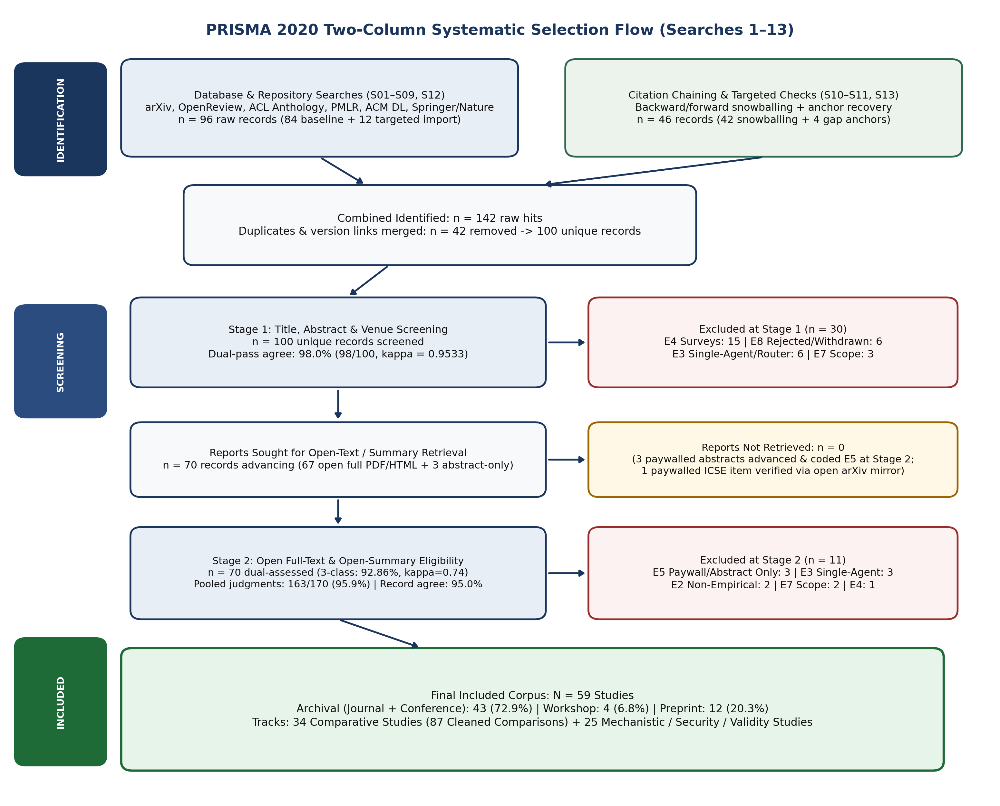
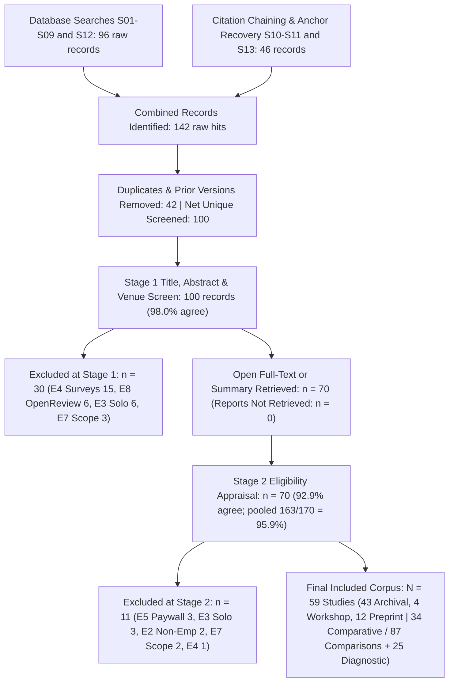
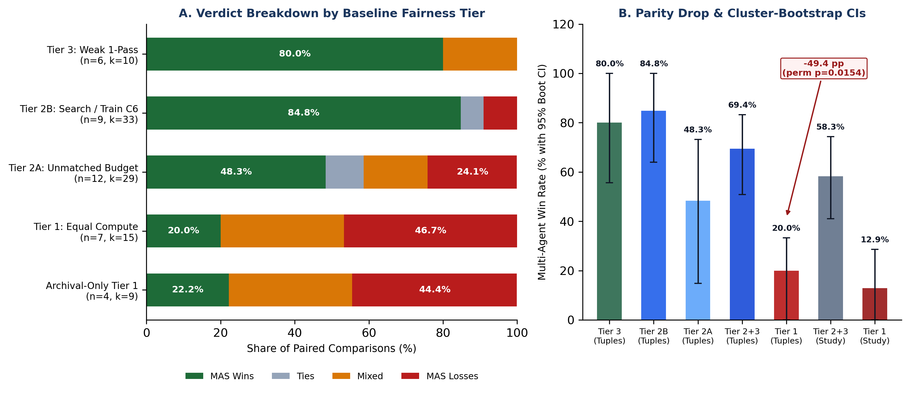
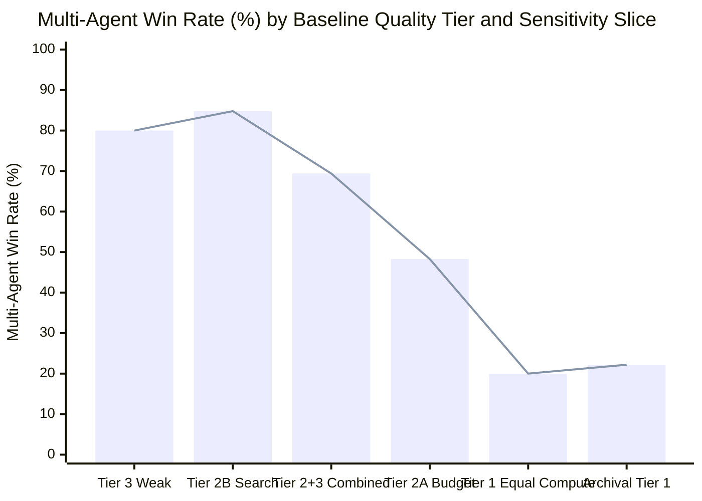
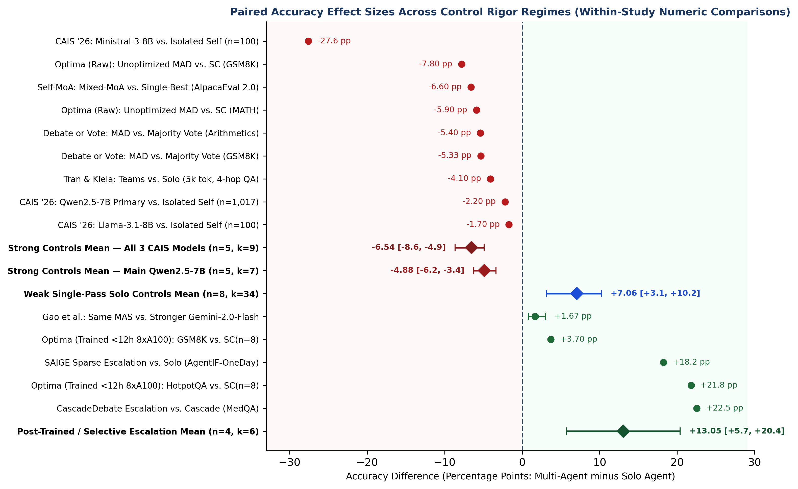
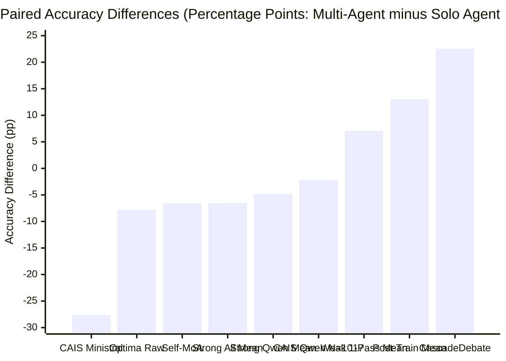
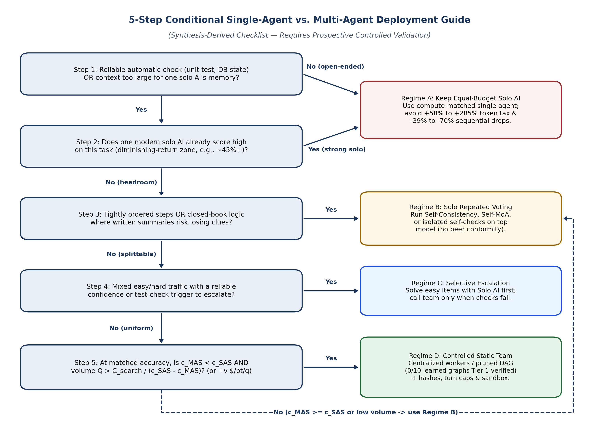

# When Do LLM Multi-Agent Systems Outperform Single Agents? A Systematic Review of Compute-Normalized Evidence, Coordination Topologies, Failure Mechanisms, and Evaluation Validity

**Author(s) & Affiliation(s):** [Author Placeholder — Blinded for Review / ACM Computing Surveys Style]  
*Target Journal:* **ACM Computing Surveys (CSUR)** *(Formatted for conversion to acmsmall; includes complete self-contained Reproducibility Appendices in Section 12).*

---

## Abstract

Teams of large language models are widely applied to reasoning, coding, and tool tasks, yet many benchmarks lack compute-matched single-agent baselines. This systematic review synthesizes 59 studies (34 comparative studies, 87 comparisons). Multi-agent teams win 69.4% of unmatched comparisons, declining to 20.0% wins and 46.7% losses under equal-compute controls (-49.4 percentage points; study-weighted -45.4 points, permutation p = 0.0154). Multi-agent gains appear mainly on splittable multi-source tasks observed in Kim et al., while declines reflect error cascades, peer conformity, text-handoff loss, unamortized search (12/12 comparative optimizers), and missing reliability checks.

---

## ACM CCS Concepts

- **Computing methodologies ~ Artificial intelligence ~ Distributed artificial intelligence ~ Multi-agent systems** (Significance: 500)
- **Computing methodologies ~ Natural language processing ~ Natural language generation** (Significance: 300)
- **General and reference ~ Surveys and overviews** (Significance: 300)
- **General and reference ~ Empirical studies** (Significance: 100)

## Keywords

Large language models, multi-agent systems, compute-normalized evaluation, test-time scaling, multi-agent debate, failure mechanisms, systematic literature review

---

## 1. Introduction

Teams of Large Language Models (LLMs), often called multi-agent systems, connect two or more AI instances so they can debate answers, play specialized roles, check each other's work, or split up long tasks. Early frameworks such as CAMEL [49], AutoGen [93], MetaGPT [36], and ChatDev [66] popularized a straightforward intuition: assigning several AI agents to collaborate like a human team should beat a single AI working alone. Early debate papers such as Society of Minds [25], Divergent Thinking MAD [54], and ReConcile [11] reported encouraging gains on reasoning tasks.

Yet a practical engineering question soon emerged. When a three-agent team runs three rounds of discussion, it spends far more computing time, tokens, and API dollars than a single AI answering once. What happens if you give that **single solo AI the exact same token or compute budget**—either through Self-Consistency majority voting [87], repeated random sampling [8], extended test-time thinking [75], or structured single-agent iteration? Controlled experiments across 2024–2026 show a consistent pattern: once solo baselines receive matched budgets and strong models, published multi-agent gains shrink sharply, vanish, or reverse [46, 78, 74, 30, 6].

To make every part of this review easy to follow for readers who know basic AI terms (like prompts, tokens, and accuracy) without memorizing specialist jargon, Table 1 defines the eight core concepts used throughout this paper.

#### Table 1: Plain-English Glossary of Key Concepts Used in This Review

| Term | Simple Meaning |
| :--- | :--- |
| Single-Agent System (SAS) | One AI model solving a problem alone, either in one pass or by generating and checking several independent attempts by itself. |
| Multi-Agent System (MAS) | Two or more stateful AI agents exchanging messages, critiques, or delegated subtasks—or mixing distinct LLM model families together. |
| Compute-Matched Baseline | A fair test where the solo AI and the multi-agent team spend the same total tokens, API calls, or dollar budget. |
| Self-Consistency Voting | Asking one solo AI to solve the same problem multiple times independently and choosing the most common answer by vote. |
| Pass-at-k vs. Pass-power-k | Pass-at-k checks whether at least one out of k attempts works; pass-power-k checks whether all k attempts succeed consistently. |
| Cost Amortization | Including the hidden upfront GPU hours or search tokens spent discovering a team workflow inside total deployment cost. |
| Error Amplification | One agent making an early mistake that teammates repeat, defend, and magnify instead of catching. |
| Sycophantic Conformity | An agent that held the right answer switching sides just to agree with a confident or larger wrong crowd. |

Many prior surveys already catalog how LLM agents and multi-agent architectures work. Peer-reviewed articles in *Artificial Intelligence Review* [3, 4, 18], *ACM Computing Surveys* [21, 24, 31, 35, 37, 114], *Journal of Artificial Intelligence Research* [64], *Frontiers of Computer Science* [83], *Transactions on Machine Learning Research* [29, 39, 43, 59, 91, 109, 113], *IJCAI* [32], *KDD* [58], *Findings of ACL/EMNLP* [100, 104], *IEEE Transactions on Software Engineering* [81], *Future Internet* [122], and open preprints [5, 20, 44, 50, 52, 56, 60, 70, 77, 79, 90, 97] organize agent memory, workflow graphs, trace failures, and security risks. However, as Table 2 summarizes, none quantifies empirically **how much of the multi-agent accuracy advantage shrinks once single-agent baselines match total inference compute and upfront search or training costs**.

#### Table 2: Positioning Against Competing Surveys (2024–2026)

| Prior Survey / Group | Venue & Year | Main Topic Covered | Overlap and Complementarity With This Review |
| :--- | :--- | :--- | :--- |
| Li et al. [52] | Preprints.org (2026) | Conceptual efficiency taxonomy ("Collaboration Boundary"), matched baselines, and lifecycle cost amortization | Conceptual foundation: Li et al. formulate matched-baseline and lifecycle principles qualitatively. This review tests those principles across 87 cleaned comparisons, measuring a -49.4 pp drop under equal compute and 12/12 unamortized comparative optimizers. |
| Motger et al. [60] | arXiv (2026) | Systematic review of 141 multi-agent debate (MAD) papers; compares debate against majority voting | Overlaps on debate (4/7 of our equal-compute Tier 1 studies test debate). We extend beyond debate to sequential pipelines, orchestrator-workers, learned graphs, selective escalation, and benchmark harness validity. |
| Yue et al. [104] | Findings of EMNLP 2026 | Static vs. dynamic agent workflow graphs (AFlow, GPTSwarm, G-Designer) and graph efficiency | Surveys graph optimization without stratifying by equal-budget single-agent parity or pricing upfront MCTS/RL/VGAE search costs (0 learned-graph studies meet Tier 1 parity). |
| Wang et al. [81] | IEEE TSE 52(11) (2026) | Survey of trajectory failure attribution across 55 LLM multi-agent reliability papers | Maps execution trace datasets (overlapping 7 of our diagnostic studies); we connect these failure pathways to multi-agent vs. single-agent accuracy drops and security multiplication. |
| Mallampati & Nagoriya [56] | Preprint (2026) | 62 papers on coordination reliability, stopping rules, and deadlock recovery | Complements our stopping and blocking analysis without equal-budget win-rate stratification or benchmark harness audits. |
| Dantas et al. [20] | Preprint (2026) | 38-study PRISMA review of formal safety specification and verification tax in AI agents | Focuses on formal safety verification rather than equal-compute accuracy comparisons or multi-agent vs. single-agent trade-offs. |
| Kim et al. [45] & Deng et al. [21] | USENIX Security '26 & ACM CSUR 57(7) (2025) | Threat landscapes covering prompt hijacking, memory poisoning, and agentic defense | Comprehensive security overviews; complement our topological security analysis across NetSafe, CORBA, G-Safeguard, and Hagag et al. |
| Wei et al. [91], Huang et al. [39], Moslem & Kelleher [59] | TMLR (2025–2026) | Agentic reasoning, long-horizon agent memory, and single-query dynamic model routing | Broad reasoning, memory, and single-query routing reviews [29], [113], [43], [109]; none audits equal-compute multi-agent vs. single-agent outcomes. |
| Yehudai et al. [100] & Mohammadi et al. [58] | Findings of ACL '26 & KDD '25 | General agent evaluation metrics, pass-power-k reliability, and judge bias | Survey agentic evaluation broadly without measuring how baseline compute mismatches inflate published multi-agent gains. |
| ACM CSUR & Broad Reviews [24], [31], [35], [37], [114] | ACM CSUR, AIRE, JAIR, IJCAI, Preprints (2024–2026) | Agent optimization, classical reinforcement learning teams, game agents, and classical-to-LLM boundaries [3], [4], [18], [32], [64], [79], [122], [44], [48], [90], [5], [70], [77], [97], [83] | Establish architectures and classical MARL/swarm distinctions; leave open an empirical compute-normalized audit of when multi-agent teams help vs. hurt. |

Guided by established systematic review standards [62, 47, 71], this paper makes four specific contributions:
1. **Fair Compute Audit:** Across 34 comparative studies (87 cleaned paired comparisons), we observe a -49.4 percentage-point decline in multi-agent win rates when weak or unequal-budget baselines are replaced by compute-matched single-agent controls (validated across Archival-Only, Wave-1 vs. Wave-2, Interactive-Only, fixed-margin tie, within-study paired contrasts, and continuous effect sizes).
2. **Topology & Hidden Cost Audit:** We separate non-interactive voting ensembles from genuine interactive teams and find that all 12/12 comparative learned or optimized frameworks omit upfront search or GPU training costs from headline per-query efficiency tables (compared with 22/34 static zero-search comparative papers).
3. **Failure & Security Synthesis:** We link documented failure pathways—error amplification, peer conformity, information loss across text summaries, and multi-agent exploit spreading—to why teams underperform solo baselines on tightly coupled tasks.
4. **Evidence-Graded Guide:** Using a GRADE-inspired certainty framework [33], we grade each finding transparently, expose empty research cells (such as 0/10 learned-graph systems passing Tier 1 parity), and offer a conditional 5-step decision guide awaiting prospective controlled trials.

---

## 2. Research Questions and Scope

To separate verified engineering value from evaluation artifacts, this review investigates four focused research questions:

- **RQ1 (Effectiveness Under Fair Budgets):** When total tokens, API cost, prompt quality, and tool access are matched against a strong solo AI baseline, how often do LLM multi-agent teams outperform solo agents, and on which kinds of tasks do wins or losses cluster?
- **RQ2 (Team Structure and Hidden Search Costs):** How do different team designs—parallel voting, step-by-step pipelines, hub-and-spoke orchestrators, all-to-all debate, learned sparse graphs, and selective escalation—trade accuracy against extra inference overhead and upfront training or search time?
- **RQ3 (Why Multi-Agent Teams Fail or Lose Security):** Which verified mechanisms—cascading errors, sycophantic conformity, information loss during handoffs, verification breakdowns, and inter-agent attack propagation—explain multi-agent degradation?
- **RQ4 (Evaluation Flaws and Reporting Gaps):** How heavily do six common experimental confounders, missing multi-run consistency checks, missing latency or dollar logs, and flawed benchmark test suites distort published multi-agent claims?

We strictly focus on teams of two or more LLM instances coordinating through natural language or structured schemas. We exclude single-policy query routers without persistent multi-agent state [111], classical insect or particle swarm algorithms using numeric vectors [70, 40, 72], and static weight-space checkpoint merging [28], clarifying these conceptual boundaries in Section 4.2.

---

## 3. Systematic Review Methodology

### 3.1 Transparent Search Strategy (PRISMA-S)

Following PRISMA 2020 [62], Kitchenham–Charters guidelines [47], and PRISMA-S search reporting standards [71], we conducted a **targeted open-web query- and citation-seeded systematic search in a single consolidated retrieval and verification campaign on November 20, 2026** (covering publications from January 2023 through November 20, 2026). Because proprietary bulk exports from Scopus and Web of Science were not available in our environment, we report this explicitly as a documented open-web seeded review across arXiv, OpenReview, ACL Anthology, PMLR, ACM DL, Springer/Nature, and IEEE Xplore rather than a closed-publisher census.

Our search progressed through three documented stages in Table 3, with all six verbatim Boolean queries and all 13 search executions recorded in Section 12, Appendix A. Baseline core queries logged 105 hits. Backward and forward citation chaining around flagship scaling, debate, workflow, and harness papers added 21 hits (126 baseline records; 42 duplicates merged into 84 unique records). Finally, a targeted gap-recovery pass imported 16 named anchors in agent ensembles, graph pruning, conformity, and multi-agent security that broad Boolean phrases missed, yielding 142 raw hits and **100 unique records screened**. Section 5.1 compares Wave 1 and Wave 2 directly to confirm that targeted gap recovery did not manufacture our headline drop.

#### Table 3: PRISMA-S Summary of Literature Searches (Campaign Date: November 20, 2026)

| Search Phase | Target Repositories & Method | Campaign Date | Raw Logged | Duplicates Merged | Net Unique | Primary Purpose |
| :--- | :--- | :---: | :---: | :---: | :---: | :--- |
| Baseline Core Queries (S01–S09) | arXiv, OpenReview, ACL Anthology, PMLR, ACM DL, Springer, Nature, IEEE Xplore | 2026-11-20 (2023–2026 window) | 105 | 33 | 72 | Comparative tests, topologies, failure mechanisms, validity audits, OpenReview status |
| Backward & Forward Snowballing (S10–S11) | Reference lists & citations around flagship scaling, debate, workflow, and harness papers | 2026-11-20 (2023–2026 window) | 21 | 9 | 12 | Recover foundational anchors and late-2026 follow-up studies |
| Targeted Gap Recovery (S12–S13) | Named anchors in agent ensembles, optimization, conformity, and multi-agent security | 2026-11-20 (2023–2026 window) | 16 | 0 | 16 | Close recall gaps missed by broad Boolean terms (15 included, 1 excluded) |
| Cumulative Total (S01–S13) | Consolidated single-day retrieval & verification campaign | Through 2026-11-20 | 142 | 42 | 100 | Yields 59 included studies and 41 excluded records |

### 3.2 Screening Process and Human Verification

To screen all 100 unique candidates systematically, initial Stage 1 (title and abstract) and Stage 2 (open PDF, HTML proceedings, or open summary) passes were run independently by **two blinded automated LLM screening workflows** following fixed protocol rules, followed by **direct human-author verification of every included study, quality rating, and numerical comparison**. Because automated pass-agreement reflects inter-model consistency rather than two separate human raters, human review adjudicated every disagreement and checked source numbers directly. Stage 1 agreement across all 100 records reached **98.0%** (98/100; inter-model Cohen's kappa = 0.9533; Wave-1 baseline 97.62%, kappa = 0.9489), and Stage 2 eligibility agreement across 70 advancing papers reached **92.86%** (65/70; kappa = 0.74). Pooled across all 170 screening judgments (100 Stage 1 + 70 Stage 2 decisions), raw pass agreement was **163/170 (95.9%)**, while end-to-end record inclusion agreement across all 100 unique records was **95.0%** (95/100; kappa = 0.897).

### 3.3 PRISMA Flow, Inclusion Rules, and Exclusion Boundaries

Figure 1 shows the complete two-column PRISMA 2020 selection flow separating repository searches from citation chaining and targeted additions. Table 4 breaks down the 59 included studies by publication status and research track, and Table 5 summarizes the 41 excluded records (itemized individually in Section 12, Appendix E).




*Figure 1: PRISMA 2020 two-column flow diagram tracking identification, duplicate removal, screening, and final inclusion across database queries and citation chaining (N = 59 included studies).*

#### Table 4: Included Corpus by Publication Status and Research Track (N = 59)

| Grouping Axis | Category | Studies (n) | Share (%) | Role in This Review |
| :--- | :--- | :---: | :---: | :--- |
| Publication Status | Peer-reviewed journal or conference | 43 (4 J + 39 C) | 72.9% | Core archival anchor tested separately in Archival-Only sensitivity checks. |
| Publication Status | Peer-reviewed workshop | 4 | 6.8% | Includes ColMAD [15] (ICML Wkshp), WebArena Verified [26], Verifier Transport [73], and CMAD [19]; excluded in Archival-Only sensitivity checks. |
| Publication Status | Open preprint (arXiv / Preprints.org) | 12 | 20.3% | Admitted only after clearing >=6/14 (or /12) quality and claims-parity checks; isolated in Archival-Only checks. |
| Research Track | Comparative Effectiveness & Topology | 33 | 55.9% | 33 primary comparative studies (+1 comparative sycophancy study in Mechanistic Failure track = 34 total comparative studies across 87 comparisons). |
| Research Track | Mechanistic Failure & Security | 16 | 27.1% | Error localization (MAST, Who&When, TraceElephant, TRIAGE), conformity, embodied observation, and multi-agent attack studies (incl. 1 comparative mitigation study). |
| Research Track | Evaluation Validity & Harness Audits | 10 | 16.9% | Cost-accuracy audits, multi-run consistency (pass^k), Agent Forest solo-voting C3 boundary case, SWE/WebArena harness exploits, and OpenReview rejection cases. |

Studies entered the corpus if they were written in English (2023–2026) and tested at least one of three pillars: (1) a team of two or more collaborating LLM agents (or heterogeneous multi-LLM ensemble) compared directly against a single-agent system; (2) verified multi-agent failure mechanisms, trace attribution, or topological security attacks [17, 42, 120, 68, 101, 85]; or (3) cross-cutting agentic benchmark, solo-voting boundary [51], and reliability audits [41, 99, 69, 57, 88, 123, 80, 26, 73]. Single-agent module logs lacking multi-agent coordination (AgentDebug, Excl-01), single-policy routers (Router-R1 [111]), and unverified paywalled abstracts lacking open mirrors were excluded. Unrefereed preprints (12/59, 20.3%) entered only after clearing a >=6/14 (or /12) quality floor and are isolated in Archival-Only sensitivity checks.

#### Table 5: Excluded Records Summary (n = 41)

| Exclusion Reason | Excluded (n) | Representative Works & Boundary Logic |
| :--- | :---: | :--- |
| Single-agent tool loop or router without multi-agent teamwork | 9 (6 Stage 1, 3 Stage 2) | Solo coding pipelines like Agentless [94] and intra-agent fault logs like AgentDebug [121] (Excl-01), plus single-policy routers like Router-R1 [111] invoking stateless APIs without inter-agent dialogue. |
| Secondary surveys and narrative reviews | 16 (15 Stage 1, 1 Stage 2) | Competing surveys [60, 77, 81, 100, 104, 97, 52, 59, 31, 35, 24, 83, 29, 113, 50, 115] (including single-query routing review [59]); excluded from primary counts and compared in Table 2. |
| Paywalled abstract only, non-empirical, or off-topic tasks | 10 (3 paywalled, 2 non-emp., 5 scope) | Closed-access proceedings lacking open mirrors (3 papers), non-empirical or non-LLM essays (Model Swarms [28], NetLogo insects [40]), and single-agent security suites (5 papers). |
| Publicly rejected or withdrawn OpenReview versions | 6 (all Stage 1) | Separated into our peer-review case audit in Section 5.4: rejected TMLR submissions (AgenticNet [2], Inducing Disagreement [1], self-play survey [115]) and withdrawn drafts (Harness survey [50], SwarmBench [72], Peacemaker [98], alongside SCALE's withdrawn draft [117] before ACL 2025 acceptance [118]). |

### 3.4 Defining Single-Agent Types, Six Confounders, and Statistical Synthesis Methods

A subtle confusion in the literature is calling **parallel single-model voting** (such as Self-Consistency [87] or Self-MoA [53]) a "single-agent baseline" in one paper while labeling the exact same single-model sampling trick ("Agent Forest" [51]) a "multi-agent swarm" in another. To enforce strict conceptual hygiene, we distinguish three execution regimes:
1. **Single-Pass Solo Agent:** One model making one continuous execution (Chain-of-Thought, ReAct, or one long thinking trace).
2. **Multi-Sample Solo Voting (Test-Time Compute Scaling):** Generating multiple independent answers from *one* model and picking the consensus answer without agents communicating (Self-Consistency [87], Best-of-N, Agent Forest [51], Self-MoA [53]). Following this rule strictly, *Agent Forest* [51] is classified as an **RQ4 evaluation-validity boundary check (Confounder C3)** with 0 comparative multi-agent rows rather than as a Tier 3 multi-agent system.
3. **Interactive or Multi-Model Team (MAS):** Two or more stateful agents exchanging messages, critiques, or delegated subtasks—or mixing distinct LLM model families (Mixed-MoA).

For comparative synthesis (Section 5.1), we classify all 34 comparative studies (87 cleaned comparisons) into clear baseline fairness tiers: **Tier 1 (equal compute and strong solo baseline, n=7, k=15)**, **Tier 2A (strong solo baseline, unmatched inference compute, zero search cost, n=12, k=29)**, **Tier 2B (strong solo baseline, unamortized upfront search or RL/DPO training C6, n=9, k=33)**, and **Tier 3 (weak single-pass solo baseline only, n=6, k=10)**. Because averaging raw accuracies across incompatible benchmarks (such as algebra, coding, and clinical diagnosis) is invalid [7], we synthesize within-study paired outcomes (MAS minus Solo) using four complementary methods:
- **Cluster-Bootstrapped Intervals (10,000 study resamples) & 95% Wilson Score CIs:** Cluster bootstrapping accounts for multiple comparisons per study, while Wilson binomial score intervals avoid zero-collapse on small proportions.
- **Exact Study-Level Permutation Tests (20,000 randomizations) & Fisher's Exact Tests:** Assigns equal weight (1.0) to every study regardless of how many benchmark rows it reports.
- **Unweighted Study-Level Effect-Size Summaries (with Binomial Variance Audit):** Panel A of Table 11 operates strictly at a single unweighted study level (never mixing comparisons and study averages inside one distribution). Full cross-study random-effects (DerSimonian–Laird) pooling is withheld because 4 of 5 strong-control numeric studies omit item-level variances; instead, Panel B reports exact binomial standard errors and inverse-variance weights across all three splits of *Bertalanič & Fortuna* [6].
- **Within-Study Paired Contrasts & Task-Family Stratification:** Tests whether switching from weak to equal-compute controls shrinks gains inside the *exact same papers and datasets*.

Table 6 lists our six experimental confounders and seven quality-appraisal criteria.

#### Table 6: Six Experimental Confounders and Seven Study-Quality Checks

| Methodological Check | Simple Definition & Why It Matters |
| :--- | :--- |
| Equal Token / Compute Check (Confounder C1) | Did both solo AI and team spend roughly equal tokens, API calls, and dollars, or use equal-budget Self-Consistency? |
| Hidden Thinking-Token Check (Confounder C2) | Did evaluation count hidden internal reasoning tokens (such as extended thinking traces) in the budget? |
| Real Communication vs. Voting (Confounder C3) | Did agents actually exchange feedback, or were single-model answers merely aggregated by vote (such as Agent Forest [51])? |
| Equal Prompts and Tools (Confounder C4) | Did the solo AI receive the same instructions, tools, and code retries as the multi-agent team? |
| Test Harness Reliability (Confounder C5) | Did benchmarks check real execution states and prevent grading loopholes or data leakage? |
| Upfront Search/Training Amortization (Confounder C6) | If a comparative framework spent hours searching or training workflows before testing, were those upfront costs counted? |
| Study Quality Rubric (QA1–QA7) | Seven 0–2 criteria (14 pts for comparative studies; 12 pts for diagnostic audits without a solo arm) plus a 12-pt scale excluding QA1. |

---

## 4. Core Concepts and Classical Boundaries

### 4.1 Three Simple Mathematical Ideas Behind Multi-Agent Evaluation

Understanding why multi-agent systems help or hurt hinges on three practical ideas—every-try reliability, information loss across text summaries, and upfront search payback—explained plainly before each formula.

1. **Best-Case Luck vs. Every-Try Reliability (pass-at-k vs. pass-power-k):**  
   Many coding suites let an AI try k times and count a win if **at least one** attempt succeeds (pass@k) [8]. That rewards noisy guessing. In real operations—like modifying customer bookings or issuing database transactions—a system must succeed **every single time** across k repeated deployments. Yao et al. [99] formalize this with pass^k, sampling **without replacement** for k random draws out of n recorded runs (approaching $p^k$ when $n \gg k$ and c out of n trials succeed):
   $$\text{pass}^k = \mathbb{E}_{\text{task}} \left[ \frac{\binom{c}{k}}{\binom{n}{k}} \right]$$
   Take one task where an agent solves c = 6 out of n = 10 attempts (60% single-run score). Over k = 4 deployments, pass@4 (at least one win) looks misleadingly strong at $1 - \binom{4}{4}/\binom{10}{4} = 99.5\%$, while pass^4 (all four succeed) collapses to $\binom{6}{4}/\binom{10}{4} = 15/210 = 7.1\%$. Notice also **Jensen's inequality**: because $f(p) = p^k$ is convex, plugging dataset average pass rate $\bar{p}$ into $\bar{p}^k$ **underestimates** true pass^k on heterogeneous pass/fail tasks ($\frac{1}{M}\sum p_i^k \ge \bar{p}^k$), while single-run average accuracy (60%) severely **overstates** pass^4 (7.1%) on stochastic tasks. Researchers must run multiple trials per task directly.

2. **Information Loss in Text Relays ("Telephone Game" / Data Processing Inequality):**  
   Suppose Agent 1 reads question X, computes intermediate reasoning $Z_1$, writes a compressed summary $M_{\text{handoff}}$, and passes *only that summary* to Agent 2—like a closed-book game of telephone where Agent 2 cannot re-read X or query tools. In that Markov chain ($Y \leftrightarrow Z_1 \leftrightarrow M_{\text{handoff}} \leftrightarrow \hat{Z}_2$ relative to true answer Y), information theory's **Data Processing Inequality** guarantees that Agent 2 cannot extract more mutual information about Y than Agent 1 already held: $I(Y; \hat{Z}_2) \le I(Y; Z_1)$ [78]. Two explicit caveats apply: first, when downstream agents *can* inspect original input X, or when independent parallel samples cancel decoding variance [87], accuracy can still improve without extra Shannon information; second, when workers query **different documents or tools** [46, 103], they break the closed-book Markov chain and supply genuinely new evidence.

3. **When Does Upfront Search or Training Cost Pay Back? ($Q^*$):**  
   Many modern frameworks run Monte Carlo Tree Search, reinforcement learning, or evolution to discover team graphs before evaluation begins, incurring a large upfront cost $C_{\text{search}}$ (in GPU hours, search tokens, or dollars) [124, 112, 14]. Suppose a learned team reaches **matched accuracy** against a strong solo AI, with both per-query runtime costs $c_{\text{SAS}}$ and $c_{\text{MAS}}$ measured in the **same unit** (dollars or tokens). How many production queries $Q^*$ are needed before test-time savings recover $C_{\text{search}}$?
   $$Q^* = \frac{C_{\text{search}}}{c_{\text{SAS}} - c_{\text{MAS}}} \quad (\text{at equal accuracy, valid only if } c_{\text{MAS}} < c_{\text{SAS}})$$
   If the learned team costs **more or equal per query** than the solo AI ($c_{\text{MAS}} \ge c_{\text{SAS}}$) at equal accuracy, extra search costs never pay back in runtime savings ($Q^* = \infty$). More generally, if accuracy gains are valued at $v$ dollars **per accuracy point per query** ($\Delta\text{Acc} = \text{Acc}_{\text{MAS}} - \text{Acc}_{\text{SAS}}$), break-even requires $(c_{\text{SAS}} - c_{\text{MAS}}) + v \cdot \Delta\text{Acc} > 0$, giving $Q^* = C_{\text{search}} / [(c_{\text{SAS}} - c_{\text{MAS}}) + v \cdot \Delta\text{Acc}]$.

### 4.2 How LLM Agent Teams Differ From Classical Swarms and Classical Multi-Agent Systems

Before examining empirical comparisons, it helps to separate modern LLM agent teams from two older research fields [48, 90, 5, 70]. **Classical Swarm Intelligence** (Ant Colony Optimization, Particle Swarm Optimization, Boids) coordinates hundreds to millions of simple mathematical units updating local rules or digital pheromones [40, 70]. **Classical Multi-Agent Systems** (Belief–Desire–Intention architectures, speech-act protocols, and multi-agent reinforcement learning) exchange compact symbols or numeric state vectors in structured worlds [31, 90].

In contrast, modern **LLM multi-agent systems** typically coordinate 2 to 15 expensive language models (and occasionally sparse graphs up to ~1,000 nodes like MacNet [67]) via **open-ended natural-language text** inside finite context windows [5, 48]. Table 7 highlights these structural differences. Because natural language carries persuasion and bloat, LLM teams suffer brand-new failures—peer flattery, summary loss, and text prompt injections—rarely seen in classical swarms.

#### Table 7: Key Differences Across Classical Swarms, Classical Multi-Agent Systems, and LLM Agent Teams

| System Property | Classical Swarm Intelligence (ACO, PSO, Boids) [70, 40] | Classical Multi-Agent Systems (BDI, FIPA, MARL) [31, 90] | Modern LLM Agent Teams (AutoGen, Debate, AFlow, GPTSwarm) [5, 48] |
| :--- | :--- | :--- | :--- |
| Memory per Agent | Tiny numeric vectors or pheromone weights | Formal logic beliefs or compact learned hidden vectors | Long text context windows plus external vector memory |
| How Agents Communicate | Simple local math attraction or neighbor signals | Formal predefined message schemas or policy embeddings | Flexible natural language or JSON text handoffs |
| Typical Team Size & Cost | 100 to 1,000,000+ lightweight units (O(1) per step) | 2 to 100 policy agents in fast simulated worlds | Typically 2–15 heavy LLMs (up to ~1,000 in sparse DAGs), high token cost |
| Main Failure Mode at Scale | Local optima or parameter oscillation | Non-stationarity, sparse rewards, noisy credit assignment | Peer conformity, handoff summary loss, prompt-injection cascades |

---

## 5. Empirical Synthesis (RQ1–RQ4)

### 5.1 Do Multi-Agent Teams Beat Solo Agents Under Equal Compute? (RQ1)

Across **34 comparative studies** covering **87 cleaned paired comparisons** (Section 12, Appendices C–D), a consistent empirical gradient emerges: **multi-agent win rates drop sharply as single-agent baselines become compute-matched and properly prompted**. Table 8 presents the full breakdown—separating unmatched static compute (Tier 2A) from unamortized training/search (Tier 2B) and showing both cluster-bootstrap and Wilson 95% confidence intervals—while Figure 2 visualizes this shift.




*Figure 2: Multi-agent win, loss, and mixed rates by baseline quality tier (left) alongside cluster-bootstrap 95% confidence intervals and study-weighted drops (right).*

#### Table 8: Multi-Agent Win/Loss Rates by Baseline Fairness Tier and Sensitivity Slice (34 Comparative Studies, 87 Comparisons)

| Baseline Quality Tier / Sensitivity Slice | Studies (n) | Comparisons (k) | MAS Wins [95% Boot CI; 95% Wilson CI] | Ties (%) | MAS Losses (%) | Mixed (%) | Study-Weighted Win % [Boot CI] | Study Maj (>50%) | Study >=50% |
| :--- | :---: | :---: | :---: | :---: | :---: | :---: | :---: | :---: | :---: |
| Tier 1: Equal-Compute Strong Single Agent | 7 | 15 | 3/15 (20.0%) [Boot 0.0–33.3%; Wilson 7.0–45.2%] | 0 (0.0%) | 7 (46.7%) | 5 (33.3%) | 12.9% [0.0–28.6%] | 0/7 (0.0%) | 1/7 (14.3%) |
| Tier 2A: Strong Solo, Unmatched Inference Budget (Zero Search) | 12 | 29 | 14/29 (48.3%) [Boot 14.8–73.2%; Wilson 31.4–65.6%] | 3 (10.3%) | 7 (24.1%) | 5 (17.2%) | 30.6% [8.3–52.8%] | 3/12 (25.0%) | 5/12 (41.7%) |
| Tier 2B: Strong Solo, Unamortized Training/Search (C6) | 9 | 33 | 28/33 (84.8%) [Boot 64.0–100.0%; Wilson 69.1–93.3%] | 2 (6.1%) | 3 (9.1%) | 0 (0.0%) | 81.5% [57.4–100.0%] | 7/9 (77.8%) | 8/9 (88.9%) |
| Tier 2 (All): Strong Solo, Unmatched Cost or Search | 21 | 62 | 42/62 (67.7%) [Boot 45.8–83.0%; Wilson 55.4–78.0%] | 5 (8.1%) | 10 (16.1%) | 5 (8.1%) | 52.4% [33.3–70.6%] | 10/21 (47.6%) | 13/21 (61.9%) |
| Tier 3: Weak Single-Pass Single Agent Only | 6 | 10 | 8/10 (80.0%) [Boot 55.6–100.0%; Wilson 49.0–94.3%] | 0 (0.0%) | 0 (0.0%) | 2 (20.0%) | 79.2% [45.8–100.0%] | 5/6 (83.3%) | 5/6 (83.3%) |
| Tier 2+3 Combined: All Non-Parity Controls | 27 | 72 | 50/72 (69.4%) [Boot 50.9–83.2%; Wilson 58.0–78.9%] | 5 (6.9%) | 10 (13.9%) | 7 (9.7%) | 58.3% [41.0–74.4%] | 15/27 (55.6%) | 18/27 (66.7%) |
| Parity Gap (Tier 2+3 to Tier 1, Full Corpus) | 34 total | 87 | -49.4 pp [Boot -75.3 to -25.8 pp] | — | +32.8 pp | — | -45.4 pp (perm p=0.0154) | -55.6 pp (Fisher p=0.0106) | Fisher p=0.0282 |
| Sensitivity A: Archival-Only Tier 1 (No Preprints/Wkshps) | 4 | 9 | 2/9 (22.2%) [Boot 0.0–37.5%; Wilson 6.3–54.7%] | 0 (0.0%) | 4 (44.4%) | 3 (33.3%) | 10.0% [0.0–30.0%] | 0/4 (0.0%) | 0/4 (0.0%) |
| Sensitivity A: Archival-Only Tier 2+3 (Fisher p=0.0957) | 21 | 58 | 40/58 (69.0%) [Boot 48.8–84.4%; Wilson 56.2–79.4%] | 4 (6.9%) | 9 (15.5%) | 5 (8.6%) | 62.3% [42.9–80.2%] | 12/21 (57.1%) | 15/21 (71.4%) |
| Sensitivity B: Wave 1 Baseline Tier 2+3 (S01-S11, Fisher p=0.0075) | 16 | 31 | 22/31 (71.0%) [Boot 54.5–84.4%; Wilson 53.4–83.9%] | 4 (12.9%) | 1 (3.2%) | 4 (12.9%) | 66.1% [45.3–85.4%] | 10/16 (62.5%) | 12/16 (75.0%) |
| Sensitivity B: Wave 2 Gap Imports Tier 2+3 Only (S12-S13) | 11 | 41 | 28/41 (68.3%) [Boot 33.3–88.7%; Wilson 53.0–80.4%] | 1 (2.4%) | 9 (22.0%) | 3 (7.3%) | 47.0% [21.2–74.2%] | 5/11 (45.5%) | 6/11 (54.5%) |
| Sensitivity C: Interactive Teams Only Tier 1 (Excl. Ensembles) | 6 | 13 | 3/13 (23.1%) [Boot 0.0–37.5%; Wilson 8.2–50.3%] | 0 (0.0%) | 5 (38.5%) | 5 (38.5%) | 15.0% [0.0–31.7%] | 0/6 (0.0%) | 1/6 (16.7%) |
| Sensitivity C: Interactive Teams Only Tier 2+3 (Fisher p=0.0209) | 25 | 67 | 47/67 (70.1%) [Boot 50.0–84.4%; Wilson 58.3–79.8%] | 4 (6.0%) | 10 (14.9%) | 6 (9.0%) | 60.0% [42.7–76.0%] | 14/25 (56.0%) | 17/25 (68.0%) |
| Sensitivity D: Practical ±1.0 pp Tie Margin Tier 1 | 7 | 15 | 3/15 (20.0%) [Boot 0.0–33.3%; Wilson 7.0–45.2%] | 1 (6.7%) | 7 (46.7%) | 4 (26.7%) | 12.9% [0.0–28.6%] | 0/7 (0.0%) | 1/7 (14.3%) |
| Sensitivity D: Practical ±1.0 pp Tie Margin Tier 2+3 | 27 | 72 | 49/72 (68.1%) [Boot 50.7–81.5%; Wilson 56.6–77.7%] | 6 (8.3%) | 10 (13.9%) | 7 (9.7%) | 57.8% [40.7–73.8%] | 15/27 (55.6%) | 18/27 (66.7%) |
| Sensitivity E: Zero-Search Static Only Tier 2A+3 (No C6) | 15 | 35 | 18/35 (51.4%) [Boot 23.3–73.0%; Wilson 35.6–67.0%] | 3 (8.6%) | 7 (20.0%) | 7 (20.0%) | 36.1% [16.1–57.2%] | 5/15 (33.3%) | 7/15 (46.7%) |
| Sensitivity F: Optimistic Tier 1 (Nguyen Table 17 as Win) | 7 | 15 | 4/15 (26.7%) [Boot 7.7–40.0%; Wilson 10.9–52.0%] | 0 (0.0%) | 7 (46.7%) | 4 (26.7%) | 20.0% [5.7–35.7%] | 0/7 (0.0%) | 2/7 (28.6%) |

When teams face weak single-pass solo prompts (Tier 3 [82, 106, 107, 63, 118, 89]), they win **8/10 (80.0%)** of comparisons (Wilson 95% CI 49.0%–94.3%; study-weighted 79.2%). Under Tier 2 (strong solo baselines without matched compute or amortized search, n=21, k=62), overall win rate sits at **42/62 (67.7%)**—splitting cleanly between **48.3%** (14/29, Wilson 31.4%–65.6%) in zero-search unmatched inference (Tier 2A) and **84.8%** (28/33, Wilson 69.1%–93.3%) in systems with unamortized upfront search or RL/DPO training (Tier 2B). When only zero-search static systems are inspected (**Sensitivity E**, omitting all C6 optimizers), even non-parity Tier 2A+3 wins fall to **18/35 (51.4%)** (Wilson 35.6%–67.0%), showing how heavily Tier 2B training boosts raw headline percentages.

Under strict **equal-compute strong solo controls (Tier 1, n=7, k=15)** [46, 78, 61, 74, 110, 53, 15], multi-agent win rates drop to **3/15 (20.0%)** (cluster-bootstrap 95% CI 0.0%–33.3%; Wilson 95% CI 7.0%–45.2%), while losses rise to **7/15 (46.7%)** (-49.4 percentage points relative to Tier 2+3's 69.4% [Wilson 58.0%–78.9%]; cluster-bootstrap CI -75.3 to -25.8). Giving every paper equal 1.0 study weight confirms the same gradient: Tier 1 averages **12.9%** vs. **58.3%** in Tier 2+3 (-45.4 points; exact two-sided permutation test **p = 0.0154**; strict >50% majority Fisher p = 0.0106; >=50% Fisher p = 0.0282). Separating Tier 1 by solo comparator yields identical lessons: interactive teams win **0/3 (0.0%)** against equal-budget single-model voting (Self-Consistency [61, 74, 110]), lose 2/2 (0%) when heterogeneous Mixed-MoA faces k-sample single-best Self-MoA [53], and win **3/10 (30.0%)** across equal-token single-agent comparisons [46, 78, 61, 15] (2 splittable gains in Kim et al. [46] and 1 non-zero-sum judge gain in ColMAD [15]).

Table 9 inspects all 7 Tier 1 equal-compute studies across all 15 comparisons.

#### Table 9: Complete Tier 1 Equal-Compute Study Ledger (7 Studies, 15 Comparisons)

| Study | Status | Benchmark & Model Family | Comparison Pair | Accuracy Difference (MAS minus SAS) | Compute Ratio | Verdict |
| :--- | :---: | :--- | :--- | :--- | :--- | :---: |
| Kim et al. (2026) [46] | Archival | Finance-Agent (Decomposable financial analysis; OpenAI/Anthropic/Google models) | Centralized MAS (Orchestrator-Subagents) vs. Compute-matched SAS (normalized reasoning budget) | Up to +80.8% / +80.9% relative improvement | 1.0x normalized reasoning budget (+285% unconstrained orchestration overhead in turn-sweep runs) | **MAS > SAS** |
| Kim et al. (2026) [46] | Archival | BrowseComp-Plus (Decomposable web browsing; frontier models) | Decentralized / Structured MAS vs. Compute-matched SAS (normalized reasoning budget) | +9.2% relative improvement | 1.0x normalized reasoning token budget | **MAS > SAS** |
| Kim et al. (2026) [46] | Archival | PlanCraft (Sequential stateful crafting across all 4 MAS topologies) | Independent / Centralized / Decentralized / Hybrid MAS (all 4 topologies) vs. Compute-matched SAS | -39% to -70% relative degradation | 1.0x normalized reasoning token budget | **MAS < SAS** |
| Kim et al. (2026) [46] | Archival | WorkBench (Workplace tool-execution environment; NMI core suite) | Independent / Centralized / Decentralized / Hybrid MAS vs. Compute-matched SAS | Mixed tool-coordination trade-off under fixed token budgets | 1.0x normalized reasoning token budget (+58% to +285% unconstrained overhead) | **Mixed across budgets/subtasks** |
| Kim et al. (2026) [46] | Archival | SWE-bench Verified & Terminal-Bench (NMI held-out coding/CLI validation suite) | Canonical MAS architectures vs. predictive scaling model vs. Compute-matched SAS | Mixed across capability levels (~45% saturation cutoff predicts declines at high SAS) | 1.0x normalized reasoning token budget | **Mixed across budgets/subtasks** |
| Tran & Kiela (2026) [78] | Preprint | FRAMES & MuSiQue 4-hop (500 to 10,000 thinking-token budgets across 5 MAS topologies & 4 LLMs) | Sequential / Subtask-parallel / Parallel-roles / Debate / Ensemble MAS vs. Equal-thinking-token SAS / SAS-L | -3.9 pp at 1k tok (0.379 vs 0.418); -4.1 pp at 5k tok (0.386 vs 0.427); SAS beats MAS across all >=500-token budgets | 1.0 | **MAS < SAS** |
| Tran & Kiela (2026) [78] | Preprint | FRAMES & MuSiQue (100-token floor & injected context-fragmentation stress test) | 5 MAS topologies under 100-tok budget or severe SAS context rot vs. Equal-thinking-token SAS | Parity at 100 tokens; MAS helps selectively under severe context-rot stress | 1.0 | **Mixed across budgets/subtasks** |
| Nguyen et al. (2026) [61] | Preprint | GSM8K, MATH500, MMLU-Pro, CSQA (980 shared-window settings: MAD vs. Self-Consistency) | Multi-Agent Debate (reading peer outputs inside shared window W) vs. Self-Consistency (k-sample single-model parallel voting, zero reading tax) | SC >= MAD in 93% of 980 matched settings (ties/losses across tight-to-moderate windows) | 1.0 | **MAS < SAS** |
| Nguyen et al. (2026) [61] | Preprint | Shared-Context Generous-Window Regime (Table 17: MAD vs. 1-pass Long-CoT) | Multi-Agent Debate (generative peer reading) vs. 1-pass Long-CoT single agent (without multi-sample voting) | MAD beats single-pass Long-CoT in generous-window Table 17 slices despite losing to parallel SC overall | 1.0 | **Mixed across budgets/subtasks** |
| Smit et al. (2024) [74] | Archival | MedQA, PubMedQA, MMLU, CosmosQA, CIAR, GPQA, Chess (GPT-3.5-turbo & GPT-4) | Default/out-of-the-box MAD vs. Agreement-Modulated MAD vs. Compute-matched Self-Consistency & Medprompt | Default MAD fails to reliably outperform SC/Medprompt while incurring higher token/USD/time cost; tuned agreement modulation narrows or reverses gap on specific splits | Pareto frontier sweeps across matched USD/token budgets (Figs 1-13) | **Mixed across budgets/subtasks** |
| Zhang et al. (2025) [110] | Archival | 9 benchmarks x 4 models (36 scenarios) | 5 homogeneous MAD frameworks vs. Compute-matched Self-Consistency (SC) | Homogeneous MAD fails to beat CoT/SC in >80% of scenarios despite higher token/call cost | 1.0 (compute-matched against Self-Consistency; separate >1x vs 1-pass CoT analyzed in Within-Study Contrasts) | **MAS < SAS** |
| Li et al. (2026) [53] | Archival | AlpacaEval 2.0 (matched proposer sample budget) | Mixed-MoA (heterogeneous LLM mixture) vs. Self-MoA (single best LLM k-sample voting/synthesis ensemble; non-interactive boundary benchmark) | -6.6 pp (-10.0% relative; Mixed-MoA 59.1% vs. Self-MoA 65.7%) | 1.0 | **MAS < SAS** |
| Li et al. (2026) [53] | Archival | MMLU, CRUX, MATH average (matched sample budget) | Mixed-MoA (heterogeneous) vs. Self-MoA (single best LLM k-sample voting/synthesis ensemble) | -3.8% average (Mixed-MoA trails single-LLM Self-MoA) | 1.0 | **MAS < SAS** |
| Chen et al. (2026) [15] | Workshop | Error detection & reasoning tasks (matched compute) | CopMAD (Competitive MAD) vs. Single-Agent (SA) baseline | -15% to -19% degradation due to competitive cheap-talk hacking | 1.0 | **MAS < SAS** |
| Chen et al. (2026) [15] | Workshop | Error detection & reasoning tasks (equal token/compute budgets) | ColMAD (Collaborative Non-Zero-Sum MAD) vs. Compute-matched Single-Agent (SA) & CopMAD/CosMAD | Up to +10 pp over prior MAD protocols; outperforms compute-matched SA | 1.0 | **MAS > SAS** |

*Note: Raw cell % marked as not verifiable from accessible open summary where open preprints/HTML texts report relative % changes or normalized frontier figures without raw cell matrices; pp = percentage points; % rel. = relative percentage change.*

To test whether Tier 1's modest win rate could be explained by author bias, benchmark differences, sampling choices, or margin thresholds, we ran four robustness checks:
1. **Within-Study Paired Contrasts (Fixed Authors & Tasks):** Table 10 tracks six papers that tested *both* weak/unequal and strong/equal controls on identical datasets [74, 84, 110, 30, 16, 14]. Every single paper shows multi-agent gains shrinking or reversing when solo baselines tighten—for instance, in Choi et al. [16], debate slightly beats a 1-pass solo prompt (0.7377 vs. 0.7205) yet loses to N = 5 Majority Voting on GSM8K (88.67% vs. 94.00%, -5.33 points), and in Optima [14], unoptimized debate loses -5.4 to -7.8 points against Self-Consistency(n=8) unless <12 hours (for HotpotQA/GSM8K; ~24 hours for MATH) of 8x A100 RL/DPO post-training is applied.
2. **Continuous Effect Sizes & Primary-Split Variance Audit:** Across comparative studies reporting exact 0–100% scores (Table 11 and Figure 3), Panel A shows that unmatched single-pass comparisons average **+7.06 pp** (median +7.61 pp, n=8, k=34), whereas equal-budget or strong voting/self-correction controls reverse to **-6.54 pp** across all three CAIS '26 [6] splits (median -6.37 pp, range -10.50 to -3.90 pp) and **-4.88 pp** when using only CAIS '26's primary large-N model (Qwen2.5-7B, n=1,017, 58.8% vs. 61.0% = -2.2 pp). Panel B shows why inspecting sample sizes matters: *Bertalanič & Fortuna* [6] evaluate Qwen2.5-7B on 1,017 items (binomial SE = 2.17 pp, carrying 82.5% inverse-variance weight) alongside two 100-item secondary splits (Llama-3.1-8B -1.7 pp, SE = 6.93 pp; Ministral-3-8B -27.6 pp, SE = 6.43 pp), yielding an item-weighted CAIS '26 mean of -4.25 pp (inverse-variance -4.55 pp) versus an unweighted 3-model average of -10.50 pp. Because 4 of 5 strong-control studies omit per-item variances, Panel A keeps study-level summaries strictly unweighted and non-pooled.
3. **Task-Family Concentration:** Table 12 stratifies outcomes across four task types. All 2/2 (100%, Wilson 34.2%–100.0%) Tier 1 decomposable/multi-source wins occur within **one six-benchmark study (*Kim et al.* [46])** (Finance-Agent and BrowseComp-Plus), whereas Math & Logic (0/2), General QA (1/7), and Sequential / Tool suites (0/4) rarely beat equal-compute solo controls (note Tran & Kiela [78] specifically tests 4-hop FRAMES and MuSiQue QA under matched thinking budgets).
4. **Archival, Wave, Interactive, Margin & Optimistic Sensitivity Checks (Table 8):**
   - *Archival-Only:* Removing preprints and workshops yields 22.2% (2/9, Wilson 6.3%–54.7%) vs. 69.0% (40/58; -46.8 pp, study-weighted 10.0% vs. 62.3%, permutation p = 0.0353), while small n = 4 vs. 21 sample size leaves binary majority Fisher p = 0.0957.
   - *Wave 1 vs. Wave 2 Side-by-Side:* Wave-1 baseline Tier 2+3 studies win **71.0% (22/31)** (-51.0 pp drop to Tier 1, Fisher p = 0.0075), closely matching Wave-2 targeted additions (**68.3%**, 28/41), confirming gap recovery did not skew overall results.
   - *Interactive Teams Only:* Excluding non-interactive multi-LLM ensembles [53, 82, 22] leaves Tier 1 at **23.1%** (3/13, Wilson 8.2%–50.3%) vs. **70.1%** (47/67, Fisher p = 0.0209).
   - *Practical ±1.0 pp Tie Margin (Sensitivity D) & Optimistic Recoding (Sensitivity F):* Treating <=1.0 pp differences symmetrically as ties (re-coding Gao et al. [30] GSM8K +0.8 pp and AFlow GSM8K +0.8 pp inside Tier 2+3 alongside Nguyen Table 17 in Tier 1) keeps Tier 1 at 3/15 (20.0%) wins and 1 (6.7%) tie vs. Tier 2+3 49/72 (68.1%) (perm p = 0.0144). Conversely, promoting Nguyen Table 17 optimistically as a full win (Sensitivity F) shifts Tier 1 only to **26.7% (4/15, Wilson 10.9%–52.0%, perm p = 0.0388)**.

#### Table 10: Within-Study Contrasts Holding Author Team and Benchmarks Fixed

| Study | Benchmarks Held Constant | Result vs. Weak or Unmatched Baseline | Result vs. Strong or Equal-Compute Baseline (Same Authors/Tasks) |
| :--- | :--- | :--- | :--- |
| Smit et al. [74] | MedQA, PubMedQA, MMLU, CosmosQA, GPQA, Chess | Untuned multi-round MAD vs. single-pass baselines (outperforms 1x on specific configs) | Same MAD vs. equal-budget Self-Consistency / Medprompt (out-of-the-box gains disappear; tuned agreement needed) |
| Wang et al. [84] | ECQA, GSM8K, FOLIO-wiki | MAD / ReConcile / CMD vs. Zero-Shot CoT (no demonstrations -> MAS wins) | Same MAS vs. Strong Few-Shot CoT (same-model prompt parity collapses gap to near tie) |
| Zhang et al. [110] | 9 benchmarks x 4 models (36 scenarios) | Standard homogeneous MAD benchmarks in prior papers at >1x calls | Same 5 MAD methods vs. CoT & compute-matched Self-Consistency (<20% win rate; >80% tie or lose) |
| Choi et al. [16] | 7 benchmarks incl. GSM8K (Qwen2.5-7B) | Decentralized MAD (T=2, N=5) vs. Single-Agent (0.7377 vs. 0.7205 macro avg; drops below SAS by T=3/5) | Same MAD vs. T=0 Majority Voting (N=5: 0.8867 MAD vs. 0.9400 MV = -5.33 pp loss on GSM8K) |
| Chen et al. (Optima) [14] | HotpotQA, GSM8K, MATH (Llama-3-8B) | Unoptimized MAD appears competitive when tested only against 1-pass CoT (33.8% SC omitted) | Unoptimized MAD loses vs. SC(n=8) (-5.4, -7.8, -5.9 pp); OPTIMA beats SC only after RL/DPO (<12h on 8x A100 for HotpotQA/GSM8K, ~24h for MATH) |
| Gao et al. [30] | HumanEval, MBPP, GSM8K | MetaGPT / SelfCol / MathDebate vs. older GPT-3.5-era SAS (+8.0 to +20.7 pp gains) | Exact same MAS vs. stronger Gemini-2.0-Flash SAS (margins compress to +0.8 to +3.0 pp) |




*Figure 3: Paired accuracy differences (Percentage Points: Multi-Agent minus Solo Agent) contrasting equal-budget or strong voting controls (negative) with weak single-pass or post-trained/cascading setups (positive).*

#### Table 11: Continuous Accuracy Effect Sizes Across Numeric % Studies (Panel A: Unweighted Study-Level; Panel B: CAIS '26 Binomial Variance Audit)

Panel A — Unweighted Study-Level Descriptive Accuracy Differences (Percentage Points: MAS minus Solo Agent; Strictly Single Aggregation Level)

| Control Regime (Numeric 0–100% Scale Pairs Only) | Studies (n) | Comparisons (k) | Unweighted Study Mean (pp) | Study Median [IQR] (pp) | Full Study Range [Min to Max] (pp) |
| :--- | :---: | :---: | :---: | :---: | :---: |
| Tier 1 Equal-Compute Numeric Subset ([78], [53]) | 2 | 2 | -5.25 | -5.25 [-6.60 to -3.90] | -6.60 to -3.90 |
| Strong Voting or Self-Correction Controls — All 3 CAIS '26 Models ([78], [53], [16], [14], [6]) | 5 | 9 | -6.54 | -6.37 [-6.60 to -5.33] | -10.50 to -3.90 |
| Strong Controls — Main Large-N Model Only for CAIS '26 (Qwen2.5-7B, n=1,017, -2.2 pp) | 5 | 7 | -4.88 | -5.33 [-6.37 to -3.90] | -6.60 to -2.20 |
| Weak Single-Pass Solo Controls (Untrained MAS vs. 1x Solo) | 8 | 34 | +7.06 | +7.61 [+6.70 to +12.50] | -5.40 to +13.33 |
| Post-Trained (RL/DPO) or Selective Escalation Systems | 4 | 6 | +13.05 | +13.83 [+9.43 to +22.52] | +2.00 to +22.52 |

Panel B — Binomial Variance & Inverse-Variance Reweighting Across Bertalanič & Fortuna (CAIS '26) [6] GSM-Hard Splits (Why One Small-N Model Split Inflates Unweighted Averages)

| Model Split in CAIS '26 [6] | Test Items (N) | Debate vs. Isolated Self (%) | Gap (pp) | Binomial SE (pp) | Variance | Inverse-Variance Weight (%) |
| :--- | :---: | :---: | :---: | :---: | :---: | :---: |
| Qwen2.5-7B (Primary split, n=1,017) | 1017 | 58.8% vs. 61.0% | -2.2 | 2.17 | 4.72 | 82.5% |
| Llama-3.1-8B (Secondary split, n=100) | 100 | 39.3% vs. 41.0% | -1.7 | 6.93 | 48.05 | 8.1% |
| Ministral-3-8B (Secondary split, n=100) | 100 | 20.7% vs. 48.3% | -27.6 | 6.43 | 41.39 | 9.4% |
| Summary Across All 3 CAIS '26 Models | 1,217 total | Unweighted study mean = -10.50 pp | Item-weighted = -4.25 pp | IV-weighted = -4.55 pp | — | Exact DerSimonian-Laird cross-study pooling omitted because 4/5 studies lack complete per-item SEs |

#### Table 12: Multi-Agent Win Rates Stratified by Task Structure

| Task Family | Studies Testing Family (n) | Comparisons (k) | All-Corpus Wins / k (%) [Wilson 95% CI] | Tier 1 Wins / k (%) [Wilson 95% CI] | Pattern Summary |
| :--- | :---: | :---: | :---: | :---: | :--- |
| Decomposable / Multi-Source & Info-Split | 5 | 8 | 6/8 (75.0%) [40.9–92.9%] | 2/2 (100.0%) [34.2–100.0%] | Partitioned information & splittable sub-tasks; Tier 1 wins (2/2) come solely from Kim et al. [46] (Finance-Agent, BrowseComp-Plus). |
| General QA, Truthfulness & Instruction Following | 20 | 40 | 26/40 (65.0%) [49.5–77.9%] | 1/7 (14.3%) [2.6–51.3%] | Most Tier 1 debate/polling studies tie or lose once sampling/prompt quality is matched. |
| Math & Symbolic Logic | 16 | 27 | 14/27 (51.9%) [34.0–69.3%] | 0/2 (0.0%) [0.0–65.8%] | Majority voting (Self-Consistency) matches or beats iterative debate at equal token budgets. |
| Sequential Planning, Embodied & Tool/SWE | 6 | 12 | 7/12 (58.3%) [32.0–80.7%] | 0/4 (0.0%) [0.0–49.0%] | Tightly coupled step dependencies incur up to -39% to -70% degradation (PlanCraft) and coordination deadlocks. |

---

### 5.2 Coordination Topologies, Compute Tax, and Upfront Search Costs (RQ2)

Table 13 maps all 59 included studies across six coordination designs plus non-topological diagnostic studies, tracking multi-topology suites evaluating sequential chains (+3 suites [78, 67, 101]), centralized orchestrator-workers (+4 suites [46, 67, 34, 101]), debate (+6), and independent ensembles (+3). Complete per-study tags appear in Section 12, Appendix B.

#### Table 13: Empirical Summary Across Coordination Structures (59 Studies, RQ2)

| Coordination Structure | Single-Topology Studies (n) | Evaluated in Multi-Topo Suites | Citations | How It Works | Key Parity Finding |
| :--- | :---: | :---: | :--- | :--- | :--- |
| Non-Interactive Multi-LLM Ensemble | 3 | +3 suites | [22], [53], [82] | Parallel independent candidates aggregated by majority vote or final synthesizer across models (single-LLM voting treated as solo baseline per Sec. 3.4). | Single-best repetition (Self-MoA) beat mixed-model ensembles by +6.6 pp (+10.0% rel.) on AlpacaEval 2.0 under equal sampling. |
| Sequential Pipeline / SOP | 0 | +3 suites | Tested inside Multi-Topo Suites: [78], [67], [101] | Fixed ordered steps passing text summaries downstream without revisiting raw context. | Findings derive from multi-topology suites: step-by-step handoffs lose information in closed-book reasoning and multiply latency. |
| Centralized Orchestrator-Worker | 0 | +4 suites | Tested inside Multi-Topo Suites: [46], [67], [34], [101] | One central coordinator assigns sub-tasks to isolated workers and checks final output. | Findings derive from multi-topology suites: wins on splittable multi-source tasks (+80.8% rel. on Finance-Agent, +285% overhead) while capping error growth at 4.4x vs. 17.2x. |
| Dense All-to-All Debate | 14 | +6 suites | [61], [74], [110], [92], [15], [25], [17], [63], [42], [65], [19], [118], [27], [6] | Every agent reads peers' answers across multiple critique rounds on shared prompts. | 12/14 (85.7%) document peer conformity collapse (up to 85.5% modal adoption); loses to Self-Consistency and isolated self-correction at strong controls. |
| Adaptive / Learned Sparse Graph | 10 | — | [124], [106], [107], [112], [105], [103], [55], [89], [102], [85] | Pruning, MCTS, RL, or evolutionary search shapes agent workflows automatically. | 0/10 learned-graph comparative studies pass Tier 1 parity because headline test-time tables omit hours of upfront search or RL training. |
| Selective Escalation & Multi-Topology Suites | 13 | — | Hybrid: [10], [30]; Multi-Topo: [46], [78], [96], [84], [67], [120], [16], [119], [14], [34], [101] | Try a fast single agent first, calling a team only on uncertain items; plus factorial sweeps across topologies. | Selective escalation cuts deployment cost ~20% vs. always-on MAS while avoiding needless sequential penalties. |
| Non-Topological Diagnostic & Validity Studies | 19 | — | 19 trace, conformity, embodied, security, & C3 boundary studies (incl. [51]) | Trace localization, sycophancy probes, embodied partner checks, benchmark audits, and solo-voting boundary checks. | No comparative MAS-vs-SAS arm; unique primary study assignments = 40 + 19 = 59. |

Three clear engineering patterns emerge from Table 13:
1. **Repeating Your Strongest Model Beats Mixing Weaker Models in Ensembles:** Earlier Mixture-of-Agents (MoA [82]) compared multiple open models against single-pass GPT-4o without equal sample counts. At matched sample counts, Self-MoA [53] demonstrated that resampling the *single best* model repeatedly beats heterogeneous mixtures (65.7% vs. 59.1% on AlpacaEval 2.0, -6.6 percentage points for mixing weaker models; see also Chen et al. [12], showing compound multi-call voting can degrade non-monotonically on harder queries). Similarly, OneFlow [96] showed that executing multi-role steps inside **one multi-turn LLM context** matches homogeneous MAS accuracy across 7 benchmarks within <1% while saving runtime prefill dollars via shared KV-cache reuse.
2. **All 12/12 Comparative Learned-Graph & Optimized Systems Omit Upfront Search/Training Costs:** Every comparative study using upfront graph search, evolutionary loops, or RL/DPO training (12/12 = 100% flagged C6 [96, 124, 106, 107, 112, 105, 10, 65, 55, 89, 14, 102], compared with 22/34 static zero-search comparative papers) excludes upfront training or search cost from headline per-query cost-vs-accuracy tables (0/12 amortized). Those omitted upfront costs are substantial: **<12 hours on 8x A100 GPUs for HotpotQA/GSM8K and ~24 hours for MATH** in Optima [14], 2.1–2.8 hours of optimization in DyLAN / GPTSwarm / G-Designer [124, 107, 55], 20 MCTS iterations on Claude-3.5-Sonnet in AFlow [112], routing training in MasRouter [105], and LoRA RL in MADA-RL [65]. Under Section 4.1's payback rule ($Q^*$), upfront search recovers its cost only when post-deployment per-query savings over a strong solo model remain positive.
3. **Selective Escalation Offers the Most Practical Runtime Trade-Off:** Because always-on MAS orchestration adds +58% to +285% token overhead [46], selective escalation runs a fast solo AI first and escalates to a team **only** when confidence or verifier signals fail [10, 30, 119, 103]. Gao et al. [30] reduce deployment cost up to 20% while preserving gains; CascadeDebate [10] raises MedQA (75.22% vs. 52.70%); and SAIGE [103] gains +18.23 points on sparse AgentIF-OneDay (71.80% vs. 53.57%) while confirming solo execution still outperforms all tested MAS variants on tightly sequential Terminal-Bench 2.1 (76.71%).

---

### 5.3 Why Teams Fail or Become Less Secure (RQ3)

We separate **mechanisms measured alongside matched solo baselines** [46, 78, 61, 15, 16, 6] from **diagnostic trace and attack benchmarks** (MAST, Who&When, NetSafe, CORBA, G-Safeguard) lacking a solo accuracy comparison. Six documented pathways (summarized in Table 14) explain why multi-agent systems degrade or fail safely:

#### Table 14: Six Failure and Security Pathways Observed Across the 59-Study Corpus (RQ3)

| Failure Pathway | Studies (n / 59) | Citations | Observed Quantitative Evidence & Remedies |
| :--- | :---: | :--- | :--- |
| Error Amplification & Cascading Mistakes | 34 | [46], [61], [74], [84], [110], [92], [22], [53], [82], [25], [124], [106], [107], [9], [116], [108], [95], [13], [86], [23], [63], [42], [57], [120], [76], [19], [30], [16], [27], [6], [119], [68], [101], [85] | Multiplies initial mistakes 4.4x (Centralized) to 5.1x (Hybrid), 7.8x (Decentralized), and 17.2x (Independent) without central checks. |
| Conformity, Sycophancy & Debate Hacking | 17 | [46], [74], [84], [110], [92], [15], [9], [17], [63], [42], [65], [19], [118], [16], [27], [6], [101] | Agents cave to a loud majority (12/14 [85.7%] Debate studies, up to 85.5% modal adoption); competitive debate cheap-talk drops -15% to -19% below single agents before collaborative ColMAD recovers up to +10 pp. |
| Information Loss Across Text Summaries | 11 | [78], [61], [9], [116], [13], [73], [30], [119], [103], [14], [34] | Passing compressed summaries along sequential closed-book chains discards subtle details (0.379 vs 0.418 at 1k tokens); peer reading also steals context window room in 93% of 980 settings. |
| Role Confusion & Fault Attribution Gaps | 14 | [46], [15], [105], [9], [108], [95], [13], [23], [99], [76], [118], [102], [68], [34] | Persona prompts offer little real specialization; human single-step bug labels show 59.3% LLM-council disagreement in TRIAGE [86] and 14.2% step-level accuracy ceiling (53.5% agent-level) in Who&When [116], alongside 41%–86.7% trace failure in MAST [9]. |
| Verification & Stopping Breakdowns | 21 | [46], [22], [15], [124], [112], [10], [9], [116], [108], [23], [99], [69], [88], [123], [80], [26], [73], [120], [19], [103], [68] | Verifier summary abstraction drops 30.9% of initially correct answers (85.5% recoverable via full trace links); weak stopping rules cause 18%–47% calibration miscoverage. |
| Inter-Agent Attack Spread | 8 | [124], [106], [107], [17], [120], [34], [101], [85] | Multi-agent tool wiring shows up to 3.8x higher attack success than single agents (Hagag et al.); CORBA recursive blocking disables ~92%–100% of broadcast agents in 1.6–1.9 turns unless pruned. |

1. **Error Amplification Along Unchecked Handoffs:** Kim et al. [46] observe that initial errors amplify by 4.4x in centralized orchestrator-worker teams, 5.1x in hybrid teams, 7.8x in decentralized teams, and **17.2x in independent teams** lacking central checks. Sequential closed-book chains discard information across text summaries [78] (0.379 vs. 0.418 at 1k thinking tokens on 4-hop QA), while Nguyen et al. [61] show across 980 configurations that reading peer replies competes for context-window room needed for deep reasoning (Self-Consistency matches or beats debate in 93% of settings). Meanwhile, embodied partner studies show sharing compact goal cues aids efficiency when bandwidth is constrained [76].
2. **Sycophancy, Peer Conformity, and Debate Hacking:** Across all 14 Dense All-to-All Debate studies in the corpus, **12/14 (85.7%)** [6, 15, 17, 19, 27, 42, 63, 65, 74, 92, 110, 118] document peer conformity or consensus collapse (only [61, 25] do not study conformity directly). Specifically, Choi et al. [17] quantify majority pressure across >2,500 debates; Estornell & Liu [27] analyze shared-misconception lock-in ("tyranny of the majority"); Choi et al. [16] prove homogeneous debate updates act as zero-drift martingales around initial majority votes; and Bertalanič & Fortuna [6] show debate consistently trails isolated solo self-correction on all three GSM-Hard models (Qwen2.5-7B n=1,017: 58.8% vs. 61.0% = -2.2 pp; Llama-3.1-8B n=100: -1.7 pp; Ministral-3-8B n=100: 20.7% vs. 48.3% = -27.6 pp alongside 85.5% modal conformity, while spending 2.1x–3.4x more tokens; note also Huang et al.'s warning [38] on intrinsic self-correction sensitivity). Anti-sycophancy prompts [63, 42] and non-zero-sum collaborative evidence sharing (ColMAD [15], +10 pp over competitive CopMAD cheap-talk) reduce conformity cascades.
3. **Trace-Attribution Tools Debug MAS Failures:** Multi-agent traces exhibit high failure rates—MAST [9] annotates 1,642 traces across 7 frameworks finding 41%–86.7% failure across 14 failure modes (inter-annotator kappa = 0.88), while TRAIL [23] drops to 11% localization accuracy on >200k-token traces. Root-cause tools including Who&When [116] (14.2% automated step-level / 53.5% agent-level localization across 127 MAS), AgenTracer [108], AgentLocate [95], TraceElephant [13], VerifyMAS [68], and TRIAGE [86] (reporting 59.3% LLM-council disagreement with single-bug labels) substantially improve failure attribution without making comparative runtime cost claims.
4. **Multi-Agent Wiring Expands Security & Availability Risks:** Connecting agents multiplies attack pathways. Testing 13 Inspect AI architectures on identical models, Hagag et al. [34] measure up to **3.8x higher attack success rates** in multi-agent tool architectures over single_agent; NetSafe [101] records -29.7% star-topology misinformation collapse; CORBA [120] causes **~92%–100% proportional blocking** within 1.60–1.90 turns via contagious broadcast loops; and G-Safeguard [85] restores >40% task utility by pruning compromised graph edges via anomaly detection.
5. **Archival Stability:** Excluding preprints and workshops retains **13/16** mechanistic/security studies in peer-reviewed archival venues (TRAIL [23] and PARTNR [76] are preprints; CMAD [19] is a workshop study).

---

### 5.4 Evaluation Flaws, Quality Scores, and OpenReview Rejection Evidence (RQ4)

Table 15 presents our seven-criterion study-quality scores (QA1–QA7 on raw 14/12 scales and uniform 12-point scales excluding single-agent parity) alongside all six experimental confounders (C1–C6) and missing metric rates.

#### Table 15: Study Quality Scores, Six-Confounder Prevalence, and Reporting Blind Spots (N = 59, RQ4)

Panel A — Quality Scores (QA1–QA7 Raw Scale vs. 12-Pt Scale Across QA2–QA7; N = 59)

| Subgroup | Studies (n) | Raw Mean (%) | 12-Pt Normalized Mean (%) | Key Score Drivers (0–2 Scale) |
| :--- | :---: | :---: | :---: | :--- |
| Full Corpus | 59 | 73.4% (Med 75.0%) | 74.2% | Single-agent rigor = 1.21 (n=34); Cost/latency = 1.05; Amortization = 1.8; Stats = 1.12; Reproducibility = 1.73 |
| Comparative Track (RQ1/RQ2) | 33 | 68.2% | 69.4% | Pulled down by single-run tables, omitted latency, and unamortized search costs. |
| Mechanistic & Security Track (RQ3) | 16 | 76.9% | 77.1% | 15/16 studies use the 12-pt diagnostic scale; CONSENSAGENT carries QA1=1 on 14-pt scale, explaining the minor raw-vs-12pt difference. |
| Evaluation Validity Track (RQ4) | 10 | 85.0% | 85.0% | All 10/10 use 12-pt diagnostic scale (0.0 pp difference); includes [51] as C3 boundary audit alongside harness studies. |
| Archival vs. Preprints | 43 vs. 12 | 71.9% vs. 75.9% | 72.7% vs. 77.1% | Preprints passed a strict >=6/14 (12) quality screen before admission (QA7 = 2.0 vs. 1.65). |

Panel B — Confounder Prevalence & Missing Reporting (N = 59; Comparative Studies = 34)

| Methodological Confounder or Reporting Gap | All 59 Studies (%) | Comparative 34 Studies (%) | Practical Effect on Claims |
| :--- | :---: | :---: | :--- |
| Unequal Compute / Token Budgets (C1) | 27/59 (45.8%) | 26/34 (76.5%) | Multi-agent pipelines spend 2x to 25x more tokens or API calls without equal-token Self-Consistency or Best-of-N single-agent controls. |
| Hidden Reasoning Token Leaks (C2) | 1/59 (1.7%) | 1/34 (2.9%) | Hidden thinking tokens inside reasoning APIs distort nominal token matching unless internal reasoning tokens are explicitly metered. |
| Voting Labeled as Deliberation (C3) | 8/59 (13.6%) | 5/34 (14.7%) | Parallel independent candidate voting/polling attributed to interactive multi-agent communication or persuasion (incl. [51]). |
| Prompt or Tool Asymmetry (C4) | 10/59 (16.9%) | 10/34 (29.4%) | Extra system hints, code execution loops, or human/tool feedback given to teams while withheld from the single-agent baseline. |
| Fragile / Leaky Test Harnesses (C5) | 44/59 (74.6%) | 29/34 (85.3%) | Weak unit tests (PatchDiff 6.2–6.4 pp inflation) or buggy substring checks (WebArena 11.3 pp false negatives) dwarf typical MAS deltas. |
| Omitted Upfront Search/Training Costs (C6) | 12/59 (20.3%) | 12/34 (35.3%) | All 12/12 comparative systems using upfront graph search, prompt search, or RL/DPO training (0% amortized; vs. 22/34 static zero-search comparative papers) omit training GPU/token costs from headline efficiency tables. |
| Clean of Flagged Confounders (None Observed) | 10/59 (16.9%) | 2/34 (5.9%) | Controlled multi-topology/debate parity studies and clean diagnostic/benchmark audits. |
| Missing Multi-Trial Consistency (pass^k) | 56/59 (94.9%) | 34/34 (100.0%) | Only 3/59 studies overall ([99], [69], [57]) measure whether systems pass consistently across k runs. |
| Missing Direct Wall-Clock Latency | 47/59 (79.7%) | — | Only 9 studies ([10], [26], [57], [61], [74], [95], [96], [107], [119]) report direct seconds/minutes (+3 proxy step/TFLOP studies). |
| Missing Dollar (USD) Cost Totals/Ratios | 52/59 (88.1%) | — | Only 7/59 (11.9%) report exact USD spend ([41], [95], [106]) or numeric USD ratios ([30], [57], [82], [112]). |

Four widespread evaluation gaps explain why multi-agent benefits are routinely overstated:
1. **Missing Consistency (pass^k), Wall-Clock Time, and Dollar Logs:** Across all 34 comparative studies (0 unverifiable), **34/34 (0% reported)** evaluate multi-trial pass^k, and only 3/59 (5.1%) studies overall (tau-bench [99], Rabanser et al. [69], and CLEAR [57]) measure pass^k (Zhao et al. [119] report best-of-k pass@k). Likewise, **79.7% (47/59)** omit direct wall-clock seconds (only 9 direct [10, 26, 57, 61, 74, 95, 96, 107, 119] + 3 step/TFLOP proxies [76, 82, 120]), and **88.1% (52/59)** omit API dollar totals or ratios (only 7 reported: exact USD [41, 95, 106] or USD ratios [30, 57, 82, 112]).
2. **Broken Test Harnesses Can Mask or Mimic Typical MAS Deltas:** On interactive software engineering and web tasks, benchmark harness flaws often rival or exceed typical MAS differences. PatchDiff [88] finds weak test suites inflate SWE-bench resolve rates by 6.2–6.4 percentage points (29.6% behavioral divergence), WebArena Verified [26] removes 11.3 points of false grading failures while reducing runtime 68.2%–83%, BenchJack [80] identifies 219 reward-hacking exploits across 10 benchmarks, Zhu et al. [123] systematize reward/oracle setup flaws, CLEAR [57] measures 50x enterprise cost spread, and Sheshanarayana & Goli [73] show abstracting tool logs loses **30.9%** of initially right verifier judgments (85.5% recoverable via provenance hashes). (Note carefully: interactive SWE/web harness flaws apply specifically to execution sandboxes rather than closed-form multiple-choice QA.)
3. **What Public OpenReview Rejections and Withdrawals Reveal:** Public review threads corroborate these exact issues. AgenticNet [2] was publicly rejected by TMLR after stricter exact-match checks dropped MBPP from 100% to 77.5% and cost-matched MATH Level 5 trailed single CoT; Inducing Disagreement [1] was rejected for reporting a 99.2% disagreement proxy without improving task accuracy; and SCALE withdrew an incomplete ICLR 2025 draft [117] before adding N=1 baselines for ACL 2025 publication [118]. Similarly, More Agents Is All You Need [51] highlights our Section 3.4 C3 boundary: repeated sampling from one LLM via majority voting improves accuracy without inter-agent communication, belonging to single-model test-time scaling rather than interactive MAS.
4. **Quality Check Without Selection Distortion:** Removing preprints and workshops retains 6/10 validity studies in archival venues (tau-bench, Kapoor et al., Rabanser et al., PatchDiff, Zhu et al., Agent Forest). Preprints in Table 15A score slightly higher than archival averages (75.9% vs. 71.9%) solely because our minimum preprint gate filtered weak preprints prior to inclusion, and switching to the uniform 12-point scale preserves exact track ranking (RQ4 85.0% > RQ3 77.1% > RQ1/RQ2 69.4%).

---

## 6. Evidence Grading, Architecture Map, and Decision Guide

### 6.1 GRADE-Adapted Evidence Certainty Separation

Borrowing the certainty criteria of the clinical GRADE framework [33], Table 16 separates **High-Certainty** census facts (missing search amortization and pass^k), **Moderate-Certainty** observational parity patterns (-49.4 pp overall shift, splittable vs. sequential contrast, peer conformity), **Low-to-Moderate** small-sample archival slices, and **Low / Provisional** workshop or untested learned-graph hypotheses (CMAD 18%–47% miscoverage [19]).

#### Table 16: Evidence Certainty Ratings Across Findings

| Evidence Certainty (GRADE-Adapted) | Core Empirical Finding & Important Scope Conditions | Key Grounding Studies |
| :--- | :--- | :--- |
| Moderate Certainty (Observational Cross-Study + Within-Study Contrasts) | Moving from weak single-pass or unmatched baselines to equal-compute controls is associated with a -49.4 percentage-point drop in multi-agent win rates (69.4% to 20.0%, Wilson 95% CI 7.0%–45.2%; study-weighted -45.4 points, permutation p = 0.0154). Replicated inside 6 single-paper contrasts holding authors and benchmarks fixed; rated Moderate rather than High because Tier 1 contains n = 7 studies (4 archival, 2 preprints, 1 workshop) and non-randomized observational designs. | [46, 78, 61, 74, 84, 110, 53, 15, 30, 16, 6, 14] |
| High Certainty (Direct Corpus Census of Published Reporting) | Every comparative learned-graph or RL/MCTS-optimized framework (12/12 = 100%) omits upfront search or GPU training costs from headline efficiency tables. Similarly, 0/34 (0%) verifiable comparative studies report multi-trial pass^k consistency, 79.7% (47/59) omit direct wall-clock seconds, and 88.1% (52/59) omit dollar spend totals or ratios. | [96, 124, 106, 107, 112, 105, 10, 65, 55, 89, 14, 102] |
| Low-to-Moderate Certainty (Sample-Limited Archival Sub-Slice) | Restricting solely to archival journal and conference papers preserves a -46.8 pp win difference (22.2% [2/9, Wilson 6.3%–54.7%] vs. 69.0% [40/58]; study-weighted permutation p = 0.0353). Wide intervals and non-significant binary majority Fisher p = 0.0957 reflect the small n = 4 archival Tier 1 sample. | [46, 74, 110, 53] |
| Moderate Certainty (Task- & Model-Bounded) | Tier 1 gains on splittable multi-source tasks (2/2 = 100%, Finance-Agent +80.8% relative and BrowseComp-Plus +9.2% relative) come from one six-benchmark study (Kim et al. [46]), alongside non-zero-sum verification (ColMAD [15], +10 pp vs. prior debate). Conversely, sequential PlanCraft drops -39% to -70%, and CAIS '26 [6] loses across all three GSM-Hard models (-2.2 pp on Qwen2.5-7B n=1,017; -1.7 pp on Llama-3.1-8B; -27.6 pp on Ministral-3-8B). | [46, 78, 15, 10, 30, 6, 103] |
| Moderate Certainty (Mechanism-Specific) | Dense all-to-all debate triggers peer conformity or sycophancy in 12/14 (85.7%) debate papers; multi-agent tool wiring reaches up to 3.8x higher attack success than solo baselines under shared models and risks recursive blocking unless pruned. | [74, 110, 17, 42, 120, 16, 27, 6, 34, 101, 85] |
| Low / Provisional Certainty (Evidence Gap) | Workshop calibration findings (18%–47% miscoverage in CMAD [19]) await archival replication. Because 0/10 learned-graph studies meet Tier 1 equal-compute and amortized-search standards, Figure 4's routing guide represents a structured synthesis checklist awaiting prospective controlled trials. | [124, 107, 112, 65, 19, 103, 89, 14] |

### 6.2 Separating Design Axes From Study Rigor & Identifying Research Gaps

To keep engineering structure separate from methodological quality, Table 17 cross-tabulates **Coordination Topology** against **Task Structure**, showing total studies alongside equal-compute Tier 1 parity counts. A stark evidence gap stands out: **0 out of 10 learned sparse-graph studies** and **0 out of 2 selective escalation studies** currently satisfy Tier 1 equal-compute + amortized-search standards.

#### Table 17: Evidence-Gap Matrix Mapping Coordination Structure Against Task Type (Multi-Label Benchmark Coverage / Tier 1 Parity Count)

| Primary Topology Row | Decomposable / Parallel (Tot / Tier 1) | Sequential / State-Dep. (Tot / Tier 1) | Long-Context / Sandbox (Tot / Tier 1) | Static Single-Turn / Mixed (Tot / Tier 1) | Unique Studies in Row (Tot / Tier 1) |
| :--- | :---: | :---: | :---: | :---: | :---: |
| Independent / Voting | 0 / 0 (Gap) | 0 / 0 (Gap) | 1 / 0 | 3 / 1 | 3 / 1 |
| Sequential Chain / SOP | 0 / 0 (Gap) | 0 / 0 (Gap) | 0 / 0 (Gap) | 0 / 0 (Gap) | 0 / 0 |
| Centralized Star | 0 / 0 (Gap) | 0 / 0 (Gap) | 0 / 0 (Gap) | 0 / 0 (Gap) | 0 / 0 |
| Dense All-to-All Debate | 0 / 0 (Gap) | 4 / 1 | 2 / 0 | 10 / 4 | 14 / 4 |
| Adaptive Sparse / Learned DAG | 2 / 0 | 3 / 0 | 1 / 0 | 10 / 0 | 10 / 0 |
| Hybrid / Selective Escalation | 0 / 0 (Gap) | 0 / 0 (Gap) | 0 / 0 (Gap) | 2 / 0 | 2 / 0 |
| Multi-Topology Suites | 3 / 1 | 3 / 2 | 4 / 1 | 7 / 0 | 11 / 2 |
| Non-Topological Diagnostic / Validity Studies (N/A) | — | — | — | — | 19 / 0 |
| Total Corpus Studies | Multi-label coverage above | Multi-label coverage above | Multi-label coverage above | Multi-label coverage above | 59 / 7 |

*Note: Multi-benchmark suites (e.g., Kim et al. [46], Tran & Kiela [78], MacNet [67]) span multiple task-type columns across their datasets while summing once in the rightmost unique-studies column (40 topological + 19 diagnostic = 59 total).*

Synthesizing verified findings yields the cautious **5-Step Conditional Deployment Guide** in Figure 4 (intended as a structured checklist awaiting prospective controlled trials):
1. **Step 1 — Reliable Verifier or Split Context?** Without reliable automatic verification (unit tests, DB checks, or objective keys) *and* when inputs fit comfortably in one prompt window, stay with a **Solo AI** (avoids correlated hallucination polling [22, 99, 88]).
2. **Step 2 — Check Diminishing Returns on Strong Solo Models:** Where a single modern AI already performs well (such as around >=45% baseline accuracy in [46], or capable Gemini-2.0-Flash baselines in [30]), measure equal-compute solo performance first before spending +58% to +285% orchestration tokens.
3. **Step 3 — Sequential Steps or Closed-Book Logic? Use Solo Repeated Sampling (Regime B):** For stateful sequential plans or closed-book logic without external retrieval, **Self-Consistency**, **Self-MoA**, or **isolated self-checks** outperform unguided debate and text-handoff chains [78, 61, 53, 16, 6].
4. **Step 4 — Mixed Query Difficulty? Use Selective Escalation (Regime C):** Route easy items to a fast solo AI first and trigger a multi-agent team **only** when confidence or test checks fail [10, 30, 119].
5. **Step 5 — Splittable Tasks & Proven Payback? Deploy Controlled Static Teams (Regime D):** Because **0/10 learned sparse graphs currently pass Tier 1 parity**, prefer simple centralized orchestrator-worker teams or static pruned graphs with hard turn caps, provenance hashes [73], and sandboxed tools—and apply learned-graph pipelines only where $Q > Q^*$ pays back $C_{\text{search}}$ [46, 103, 14, 120, 34, 85].



```mermaid
flowchart TD
    D0["Step 1: Reliable automatic verifier OR context larger than one solo window?"] -->|No open-ended| RA["Regime A: Equal-Budget Solo AI (+58% to +285% overhead avoided)"]
    D0 -->|Yes| D1["Step 2: Does one modern solo AI already score high (roughly 45%+)?"]
    D1 -->|Yes diminishing returns| RA
    D1 -->|No headroom remains| D2["Step 3: Tightly sequential steps OR closed-book logic?"]
    D2 -->|Yes summary risk| RB["Regime B: Solo Repeated Voting (Self-Consistency, Self-MoA, Isolated Self-Check)"]
    D2 -->|No splittable| D3["Step 4: Mixed easy/hard traffic with reliable escalation check?"]
    D3 -->|Yes| RC["Regime C: Selective Escalation (Fast Solo first, MAS only on failure)"]
    D3 -->|No uniform| D4["Step 5: Payback volume Q > C_search / (deltaCost + v*deltaAcc) & verified topology?"]
    D4 -->|Yes (0/10 learned graphs Tier 1 verified)| RD["Regime D: Controlled Centralized Workers or Static Pruned Graph + Provenance & Sandbox"]
    D4 -->|No cost >= SAS| RB
```
*Figure 4: Conditional 5-step deployment decision workflow separating when equal-compute solo control, solo repeated voting, selective escalation, or controlled multi-agent teams are justified by verified evidence.*

### 6.3 Security-vs.-Liveness and Lifecycle Governance

Production multi-agent deployment also faces security-versus-liveness trade-offs [45, 21, 35, 20]. Unrestricted tool access and broadcast agent chat enable 3.8x higher exploit success [34] and ~92%–100% contagious blocking [120], while summarizing intermediate tool logs drops 30.9% of initially valid verifier checks [73]. Safe deployments therefore enforce least-privilege worker isolation, immutable provenance hashes across summaries, strict turn/token circuit breakers, and explicit tracking of $C_{\text{search}}$.

---

## 7. Open Research Directions

1. **Equal-Compute & Amortized Trials for Learned Graphs (0/10 Tier 1 Gap):** Benchmark AFlow [112], Optima [14], DyLAN [55], AgentDropout [89], and SAIGE [103] directly against compute- and dollar-matched Self-Consistency and Self-MoA, reporting end-to-end break-even query volume $Q^*$.
2. **Mandatory pass^k, Wall-Clock, Hidden-Token, and Dollar Accounting:** Replace single-run averages with multi-trial pass^5, wall-clock seconds, hidden thinking tokens, and API dollar spend per resolved task.
3. **Combined Security, Provenance, and Non-Zero-Sum Verification:** Test whether pairing ColMAD collaborative debate [15], G-Safeguard edge pruning [85], and provenance hashes [73] mitigates conformity and exploit amplification under equal compute.
4. **Hardened Execution Sandboxes:** Replace brittle string-match evaluators with database-state checks (WebArena Verified [26], PatchDiff differential audits [88], and Inspect AI adversarial suites [34]).

---

## 8. Threats to Validity and Limitations

1. **Single-Campaign Open-Web Search vs. Closed Publisher APIs:** Without proprietary bulk exports from Scopus or Web of Science, our 13 searches represent a targeted open-web query- and citation-seeded systematic review executed in one consolidated retrieval and verification campaign on November 20, 2026. To confirm targeted Wave-2 additions did not bias our conclusions, Table 8 reports **Wave 1 Only** (71.0% Tier 2+3 wins, -51.0 pp drop, Fisher p = 0.0075) alongside **Wave 2 Only** (68.3%).
2. **Fields Not Verifiable From Open Summaries (NV):** Relying strictly on open arXiv preprints, ACL/PMLR/OpenReview HTML proceedings, and public code repositories without guessing unprinted numbers left 404 scalar fields (478 strings across 58/59 records) coded as not verifiable from accessible open summary—for instance, raw per-cell accuracy tables in papers reporting relative percentages or frontier plots [46, 74] or secondary metadata absent from accessible HTML snippets [82, 50]. Zero missing numbers were imputed.
3. **Author Allegiance, Task-Mix Concentration, and Boundary Choices:** Skeptical evaluation teams in Tier 1 might pick benchmarks unfavorable to MAS, and all 2/2 Tier 1 decomposable wins come from one study (*Kim et al.* [46]). We mitigated both risks directly via **Within-Study Paired Contrasts** (showing reversals inside identical author teams and datasets), **Task-Family Stratification** (Table 12), **Sensitivity C** separating non-interactive ensembles (23.1% Tier 1), **Sensitivity D** (±1.0 pp tie margin), and **Sensitivity F** (26.7% optimistic recoding).
4. **LLM-Assisted Screening Consistency & Small Sub-Sample Power:** Blinded initial screening passes ran via two LLM screening workflows (Stage 1 kappa = 0.9533, Stage 2 kappa = 0.74, pooled raw pass agreement 163/170 = 95.9%, end-to-end 95/100 = 95.0%), verified manually across all 100 records and all 59 extracted studies by human review rather than claiming two independent human raters. Small n = 4 archival Tier 1 sample size limits binary Fisher power (p = 0.0957 vs. exact permutation p = 0.0353).

---

## 9. Conclusion

Across 59 studies (2023–2026) and 87 paired comparisons, **the measured advantage of LLM multi-agent systems over single agents depends critically on baseline fairness**. Under weak single-pass or unmatched baselines (Tier 2+3), teams win 69.4% of comparisons. Under equal-compute parity (Tier 1), wins drop to **20.0% (3/15, Wilson 7.0%–45.2%)** while losses reach **46.7% (7/15)** (-49.4 percentage points; study-weighted -45.4 points, permutation p = 0.0154), echoed across fixed-author paired contrasts and continuous effect-size gaps (+7.06 pp unmatched vs. -6.54 pp across all three CAIS '26 splits / -4.88 pp using main Qwen2.5-7B).

These results clarify *where* multi-agent coordination helps: splittable multi-source tasks exceeding single-context capacity (+80.8% relative on Finance-Agent in Kim et al. [46]) and boundary-triggered selective cascades (-20% spend [30]). On tightly sequential workflows, closed-book reasoning, and unverified QA, however, equal-budget **Self-Consistency**, **Single-Best Repetition (Self-MoA)**, and **isolated solo iteration** remain stronger, safer, and cheaper baselines until multi-agent frameworks satisfy equal-compute, amortized-search, pass^k, and security-audit standards.

---

## 10. References

**[1]** Anonymous (TMLR Submission 7253). 2025. Inducing Disagreement in Multi-Agent LLM Executive Teams: Only the Devil's Advocate Works. OpenReview (TMLR Submission 7253, publicly rejected). https://openreview.net/group?id=TMLR

**[2]** Anonymous (TMLR Submission 7332). 2025. AgenticNet: Rethinking Multi-agent System Architectures with LLM-based Networks. OpenReview (TMLR Submission 7332, publicly rejected). https://openreview.net/group?id=TMLR

**[3]** Mohamad Abou Ali, Fadi Dornaika, and Jinan Charafeddine. 2026. Agentic AI: a comprehensive survey of architectures, applications, and future directions. *Artificial Intelligence Review* (Vol. 59, Article 11). https://doi.org/10.1007/s10462-025-11422-4

**[4]** Mohammed Alaa Ala'anzy, Meruyert Oshayeva, and Yassine Himeur. 2026. Autonomous agents and multi-agent systems: a comprehensive review. *Artificial Intelligence Review* (Vol. 59). https://doi.org/10.1007/s10462-026-11731-2

**[5]** Costin Bădică, Amelia Bădică, Maria Ganzha, Mirjana Ivanović, Marcin Paprzycki, Dan Selişteanu, and Zofia Wrona. 2025. Contemporary Agent Technology: LLM-Driven Advancements vs Classic Multi-Agent Systems. https://arxiv.org/abs/2509.02515

**[6]** Blaž Bertalanič and Carolina Fortuna. 2026. The Cost of Consensus: Isolated Self-Correction Prevails Over Unguided Homogeneous Multi-Agent Debate. In *Proceedings of the ACM Conference on AI and Agentic Systems (CAIS '26)*, pp. 311–329. ACM. https://doi.org/10.1145/3786335.3813137

**[7]** Michael Borenstein, Larry V. Hedges, Julian P. T. Higgins, and Hannah R. Rothstein. 2009. Introduction to Meta-Analysis. John Wiley & Sons.

**[8]** Bradley Brown, Jordan Juravsky, Ryan Ehrlich, Ronald Clark, Quoc V. Le, Christopher Ré, and Azalia Mirhoseini. 2024. Large Language Monkeys: Scaling Inference Compute with Repeated Sampling. https://arxiv.org/abs/2407.21787

**[9]** Mert Cemri, Melissa Z. Pan, Shuyi Yang, Lakshya A. Agrawal, Bhavya Chopra, Rishabh Tiwari, Kurt Keutzer, Aditya Parameswaran, Dan Klein, Kannan Ramchandran, Matei Zaharia, Joseph E. Gonzalez, and Ion Stoica. 2025. Why Do Multi-Agent LLM Systems Fail?. In *Advances in Neural Information Processing Systems (NeurIPS 2025, Datasets and Benchmarks Track)*. https://arxiv.org/abs/2503.13657

**[10]** Raeyoung Chang, Dongwook Kwon, Jisoo Lee, and Nikhil Verma. 2026. CascadeDebate: Multi-Agent Deliberation for Cost-Aware LLM Cascades. In *Proceedings of the 64th Annual Meeting of the Association for Computational Linguistics (Volume 6: Industry Track)*, pp. 1329–1340. Association for Computational Linguistics. https://aclanthology.org/2026.acl-industry.93/

**[11]** Justin Chen, Swarnadeep Saha, and Mohit Bansal. 2024. ReConcile: Round-Table Conference Improves Reasoning via Consensus among Diverse LLMs. In *Proceedings of the 62nd Annual Meeting of the Association for Computational Linguistics (Volume 1: Long Papers)*, pp. 7066–7085. Association for Computational Linguistics. https://aclanthology.org/2024.acl-long.381/

**[12]** Lingjiao Chen, Jared Quincy Davis, Boris Hanin, Peter Bailis, Ion Stoica, Matei Zaharia, and James Zou. 2024. Are More LLM Calls All You Need? Towards Scaling Laws of Compound Inference Systems. In *Advances in Neural Information Processing Systems (NeurIPS 2024)*. https://arxiv.org/abs/2403.02419

**[13]** Mengzhuo Chen, Junjie Wang, Fangwen Mu, Yawen Wang, Zhe Liu, Huanxiang Feng, and Qing Wang. 2026. Seeing the Whole Elephant: A Benchmark for Failure Attribution in LLM-based Multi-Agent Systems. In *Proceedings of the 64th Annual Meeting of the Association for Computational Linguistics (Volume 1: Long Papers)*, pp. 19888–19905. Association for Computational Linguistics. https://aclanthology.org/2026.acl-long.912/

**[14]** Weize Chen, Jiarui Yuan, Chen Qian, Cheng Yang, Zhiyuan Liu, and Maosong Sun. 2025. Optima: Optimizing Effectiveness and Efficiency for LLM-Based Multi-Agent Systems. In *Findings of the Association for Computational Linguistics: ACL 2025*. arXiv:2410.08115. https://doi.org/10.18653/v1/2025.findings-acl.601

**[15]** Yongqiang Chen, Gang Niu, James Cheng, Bo Han, and Masashi Sugiyama. 2026. When and Why Does Multi-Agent Debate Fail and Does It Really Underperform?. In *ICML 2026 Workshop on Failure Modes of Agentic AI*. https://arxiv.org/abs/2510.20963

**[16]** Hyeong Kyu Choi, Xiaojin Zhu, and Sharon Li. 2025. Debate or Vote: Which Yields Better Decisions in Multi-Agent Large Language Models?. In *Advances in Neural Information Processing Systems (NeurIPS 2025, Spotlight)*. arXiv:2508.17536. https://openreview.net/forum?id=iUjGNJzrF1

**[17]** Min Choi, Keonwoo Kim, Sungwon Chae, and Sangyeob Baek. 2025. An Empirical Study of Group Conformity in Multi-Agent Systems. In *Findings of the Association for Computational Linguistics: ACL 2025*, pp. 5123–5139. Association for Computational Linguistics. https://aclanthology.org/2025.findings-acl.265/

**[18]** Sadia Sultana Chowa, Riasad Alvi, S M Asif Ur Rahman, Md Abdur Rahman, Mohaimenul Azam Khan Raiaan, Md Rafiqul Islam, Mukhtar Hussain, and Sami Azam. 2026. From language to action: a review of large language models as autonomous agents and tool users. *Artificial Intelligence Review* (59, 2, Article 71, pp. 1–59). https://doi.org/10.1007/s10462-025-11471-9

**[19]** Chengxiao Dai. 2026. When Consensus Is Not Correctness: Diversity Collapse and Manufactured Overconfidence in Multi-Agent LLM Debate. In *KDD 2026 Workshop on Evaluation and Trustworthiness of Agentic AI*. https://openreview.net/group?id=KDD.org/2026/Workshop/Agentic_AI

**[20]** Pierre Vilar Dantas, Lucas Cordeiro, Ehsan Nowroozi, and Norbert Tihanyi. 2026. Toward Safe LLM Agents: A Survey of Specification, Verification, and Enforcement. https://arxiv.org/abs/2608.14590

**[21]** Zehang Deng, Yongjian Guo, Changzhou Han, Wanlun Ma, Junwu Xiong, Sheng Wen, and Yang Xiang. 2025. AI Agents Under Threat: A Survey of Key Security Challenges and Future Pathways. *ACM Computing Surveys* (57, 7, Article 182, pp. 1–36). https://doi.org/10.1145/3716628

**[22]** Yegor Denisov-Blanch, Joshua Kazdan, Jessica Chudnovsky, Rylan Schaeffer, Sheng Guan, Soji Adeshina, and Sanmi Koyejo. 2026. Truthfulness Does Not Scale Like Reasoning: Why Polling Fails as a Proxy Verifier. In *Proceedings of the 43rd International Conference on Machine Learning (ICML 2026)*, pp. 24461–24477. PMLR. https://proceedings.mlr.press/v306/denisov-blanch26a.html

**[23]** Darshan Deshpande, Varun Gangal, Hersh Mehta, Jithin Krishnan, Anand Kannappan, and Rebecca Qian. 2025. TRAIL: Trace Reasoning and Agentic Issue Localization. https://arxiv.org/abs/2505.08638

**[24]** Shangheng Du, Jiabao Zhao, Jinxin Shi, Zhentao Xie, Xin Jiang, Yanhong Bai, and Liang He. 2026. A Survey on the Optimization of Large Language Model-based Agents. *ACM Computing Surveys* (58, 9, Article 223, pp. 1–37). https://doi.org/10.1145/3789261

**[25]** Yilun Du, Shuang Li, Antonio Torralba, Joshua B. Tenenbaum, and Igor Mordatch. 2024. Improving Factuality and Reasoning in Language Models through Multiagent Debate. In *Proceedings of the 41st International Conference on Machine Learning (ICML 2024)*, pp. 11733–11763. PMLR. https://proceedings.mlr.press/v235/du24e.html

**[26]** Amine El Hattami, Megh Thakkar, Nicolas Chapados, and Christopher Pal. 2025. WebArena Verified: Reliable Evaluation for Web Agents. In *NeurIPS 2025 Workshop on Scaling Environments for Agents (SEA)*. https://openreview.net/forum?id=94tlGxmqkN

**[27]** Andrew Estornell and Yang Liu. 2024. Multi-LLM Debate: Framework, Principals, and Interventions. In *Advances in Neural Information Processing Systems (NeurIPS 2024)*. https://doi.org/10.52202/079017-0911

**[28]** Shangbin Feng, Zifeng Wang, Yike Wang, Sayna Ebrahimi, Hamid Palangi, Lesly Miculicich, Achin Kulshrestha, Nathalie Rauschmayr, Yejin Choi, Yulia Tsvetkov, Chen-Yu Lee, and Tomas Pfister. 2025. Model Swarms: Collaborative Search to Adapt LLM Experts via Swarm Intelligence. In *Proceedings of the 42nd International Conference on Machine Learning (ICML 2025)*, pp. 16904–16930. PMLR. https://proceedings.mlr.press/v267/feng25o.html

**[29]** Huan-ang Gao, Jiayi Geng, Wenyue Hua, Mengkang Hu, Xinzhe Juan, Hongzhang Liu, Shilong Liu, Jiahao Qiu, Xuan Qi, Qihan Ren, Yiran Wu, Hongru Wang, Han Xiao, Yuhang Zhou, Shaokun Zhang, Jiayi Zhang, Jinyu Xiang, Yixiong Fang, Qiwen Zhao, Dongrui Liu, Cheng Qian, Zhenhailong Wang, Minda Hu, Huazheng Wang, Qingyun Wu, Heng Ji, and Mengdi Wang. 2026. A Survey of Self-Evolving Agents: What, When, How, and Where to Evolve on the Path to Artificial Super Intelligence. *Transactions on Machine Learning Research*. https://openreview.net/forum?id=CTr3bovS5F

**[30]** Mingyan Gao, Yanzi Li, Banruo Liu, Yifan Yu, Phillip Wang, Ching-Yu Lin, and Fan Lai. 2025. Single-agent or Multi-agent Systems? Why Not Both?. arXiv preprint. https://arxiv.org/abs/2505.18286

**[31]** Minghong Geng, Shubham Pateria, Budhitama Subagdja, and Ah-Hwee Tan. 2026. Scaling Up Multi-Agent Reinforcement Learning for Large Agent Teams and Long-Horizon Tasks: A Survey. *ACM Computing Surveys* (58, 14, pp. 1–37). https://doi.org/10.1145/3817113

**[32]** Taicheng Guo, Xiuying Chen, Yaqi Wang, Ruidi Chang, Shichao Pei, Nitesh V. Chawla, Olaf Wiest, and Xiangliang Zhang. 2024. Large Language Model Based Multi-Agents: A Survey of Progress and Challenges. In *Proceedings of the Thirty-Third International Joint Conference on Artificial Intelligence (IJCAI-24)*. https://arxiv.org/abs/2402.01680

**[33]** Gordon H. Guyatt, Andrew D. Oxman, Gunn E. Vist, Regina Kunz, Yngve Falck-Ytter, Pablo Alonso-Coello, and Holger J. Schünemann. 2008. GRADE: an emerging consensus on rating quality of evidence and strength of recommendations. *BMJ* (336, 7650, pp. 924–926). https://doi.org/10.1136/bmj.39489.470347.AD

**[34]** Ben Hagag, William L. Anderson, Christian Schroeder de Witt, and Sarah Scheffler. 2026. Architecture Matters for Multi-Agent Security. In *Proceedings of the 43rd International Conference on Machine Learning (ICML 2026) (Proceedings of Machine Learning Research, Vol. 306)*. arXiv:2604.23459. https://proceedings.mlr.press/v306/hagag26a.html

**[35]** Feng He, Tian-Qing Zhu, Dayong Ye, Bo Liu, Wan-Lei Zhou, and Philip S. Yu. 2026. The Emerged Security and Privacy of LLM Agent: A Survey with Case Studies. *ACM Computing Surveys* (58, 6, Article 119, pp. 1–36). https://doi.org/10.1145/3773080

**[36]** Sirui Hong, Mingchen Zhuge, Jonathan Chen, Xiawu Zheng, Yuheng Cheng, Ceyao Zhang, Jinlin Wang, Zili Wang, Steven Ka Shing Yau, Zijuan Lin, Liyang Zhou, Chenyu Ran, Lingfeng Xiao, Chenglin Wu, and Jürgen Schmidhuber. 2024. MetaGPT: Meta Programming for a Multi-Agent Collaborative Framework. In *International Conference on Learning Representations (ICLR 2024)*. https://arxiv.org/abs/2308.00352

**[37]** Sihao Hu, Tiansheng Huang, Gaowen Liu, Ramana Rao Kompella, Fatih Ilhan, Selim Furkan Tekin, Yichang Xu, Zachary Yahn, and Ling Liu. 2026. A Survey on Large Language Model-Based Game Agents. *ACM Computing Surveys*. https://doi.org/10.48550/arXiv.2404.02039

**[38]** Jie Huang, Xinyun Chen, Swaroop Mishra, Huaixiu Steven Zheng, Adams Wei Yu, Xinying Song, and Denny Zhou. 2024. Large Language Models Cannot Self-Correct Reasoning Yet. In *International Conference on Learning Representations (ICLR 2024)*. https://arxiv.org/abs/2310.01798

**[39]** Wei-Chieh Huang, Weizhi Zhang, Yueqing Liang, Yuanchen Bei, Yankai Chen, Tao Feng, Xinyu Pan, Zhen Tan, Yu Wang, Tianxin Wei, Shanglin Wu, Ruiyao Xu, Liangwei Yang, Rui Yang, Wooseong Yang, Chin-Yuan Yeh, Hanrong Zhang, Haozhen Zhang, Siqi Zhu, Henry Peng Zou, Wanjia Zhao, Song Wang, Wujiang Xu, Zixuan Ke, Zheng Hui, Dawei Li, Yaozu Wu, Langzhou He, Chen Wang, Xiongxiao Xu, Baixiang Huang, Juntao Tan, Shelby Heinecke, Huan Wang, Caiming Xiong, Ahmed A. Metwally, Jun Yan, Chen-Yu Lee, Hanqing Zeng, Yinglong Xia, Xiaokai Wei, Ali Payani, Yu Wang, Haitong Ma, Wenya Wang, Chenguang Wang, Yu Zhang, Xin Wang, Yongfeng Zhang, Jiaxuan You, Hanghang Tong, Xiao Luo, Xue Liu, Yizhou Sun, Wei Wang, Julian McAuley, James Zou, Jiawei Han, Philip S. Yu, and Kai Shu. 2026. A Survey of Agent Memory in the Second Half: Towards Self-Evolving and Long-Horizon Agents. *Transactions on Machine Learning Research*. https://openreview.net/forum?id=XycbogUAeJ

**[40]** Cristian Jimenez-Romero, Alper Yegenoglu, and Christian Blum. 2025. Multi-agent systems powered by large language models: applications in swarm intelligence. *Frontiers in Artificial Intelligence* (Vol. 8, pp. 1593017). https://doi.org/10.3389/frai.2025.1593017

**[41]** Sayash Kapoor, Benedikt Stroebl, Zachary S. Siegel, Nitya Nadgir, and Arvind Narayanan. 2025. AI Agents That Matter. *Transactions on Machine Learning Research*. https://openreview.net/forum?id=zi7g1W899z

**[42]** Vira Kasprova, Amruta Parulekar, Abdulrahman AlRabah, Krishna Agaram, Ritwik Garg, Sagar Jha, Nimet Beyza Bozdag, and Dilek Hakkani-Tür. 2026. Too Polite to Disagree: Understanding Sycophancy Propagation in Multi-Agent Systems. In *Proceedings of the 27th Annual Meeting of the Special Interest Group on Discourse and Dialogue (SIGDIAL 2026)*, pp. 795–814. Association for Computational Linguistics. https://aclanthology.org/2026.sigdial-1.56/

**[43]** Zixuan Ke, Fangkai Jiao, Yifei Ming, Xuan-Phi Nguyen, Austin Xu, Do Xuan Long, Minzhi Li, Chengwei Qin, PeiFeng Wang, Silvio Savarese, Caiming Xiong, and Shafiq Joty. 2025. A Survey of Frontiers in LLM Reasoning: Inference Scaling, Learning to Reason, and Agentic Systems. *Transactions on Machine Learning Research*. https://openreview.net/forum?id=SlsZZ25InC

**[44]** Asifullah Khan, Hamna Asif, Maha Tariq, Hania Khan, Inaya Imran, Nayab Ibrahim, Aqsa Asif, Zunaira Rauf, Aleesha Zainab, and Saleha Jamshed. 2026. Multi-Agent Systems and Their Evolution: A Comparative Survey. https://doi.org/10.20944/preprints202606.0358.v1

**[45]** Juhee Kim, Xiaoyuan Liu, Zhun Wang, Shi Qiu, Bo Li, Wenbo Guo, and Dawn Song. 2026. SoK: Attack and Defense Landscape of Agentic AI Systems. In *Proceedings of the USENIX Security Symposium (USENIX Security '26)*. https://arxiv.org/abs/2603.11088

**[46]** Yubin Kim, Ken Gu, Chanwoo Park, Chunjong Park, Samuel Schmidgall, A. Ali Heydari, Yao Yan, Zhihan Zhang, Yuchen Zhuang, Yun Liu, Mark Malhotra, Paul Pu Liang, Hae Won Park, Yuzhe Yang, Xuhai Xu, Yilun Du, Shwetak Patel, Tim Althoff, Daniel McDuff, and Xin Liu. 2026. Capable language models can outgrow the benefits of collaboration. *Nature Machine Intelligence* (Vol. 8, pp. 1157–1172). https://doi.org/10.1038/s42256-026-01268-y

**[47]** Barbara Kitchenham and Stuart Charters. 2007. Guidelines for performing Systematic Literature Reviews in Software Engineering. Technical Report EBSE-2007-01, Keele University and Durham University Joint Report.

**[48]** Emanuele La Malfa, Gabriele La Malfa, Samuele Marro, Jie M. Zhang, Elizabeth Black, Michael Luck, Philip Torr, and Michael J. Wooldridge. 2025. Large Language Models Miss the Multi-agent Mark. In *Advances in Neural Information Processing Systems (NeurIPS 2025, Position Paper Track)*. https://openreview.net/forum?id=FfsxgSZW0c

**[49]** Guohao Li, Hasan Abed Al Kader Hammoud, Hani Itani, Dmitrii Khizbullin, and Bernard Ghanem. 2023. CAMEL: Communicative Agents for "Mind" Exploration of Large Language Model Society. In *Advances in Neural Information Processing Systems (NeurIPS 2023)*. https://arxiv.org/abs/2303.17760

**[50]** Junjie Li, Xi Xiao, Yunbei Zhang, Chen Liu, Lin Zhao, Xiaoying Liao, Yingrui Ji, Janet Wang, Yingqiang Ge, Weijie Xu, Xi Fang, Xiang Xu, Tianchen Zhao, Youngeun Kim, Tianyang Wang, Jihun Hamm, Smita Krishnaswamy, Jun Huan, and Chandan K. Reddy. 2026. Agent Harness Engineering: A Survey. OpenReview (withdrawn at TMLR). https://openreview.net/forum?id=3hXEPbG0dh

**[51]** Junyou Li, Qin Zhang, Yangbin Yu, Qiang Fu, and Deheng Ye. 2024. More Agents Is All You Need. *Transactions on Machine Learning Research (TMLR)*. arXiv:2402.05120. https://openreview.net/forum?id=bgzUSZ8aeg

**[52]** Qi Li, Lexiang Xiong, Haiquan Lu, Wenjie Qu, Xingyi Yang, Jiaheng Zhang, and Xinchao Wang. 2026. Efficiency in LLM Multi-Agent Systems: A Survey. https://doi.org/10.20944/preprints202609.1639.v1

**[53]** Wenzhe Li, Yong Lin, Mengzhou Xia, and Chi Jin. 2026. Rethinking Mixture-of-Agents: Is Mixing Different Large Language Models Beneficial?. *Transactions on Machine Learning Research*. https://openreview.net/forum?id=K6WwK8URlV

**[54]** Tian Liang, Zhiwei He, Wenxiang Jiao, Xing Wang, Yan Wang, Rui Wang, Yujiu Yang, Shuming Shi, and Zhaopeng Tu. 2024. Encouraging Divergent Thinking in Large Language Models through Multi-Agent Debate. In *Proceedings of the 2024 Conference on Empirical Methods in Natural Language Processing (EMNLP 2024)*, pp. 17889–17904. Association for Computational Linguistics. https://aclanthology.org/2024.emnlp-main.992/

**[55]** Zijun Liu, Yanzhe Zhang, Peng Li, Yang Liu, and Diyi Yang. 2024. A Dynamic LLM-Powered Agent Network for Task-Oriented Agent Collaboration. In *Conference on Language Modeling (COLM 2024)*. https://arxiv.org/abs/2310.02170

**[56]** Sushma Chowdary Mallampati and Harsh Sanjaykumar Nagoriya. 2026. Coordination Reliability in LLM Multi-Agent Systems: Progress, Failure Detection, Recovery, and Termination. https://www.researchgate.net/publication/416608744

**[57]** Sushant Mehta. 2025. Beyond Accuracy: A Multi-Dimensional Framework for Evaluating Enterprise Agentic AI Systems. https://arxiv.org/abs/2511.14136

**[58]** Mahmoud Mohammadi, Yipeng Li, Jane Lo, and Wendy Yip. 2025. Evaluation and Benchmarking of LLM Agents: A Survey. In *Proceedings of the 31st ACM SIGKDD Conference on Knowledge Discovery and Data Mining V.2 (KDD '25)*, pp. 1–11. https://doi.org/10.1145/3711896.3736570

**[59]** Yasmin Moslem and John D. Kelleher. 2026. Dynamic Model Routing and Cascading for Efficient LLM Inference: A Survey. *Transactions on Machine Learning Research*. https://openreview.net/forum?id=ypRg1TvQaM

**[60]** Quim Motger, Marc Oriol, Jordi Marco, and Xavier Franch. 2026. Multi-Agent Debate Strategies: Survey, Taxonomy, and Challenges. https://arxiv.org/abs/2607.26212

**[61]** Manh Nguyen, Sunil Gupta, and Hung Le. 2026. Think More or Read More? A Token-Budget Theory of Reasoning with Shared Context. https://arxiv.org/abs/2610.23246

**[62]** Matthew J. Page, Joanne E. McKenzie, Patrick M. Bossuyt, Isabelle Boutron, Tammy C. Hoffmann, Cynthia D. Mulrow, Larissa Shamseer, Jennifer M. Tetzlaff, Elie A. Akl, Sue E. Brennan, Roger Chou, Julie Glanville, Jeremy M. Grimshaw, Asbjørn Hróbjartsson, Manoj M. Lalu, Tianjing Li, Elizabeth W. Loder, Evan Mayo-Wilson, Steve McDonald, Luke A. McGuinness, Lesley A. Stewart, James Thomas, Andrea C. Tricco, Vivian A. Welch, Penny Whiting, and David Moher. 2021. The PRISMA 2020 statement: an updated guideline for reporting systematic reviews. *BMJ* (Vol. 372, pp. n71). https://doi.org/10.1136/bmj.n71

**[63]** Priya Pitre, Naren Ramakrishnan, and Xuan Wang. 2025. CONSENSAGENT: Towards Efficient and Effective Consensus in Multi-Agent LLM Interactions Through Sycophancy Mitigation. In *Findings of the Association for Computational Linguistics: ACL 2025*, pp. 22112–22133. Association for Computational Linguistics. https://aclanthology.org/2025.findings-acl.1141/

**[64]** Aske Plaat, Max van Duijn, Niki van Stein, Mike Preuss, Peter van der Putten, and Kees Joost Batenburg. 2025. Agentic Large Language Models, a Survey. *Journal of Artificial Intelligence Research* (Vol. 84). https://doi.org/10.1613/jair.1.18675

**[65]** Martino M. L. Pulici, Cuong Xuan Chu, Evgeny Kharlamov, Zifeng Ding, Volker Tresp, and Yunpu Ma. 2026. MADA-RL: Multi-Agent Debate-Aware Reinforcement Learning for Parameter-Efficient Reasoning in Compact Models. https://arxiv.org/abs/2607.18006

**[66]** Chen Qian, Wei Liu, Hongzhang Liu, Nuo Chen, Yufan Dang, Jiahao Li, Cheng Yang, Weize Chen, Yusheng Su, Xin Cong, Juyuan Xu, Dahai Li, Zhiyuan Liu, and Maosong Sun. 2024. ChatDev: Communicative Agents for Software Development. In *Proceedings of the 62nd Annual Meeting of the Association for Computational Linguistics (Volume 1: Long Papers)*, pp. 15174–15186. Association for Computational Linguistics. https://aclanthology.org/2024.acl-long.810/

**[67]** Cheng Qian, Zi-Hao Xie, Yi-Fei Wang, Wei Liu, Kunlun Zhu, Hanchen Xia, Yu-Fan Dang, Zhuoyun Du, Weize Chen, Cheng Yang, Zhi-Yuan Liu, and Mao-Song Sun. 2025. Scaling Large Language Model-based Multi-Agent Collaboration. In *International Conference on Learning Representations (ICLR 2025)*. https://openreview.net/forum?id=K3n5jPkrU6

**[68]** Hezhe Qiao, Hanghang Tong, Ee-Peng Lim, Bing Liu, and Guansong Pang. 2026. VerifyMAS: Hypothesis Verification for Failure Attribution in LLM-based Multi-Agent Systems. In *Advances in Neural Information Processing Systems (NeurIPS 2026)*. https://arxiv.org/abs/2605.17467

**[69]** Stephan Rabanser, Sayash Kapoor, Peter Kirgis, Kangheng Liu, Saiteja Utpala, and Arvind Narayanan. 2026. Towards a Science of AI Agent Reliability. In *Proceedings of the 43rd International Conference on Machine Learning (ICML 2026)*, pp. 102769–102820. PMLR. https://proceedings.mlr.press/v306/rabanser26a.html

**[70]** Muhammad Atta Ur Rahman, Melanie Schranz, and Samira Hayat. 2025. LLM-Powered Swarms: A New Frontier or a Conceptual Stretch?. https://arxiv.org/abs/2506.14496

**[71]** Melissa L. Rethlefsen, Shona Kirtley, Siw Waffenschmidt, Ana Patricia Ayala, David Moher, Matthew J. Page, and Jonathan B. Koffel. 2021. PRISMA-S: an extension to the PRISMA Statement for Reporting Literature Searches in Systematic Reviews. *Systematic Reviews* (10, 1, pp. 39). https://doi.org/10.1186/s13643-020-01542-z

**[72]** Kai Ruan, Mowen Huang, Ji-Rong Wen, and Hao Sun. 2025. Benchmarking LLMs' Swarm Intelligence. arXiv preprint (withdrawn from ICLR 2026). https://arxiv.org/abs/2505.04364

**[73]** Disha Sheshanarayana and Sai Linisha Reddy Goli. 2026. Do Verifier Judgments Survive Abstraction? Measuring Verification Transport for LLM Agent Evaluation. In *NeurIPS 2026 Workshop: Who Verifies the Agents? Toward Reliable Agent Development*. https://arxiv.org/abs/2611.18471

**[74]** Andries Petrus Smit, Nathan Grinsztajn, Paul Duckworth, Thomas D. Barrett, and Arnu Pretorius. 2024. Should we be going MAD? A Look at Multi-Agent Debate Strategies for LLMs. In *Proceedings of the 41st International Conference on Machine Learning (ICML 2024)*, pp. 45883–45905. PMLR. https://proceedings.mlr.press/v235/smit24a.html

**[75]** Charlie Snell, Jaehoon Lee, Kelvin Xu, and Aviral Kumar. 2025. Scaling LLM Test-Time Compute Optimally can be More Effective than Scaling Model Parameters. In *International Conference on Learning Representations (ICLR 2025)*. https://arxiv.org/abs/2408.03314

**[76]** Adrián Szlatincsán, Filippo Ziliotto, Bruno Lepri, Luciano Serafini, Massimiliano Luca, and Tommaso Campari. 2026. Observe, Share, or Predict? Disentangling Partner Information in Embodied Multi-Agent Collaboration. https://arxiv.org/abs/2610.16895

**[77]** Arne Tillmann. 2025. Literature Review Of Multi-Agent Debate For Problem-Solving. https://arxiv.org/abs/2506.00066

**[78]** Dat Tran and Douwe Kiela. 2026. Single-Agent LLMs Outperform Multi-Agent Systems on Multi-Hop Reasoning Under Equal Thinking Token Budgets. https://arxiv.org/abs/2604.02460

**[79]** Khanh-Tung Tran, Dung Dao, Minh-Duong Nguyen, Quoc-Viet Pham, Barry O'Sullivan, and Hoang D. Nguyen. 2025. Multi-Agent Collaboration Mechanisms: A Survey of LLMs. https://arxiv.org/abs/2501.06322

**[80]** Hao Wang, Hanchen Li, Qiuyang Mang, Alvin Cheung, Koushik Sen, and Dawn Song. 2026. Do Androids Dream of Breaking the Game? Systematically Auditing AI Agent Benchmarks with BenchJack. https://arxiv.org/abs/2605.12673

**[81]** Junjie Wang, Yawen Wang, Mengzhuo Chen, Xiaofei Xie, Chunyang Chen, Fangwen Mu, Zhe Liu, and Qing Wang. 2026. A Survey for LLM Agent Trajectory Analysis: From Failure Attribution to Enhancement. *IEEE Transactions on Software Engineering* (52, 11, pp. 3406–3426). https://doi.org/10.1109/TSE.2026.3717765

**[82]** Junlin Wang, Jue Wang, Ben Athiwaratkun, Ce Zhang, and James Zou. 2025. Mixture-of-Agents Enhances Large Language Model Capabilities. In *International Conference on Learning Representations (ICLR 2025)*. https://arxiv.org/abs/2406.04692

**[83]** Lei Wang, Chenbang Ma, Xueyang Feng, Zeyu Zhang, Hao Yang, Jingsen Zhang, Zhiyuan Chen, Jiakai Tang, Xu Chen, Yankai Lin, Wayne Xin Zhao, Zhewei Wei, and Ji-Rong Wen. 2024. A survey on large language model based autonomous agents. *Frontiers of Computer Science*. https://doi.org/10.1007/s11704-024-40231-1

**[84]** Qineng Wang, Zihao Wang, Ying Su, Hanghang Tong, and Yangqiu Song. 2024. Rethinking the Bounds of LLM Reasoning: Are Multi-Agent Discussions the Key?. In *Proceedings of the 62nd Annual Meeting of the Association for Computational Linguistics (Volume 1: Long Papers)*, pp. 6106–6131. Association for Computational Linguistics. https://aclanthology.org/2024.acl-long.331/

**[85]** Shilong Wang, Guibin Zhang, Miao Yu, Guancheng Wan, Fanci Meng, Chongye Guo, Kun Wang, and Yang Wang. 2025. G-Safeguard: A Topology-Guided Security Lens and Treatment on LLM-based Multi-agent Systems. In *Proceedings of the 63rd Annual Meeting of the Association for Computational Linguistics (ACL 2025, Volume 1: Long Papers)*. arXiv:2502.11127. https://doi.org/10.18653/v1/2025.acl-long.359

**[86]** Xizhi Wang. 2026. TRIAGE: Severity-Ranked Multi-Agent Failure Attribution. In *Proceedings of the 15th International Joint Conference on Natural Language Processing and the 5th Conference of the Asia-Pacific Chapter of the Association for Computational Linguistics (Volume 2: Short Papers)*, pp. 376–397. Association for Computational Linguistics. https://doi.org/10.18653/v1/2026.aacl-short.27

**[87]** Xuezhi Wang, Jason Wei, Dale Schuurmans, Quoc V. Le, Ed H. Chi, Sharan Narang, Aakanksha Chowdhery, and Denny Zhou. 2023. Self-Consistency Improves Chain of Thought Reasoning in Language Models. In *International Conference on Learning Representations (ICLR 2023)*. https://arxiv.org/abs/2203.11171

**[88]** You Wang, Michael Pradel, and Zhongxin Liu. 2026. Are "Solved Issues" in SWE-bench Really Solved Correctly? An Empirical Study. In *Proceedings of the 48th International Conference on Software Engineering (ICSE '26)*. https://doi.org/10.1145/3744916.3764576

**[89]** Zhexuan Wang, Yutong Wang, Xuebo Liu, Liang Ding, Miao Zhang, Jie Liu, and Min Zhang. 2025. AgentDropout: Dynamic Agent Elimination for Token-Efficient and High-Performing LLM-Based Multi-Agent Collaboration. In *Proceedings of the 63rd Annual Meeting of the Association for Computational Linguistics (ACL 2025, Volume 1: Long Papers)*. arXiv:2503.18891. https://doi.org/10.18653/v1/2025.acl-long.1170

**[90]** Zixiang Wang, Mengjia Gong, Qiyu Sun, Jing Xu, Shuai Mao, Xin Jin, Qing-Long Han, and Yang Tang. 2026. Multi-Agent Systems: From Classical Paradigms to Large Foundation Model-Enabled Futures. https://arxiv.org/abs/2604.18133

**[91]** Tianxin Wei, Ting-Wei Li, Zhining Liu, Xuying Ning, Ze Yang, Jiaru Zou, Zhichen Zeng, Ruizhong Qiu, Xiao Lin, Dongqi Fu, Zihao Li, Mengting Ai, Duo Zhou, Wenxuan Bao, Yunzhe Li, Yanjun Zhao, Gaotang Li, Cheng Qian, Yu Wang, Xiangru Tang, Yin Xiao, Liri Fang, Hui Liu, Xianfeng Tang, Yuji Zhang, Chi Wang, Jiaxuan You, Heng Ji, Hanghang Tong, and Jingrui He. 2026. Agentic Reasoning for Large Language Models: A Survey. *Transactions on Machine Learning Research*. https://openreview.net/forum?id=2HIxxXIq2u

**[92]** Haolun Wu, Zhenkun Li, and Lingyao Li. 2025. Can LLM Agents Really Debate? A Controlled Study of Multi-Agent Debate in Logical Reasoning. https://arxiv.org/abs/2511.07784

**[93]** Qingyun Wu, Gagan Bansal, Jieyu Zhang, Yiran Wu, Beibin Li, Erkang Zhu, Li Jiang, Xiaoyun Zhang, Shaokun Zhang, Jiale Liu, Ahmed Hassan Awadallah, Ryen W. White, Doug Burger, and Chi Wang. 2024. AutoGen: Enabling Next-Gen LLM Applications via Multi-Agent Conversations. In *Conference on Language Modeling (COLM 2024)*. https://arxiv.org/abs/2308.08155

**[94]** Chunqiu Steven Xia, Yinlin Deng, Soren Dunn, and Lingming Zhang. 2025. Agentless: Demystifying LLM-Based Software Engineering Agents. *Proceedings of the ACM on Software Engineering (PACMSE)* (2, FSE, Article FSE037, pp. 801–824). https://doi.org/10.1145/3715754

**[95]** Yufei Xia, Anjun Gao, Yueyang Quan, Zhuqing Liu, and Minghong Fang. 2026. Who Broke the System? Failure Localization in LLM-Based Multi-Agent Systems. In *Conference on Language Modeling (COLM 2026)*. https://arxiv.org/abs/2607.07989

**[96]** Jiawei Xu, Arief Koesdwiady, Sisong Bei, Yan Han, Baixiang Huang, Dakuo Wang, Yutong Chen, Zheshen Wang, Peihao Wang, Pan Li, and Ying Ding. 2026. Rethinking the Value of Multi-Agent Workflow: A Strong Single Agent Baseline. https://arxiv.org/abs/2601.12307

**[97]** Bingyu Yan, Zhibo Zhou, Litian Zhang, Lian Zhang, Ziyi Zhou, Dezhuang Miao, Zhoujun Li, Chaozhuo Li, and Xiaoming Zhang. 2026. Beyond Self-Talk: A Communication-Centric Survey of LLM-Based Multi-Agent Systems. https://arxiv.org/abs/2502.14321

**[98]** Binwei Yao, Chao Shang, Wanyu Du, Jianfeng He, Ruixue Lian, Yi Zhang, Hang Su, Sandesh Swamy, and Yanjun Qi. 2025. Peacemaker or Troublemaker: How Sycophancy Shapes Multi-Agent Debate. arXiv preprint (withdrawn from ICLR 2026). https://arxiv.org/abs/2509.23055

**[99]** Shunyu Yao, Noah Shinn, Pedram Razavi, and Karthik R. Narasimhan. 2025. τ-bench: A Benchmark for Tool-Agent-User Interaction in Real-World Domains. In *International Conference on Learning Representations (ICLR 2025)*. https://openreview.net/forum?id=roNSXZpUDN

**[100]** Asaf Yehudai, Lilach Eden, Alan Li, Guy Uziel, Yilun Zhao, Roy Bar-Haim, Arman Cohan, and Michal Shmueli-Scheuer. 2026. Survey on Evaluation of LLM-based Agents. In *Findings of the Association for Computational Linguistics: ACL 2026*, pp. 26690–26714. Association for Computational Linguistics. https://aclanthology.org/2026.findings-acl.1330/

**[101]** Miao Yu, Shilong Wang, Guibin Zhang, Junyuan Mao, Chenlong Yin, Qijiong Liu, Kun Wang, Qingsong Wen, and Yang Wang. 2025. NetSafe: Exploring the Topological Safety of Multi-agent Systems. In *Findings of the Association for Computational Linguistics: ACL 2025*. arXiv:2410.15686. https://doi.org/10.18653/v1/2025.findings-acl.150

**[102]** Siyu Yuan, Kaitao Song, Jiangjie Chen, Xu Tan, Dongsheng Li, and Deqing Yang. 2025. EvoAgent: Towards Automatic Multi-Agent Generation via Evolutionary Algorithms. In *Proceedings of the 2025 Conference of the Nations of the Americas Chapter of the Association for Computational Linguistics: Human Language Technologies (NAACL 2025, Volume 1: Long Papers)*. arXiv:2406.14228. https://doi.org/10.18653/v1/2025.naacl-long.315

**[103]** Yishuo Yuan, Yibo Wu, Yihan Zhang, Minyuan Sun, Shenliang Li, Xinkai Ma, Yifan Li, and Jiaheng Liu. 2026. Rethinking Multi-Agent Collaboration: When More Is Less. arXiv preprint. https://arxiv.org/abs/2609.19759

**[104]** Ling Yue, Kushal Raj Bhandari, Ching-Yun Ko, Dhaval C Patel, Shuxin Lin, Nianjun Zhou, Jianxi Gao, Pin-Yu Chen, and Shaowu Pan. 2026. From Static Templates to Dynamic Runtime Graphs: A Survey of Workflow Optimization for LLM Agents. In *Findings of the Association for Computational Linguistics: EMNLP 2026*, pp. 29630–29658. https://doi.org/10.18653/2026.findings-emnlp.1393

**[105]** Yanwei Yue, Guibin Zhang, Boyang Liu, Guancheng Wan, Kun Wang, Dawei Cheng, and Yiyan Qi. 2025. MasRouter: Learning to Route LLMs for Multi-Agent Systems. In *Proceedings of the 63rd Annual Meeting of the Association for Computational Linguistics (Volume 1: Long Papers)*, pp. 15549–15572. Association for Computational Linguistics. https://doi.org/10.18653/v1/2025.acl-long.757

**[106]** Guibin Zhang, Yanwei Yue, Zhixun Li, Sukwon Yun, Guancheng Wan, Kun Wang, Dawei Cheng, Jeffrey Xu Yu, and Tianlong Chen. 2025. Cut the Crap: An Economical Communication Pipeline for LLM-based Multi-Agent Systems. In *International Conference on Learning Representations (ICLR 2025)*. https://openreview.net/forum?id=LkzuPorQ5L

**[107]** Guibin Zhang, Yanwei Yue, Xiangguo Sun, Guancheng Wan, Miao Yu, Junfeng Fang, Kun Wang, Tianlong Chen, and Dawei Cheng. 2025. G-Designer: Architecting Multi-agent Communication Topologies via Graph Neural Networks. In *Proceedings of the 42nd International Conference on Machine Learning (ICML 2025)*, pp. 76678–76692. PMLR. https://proceedings.mlr.press/v267/zhang25cu.html

**[108]** Guibin Zhang, Junhao Wang, Junjie Chen, Wangchunshu Zhou, Kun Wang, and Shuicheng Yan. 2026. AgenTracer: Who Is Inducing Failure in the LLM Agentic Systems?. In *International Conference on Learning Representations (ICLR 2026)*. https://arxiv.org/abs/2509.03312

**[109]** Guibin Zhang, Hejia Geng, Xiaohang Yu, Zhenfei Yin, Zaibin Zhang, Zelin Tan, Heng Zhou, Zhong-Zhi Li, Xiangyuan Xue, Yijiang Li, Yifan Zhou, Yang Chen, Chen Zhang, Yutao Fan, Zihu Wang, Songtao Huang, Francisco Piedrahita Velez, Yue Liao, Hongru Wang, Mengyue Yang, Heng Ji, Jun Wang, Shuicheng Yan, Philip Torr, and Lei Bai. 2026. The Landscape of Agentic Reinforcement Learning for LLMs: A Survey. *Transactions on Machine Learning Research*. https://openreview.net/forum?id=RY19y2RI1O

**[110]** Hangfan Zhang, Zhiyao Cui, Jianhao Chen, Xinrun Wang, Qiaosheng Zhang, Zhen Wang, Dinghao Wu, and Shuyue Hu. 2025. Position: Stop Overvaluing Multi-Agent Debate–-We Must Rethink Evaluation and Embrace Model Heterogeneity. In *Advances in Neural Information Processing Systems (NeurIPS 2025, Position Paper Track)*. https://openreview.net/forum?id=tMJvb9JDsd

**[111]** Haozhen Zhang, Tao Feng, and Jiaxuan You. 2025. Router-R1: Teaching LLMs Multi-Round Routing and Aggregation via Reinforcement Learning. In *Advances in Neural Information Processing Systems (NeurIPS 2025)*. arXiv:2506.09033. https://openreview.net/forum?id=DWf4vroKWJ

**[112]** Jiayi Zhang, Jinyu Xiang, Zhaoyang Yu, Fengwei Teng, Xiong-Hui Chen, Jiaqi Chen, Mingchen Zhuge, Xin Cheng, Sirui Hong, Jinlin Wang, Bingnan Zheng, Bang Liu, Yuyu Luo, and Chenglin Wu. 2025. AFlow: Automating Agentic Workflow Generation. In *International Conference on Learning Representations (ICLR 2025)*. https://openreview.net/forum?id=z5uVAKwmjf

**[113]** Kuan Zhang, Dongchen Liu, Qiyue Zhao, Tianyu Xin, Yue Su, Haisheng Wang, Han Yin, Hongbo Ma, Peize Li, Tianjun Gu, Xiangnan Wu, Xinran Zhang, Yongxuan Li, Zirong Chen, and Yiming Li. 2026. Towards Generalist Game Agents: A Survey of Foundation Models in Virtual Worlds. *Transactions on Machine Learning Research*. https://openreview.net/forum?id=SDkEq8Fzvl

**[114]** Minxing Zhang, Yi Yang, Roy Xie, Bhuwan Dhingra, Shuyan Zhou, and Jian Pei. 2026. Generalizability of Large Language Model-Based Agents: A Comprehensive Survey. *ACM Computing Surveys* (58, 10, Article 263, pp. 1–44). https://doi.org/10.1145/3794858

**[115]** Ruize Zhang, Zelai Xu, Chengdong Ma, Chao Yu, Wei-Wei Tu, Shiyu Huang, Deheng Ye, Wenbo Ding, Yaodong Yang, and Yu Wang. 2025. A Survey on Self-play Methods in Reinforcement Learning. OpenReview (TMLR Submission 4567, publicly rejected). https://arxiv.org/abs/2408.01072

**[116]** Shaokun Zhang, Ming Yin, Jieyu Zhang, Jiale Liu, Zhiguang Han, Jingyang Zhang, Beibin Li, Chi Wang, Huazheng Wang, Yiran Chen, and Qingyun Wu. 2025. Which Agent Causes Task Failures and When? On Automated Failure Attribution of LLM Multi-Agent Systems. In *Proceedings of the 42nd International Conference on Machine Learning (ICML 2025)*, pp. 76583–76599. PMLR. https://proceedings.mlr.press/v267/zhang25cq.html

**[117]** Chengshuai Zhao, Zhen Tan, Chau-Wai Wong, Xinyan Zhao, Huan Liu, and Tianlong Chen. 2025. SCALE: Augmenting Content Analysis via LLM Agents and AI-Human Collaboration. OpenReview (withdrawn ICLR 2025 Submission 6097; revised in ACL 2025). https://openreview.net/group?id=ICLR.cc/2025/Conference

**[118]** Chengshuai Zhao, Zhen Tan, Chau-Wai Wong, Xinyan Zhao, Tianlong Chen, and Huan Liu. 2025. SCALE: Towards Collaborative Content Analysis in Social Science with Large Language Model Agents and Human Intervention. In *Proceedings of the 63rd Annual Meeting of the Association for Computational Linguistics (Volume 1: Long Papers)*, pp. 8473–8503. Association for Computational Linguistics. https://aclanthology.org/2025.acl-long.416/

**[119]** Yuxuan Zhao, Sijia Chen, and Ningxin Su. 2026. When Does Multi-Agent Collaboration Help? An Entropy Perspective. arXiv preprint. https://arxiv.org/abs/2602.04234

**[120]** Zhenhong Zhou, Zherui Li, Jie Zhang, Yuanhe Zhang, Kun Wang, Yang Liu, and Qing Guo. 2026. CORBA: Contagious Recursive Blocking Attacks on Multi-Agent Systems Based on Large Language Models. In *Findings of the Association for Computational Linguistics: ACL 2026*, pp. 6899–6908. Association for Computational Linguistics. https://aclanthology.org/2026.findings-acl.342/

**[121]** Kunlun Zhu, Zijia Liu, Bingxuan Li, Muxin Tian, Yingxuan Yang, Jiaxun Zhang, Pengrui Han, Qipeng Xie, Fuyang Cui, Weijia Zhang, Xiaoteng Ma, Xiaodong Yu, Gowtham Ramesh, Jialian Wu, Zicheng Liu, Pan Lu, James Zou, and Jiaxuan You. 2026. Where LLM Agents Fail and How They Can Learn From Failures. In *ICML 2026 Workshop on Failure Modes in Agentic AI (FAGEN)*. https://arxiv.org/abs/2509.25370

**[122]** Yiwen Zhu, Lihe Liu, Jiaqian Yu, and Di Zhang. 2026. LLM-Based Multi-Agent Orchestration: A Survey of Frameworks, Communication Protocols, and Emerging Patterns. *Future Internet* (18, 6, pp. 326). https://doi.org/10.3390/fi18060326

**[123]** Yuxuan Zhu, Tengjun Jin, Yada Pruksachatkun, Andy K. Zhang, Shu Liu, Sasha Cui, Sayash Kapoor, Shayne Longpre, Kevin Meng, Rebecca Weiss, Fazl Barez, Rahul Gupta, Jwala Dhamala, Jacob Merizian, Mario Giulianelli, Harry Coppock, Cozmin Ududec, Antony Kellermann, Jasjeet S. Sekhon, Jacob Steinhardt, Sarah Schwettmann, Arvind Narayanan, Matei Zaharia, Ion Stoica, Percy Liang, and Daniel Kang. 2025. Establishing Best Practices in Building Rigorous Agentic Benchmarks. In *Advances in Neural Information Processing Systems (NeurIPS 2025, Datasets and Benchmarks Track)*. https://openreview.net/forum?id=E58HNCqoaA

**[124]** Mingchen Zhuge, Wenyi Wang, Louis Kirsch, Francesco Faccio, Dmitrii Khizbullin, and Jürgen Schmidhuber. 2024. GPTSwarm: Language Agents as Optimizable Graphs. In *Proceedings of the 41st International Conference on Machine Learning (ICML 2024)*, pp. 62743–62767. PMLR. https://proceedings.mlr.press/v235/zhuge24a.html

---

## 11. Declarations

- **Originality & Verification Statement:** All prose, synthesis tables, figures, and frameworks in this manuscript are original; all reported numbers and citations were verified directly against accessible primary papers, OpenReview records, and public repositories without imputing missing values.
- **Competing Interests:** The authors declare no commercial funding or competing financial interests.
- **AI Tooling Transparency:** Tool-verified LLM workflows assisted initial screening triage, structured JSON extraction, and deterministic statistical scripting under continuous human-author protocol design, conflict adjudication, and source verification.
- **Data & Code Availability:** Section 12 embeds the complete self-contained PRISMA-S search strings and execution log (Appendix A), full 59-study ledger with item-level QA1–QA7 ratings, confounder flags, and verified source locators (Appendix B), complete 87-comparison paired dataset and 34-study win-share vector (Appendix C), comparison-cleaning and re-coding log (Appendix D), and 41-record excluded-studies ledger (Appendix E). Machine-readable JSON, CSV, BibTeX (124 entries), and deterministic Python analysis/verification scripts reside in the companion data/ and scripts/ directories.

---

## 12. Self-Contained Reproducibility & Evidence Appendix

### Appendix A: Verbatim Boolean Search Queries (Q1–Q6) and Complete Execution Log (S01–S13, PRISMA-S)

All six Boolean queries were executed in a single consolidated retrieval campaign on November 20, 2026 (2023-01-01 to 2026-11-20). Minimal repository syntax adjustments (parentheses, quotes, site: filters) preserved identical logical terms:

* **Q1 — Compute/Token-Matched SAS-vs.-MAS Benchmarks (RQ1):**
```text
("multi-agent" OR "multiagent" OR "multi-agent debate" OR "agent collaboration")
AND ("LLM" OR "large language model" OR "language agent")
AND ("single-agent" OR "single agent" OR "self-consistency" OR "chain-of-thought" OR "vanilla CoT")
AND ("token budget" OR "compute-matched" OR "equal compute" OR "inference cost" OR "cost-accuracy" OR "outperform" OR "underperform")
```
* **Q2 — Coordination Topologies, Pruning, Scaling & Amortization (RQ2):**
```text
("multi-agent" OR "LLM-MAS" OR "agentic workflow")
AND ("LLM" OR "large language model")
AND ("topology" OR "communication graph" OR "pruning" OR "orchestration" OR "decentralized" OR "centralized" OR "hierarchical")
AND ("token reduction" OR "token overhead" OR "latency" OR "scaling" OR "MCTS" OR "GNN" OR "amortized" OR "search cost")
```
* **Q3 — Inter-Agent Error Propagation, Conformity, Cascades & Attribution (RQ3):**
```text
("multi-agent" OR "multi-agent debate" OR "LLM agents")
AND ("LLM" OR "large language model")
AND ("error propagation" OR "error amplification" OR "cascading failure" OR "conformity" OR "sycophancy" OR "consensus collapse" OR "diversity collapse" OR "failure attribution" OR "root cause" OR "trajectory")
```
* **Q4 — Evaluation Validity, pass^k, Harness Fragility & Reliability Audits (RQ4):**
```text
("LLM agent" OR "multi-agent" OR "agentic benchmark")
AND ("pass^k" OR "pass@k" OR "multi-run" OR "reliability" OR "harness" OR "reward hacking" OR "benchmark leakage" OR "exact match" OR "SWE-bench" OR "tau-bench" OR "WebArena" OR "verification transport")
```
* **Q5 — Terminological Boundary & Selective SAS-to-MAS Escalation (Boundary / Mitigation):**
```text
("LLM" OR "large language model")
AND (("swarm intelligence" OR "classical MAS" OR "prompt chaining" OR "emergent coordination")
     OR ("selective escalation" OR "uncertainty-aware delegation" OR "single-to-multi" OR "masrouter" OR "cascadedebate"))
```
* **Q6 — Venue-Targeted & Public Peer-Review / OpenReview Audit Query (RQ4 & Status Verification):**
```text
(site:openreview.net OR site:aclanthology.org OR site:proceedings.neurips.cc OR site:proceedings.mlr.press OR site:dl.acm.org)
AND ("multi-agent" OR "multiagent")
AND ("large language model" OR "LLM")
AND ("single-agent" OR "failure" OR "debate" OR "topology" OR "benchmark")
AND ("2023" OR "2024" OR "2025" OR "2026")
```


| Search ID | Wave / Query Focus | Date | Raw Hits | Merged | Unique Added | Domains Covered |
| :--- | :--- | :---: | :---: | :---: | :---: | :--- |
| S01 | Q1 | 2026-11-20 | 12 | 4 | 8 | arxiv.org, nature.com, aclanthology.org, proceedings.mlr.press |
| S02 | Q1 | 2026-11-20 | 8 | 3 | 5 | openreview.net, arxiv.org, proceedings.neurips.cc |
| S03 | Q2 | 2026-11-20 | 13 | 5 | 8 | openreview.net, proceedings.mlr.press, aclanthology.org, arxiv.org |
| S04 | Q3 | 2026-11-20 | 14 | 6 | 8 | arxiv.org, openreview.net, aclanthology.org, proceedings.mlr.press |
| S05 | Q3 | 2026-11-20 | 7 | 3 | 4 | aclanthology.org, arxiv.org, openreview.net |
| S06 | Q4 | 2026-11-20 | 17 | 4 | 13 | arxiv.org, openreview.net, proceedings.neurips.cc, aclanthology.org |
| S07 | Q5 | 2026-11-20 | 14 | 5 | 9 | arxiv.org, openreview.net, aclanthology.org, proceedings.mlr.press |
| S08 | Q6 | 2026-11-20 | 12 | 2 | 10 | openreview.net, aclanthology.org, proceedings.neurips.cc, proceedings.mlr.press |
| S09 | Q6 | 2026-11-20 | 8 | 1 | 7 | ieeexplore.ieee.org, link.springer.com, openreview.net, arxiv.org |
| S10 | Snowball-Backward | 2026-11-20 | 13 | 4 | 9 | arxiv.org, dl.acm.org, link.springer.com, ieeexplore.ieee.org |
| S11 | Snowball-Forward | 2026-11-20 | 8 | 5 | 3 | semanticscholar.org, arxiv.org, dl.acm.org, preprints.org |
| S12 | Targeted-Comparative | 2026-11-20 | 12 | 0 | 12 | arxiv.org, openreview.net, aclanthology.org, dl.acm.org |
| S13 | Targeted-Security-Attribution | 2026-11-20 | 4 | 0 | 4 | arxiv.org, proceedings.mlr.press, aclanthology.org |

### Appendix B: Complete 59-Study Rigor, Topology, Item-Level QA1–QA7, Confounder, & Source Locator Ledger

| Ref | First Author & Year | Venue & Status | Track | Parity Tier | Topology | QA1–QA7 Items & Score (%) | Confounders | Verified Source Locator |
| :---: | :--- | :--- | :---: | :--- | :--- | :---: | :--- | :--- |
| [46] | Kim et al. (2026) | Nature Machine Intelligence (Vol. 8, pp. 1157-1172) (Archival) | RQ1/2 | Tier 1 | Multiple Topologies Compared | 2-2-2-1-2-2-2 (13/14, 92.9%) | None Observed | 10.1038/s42256-026-01268-y (open preprint mirror) |
| [78] | Tran & Kiela (2026) | arXiv (Preprint) | RQ1/2 | Tier 1 | Multiple Topologies Compared | 2-1-2-2-2-1-2 (12/14, 85.7%) | C2, C5 | arXiv:2604.02460 (open full text pdf) |
| [96] | Xu et al. (2026) | arXiv / OpenReview (Preprint) | RQ1/2 | Tier 2 | Multiple Topologies Compared | 1-2-1-2-1-1-2 (10/14, 71.4%) | C6, C5 | arXiv:2601.12307 (open full text pdf) |
| [61] | Nguyen et al. (2026) | arXiv (Preprint) | RQ1/2 | Tier 1 | Dense All-to-All Debate | 2-2-2-1-2-1-2 (12/14, 85.7%) | C5 | arXiv:2610.23246 (open full text pdf) |
| [74] | Smit et al. (2024) | ICML 2024 (PMLR Vol. 235) (Archival) | RQ1/2 | Tier 1 | Dense All-to-All Debate | 2-2-2-1-1-2-2 (12/14, 85.7%) | C5 | arXiv:2311.17371 (open html proceedings) |
| [84] | Wang et al. (2024) | ACL 2024 (Main) (Archival) | RQ1/2 | Tier 2 | Multiple Topologies Compared | 1-1-2-1-2-2-2 (11/14, 78.6%) | C1, C5, C4 | arXiv:2402.18272 (open html proceedings) |
| [110] | Zhang et al. (2025) | NeurIPS 2025 (Position Paper Track Spotlight) (Archival) | RQ1/2 | Tier 1 | Dense All-to-All Debate | 2-1-2-1-2-1-2 (11/14, 78.6%) | C5 | arXiv:2502.08788 (open html proceedings) |
| [92] | Wu et al. (2025) | arXiv / OpenReview (Preprint) | RQ1/2 | Tier 2 | Dense All-to-All Debate | 1-1-2-1-2-1-2 (10/14, 71.4%) | C1 | arXiv:2511.07784 (open full text pdf) |
| [22] | Denisov-Blanch et al. (2026) | ICML 2026 (PMLR Vol. 306, pp. 24461-24477) (Archival) | RQ1/2 | Tier 2 | Independent/Voting Ensemble | 1-1-2-2-2-1-2 (11/14, 78.6%) | C1, C3 | arXiv:2603.06612 (open html proceedings) |
| [53] | Li et al. (2026) | TMLR (Archival) | RQ1/2 | Tier 1 | Independent/Voting Ensemble | 2-1-2-1-1-2-2 (11/14, 78.6%) | C3, C5 | arXiv:2502.00674 (open html proceedings) |
| [82] | Wang et al. (2025) | ICLR 2025 (Archival) | RQ1/2 | Tier 3 | Independent/Voting Ensemble | 1-1-2-1-1-2-1 (9/14, 64.3%) | C1, C3, C5 | arXiv:2406.04692 (open full text pdf) |
| [15] | Chen et al. (2026) | ICML 2026 Workshop on Failure Modes of Agentic AI (arXiv:2510.20963) (Workshop) | RQ1/2 | Tier 1 | Dense All-to-All Debate | 2-1-2-1-1-2-2 (11/14, 78.6%) | None Observed | arXiv:2510.20963 (open full text pdf) |
| [25] | Du et al. (2024) | ICML 2024 (PMLR Vol. 235) (Archival) | RQ1/2 | Tier 2 | Dense All-to-All Debate | 1-1-2-1-1-2-1 (9/14, 64.3%) | C1, C5 | arXiv:2305.14325 (open full text pdf) |
| [67] | Qian et al. (2025) | ICLR 2025 (Archival) | RQ1/2 | Tier 2 | Multiple Topologies Compared | 1-1-2-1-1-2-1 (9/14, 64.3%) | C1, C5 | arXiv:2406.07155 (open html proceedings) |
| [124] | Zhuge et al. (2024) | ICML 2024 (PMLR Vol. 235) (Archival) | RQ1/2 | Tier 2 | Adaptive Sparse/Learned DAG | 1-1-1-2-1-2-1 (9/14, 64.3%) | C1, C4, C5, C6 | arXiv:2402.16823 (open html proceedings) |
| [106] | Zhang et al. (2025) | ICLR 2025 (Archival) | RQ1/2 | Tier 3 | Adaptive Sparse/Learned DAG | 1-1-1-1-1-2-1 (8/14, 57.1%) | C1, C5, C6 | arXiv:2410.02506 (open html proceedings) |
| [107] | Zhang et al. (2025) | ICML 2025 (PMLR Vol. 267) (Archival) | RQ1/2 | Tier 3 | Adaptive Sparse/Learned DAG | 1-2-1-2-1-2-1 (10/14, 71.4%) | C1, C5, C6 | arXiv:2410.11782 (open html proceedings) |
| [112] | Zhang et al. (2025) | ICLR 2025 Oral (Archival) | RQ1/2 | Tier 2 | Adaptive Sparse/Learned DAG | 1-1-1-1-1-2-1 (8/14, 57.1%) | C1, C4, C5, C6 | arXiv:2410.10762 (open html proceedings) |
| [105] | Yue et al. (2025) | ACL 2025 (Main) (Archival) | RQ1/2 | Tier 2 | Adaptive Sparse/Learned DAG | 1-1-1-1-1-2-2 (9/14, 64.3%) | C1, C5, C6 | 10.18653/v1/2025.acl-long.757 (open html proceedings) |
| [10] | Chang et al. (2026) | ACL 2026 (Industry Track) (Archival) | RQ1/2 | Tier 2 | Hybrid/Selective Escalation | 1-2-1-1-1-1-2 (9/14, 64.3%) | C1, C5, C3, C6 | arXiv:2604.12262 (open html proceedings) |
| [9] | Cemri et al. (2025) | NeurIPS 2025 (D&B Track) (Archival) | RQ3 | N/A | Diagnostic/Benchmark Audit (N/A) | NA-1-2-2-2-2-2 (11/12, 91.7%) | None Observed | arXiv:2503.13657 (open full text pdf) |
| [116] | Zhang et al. (2025) | ICML 2025 (PMLR Vol. 267) (Archival) | RQ3 | N/A | Diagnostic/Benchmark Audit (N/A) | NA-1-2-1-2-2-2 (10/12, 83.3%) | C5 | arXiv:2505.00212 (open html proceedings) |
| [108] | Zhang et al. (2026) | ICLR 2026 (Archival) | RQ3 | N/A | Diagnostic/Benchmark Audit (N/A) | NA-1-2-1-1-2-2 (9/12, 75.0%) | None Observed | arXiv:2509.03312 (open full text pdf) |
| [95] | Xia et al. (2026) | COLM 2026 (Archival) | RQ3 | N/A | Diagnostic/Benchmark Audit (N/A) | NA-2-2-1-2-1-2 (10/12, 83.3%) | None Observed | arXiv:2607.07989 (open full text pdf) |
| [13] | Chen et al. (2026) | ACL 2026 (Archival) | RQ3 | N/A | Diagnostic/Benchmark Audit (N/A) | NA-1-2-1-2-2-2 (10/12, 83.3%) | C5 | arXiv:2604.22708 (open html proceedings) |
| [86] | Wang (2026) | AACL-IJCNLP 2026 (Short Papers) (Archival) | RQ3 | N/A | Diagnostic/Benchmark Audit (N/A) | NA-1-2-2-2-2-2 (11/12, 91.7%) | C5 | 10.18653/v1/2026.aacl-short.27 (open html proceedings) |
| [23] | Deshpande et al. (2025) | arXiv (Preprint) | RQ3 | N/A | Diagnostic/Benchmark Audit (N/A) | NA-1-2-1-2-2-2 (10/12, 83.3%) | None Observed | arXiv:2505.08638 (open full text pdf) |
| [17] | Choi et al. (2025) | Findings of ACL 2025 (Archival) | RQ3 | N/A | Dense All-to-All Debate | NA-0-2-2-1-2-2 (9/12, 75.0%) | None Observed | arXiv:2506.01332 (open html proceedings) |
| [63] | Pitre et al. (2025) | Findings of ACL 2025 (Archival) | RQ3 | Tier 3 | Dense All-to-All Debate | 1-1-2-1-1-2-1 (9/14, 64.3%) | C1, C4, C5 | 2025.findings-acl.1141 (open html proceedings) |
| [42] | Kasprova et al. (2026) | SIGDIAL 2026 (Archival) | RQ3 | N/A | Dense All-to-All Debate | NA-1-2-1-2-2-2 (10/12, 83.3%) | None Observed | arXiv:2604.02668 (open html proceedings) |
| [41] | Kapoor et al. (2025) | TMLR (Archival) | RQ4 | N/A | Diagnostic/Benchmark Audit (N/A) | NA-1-2-2-2-2-2 (11/12, 91.7%) | C5 | arXiv:2407.01502 (open html proceedings) |
| [99] | Yao et al. (2025) | ICLR 2025 (Archival) | RQ4 | N/A | Diagnostic/Benchmark Audit (N/A) | NA-1-2-2-1-2-2 (10/12, 83.3%) | C5 | arXiv:2406.12045 (open html proceedings) |
| [69] | Rabanser et al. (2026) | ICML 2026 (Archival) | RQ4 | N/A | Diagnostic/Benchmark Audit (N/A) | NA-1-2-2-2-2-2 (11/12, 91.7%) | C5 | arXiv:2602.16666 (open html proceedings) |
| [57] | Mehta (2025) | arXiv (Preprint) | RQ4 | N/A | Diagnostic/Benchmark Audit (N/A) | NA-2-2-2-1-1-2 (10/12, 83.3%) | None Observed | arXiv:2511.14136 (open full text pdf) |
| [88] | Wang et al. (2026) | ICSE 2026 (Archival) | RQ4 | N/A | Diagnostic/Benchmark Audit (N/A) | NA-1-2-1-2-2-2 (10/12, 83.3%) | C5 | 10.1145/3744916.3764576 (open preprint mirror) |
| [123] | Zhu et al. (2025) | NeurIPS 2025 (D&B Track) (Archival) | RQ4 | N/A | Diagnostic/Benchmark Audit (N/A) | NA-1-2-1-2-2-2 (10/12, 83.3%) | C5 | arXiv:2507.02825 (open html proceedings) |
| [80] | Wang et al. (2026) | arXiv (Preprint) | RQ4 | N/A | Diagnostic/Benchmark Audit (N/A) | NA-1-2-1-2-2-2 (10/12, 83.3%) | C5 | arXiv:2605.12673 (open full text pdf) |
| [26] | El Hattami et al. (2025) | NeurIPS 2025 Workshop (Scaling Environments for Agents) (Workshop) | RQ4 | N/A | Diagnostic/Benchmark Audit (N/A) | NA-2-2-2-2-2-2 (12/12, 100.0%) | C5 | 94tlGxmqkN (open html proceedings) |
| [73] | Sheshanarayana & Goli (2026) | NeurIPS 2026 Workshop (Who Verifies the Agents?) (Workshop) | RQ4 | N/A | Diagnostic/Benchmark Audit (N/A) | NA-1-2-1-2-2-2 (10/12, 83.3%) | C5 | arXiv:2611.18471 (open full text pdf) |
| [120] | Zhou et al. (2026) | Findings of ACL 2026 (Archival) | RQ3 | N/A | Multiple Topologies Compared | NA-1-2-1-2-2-2 (10/12, 83.3%) | None Observed | arXiv:2502.14529 (open html proceedings) |
| [76] | Szlatincsán et al. (2026) | TMLR (Paper 13141) (Preprint) | RQ3 | N/A | Diagnostic/Benchmark Audit (N/A) | NA-1-2-1-2-1-2 (9/12, 75.0%) | C1, C3 | arXiv:2610.16895 (open full text pdf) |
| [65] | Pulici et al. (2026) | TMLR (Paper 10674) (Preprint) | RQ1/2 | Tier 2 | Dense All-to-All Debate | 1-1-1-2-1-1-2 (9/14, 64.3%) | C1, C5, C6 | arXiv:2607.18006 (open full text pdf) |
| [19] | Dai (2026) | KDD 2026 Workshop on Evaluation and Trustworthiness of Agentic AI (Workshop) | RQ3 | N/A | Dense All-to-All Debate | NA-0-2-2-1-1-2 (8/12, 66.7%) | C3 | TMLR-9844 (open html proceedings) |
| [118] | Zhao et al. (2025) | ACL 2025 (Main Long Papers) (Archival) | RQ1/2 | Tier 3 | Dense All-to-All Debate | 1-1-2-1-1-2-1 (9/14, 64.3%) | C1, C4 | arXiv:2502.10937 (open html proceedings) |
| [51] | Li et al. (2024) | Transactions on Machine Learning Research (TMLR) (Archival) | RQ4 | N/A | Diagnostic/Benchmark Audit (N/A) | NA-1-2-1-1-2-1 (8/12, 66.7%) | C3, C5 | arXiv:2402.05120 (open preprint mirror) |
| [30] | Gao et al. (2025) | arXiv preprint (Preprint) | RQ1/2 | Tier 2 | Hybrid/Selective Escalation | 1-1-2-0-1-1-2 (8/14, 57.1%) | C1, C4, C5 | arXiv:2505.18286 (open preprint mirror) |
| [16] | Choi et al. (2025) | Advances in Neural Information Processing Systems (NeurIPS 2025, Spotlight) (Archival) | RQ1/2 | Tier 2 | Multiple Topologies Compared | 1-0-2-0-1-2-2 (8/14, 57.1%) | C1, C3, C5 | arXiv:2508.17536 (open preprint mirror) |
| [27] | Estornell & Liu (2024) | Advances in Neural Information Processing Systems (NeurIPS 2024) (Archival) | RQ1/2 | Tier 2 | Dense All-to-All Debate | 1-0-2-0-1-1-2 (7/14, 50.0%) | C1, C5 | 10.52202/079017-0911 (open html proceedings) |
| [6] | Bertalanič & Fortuna (2026) | Proceedings of the ACM Conference on AI and Agentic Systems (CAIS 2026) (Archival) | RQ1/2 | Tier 2 | Dense All-to-All Debate | 1-1-2-1-2-1-2 (10/14, 71.4%) | C1, C5 | 10.1145/3786335.3813137 (open preprint mirror) |
| [119] | Zhao et al. (2026) | arXiv preprint (Preprint) | RQ1/2 | Tier 2 | Multiple Topologies Compared | 1-2-2-1-1-2-2 (11/14, 78.6%) | C1, C5 | arXiv:2602.04234 (open html proceedings) |
| [103] | Yuan et al. (2026) | arXiv preprint (Preprint) | RQ1/2 | Tier 2 | Adaptive Sparse/Learned DAG | 1-1-2-1-2-1-2 (10/14, 71.4%) | C1, C4, C5 | arXiv:2609.19759 (open preprint mirror) |
| [55] | Liu et al. (2024) | Conference on Language Modeling (COLM 2024) (Archival) | RQ1/2 | Tier 2 | Adaptive Sparse/Learned DAG | 1-1-1-0-1-2-1 (7/14, 50.0%) | C1, C4, C5, C6 | arXiv:2310.02170 (open preprint mirror) |
| [89] | Wang et al. (2025) | Proceedings of the 63rd Annual Meeting of the Association for Computational Linguistics (ACL 2025, Volume 1: Long Papers) (Archival) | RQ1/2 | Tier 3 | Adaptive Sparse/Learned DAG | 1-1-1-0-1-2-1 (7/14, 50.0%) | C1, C4, C5, C6 | 10.18653/v1/2025.acl-long.1170 (open html proceedings) |
| [14] | Chen et al. (2025) | Findings of the Association for Computational Linguistics: ACL 2025 (Archival) | RQ1/2 | Tier 2 | Multiple Topologies Compared | 1-1-1-0-1-2-1 (7/14, 50.0%) | C1, C5, C6 | 10.18653/v1/2025.findings-acl.601 (open html proceedings) |
| [102] | Yuan et al. (2025) | Proceedings of the 2025 Conference of the Nations of the Americas Chapter of the Association for Computational Linguistics: Human Language Technologies (NAACL 2025, Volume 1: Long Papers) (Archival) | RQ1/2 | Tier 2 | Adaptive Sparse/Learned DAG | 1-1-1-0-1-2-1 (7/14, 50.0%) | C1, C4, C5, C6 | 10.18653/v1/2025.naacl-long.315 (open html proceedings) |
| [68] | Qiao et al. (2026) | Advances in Neural Information Processing Systems (NeurIPS 2026) (Archival) | RQ3 | N/A | Diagnostic/Benchmark Audit (N/A) | NA-1-2-0-2-2-2 (9/12, 75.0%) | C5 | arXiv:2605.17467 (open preprint mirror) |
| [34] | Hagag et al. (2026) | Proceedings of the 43rd International Conference on Machine Learning (ICML 2026) (Proceedings of Machine Learning Research, Vol. 306) (Archival) | RQ1/2 | Tier 2 | Multiple Topologies Compared | 1-0-2-2-2-2-2 (11/14, 78.6%) | C1, C5 | arXiv:2604.23459 (open html proceedings) |
| [101] | Yu et al. (2025) | Findings of the Association for Computational Linguistics: ACL 2025 (Archival) | RQ3 | N/A | Multiple Topologies Compared | NA-0-2-1-1-2-2 (8/12, 66.7%) | C5 | 10.18653/v1/2025.findings-acl.150 (open html proceedings) |
| [85] | Wang et al. (2025) | Proceedings of the 63rd Annual Meeting of the Association for Computational Linguistics (ACL 2025, Volume 1: Long Papers) (Archival) | RQ3 | N/A | Adaptive Sparse/Learned DAG | NA-0-2-0-1-2-1 (6/12, 50.0%) | C5 | 10.18653/v1/2025.acl-long.359 (open html proceedings) |

### Appendix C: Complete Reconciled Comparative Dataset (87 Paired Comparisons Across 34 Studies)

#### C.1 Complete 87-Comparison Paired Dataset

| # | Study | Wave | Tier Stratum | Task Family | Benchmark & Setup | MAS vs. SAS Pair | MAS / SAS Scores | Delta | Compute Ratio | Verdict |
| :---: | :--- | :---: | :--- | :--- | :--- | :--- | :---: | :--- | :--- | :---: |
| 1 | Kim et al. (2026) [46] | Wave 1 | Tier 1 | Decomposable / Multi-Source & Info-Split | Finance-Agent (Decomposable financial analysis; OpenAI/Anthropic/Google models) | Centralized MAS (Orchestrator-Subagents) vs. Compute-matched SAS (normalized reasoning budget) | Relative gain up to +80.8% / +80.9% (raw cell % not verifiable from accessible open summary) vs. Baseline (raw cell % not verifiable from accessible open summary) | Up to +80.8% / +80.9% relative improvement | 1.0x normalized reasoning budget (+285% unconstrained orchestration overhead in turn-sweep runs) | **MAS > SAS** |
| 2 | Kim et al. (2026) [46] | Wave 1 | Tier 1 | Decomposable / Multi-Source & Info-Split | BrowseComp-Plus (Decomposable web browsing; frontier models) | Decentralized / Structured MAS vs. Compute-matched SAS (normalized reasoning budget) | Relative gain ~+9.2% (raw cell % not verifiable from accessible open summary) vs. Baseline (raw cell % not verifiable from accessible open summary) | +9.2% relative improvement | 1.0x normalized reasoning token budget | **MAS > SAS** |
| 3 | Kim et al. (2026) [46] | Wave 1 | Tier 1 | Sequential Planning, Embodied & Tool/SWE | PlanCraft (Sequential stateful crafting across all 4 MAS topologies) | Independent / Centralized / Decentralized / Hybrid MAS (all 4 topologies) vs. Compute-matched SAS | 39% to 70% degradation vs. SAS across all 4 tested MAS topologies vs. Baseline (raw cell % not verifiable from accessible open summary) | -39% to -70% relative degradation | 1.0x normalized reasoning token budget | **MAS < SAS** |
| 4 | Kim et al. (2026) [46] | Wave 1 | Tier 1 | Sequential Planning, Embodied & Tool/SWE | WorkBench (Workplace tool-execution environment; NMI core suite) | Independent / Centralized / Decentralized / Hybrid MAS vs. Compute-matched SAS | Small or topology-sensitive tool-coordination differences (~0% to +5.7% in Centralized configs, losses under tool-heavy token caps) vs. Baseline (raw cell % not verifiable from accessible open summary) | Mixed tool-coordination trade-off under fixed token budgets | 1.0x normalized reasoning token budget (+58% to +285% unconstrained overhead) | **Mixed across budgets/subtasks** |
| 5 | Kim et al. (2026) [46] | Wave 1 | Tier 1 | Sequential Planning, Embodied & Tool/SWE | SWE-bench Verified & Terminal-Bench (NMI held-out coding/CLI validation suite) | Canonical MAS architectures vs. predictive scaling model vs. Compute-matched SAS | Directional scaling framework predicts MAS gains/declines in 94% of validation configs; capable single agents tie or lead on coupled CLI/SWE vs. Baseline | Mixed across capability levels (~45% saturation cutoff predicts declines at high SAS) | 1.0x normalized reasoning token budget | **Mixed across budgets/subtasks** |
| 6 | Tran & Kiela (2026) [78] | Wave 1 | Tier 1 | General QA, Truthfulness & Instruction Following | FRAMES & MuSiQue 4-hop (500 to 10,000 thinking-token budgets across 5 MAS topologies & 4 LLMs) | Sequential / Subtask-parallel / Parallel-roles / Debate / Ensemble MAS vs. Equal-thinking-token SAS / SAS-L | 37.9 vs. 41.8 | -3.9 pp at 1k tok (0.379 vs 0.418); -4.1 pp at 5k tok (0.386 vs 0.427); SAS beats MAS across all >=500-token budgets | 1.0 | **MAS < SAS** |
| 7 | Tran & Kiela (2026) [78] | Wave 1 | Tier 1 | General QA, Truthfulness & Instruction Following | FRAMES & MuSiQue (100-token floor & injected context-fragmentation stress test) | 5 MAS topologies under 100-tok budget or severe SAS context rot vs. Equal-thinking-token SAS | Parity at 100-token floor; recovers when SAS suffers severe lost-in-the-middle noise vs. Parity at 100-token floor; degrades under extreme noisy distractor windows | Parity at 100 tokens; MAS helps selectively under severe context-rot stress | 1.0 | **Mixed across budgets/subtasks** |
| 8 | Xu et al. (2026) [96] | Wave 1 | Tier 2B (Search) | Decomposable / Multi-Source & Info-Split | 7 benchmarks (GSM8K, MATH, HumanEval, MBPP, HotpotQA, DROP, TravelPlanner) with GPT-4o-mini & Claude 3.5 Haiku | Homogeneous AFlow Multi-Agent workflow vs. Single-Agent multi-turn AFlow simulation / OneFlow | HumanEval ~88%-98%, GSM8K ~91%-95%+ (exact cell tables not verifiable from accessible open summary) vs. Matches homogeneous MAS within <1% (exact cell tables not verifiable from accessible open summary) | Within <1% / overlapping error bounds on homogeneous tasks; SAS cuts USD cost & latency via KV-cache reuse | Unmatched effective USD/prefill cost (single-LLM simulation reuses KV cache; OneFlow adds unamortized MCTS search) | **MAS ≈ SAS** |
| 9 | Nguyen et al. (2026) [61] | Wave 1 | Tier 1 | Math & Symbolic Logic | GSM8K, MATH500, MMLU-Pro, CSQA (980 shared-window settings: MAD vs. Self-Consistency) | Multi-Agent Debate (reading peer outputs inside shared window W) vs. Self-Consistency (k-sample single-model parallel voting, zero reading tax) | Trails or ties Self-Consistency in 93% of 980 settings (strongest gap at tight windows, narrowing at loose windows) vs. Matches or outperforms MAD in 93% of 980 settings | SC >= MAD in 93% of 980 matched settings (ties/losses across tight-to-moderate windows) | 1.0 | **MAS < SAS** |
| 10 | Nguyen et al. (2026) [61] | Wave 1 | Tier 1 | General QA, Truthfulness & Instruction Following | Shared-Context Generous-Window Regime (Table 17: MAD vs. 1-pass Long-CoT) | Multi-Agent Debate (generative peer reading) vs. 1-pass Long-CoT single agent (without multi-sample voting) | Outperforms 1-pass Long-CoT under generous context windows while trailing matched SC vs. Baseline 1-pass Long-CoT | MAD beats single-pass Long-CoT in generous-window Table 17 slices despite losing to parallel SC overall | 1.0 | **Mixed across budgets/subtasks** |
| 11 | Smit et al. (2024) [74] | Wave 1 | Tier 1 | Sequential Planning, Embodied & Tool/SWE | MedQA, PubMedQA, MMLU, CosmosQA, CIAR, GPQA, Chess (GPT-3.5-turbo & GPT-4) | Default/out-of-the-box MAD vs. Agreement-Modulated MAD vs. Compute-matched Self-Consistency & Medprompt | Exact Table 2 cell scores not verifiable from accessible open summary vs. Exact Table 2 cell scores not verifiable from accessible open summary | Default MAD fails to reliably outperform SC/Medprompt while incurring higher token/USD/time cost; tuned agreement modulation narrows or reverses gap on specific splits | Pareto frontier sweeps across matched USD/token budgets (Figs 1-13) | **Mixed across budgets/subtasks** |
| 12 | Wang et al. (2024) [84] | Wave 1 | Tier 2A (Budget) | Math & Symbolic Logic | ECQA, GSM8K, FOLIO-wiki (Zero-Shot without demonstrations; gpt-35-turbo-0613 / Gemini Pro / Bard) | MAD / ReConcile / CMD vs. Zero-Shot Single-Agent CoT | Outperforms zero-shot CoT (exact Table 1/2 cells not verifiable from accessible open summary) vs. Lower than MAS under zero-shot prompting | MAS > SAS only when demonstrations are omitted | Higher input/output tokens in MAS (exact ratio not verifiable from accessible open summary) | **MAS > SAS** |
| 13 | Wang et al. (2024) [84] | Wave 1 | Tier 2A (Budget) | Math & Symbolic Logic | ECQA, GSM8K, FOLIO-wiki (Few-Shot with demonstrations; gpt-35-turbo-0613 / Gemini Pro / Bard) | MAD / ReConcile / CMD vs. Few-Shot Single-Agent CoT | Exact Table 2 cells not verifiable from accessible open summary vs. Matches or closely approaches best MAS | Gap vanishes or narrows drastically once strong few-shot demonstrations are added to SAS | MAS consumes substantially more input tokens than 1-pass Few-Shot CoT | **MAS ≈ SAS** |
| 14 | Zhang et al. (2025) [110] | Wave 1 | Tier 1 | General QA, Truthfulness & Instruction Following | 9 benchmarks x 4 models (36 scenarios) | 5 homogeneous MAD frameworks vs. Compute-matched Self-Consistency (SC) | Win rate <20% vs. CoT (>80% tie or lose); App. D cell % not verifiable from accessible open summary vs. Matches or exceeds homogeneous MAD in >80% of configs | Homogeneous MAD fails to beat CoT/SC in >80% of scenarios despite higher token/call cost | 1.0 (compute-matched against Self-Consistency; separate >1x vs 1-pass CoT analyzed in Within-Study Contrasts) | **MAS < SAS** |
| 15 | Wu et al. (2025) [92] | Wave 1 | Tier 2A (Budget) | Math & Symbolic Logic | Knight-Knave-Spy across GPT, Llama, Qwen, and Gemini families | Multi-Agent Debate (6 controlled factors) vs. Single-Agent reasoning baseline | not verifiable from accessible open summary vs. not verifiable from accessible open summary | Intrinsic single-model reasoning strength & team diversity drive success; naive MAD suffers majority-pressure conformity suppressing independent correction | not verifiable from accessible open summary | **Mixed across budgets/subtasks** |
| 16 | Denisov-Blanch et al. (2026) [22] | Wave 1 | Tier 2A (Budget) | General QA, Truthfulness & Instruction Following | TruthfulQA, SimpleQA, FreshQA, HaluEval across multi-LLM ensembles vs. single-sample baselines | Crowd-wisdom polling / confidence-weighted ensemble (up to 25x inference cost) vs. Single-sample baseline (1x) / Single-model sampling | No consistent accuracy gain over single-sample baseline (exact cell % not verifiable from accessible open summary) vs. Equivalent baseline accuracy at 1x cost | 0 consistent gain; polling frequently amplifies shared misconceptions | Up to 25.0 | **MAS ≈ SAS** |
| 17 | Li et al. (2026) [53] | Wave 1 | Tier 1 | General QA, Truthfulness & Instruction Following | AlpacaEval 2.0 (matched proposer sample budget) | Mixed-MoA (heterogeneous LLM mixture) vs. Self-MoA (single best LLM k-sample voting/synthesis ensemble; non-interactive boundary benchmark) | 59.1 vs. 65.7 | -6.6 pp (-10.0% relative; Mixed-MoA 59.1% vs. Self-MoA 65.7%) | 1.0 | **MAS < SAS** |
| 18 | Li et al. (2026) [53] | Wave 1 | Tier 1 | Math & Symbolic Logic | MMLU, CRUX, MATH average (matched sample budget) | Mixed-MoA (heterogeneous) vs. Self-MoA (single best LLM k-sample voting/synthesis ensemble) | Baseline Mixed-MoA vs. +3.8% average improvement over Mixed-MoA | -3.8% average (Mixed-MoA trails single-LLM Self-MoA) | 1.0 | **MAS < SAS** |
| 19 | Wang et al. (2025) [82] | Wave 1 | Tier 3 | General QA, Truthfulness & Instruction Following | AlpacaEval 2.0 (OS MoA vs. Single-Pass GPT-4o) | MoA (6 open-source proposers/aggregators) vs. Single-pass GPT-4o | 65.1 vs. 57.5 | +7.6 pp | Higher token/TFLOP volume; lower Together-AI open-weights USD price vs. GPT-4o | **MAS > SAS** |
| 20 | Wang et al. (2025) [82] | Wave 1 | Tier 3 | General QA, Truthfulness & Instruction Following | AlpacaEval 2.0 (MoA w/ GPT-4o vs. Single-Pass GPT-4o) | MoA w/ GPT-4o Aggregator vs. Single-pass GPT-4o | 65.7 vs. 57.5 | +8.2 pp | Unmatched (>6x proposer calls + aggregator) | **MAS > SAS** |
| 21 | Wang et al. (2025) [82] | Wave 1 | Tier 3 | General QA, Truthfulness & Instruction Following | AlpacaEval 2.0 (MoA-Lite vs. Single-Pass GPT-4o) | MoA-Lite (Qwen1.5-72B-Chat aggregator) vs. Single-pass GPT-4o | 59.3 vs. 57.5 | +1.8 pp | Matched API USD cost (~1x GPT-4o USD; higher total tokens) | **MAS > SAS** |
| 22 | Wang et al. (2025) [82] | Wave 1 | Tier 3 | General QA, Truthfulness & Instruction Following | MT-Bench (MoA OS / MoA+GPT-4o vs. GPT-4o / GPT-4 Turbo) | MoA w/ GPT-4o (9.40) / MoA OS (9.25) vs. Single-pass GPT-4o (9.19) / GPT-4 Turbo (9.31) | 9.4 vs. 9.19 | +0.21 (MoA+GPT-4o vs. GPT-4o); +0.06 (OS MoA vs. GPT-4o); -0.06 (OS MoA vs. GPT-4 Turbo) | Unmatched (multi-layer TFLOPs) | **Mixed across budgets/subtasks** |
| 23 | Chen et al. (2026) [15] | Wave 1 | Tier 1 | General QA, Truthfulness & Instruction Following | Error detection & reasoning tasks (matched compute) | CopMAD (Competitive MAD) vs. Single-Agent (SA) baseline | Drops up to 15% to 19% below SA (exact cell % not verifiable from accessible open summary) vs. Baseline | -15% to -19% degradation due to competitive cheap-talk hacking | 1.0 | **MAS < SAS** |
| 24 | Chen et al. (2026) [15] | Wave 1 | Tier 1 | General QA, Truthfulness & Instruction Following | Error detection & reasoning tasks (equal token/compute budgets) | ColMAD (Collaborative Non-Zero-Sum MAD) vs. Compute-matched Single-Agent (SA) & CopMAD/CosMAD | Up to +10 pp over legacy MAD (CopMAD/CosMAD); consistent gains over compute-matched SA (exact cell % not verifiable from accessible open summary) vs. Baseline | Up to +10 pp over prior MAD protocols; outperforms compute-matched SA | 1.0 | **MAS > SAS** |
| 25 | Du et al. (2024) [25] | Wave 1 | Tier 2A (Budget) | General QA, Truthfulness & Instruction Following | MMLU (GPT-3.5-era backbone) | Multiagent Debate (3 agents, 2 rounds) vs. Single Agent / Single Agent Reflection | 73.8 vs. 66.0 (Single) / 68.3 (Reflection) | +7.8 pp vs. Single; +5.5 pp vs. Reflection | ~6.0 (3 agents x 2 rounds vs. 1x Single) | **MAS > SAS** |
| 26 | Du et al. (2024) [25] | Wave 1 | Tier 2A (Budget) | Sequential Planning, Embodied & Tool/SWE | Chess Move Validity (GPT-3.5-era backbone) | Multiagent Debate (3 agents, 2 rounds) vs. Single Agent / Single Agent Reflection | 71.1 vs. 63.9 (Single) / 57.7 (Reflection) | +7.2 pp vs. Single; +13.4 pp vs. Reflection | ~6.0 (unmatched N x R calls) | **MAS > SAS** |
| 27 | Qian et al. (2025) [67] | Wave 1 | Tier 2A (Budget) | General QA, Truthfulness & Instruction Following | MMLU (Table 1) | MacNet-Random (0.6877) / MacNet-Mesh (0.6825) / MacNet-Chain (0.6632) vs. Single-Agent CoT | 0.6877 vs. 0.3544 | +33.33 pp (0.6877 vs 0.3544) | Unmatched (multi-agent DAG calls >> 1x CoT) | **MAS > SAS** |
| 28 | Qian et al. (2025) [67] | Wave 1 | Tier 2A (Budget) | General QA, Truthfulness & Instruction Following | HumanEval (Table 1) | MacNet-Random (0.5244) / MacNet-Star (0.5549) / MacNet-Chain (0.3720) vs. Single-Agent CoT | 0.5244 vs. 0.6098 | -8.54 pp (MacNet-Random vs CoT); -5.49 pp (MacNet-Star vs CoT) | Unmatched (MAS uses much more compute yet underperforms CoT) | **MAS < SAS** |
| 29 | Qian et al. (2025) [67] | Wave 1 | Tier 2A (Budget) | General QA, Truthfulness & Instruction Following | SRDD (Table 1) | MacNet-Random (0.8054) / MacNet-Chain (0.8056) vs. Single-Agent CoT | 0.8054 vs. 0.7222 | +8.32 pp | Unmatched | **MAS > SAS** |
| 30 | Qian et al. (2025) [67] | Wave 1 | Tier 2A (Budget) | General QA, Truthfulness & Instruction Following | CommonGen-Hard (Table 1) | MacNet-Random (0.5912) / MacNet-Tree (0.7718) vs. Single-Agent CoT | 0.5912 vs. 0.6165 | -2.53 pp (MacNet-Random vs CoT); +15.53 pp (MacNet-Tree vs CoT) | Unmatched | **Mixed across budgets/subtasks** |
| 31 | Zhuge et al. (2024) [124] | Wave 1 | Tier 2B (Search) | Sequential Planning, Embodied & Tool/SWE | Mini Crosswords (GPT-4-Turbo) | GPTSwarm (optimized edge distribution) vs. Best-of-Three Tree of Thought (ToT) | 0.8 vs. 0.675 | +12.5 pp (0.800 vs 0.675) | Unmatched (excludes RL edge-optimization compute) | **MAS > SAS** |
| 32 | Zhang et al. (2025) [106] | Wave 1 | Tier 3 | Math & Symbolic Logic | MMLU, GSM8K, HumanEval (GPT-4 Table 1 SAS baselines) | AgentPrune integrated into MAS topologies vs. Vanilla (80.39% MMLU, 82.30% GSM8K, 71.39% HumanEval) & CoT (81.69% MMLU, 86.50% GSM8K, 74.67% HumanEval) | Maintains/exceeds dense MAS & SAS baselines (exact pruned Table 1 cells not verifiable from accessible open summary) vs. 81.69% (MMLU CoT) / 86.50% (GSM8K CoT) / 74.67% (HumanEval CoT) | Outperforms Vanilla/CoT SAS without compute-matched Self-Consistency parity | Unmatched vs. 1x CoT; cuts 28.1% to 72.8% tokens vs. unpruned MAS | **MAS > SAS** |
| 33 | Zhang et al. (2025) [107] | Wave 1 | Tier 3 | General QA, Truthfulness & Instruction Following | MMLU (GPT-4 Table 1) | G-Designer (VGAE adaptive topology) vs. Vanilla / CoT single-agent baseline | 84.5 vs. Baseline (note Star/Tree dipped -0.25% to -1.35% below Vanilla GPT-4; exact Vanilla/CoT % not verifiable from accessible open summary) | 84.50% peak MMLU (beats Vanilla/CoT & static topologies) | Unmatched vs. 1x CoT | **MAS > SAS** |
| 34 | Zhang et al. (2025) [107] | Wave 1 | Tier 3 | General QA, Truthfulness & Instruction Following | HumanEval (GPT-4 Table 1) | G-Designer vs. Vanilla / CoT single-agent baseline | 89.9 vs. Single-agent baselines lag structured MAS (exact % not verifiable from accessible open summary) | 89.90% pass@1 (~+4.0% over MetaGPT) | Unmatched vs. 1x SAS; -95.33% token drop vs. dense complete/debate MAS | **MAS > SAS** |
| 35 | Zhang et al. (2025) [112] | Wave 1 | Tier 2B (Search) | General QA, Truthfulness & Instruction Following | HotpotQA (GPT-4o-mini executor, Table 1) | AFlow (MCTS-searched workflow) vs. IO Direct Baseline | 73.5 vs. 68.1 | +5.4 F1 (AFlow 73.5 vs IO 68.1; ADAS 64.5) | Unmatched (multi-operator workflow + unamortized 20-iter Claude-3.5-Sonnet MCTS search) | **MAS > SAS** |
| 36 | Zhang et al. (2025) [112] | Wave 1 | Tier 2B (Search) | General QA, Truthfulness & Instruction Following | DROP (GPT-4o-mini executor, Table 1) | AFlow vs. IO Direct Baseline | 80.6 vs. 68.3 | +12.3 F1 (AFlow 80.6 vs IO 68.3; ADAS 76.6) | Unmatched (+ search cost) | **MAS > SAS** |
| 37 | Zhang et al. (2025) [112] | Wave 1 | Tier 2B (Search) | General QA, Truthfulness & Instruction Following | HumanEval (GPT-4o-mini executor, Table 1) | AFlow vs. IO Direct Baseline | 94.7 vs. 87.0 | +7.7 pp (AFlow 94.7 vs IO 87.0; ADAS 82.4) | Unmatched (+ search cost) | **MAS > SAS** |
| 38 | Zhang et al. (2025) [112] | Wave 1 | Tier 2B (Search) | General QA, Truthfulness & Instruction Following | MBPP (GPT-4o-mini executor, Table 1) | AFlow vs. IO Direct Baseline | 83.4 vs. 71.8 | +11.6 pp (AFlow 83.4 vs IO 71.8; ADAS 53.4) | Unmatched (+ search cost) | **MAS > SAS** |
| 39 | Zhang et al. (2025) [112] | Wave 1 | Tier 2B (Search) | Math & Symbolic Logic | GSM8K (GPT-4o-mini executor, Table 1) | AFlow vs. IO Direct Baseline | 93.5 vs. 92.7 | +0.8 pp (AFlow 93.5 vs IO 92.7; ADAS 90.8) | Unmatched (+ search cost) | **MAS ≈ SAS** |
| 40 | Zhang et al. (2025) [112] | Wave 1 | Tier 2B (Search) | Math & Symbolic Logic | MATH Level 5 (GPT-4o-mini executor, Table 1) | AFlow vs. IO Direct Baseline | 56.2 vs. 48.6 | +7.6 pp (AFlow 56.2 vs IO 48.6; ADAS 35.4) | Unmatched (+ search cost) | **MAS > SAS** |
| 41 | Yue et al. (2025) [105] | Wave 1 | Tier 2B (Search) | Math & Symbolic Logic | 5-benchmark average (MMLU, GSM8K, MATH, HumanEval, MBPP) vs. RouterDC | MasRouter (dynamic mode + role + LLM routing) vs. Leading Single-LLM Router (RouterDC) | +3.51 pp over RouterDC (exact Table 1 cells not verifiable from accessible open summary) vs. RouterDC baseline | +3.51 pp average accuracy over single-LLM routers | Higher MAS calls vs. 1x router; -52.07% cost vs. static MAS on HumanEval | **MAS > SAS** |
| 42 | Yue et al. (2025) [105] | Wave 1 | Tier 2B (Search) | General QA, Truthfulness & Instruction Following | MBPP across multi-model pool | MasRouter vs. Single-LLM / SOTA MAS baselines (peaked at 82.2%) | 84.0 vs. 82.2 (SOTA baseline peak; exact SAS single-model cell not verifiable from accessible open summary) | +1.8% to +8.2% over prior baselines | Unamortized RL training cost | **MAS > SAS** |
| 43 | Chang et al. (2026) [10] | Wave 1 | Tier 2B (Search) | General QA, Truthfulness & Instruction Following | MedQA | CascadeDebate (boundary-triggered lightweight MAS deliberation) vs. Standard Single-Model Cascade | 75.22 vs. 52.7 | +22.52 pp (75.22% vs 52.70%) | Budget-bounded selective escalation (exact token ratio not verifiable from accessible open summary) | **MAS > SAS** |
| 44 | Pitre et al. (2025) [63] | Wave 1 | Tier 3 | Decomposable / Multi-Source & Info-Split | KITAB, CLUTRR, HotpotQA, Ethics, TriviaQA, GSM8K across GPT-4o/mini, Llama-3, Mistral | CONSENSAGENT (dynamic anti-sycophancy prompt refinement) vs. Single-agent CoT & Zero-shot baselines | Outperforms single-agent & standard MAD baselines across all 6 benchmarks (exact table % not verifiable from accessible open summary) vs. Lower than CONSENSAGENT (exact % not verifiable from accessible open summary) | not verifiable from accessible open summary | Higher than 1x CoT; fewer rounds than naive MAD | **MAS > SAS** |
| 45 | Pulici et al. (2026) [65] | Wave 1 | Tier 2B (Search) | Math & Symbolic Logic | 5-benchmark average (Math-500, AIME 2024/2025, AMC-23, Minerva-Math) on DeepSeek-R1-Distill-Qwen-1.5B | MADA-RL (LoRA generator + critic debate) vs. Base DeepSeek-R1-Distill-Qwen-1.5B | 41.9 vs. 39.9 | +2.0 pp (41.9% vs 39.9%, Welch's t-test p < 0.001) | Unmatched (multi-round generator-critic inference + RL training) | **MAS > SAS** |
| 46 | Zhao et al. (2025) [118] | Wave 1 | Tier 3 | General QA, Truthfulness & Instruction Following | 6 social science datasets (BCD, CES, CN, NP, FWPE, PIS) | SCALE (N>=2 collaborating agents, K discussion rounds, dynamic codebook) vs. N=1 Single-Agent coding ablation / Zero-shot static LLM | Peak accuracy up to 0.92 (exact per-dataset table cells not verifiable from accessible open summary) vs. Consistently lowest accuracy & F1 across BCD, CES, FWPE (small margin on subsets like FWPE) | Outperforms N=1 single agent across tasks, though small gap on rigid polarized subsets (FWPE) | Unmatched (N agents x K discussion rounds + codebook updates vs. N=1) | **Mixed across budgets/subtasks** |
| 47 | Gao et al. (2025) [30] | Wave 2 | Tier 2A (Budget) | General QA, Truthfulness & Instruction Following | HumanEval (Original MetaGPT backbone) | MetaGPT (MAS) vs. SAS Baseline (N=1) | 87.7 vs. 67.0 | +20.7 pp | not verifiable from accessible open summary | **MAS > SAS** |
| 48 | Gao et al. (2025) [30] | Wave 2 | Tier 2A (Budget) | General QA, Truthfulness & Instruction Following | MBPP (Original SelfCol backbone) | SelfCol (MAS) vs. SAS Baseline (N=1) | 68.2 vs. 52.2 | +16.0 pp | not verifiable from accessible open summary | **MAS > SAS** |
| 49 | Gao et al. (2025) [30] | Wave 2 | Tier 2A (Budget) | Math & Symbolic Logic | GSM8K (Original MathDebate backbone) | MathDebate (MAS) vs. SAS Baseline (N=1) | 85.0 vs. 77.0 | +8.0 pp | not verifiable from accessible open summary | **MAS > SAS** |
| 50 | Gao et al. (2025) [30] | Wave 2 | Tier 2A (Budget) | General QA, Truthfulness & Instruction Following | HumanEval (Gemini-2.0-Flash) | MetaGPT (MAS) vs. SAS Baseline (N=1) | 93.2 vs. 90.2 | +3.0 pp | not verifiable from accessible open summary | **MAS > SAS** |
| 51 | Gao et al. (2025) [30] | Wave 2 | Tier 2A (Budget) | General QA, Truthfulness & Instruction Following | MBPP (Gemini-2.0-Flash) | SelfCol (MAS) vs. SAS Baseline (N=1) | 80.8 vs. 79.6 | +1.2 pp | not verifiable from accessible open summary | **MAS > SAS** |
| 52 | Gao et al. (2025) [30] | Wave 2 | Tier 2A (Budget) | Math & Symbolic Logic | GSM8K (Gemini-2.0-Flash) | MathDebate (MAS) vs. SAS Baseline (N=1) | 94.6 vs. 93.8 | +0.8 pp | not verifiable from accessible open summary | **MAS > SAS** |
| 53 | Gao et al. (2025) [30] | Wave 2 | Tier 2A (Budget) | General QA, Truthfulness & Instruction Following | Agentic Benchmarks (Hybrid Request Cascading) | Hybrid Request Cascading (SAS->MAS) vs. Standalone SAS Baseline | +1.1% to +12% gain (exact % not verifiable from accessible open summary) vs. Baseline (exact % not verifiable from accessible open summary) | +1.1% to +12% | Up to 0.80x (cuts deployment costs by up to 20% vs static MAS) | **MAS > SAS** |
| 54 | Choi et al. (2025) [16] | Wave 2 | Tier 2A (Budget) | Math & Symbolic Logic | GSM8K (Qwen2.5-7B-Instruct) | Decentralized MAD (T=2 rounds, N=5) vs. Majority Voting (T=0, N=5 independent calls) | 0.8867 vs. 0.94 | -5.33 pp (0.8867 vs 0.9400) | 2x-5x higher debate rounds vs T=0 parallel voting | **MAS < SAS** |
| 55 | Choi et al. (2025) [16] | Wave 2 | Tier 2A (Budget) | Math & Symbolic Logic | Arithmetics (Qwen2.5-7B-Instruct) | Decentralized MAD (T=2 rounds) vs. Single-Agent (N=1) | 0.76 vs. 0.814 | -5.40 pp (0.760 vs 0.814) | Multi-round debate calls vs 1 call | **MAS < SAS** |
| 56 | Choi et al. (2025) [16] | Wave 2 | Tier 2A (Budget) | General QA, Truthfulness & Instruction Following | 7-Benchmark Multi-Round Sweep (Qwen2.5-7B & Llama-3.1-8B, T=2..5) | Multi-Round MAD (Decentralized/Sparse/Centralized) vs. Majority Voting (N=5, T=0) | Trajectory drift centered around T=0 initial vote (martingale ~0 net gain; exact matrix across T=2..5 in paper figs) vs. T=0 Majority Vote matches or outperforms multi-round MAD across T=2..5 | ~0 pp net debate improvement over majority vote across rounds | Up to Tx higher serial inference tokens | **MAS ≈ SAS** |
| 57 | Estornell & Liu (2024) [27] | Wave 2 | Tier 2A (Budget) | Math & Symbolic Logic | BoolQ, MMLU, MathQA, TruthfulQA (6 models, 10 rounds) | Multi-LLM Debate (SoM & Joint Interventions) vs. Solo Model Baseline (N=1) | not verifiable from accessible open summary vs. not verifiable from accessible open summary | Interventions consistently improve over SoM and Solo; unguided SoM frequently suffers tyranny-of-the-majority collapse | 60.0 (up to 6 agents x 10 rounds vs 1 Solo call, plus misconception refutation prompts) | **Mixed across budgets/subtasks** |
| 58 | Bertalanič & Fortuna (2026) [6] | Wave 2 | Tier 2A (Budget) | Math & Symbolic Logic | GSM-Hard primary split (Qwen2.5-7B, n=1,017 items) | Unguided Homogeneous MAD (N=10, R=3) vs. Isolated Self-Correction (N=1) | 58.8 vs. 61.0 | -2.2 pp (58.8% vs. 61.0%) | 2.1x to 3.4x (~18k-24k vs 5.3k-10.7k tokens) | **MAS < SAS** |
| 59 | Bertalanič & Fortuna (2026) [6] | Wave 2 | Tier 2A (Budget) | Math & Symbolic Logic | GSM-Hard secondary split (Llama-3.1-8B, n=100 items) | Unguided Homogeneous MAD (N=10, R=3) vs. Isolated Self-Correction (N=1) | 39.3 vs. 41.0 | -1.7 pp (39.3% vs. 41.0%) | 2.1x to 3.4x (~18k-24k vs 5.3k-10.7k tokens) | **MAS < SAS** |
| 60 | Bertalanič & Fortuna (2026) [6] | Wave 2 | Tier 2A (Budget) | Math & Symbolic Logic | GSM-Hard secondary split (Ministral-3-8B, n=100 items) | Unguided Homogeneous MAD (N=10, R=3) vs. Isolated Self-Correction (N=1) | 20.7 vs. 48.3 | -27.6 pp (20.7% vs. 48.3%) | 2.1x to 3.4x (up to 28,631 tokens/problem vs ~5.3k-10.7k) | **MAS < SAS** |
| 61 | Zhao et al. (2026) [119] | Wave 2 | Tier 2A (Budget) | General QA, Truthfulness & Instruction Following | 6 Reasoning + 2 Agentic Benchmarks (Qwen3 0.6B/4B/8B, LLaMA-3.2-3B, LLaMA-3.1-8B) | Multi-Agent Systems (MAS) vs. Single-Agent System (SAS) | not verifiable from accessible open summary vs. Outperforms MAS in ~43.3% of evaluated cases (exact per-task % not verifiable from accessible open summary) | ~43.3% single-agent superiority rate; MAS helps selectively when entropy stays structured | not verifiable from accessible open summary | **Mixed across budgets/subtasks** |
| 62 | Yuan et al. (2026) [103] | Wave 2 | Tier 2A (Budget) | Sequential Planning, Embodied & Tool/SWE | Terminal-Bench 2.1 | SAIGE / TDAG / DynTaskMAS / GoA (MAS) vs. Single-Agent (N=1) | not verifiable from accessible open summary vs. 76.71 | Single-Agent (76.71) outperforms all MAS configurations including SAIGE on densely coupled sequential tasks | not verifiable from accessible open summary | **MAS < SAS** |
| 63 | Yuan et al. (2026) [103] | Wave 2 | Tier 2A (Budget) | Decomposable / Multi-Source & Info-Split | AgentIF-OneDay | SAIGE (MAS) vs. Single-Agent (N=1) | 71.8 vs. 53.57 | +18.23 pp | not verifiable from accessible open summary | **MAS > SAS** |
| 64 | Yuan et al. (2026) [103] | Wave 2 | Tier 2A (Budget) | Decomposable / Multi-Source & Info-Split | NL2Repo Bench & Deep Research Bench II | SAIGE (MAS) vs. Single-Agent (N=1) | not verifiable from accessible open summary vs. not verifiable from accessible open summary | Sparse-dependency tasks favor SAIGE over Single-Agent (exact SAIGE/SAS cell pairing not verifiable from accessible open summary) | not verifiable from accessible open summary | **MAS > SAS** |
| 65 | Liu et al. (2024) [55] | Wave 2 | Tier 2B (Search) | General QA, Truthfulness & Instruction Following | HumanEval (GPT-3.5-Turbo) | DyLAN vs. Single Execution (N=1) | 82.9 vs. 73.2 | +9.7 pp (+13.3% relative) | 16.85 | **MAS > SAS** |
| 66 | Liu et al. (2024) [55] | Wave 2 | Tier 2B (Search) | General QA, Truthfulness & Instruction Following | HumanEval (GPT-4) | DyLAN vs. Single Execution (N=1) | 92.1 vs. 88.4 | +3.7 pp (+18.9% vs GPT-3.5 Single Execution) | 15.94 | **MAS > SAS** |
| 67 | Liu et al. (2024) [55] | Wave 2 | Tier 2B (Search) | Math & Symbolic Logic | MATH (GPT-3.5-Turbo) | DyLAN vs. Single Execution (N=1) | 35.7% (Table 7 ablation) vs. not verifiable from accessible open summary | +13.0% relative improvement over Single Execution | 7.15 | **MAS > SAS** |
| 68 | Liu et al. (2024) [55] | Wave 2 | Tier 2B (Search) | General QA, Truthfulness & Instruction Following | MMLU (GPT-3.5-Turbo) | DyLAN vs. Single Execution (N=1) | 70.5% (Table 7 ablation) vs. not verifiable from accessible open summary | Up to +25.0% improvement on MMLU subjects | 4.39 | **MAS > SAS** |
| 69 | Wang et al. (2025) [89] | Wave 2 | Tier 3 | Math & Symbolic Logic | MMLU, GSM8K, AQuA, MultiArith, SVAMP, HumanEval (GPT-4o-mini) | AgentDropout (MAS) vs. Single-Agent Vanilla & CoT (N=1) | not verifiable from accessible open summary vs. not verifiable from accessible open summary | AgentDropout improves over Table 1 Single-Agent Vanilla/CoT references (exact GPT-4o-mini cell scores not verifiable from accessible open summary) | not verifiable from accessible open summary | **MAS > SAS** |
| 70 | Chen et al. (2025) [14] | Wave 2 | Tier 2B (Search) | Decomposable / Multi-Source & Info-Split | HotpotQA (Llama-3-8B, vs strong SC) | OPTIMA-iSFT-DPO (MAS) vs. SC(n=8) (N=1) | 55.6 vs. 33.8 | +21.8 | 0.064 | **MAS > SAS** |
| 71 | Chen et al. (2025) [14] | Wave 2 | Tier 2B (Search) | Decomposable / Multi-Source & Info-Split | HotpotQA (Llama-3-8B, unoptimized MAD) | MAD (MAS) vs. SC(n=8) (N=1) | 28.4 vs. 33.8 | -5.4 | 0.573 | **MAS < SAS** |
| 72 | Chen et al. (2025) [14] | Wave 2 | Tier 2B (Search) | Math & Symbolic Logic | GSM8K (Llama-3-8B) | OPTIMA-iSFT-DPOSC (MAS) vs. SC(n=8) (N=1) | 84.0 vs. 80.3 | +3.7 | 0.956 | **MAS > SAS** |
| 73 | Chen et al. (2025) [14] | Wave 2 | Tier 2B (Search) | Math & Symbolic Logic | GSM8K (Llama-3-8B, unoptimized MAD) | MAD (MAS) vs. SC(n=8) (N=1) | 72.5 vs. 80.3 | -7.8 | 0.281 | **MAS < SAS** |
| 74 | Chen et al. (2025) [14] | Wave 2 | Tier 2B (Search) | Math & Symbolic Logic | MATH (Llama-3-8B) | OPTIMA-iSFT (MAS) vs. SC(n=8) (N=1) | 38.5 vs. 35.7 | +2.8 | not verifiable from accessible open summary | **MAS > SAS** |
| 75 | Chen et al. (2025) [14] | Wave 2 | Tier 2B (Search) | Math & Symbolic Logic | MATH (Llama-3-8B, unoptimized MAD) | MAD (MAS) vs. SC(n=8) (N=1) | 29.8 vs. 35.7 | -5.9 | 0.584 | **MAS < SAS** |
| 76 | Yuan et al. (2025) [102] | Wave 2 | Tier 2B (Search) | Math & Symbolic Logic | Logic Grid Puzzle (Llama2-13B) | EvoAgent(1,3) vs. Self-Refine3 / CoT (N=1) | 51.5 vs. 33.5 | +18.00 pp vs Self-Refine3 (+25.50 pp vs CoT 26.00) | not verifiable from accessible open summary | **MAS > SAS** |
| 77 | Yuan et al. (2025) [102] | Wave 2 | Tier 2B (Search) | General QA, Truthfulness & Instruction Following | Trivia Creative Writing (Llama2-13B) | EvoAgent(1,3) vs. CoT (N=1) | 68.4 vs. 46.0 | +22.40 pp | not verifiable from accessible open summary | **MAS > SAS** |
| 78 | Yuan et al. (2025) [102] | Wave 2 | Tier 2B (Search) | Sequential Planning, Embodied & Tool/SWE | Codenames Collaborative (Llama2-13B) | EvoAgent(1,3) vs. CoT (N=1) | 72.16 vs. 18.0 | +54.16 pp | not verifiable from accessible open summary | **MAS > SAS** |
| 79 | Yuan et al. (2025) [102] | Wave 2 | Tier 2B (Search) | Math & Symbolic Logic | Logic Grid Puzzle (GPT-3.5) | EvoAgent(1,3) vs. CoT (N=1) | 63.5 vs. 52.0 | +11.50 pp | not verifiable from accessible open summary | **MAS > SAS** |
| 80 | Yuan et al. (2025) [102] | Wave 2 | Tier 2B (Search) | General QA, Truthfulness & Instruction Following | Trivia Creative Writing (GPT-3.5) | EvoAgent(1,3) vs. SPP (N=1) | 80.2 vs. 71.0 | +9.20 pp (+10.80 pp vs CoT 69.40) | not verifiable from accessible open summary | **MAS > SAS** |
| 81 | Yuan et al. (2025) [102] | Wave 2 | Tier 2B (Search) | Sequential Planning, Embodied & Tool/SWE | Codenames Collaborative (GPT-3.5) | EvoAgent(1,3) vs. Self-Refine3 (N=1) | 81.44 vs. 75.26 | +6.18 pp (+7.21 pp vs CoT 74.23) | not verifiable from accessible open summary | **MAS > SAS** |
| 82 | Yuan et al. (2025) [102] | Wave 2 | Tier 2B (Search) | Math & Symbolic Logic | Logic Grid Puzzle (GPT-4) | EvoAgent(1,3) vs. CoT (N=1) | 77.0 vs. 65.5 | +11.50 pp | not verifiable from accessible open summary | **MAS > SAS** |
| 83 | Yuan et al. (2025) [102] | Wave 2 | Tier 2B (Search) | General QA, Truthfulness & Instruction Following | Trivia Creative Writing (GPT-4) | EvoAgent(1,3) vs. SPP (N=1) | 84.4 vs. 79.2 | +5.20 pp | not verifiable from accessible open summary | **MAS > SAS** |
| 84 | Yuan et al. (2025) [102] | Wave 2 | Tier 2B (Search) | Sequential Planning, Embodied & Tool/SWE | Codenames Collaborative (GPT-4) | EvoAgent(1,3) vs. CoT (N=1) | 84.53 vs. 80.41 | +4.12 pp | not verifiable from accessible open summary | **MAS > SAS** |
| 85 | Yuan et al. (2025) [102] | Wave 2 | Tier 2B (Search) | Sequential Planning, Embodied & Tool/SWE | ScienceWorld Overall (GPT-3.5) | GPT-3.5 w/ EvoAgent(1,1) vs. GPT-3.5 Single-Agent | 19.02 vs. 17.12 | +1.90 | not verifiable from accessible open summary | **MAS > SAS** |
| 86 | Yuan et al. (2025) [102] | Wave 2 | Tier 2B (Search) | Sequential Planning, Embodied & Tool/SWE | ScienceWorld Overall (GPT-4) | GPT-4 w/ EvoAgent(1,1) vs. GPT-4 Single-Agent | 30.42 vs. 27.97 | +2.45 | not verifiable from accessible open summary | **MAS > SAS** |
| 87 | Hagag et al. (2026) [34] | Wave 2 | Tier 2A (Budget) | General QA, Truthfulness & Instruction Following | BrowserART, OS-Harm, RedCode-Gen (13 architectural configurations) | MAS Architectures (star_specialist, mesh_round_robin, mesh_delegation, etc.) vs. single_agent (N=1) | Up to 3.8x ASR variation across configs at comparable benign task accuracy (exact per-config % not verifiable from accessible open summary) vs. Baseline single_agent ASR & benign utility (exact % not verifiable from accessible open summary) | Multi-agent architectures are frequently MORE vulnerable to jailbreaks/malicious task completion than single_agent under identical base models (up to 3.8x ASR spread) | not verifiable from accessible open summary | **Mixed across budgets/subtasks** |

#### C.2 Complete 34-Study Win-Share Vector

| Study | Status | Wave | Tier Stratum | Mode | k | Wins | Ties | Losses | Mixed | Win Share | >50% Maj | >=50% |
| :--- | :---: | :---: | :--- | :--- | :---: | :---: | :---: | :---: | :---: | :---: | :---: | :---: |
| Kim et al. (2026) [46] | Archival | Wave 1 | Tier 1 | Interactive/Hybrid | 5 | 2 | 0 | 1 | 2 | 0.4000 | No | No |
| Tran & Kiela (2026) [78] | Preprint | Wave 1 | Tier 1 | Interactive/Hybrid | 2 | 0 | 0 | 1 | 1 | 0.0000 | No | No |
| Xu et al. (2026) [96] | Preprint | Wave 1 | Tier 2B (Search) | Interactive/Hybrid | 1 | 0 | 1 | 0 | 0 | 0.0000 | No | No |
| Nguyen et al. (2026) [61] | Preprint | Wave 1 | Tier 1 | Interactive/Hybrid | 2 | 0 | 0 | 1 | 1 | 0.0000 | No | No |
| Smit et al. (2024) [74] | Archival | Wave 1 | Tier 1 | Interactive/Hybrid | 1 | 0 | 0 | 0 | 1 | 0.0000 | No | No |
| Wang et al. (2024) [84] | Archival | Wave 1 | Tier 2A (Budget) | Interactive/Hybrid | 2 | 1 | 1 | 0 | 0 | 0.5000 | No | Yes |
| Zhang et al. (2025) [110] | Archival | Wave 1 | Tier 1 | Interactive/Hybrid | 1 | 0 | 0 | 1 | 0 | 0.0000 | No | No |
| Wu et al. (2025) [92] | Preprint | Wave 1 | Tier 2A (Budget) | Interactive/Hybrid | 1 | 0 | 0 | 0 | 1 | 0.0000 | No | No |
| Denisov-Blanch et al. (2026) [22] | Archival | Wave 1 | Tier 2A (Budget) | Multi-LLM Ensemble | 1 | 0 | 1 | 0 | 0 | 0.0000 | No | No |
| Li et al. (2026) [53] | Archival | Wave 1 | Tier 1 | Multi-LLM Ensemble | 2 | 0 | 0 | 2 | 0 | 0.0000 | No | No |
| Wang et al. (2025) [82] | Archival | Wave 1 | Tier 3 | Multi-LLM Ensemble | 4 | 3 | 0 | 0 | 1 | 0.7500 | Yes | Yes |
| Chen et al. (2026) [15] | Workshop | Wave 1 | Tier 1 | Interactive/Hybrid | 2 | 1 | 0 | 1 | 0 | 0.5000 | No | Yes |
| Du et al. (2024) [25] | Archival | Wave 1 | Tier 2A (Budget) | Interactive/Hybrid | 2 | 2 | 0 | 0 | 0 | 1.0000 | Yes | Yes |
| Qian et al. (2025) [67] | Archival | Wave 1 | Tier 2A (Budget) | Interactive/Hybrid | 4 | 2 | 0 | 1 | 1 | 0.5000 | No | Yes |
| Zhuge et al. (2024) [124] | Archival | Wave 1 | Tier 2B (Search) | Interactive/Hybrid | 1 | 1 | 0 | 0 | 0 | 1.0000 | Yes | Yes |
| Zhang et al. (2025) [106] | Archival | Wave 1 | Tier 3 | Interactive/Hybrid | 1 | 1 | 0 | 0 | 0 | 1.0000 | Yes | Yes |
| Zhang et al. (2025) [107] | Archival | Wave 1 | Tier 3 | Interactive/Hybrid | 2 | 2 | 0 | 0 | 0 | 1.0000 | Yes | Yes |
| Zhang et al. (2025) [112] | Archival | Wave 1 | Tier 2B (Search) | Interactive/Hybrid | 6 | 5 | 1 | 0 | 0 | 0.8333 | Yes | Yes |
| Yue et al. (2025) [105] | Archival | Wave 1 | Tier 2B (Search) | Interactive/Hybrid | 2 | 2 | 0 | 0 | 0 | 1.0000 | Yes | Yes |
| Chang et al. (2026) [10] | Archival | Wave 1 | Tier 2B (Search) | Interactive/Hybrid | 1 | 1 | 0 | 0 | 0 | 1.0000 | Yes | Yes |
| Pitre et al. (2025) [63] | Archival | Wave 1 | Tier 3 | Interactive/Hybrid | 1 | 1 | 0 | 0 | 0 | 1.0000 | Yes | Yes |
| Pulici et al. (2026) [65] | Preprint | Wave 1 | Tier 2B (Search) | Interactive/Hybrid | 1 | 1 | 0 | 0 | 0 | 1.0000 | Yes | Yes |
| Zhao et al. (2025) [118] | Archival | Wave 1 | Tier 3 | Interactive/Hybrid | 1 | 0 | 0 | 0 | 1 | 0.0000 | No | No |
| Gao et al. (2025) [30] | Preprint | Wave 2 | Tier 2A (Budget) | Interactive/Hybrid | 7 | 7 | 0 | 0 | 0 | 1.0000 | Yes | Yes |
| Choi et al. (2025) [16] | Archival | Wave 2 | Tier 2A (Budget) | Interactive/Hybrid | 3 | 0 | 1 | 2 | 0 | 0.0000 | No | No |
| Estornell & Liu (2024) [27] | Archival | Wave 2 | Tier 2A (Budget) | Interactive/Hybrid | 1 | 0 | 0 | 0 | 1 | 0.0000 | No | No |
| Bertalanič & Fortuna (2026) [6] | Archival | Wave 2 | Tier 2A (Budget) | Interactive/Hybrid | 3 | 0 | 0 | 3 | 0 | 0.0000 | No | No |
| Zhao et al. (2026) [119] | Preprint | Wave 2 | Tier 2A (Budget) | Interactive/Hybrid | 1 | 0 | 0 | 0 | 1 | 0.0000 | No | No |
| Yuan et al. (2026) [103] | Preprint | Wave 2 | Tier 2A (Budget) | Interactive/Hybrid | 3 | 2 | 0 | 1 | 0 | 0.6667 | Yes | Yes |
| Liu et al. (2024) [55] | Archival | Wave 2 | Tier 2B (Search) | Interactive/Hybrid | 4 | 4 | 0 | 0 | 0 | 1.0000 | Yes | Yes |
| Wang et al. (2025) [89] | Archival | Wave 2 | Tier 3 | Interactive/Hybrid | 1 | 1 | 0 | 0 | 0 | 1.0000 | Yes | Yes |
| Chen et al. (2025) [14] | Archival | Wave 2 | Tier 2B (Search) | Interactive/Hybrid | 6 | 3 | 0 | 3 | 0 | 0.5000 | No | Yes |
| Yuan et al. (2025) [102] | Archival | Wave 2 | Tier 2B (Search) | Interactive/Hybrid | 11 | 11 | 0 | 0 | 0 | 1.0000 | Yes | Yes |
| Hagag et al. (2026) [34] | Archival | Wave 2 | Tier 2A (Budget) | Interactive/Hybrid | 1 | 0 | 0 | 0 | 1 | 0.0000 | No | No |

### Appendix D: Comparison Cleaning, Split & Boundary Re-Coding Log

Every quantitative entry in Synthesis Tables 8–12 tests one multi-agent system ($N \ge 2$ collaborating LLMs or heterogeneous multi-LLM ensemble) against a single-agent baseline ($N = 1$). Before statistical pooling, overlapping summary rows, non-single-agent ablations, and pure single-model voting benchmarks were cleaned as itemized below:

| Item | Study | Benchmark / Scope | Action Taken | Rationale |
| :---: | :--- | :--- | :--- | :--- |
| 1 | GPTSwarm [124] | Mini Crosswords (GPT-3.5-Turbo) | Removed (-1 row) | Compares optimized MAS graph against unoptimized MAS graph rather than a single agent (N = 1). |
| 2 | GPTSwarm [124] | HumanEval (Node-opt ReAct vs. Initial ReAct) | Removed (-1 row) | Compares single-agent node optimization against single-agent baseline (N = 1 vs. N = 1). |
| 3 | Zhang et al. [110] | 9 benchmarks x heterogeneous model pairings | Removed (-1 row) | Compares Heter-MAD vs. Homog-MAD (+6.4% / +8.2%), not MAS vs. SAS (retained in diagnostic text). |
| 4 | MacNet [67] | 4-Benchmark Average (Table 1) | Removed (-1 row) | Macro-average duplicating the 4 individual benchmark rows (MMLU, HumanEval, SRDD, CommonGen-Hard). |
| 5–6 | Tran & Kiela [78] | Nested 1,000- & 5,000-token sub-slices | Collapsed & Re-Split (-2 -> +2) | Merged nested token slices into two non-overlapping strata: >=500-token budgets (MAS < SAS) vs. 100-token / injected context-rot stress (Mixed). |
| 7 | CascadeDebate [10] | 5-benchmark suite peak aggregate | Removed (-1 row) | Composite peak overlapping MedQA and blending single-LLM cascades with standalone MAS. |
| 8 | Debate or Vote [16] | 6 secondary MAD(T=2) vs. N=1 weak-prompt rows | Collapsed (-6 -> +3) | Retained primary Majority Vote (N=5, T=0), Arithmetics, and 7-benchmark sweep to avoid over-weighting one study. |
| 9–10 | Optima [14] | 2 duplicate HotpotQA weak-CoT rows | Removed (-2 rows) | Retained the 6 SC(n=8) parity pairings cleanly (3 RL/DPO-trained Optima wins vs. 3 unoptimized MAD losses). |
| 11 | Kim et al. [46] | Expanded coarse 3-row summary across all 6 suites | Expanded (3 -> 5 rows) | Explicitly separates WorkBench and SWE-bench Verified & Terminal-Bench alongside Finance-Agent, BrowseComp-Plus, and PlanCraft. |
| 12 | Nguyen et al. [61] | Split by single-agent comparator type | Split (1 -> 2 rows) | Separates MAD vs. Self-Consistency (MAS < SAS, 93% of 980 settings) from MAD vs. 1-Pass Long-CoT (Mixed, Table 17). |
| 13 | OneFlow [96] & Denisov-Blanch et al. [22] | Re-classified from Tier 1 to Tier 2 | Re-coded (1 row each) | OneFlow uses KV-cache prefix reuse + unamortized MCTS (C6 -> Tier 2B); Denisov-Blanch et al. tests 25x polling against 1x solo (Tier 2A). |
| 14 | Bertalanič & Fortuna (CAIS '26) [6] | Expanded GSM-Hard from 1 model to all 3 tested models | Expanded (1 -> 3 rows) | Reports primary Qwen2.5-7B (n=1,017, -2.2 pp), Llama-3.1-8B (n=100, -1.7 pp), and Ministral-3-8B (n=100, -27.6 pp) with binomial SEs. |
| 15 | More Agents Is All You Need / Agent Forest [51] | Re-classified from Tier 3 MAS (15 rows) to RQ4 C3 validity audit | Re-coded (-15 -> 0 comp rows) | Enforces Section 3.4 execution rule: repeating N=1 single LLM and voting without inter-agent dialogue is solo test-time scaling, not MAS. |
| 16 | AgenTracer [108], AgentLocate [95], VerifyMAS [68], G-Safeguard [85] | Removed non-comparative C6 training cost flags | Re-coded (12/12 C6) | Non-comparative fault-localization and defense studies make no comparative MAS-vs-SAS runtime cost claim (QA3 = 2). |

### Appendix E: Complete 41-Record Excluded-Studies Ledger (Excl-01 to Excl-41)

| Excl ID | Author & Year (Ref if Cited) | Title | Venue & Canonical ID | Stage Excluded | Code | Primary Exclusion Reason |
| :---: | :--- | :--- | :--- | :---: | :---: | :--- |
| Excl-01 | Zhu et al. (2026) | Where LLM Agents Fail and How They Can Learn From Failures | ICML FAGEN Workshop 2026 (arXiv:2509.25370) | Stage 2 | E3 | Verified ICML FAGEN Workshop paper (AgentDebug); separates 17 intra-agent module failure modes across Memory, Reflection, Planning, Action, System. |
| Excl-02 | Motger et al. (2026) [60] | Multi-Agent Debate Strategies: Survey, Taxonomy, and Challenges | arXiv (Under review at ACM CSUR) (arXiv:2607.26212) | Stage 1 | E4 | Competing systematic survey of 141 MAD studies; excluded as secondary literature (E4), used for backward snowballing and Table 1 differentiation. |
| Excl-03 | Tillmann (2025) [77] | Literature Review Of Multi-Agent Debate For Problem-Solving | arXiv (arXiv:2506.00066) | Stage 1 | E4 | Competing literature review of Multi-Agent Debate profiles and topologies; excluded as secondary survey (E4). |
| Excl-04 | Wang et al. (2026) [81] | A Survey for LLM Agent Trajectory Analysis: From Failure Attribution to Enhancement | IEEE Transactions on Software Engineering (Vol. 52, No. 11) (doi:10.1109/TSE.2026.3717765) | Stage 1 | E4 | Competing IEEE TSE 2026 survey on trajectory failure attribution; excluded as secondary review (E4), used for backward snowballing and Table 1 differentiation. |
| Excl-05 | Yehudai et al. (2026) [100] | Survey on Evaluation of LLM-based Agents | Findings of ACL 2026 (ACL:2026.findings-acl.1330) | Stage 1 | E4 | Competing general agent evaluation survey; excluded as secondary literature (E4). |
| Excl-06 | Yue et al. (2026) [104] | From Static Templates to Dynamic Runtime Graphs: A Survey of Workflow Optimization for LLM Agents | Findings of EMNLP 2026 (arXiv:2603.22386) | Stage 1 | E4 | Competing survey of LLM agent workflow optimization (status kept conservatively as Preprint since EMNLP acceptance was not exposed in live search); excluded (E4). |
| Excl-07 | Yan et al. (2026) [97] | Beyond Self-Talk: A Communication-Centric Survey of LLM-Based Multi-Agent Systems | arXiv (arXiv:2502.14321) | Stage 1 | E4 | Competing communication-centric survey of LLM-MAS; excluded as secondary review (E4). |
| Excl-08 | Li et al. (2026) [52] | Efficiency in LLM Multi-Agent Systems: A Survey | Preprints.org (doi:10.20944/preprints202609.1639.v1) | Stage 1 | E4 | Competing survey on efficiency control points in LLM-MAS; excluded as secondary literature (E4), retained for Table 1 differentiation. |
| Excl-09 | Moslem & Kelleher (2026) [59] | Dynamic Model Routing and Cascading for Efficient LLM Inference: A Survey | TMLR (2026) (OpenReview:ypRg1TvQaM) | Stage 1 | E4 | Competing survey on single-query model routing and cascading (TMLR status unverified in search snippet); excluded as secondary literature (E4). |
| Excl-10 | Ala'anzy et al. (2026) [4] | Autonomous agents and multi-agent systems: a comprehensive review | Artificial Intelligence Review (doi:10.1007/s10462-026-11731-2) | Stage 1 | E4 | Competing broad AIRE survey (2018-2026 agent blueprints); excluded as secondary literature (E4). |
| Excl-11 | Geng et al. (2026) [31] | Scaling Up Multi-Agent Reinforcement Learning for Large Agent Teams and Long-Horizon Tasks: A Survey | ACM Computing Surveys (Vol. 58, Issue 14) (doi:10.1145/3817113) | Stage 1 | E4 | Competing ACM CSUR survey focused on classical MARL team scaling; excluded as secondary review (E4). |
| Excl-12 | He et al. (2026) [35] | The Emerged Security and Privacy of LLM Agent: A Survey with Case Studies | ACM Computing Surveys (Vol. 58, Issue 6) (doi:10.1145/3773080) | Stage 1 | E4 | Competing ACM CSUR survey on LLM agent security and privacy; excluded as secondary literature (E4). |
| Excl-13 | Du et al. (2026) [24] | A Survey on the Optimization of Large Language Model-based Agents | ACM Computing Surveys (Vol. 58, No. 9) (doi:10.1145/3789261) | Stage 1 | E4 | Competing ACM CSUR survey on general LLM agent optimization; excluded as secondary review (E4). |
| Excl-14 | Wang et al. (2024) [83] | A survey on large language model based autonomous agents | Frontiers of Computer Science (doi:10.1007/s11704-024-40231-1) | Stage 1 | E4 | Competing Springer FCS foundational LLM autonomous agents survey; excluded as secondary literature (E4). |
| Excl-15 | Malfa et al. (2025) | Large Language Models Miss the Multi-agent Mark | NeurIPS 2025 (Position Paper Track) (OpenReview:FfsxgSZW0c) | Stage 2 | E4 | Stage 2 full-text review confirms non-empirical position paper without primary MAS-vs-SAS quantitative benchmarks (E4); retained for Section 2 Terminological Gate. |
| Excl-16 | Gao et al. (2026) [29] | A Survey of Self-Evolving Agents: What, When, How, and Where to Evolve on the Path to Artificial Super Intelligence | TMLR (Survey Certified) (OpenReview:CTr3bovS5F) | Stage 1 | E4 | Competing TMLR Survey-Certified review of self-evolving agents; excluded as secondary review (E4). |
| Excl-17 | Zhang et al. (2026) [113] | Towards Generalist Game Agents: A Survey of Foundation Models in Virtual Worlds | TMLR (OpenReview:SDkEq8Fzvl) | Stage 1 | E4 | Competing TMLR survey on generalist game agents; excluded as secondary review (E4). |
| Excl-18 | Feng et al. (2025) [28] | Model Swarms: Collaborative Search to Adapt LLM Experts via Swarm Intelligence | ICML 2025 (PMLR Vol. 267) (arXiv:2410.11163) | Stage 2 | E2 | Stage 2 confirms PSO search operates over static checkpoint weight space rather than communicating inference-time LLM agents (E2 per Section 2.5). |
| Excl-19 | Jimenez-Romero et al. (2025) [40] | Multi-Agent Systems Powered by Large Language Models: Applications in Swarm Intelligence | Frontiers in Artificial Intelligence (doi:10.3389/frai.2025.1593017) | Stage 2 | E2 | Stage 2 confirms NetLogo replication of classical ACO foraging and Boids flocking lacking SAS-vs-MAS benchmark tasks (E2). |
| Excl-20 | Ong et al. (2025) | RouteLLM: Learning to Route LLMs with Preference Data | ICLR 2025 (arXiv:2406.18665) | Stage 1 | E3 | Single-query weak-to-strong model router lacking inter-agent collaboration or SAS-to-MAS escalation (E3 per Section 2.5). |
| Excl-21 | Aggarwal et al. (2024) | AutoMix: Automatically Mixing Language Models | NeurIPS 2024 (arXiv:2310.12963) | Stage 1 | E3 | Single-query POMDP routing/self-verification between weak and strong models without multi-agent collaboration (E3). |
| Excl-22 | Ding et al. (2024) | Hybrid LLM: Cost-Efficient and Quality-Aware Query Routing | ICLR 2024 (arXiv:2404.14618) | Stage 1 | E3 | Single-query difficulty-aware LLM routing without multi-agent architecture or coordination (E3). |
| Excl-23 | Hu et al. (2024) | RouterBench: A Benchmark for Multi-LLM Routing System | arXiv (arXiv:2403.12031) | Stage 1 | E3 | Benchmark strictly for single-query multi-LLM selection without inter-agent interaction (E3). |
| Excl-24 | Madaan et al. (2023) | Self-Refine: Iterative Refinement with Self-Feedback | NeurIPS 2023 (arXiv:2303.17651) | Stage 1 | E3 | Single-agent iterative self-feedback study without multi-agent role splitting or MAS comparator (E3). |
| Excl-25 | Shinn et al. (2023) | Reflexion: Language Agents with Verbal Reinforcement Learning | NeurIPS 2023 (arXiv:2303.11366) | Stage 1 | E3 | Single-agent episodic verbal self-reflection loop without multi-agent peer interaction (E3). |
| Excl-26 | Xia et al. (2025) [94] | Agentless: Demystifying LLM-Based Software Engineering Agents | ACM FSE 2025 (PACMSE) (arXiv:2407.01489) | Stage 2 | E3 | Stage 2 confirms deterministic 3-phase single-agent SWE pipeline lacking multi-agent architecture (E3); cited as strong SAS baseline template. |
| Excl-27 | Debenedetti et al. (2024) | AgentDojo: A Dynamic Environment to Evaluate Prompt Injection Attacks and Defenses for LLM Agents | NeurIPS 2024 (D&B Track) (arXiv:2406.13352) | Stage 1 | E7 | Single-agent tool-use indirect prompt-injection security benchmark excluded per Section 2.5 (E7). |
| Excl-28 | Zhan et al. (2024) | InjecAgent: Benchmarking Indirect Prompt Injections in Tool-Integrated Large Language Model Agents | Findings of ACL 2024 (arXiv:2403.02691) | Stage 1 | E7 | Single-agent indirect prompt-injection benchmark without MAS coordination analysis (E7 per Section 2.5). |
| Excl-29 | Zhang et al. (2025) | Agent Security Bench (ASB): Formalizing and Benchmarking Attacks and Defenses in LLM-based Agents | ICLR 2025 (arXiv:2410.02644) | Stage 1 | E7 | Single-agent security benchmark covering prompt injection and memory poisoning without MAS topology comparators (E7). |
| Excl-30 | Zhang et al. (2025) | GNNs as Predictors of Agentic Workflow Performances | LoG 2025 (arXiv:2503.11301) | Stage 2 | E7 | Stage 2 confirms FLORA-Bench evaluates surrogate GNN workflow accuracy prediction without end-to-end MAS-vs-SAS task outcomes (E7). |
| Excl-31 | Khan et al. (2026) | Multi-Agent LLM-based Metamorphic Testing for REST APIs | IEEE COMPSAC 2026 (arXiv:2605.28321) | Stage 2 | E7 | Stage 2 confirms domain-specific REST API metamorphic oracle generation (ARMeta) without MAS-vs-SAS or coordination-failure evidence (E7). |
| Excl-32 | Eberhardt et al. (2025) | Towards Automated or Assisted Requirements Extraction and Analysis Using an LLM-Based Multi-Agent System: A Case Study | IEEE ICE/ITMC 2025 (doi:10.1109/ice/itmc65658.2025.11106535) | Stage 2 | E5 | Paywalled IEEE Xplore conference proceedings lacking any verified open-access mirror or arXiv preprint; methodology/outcomes unverifiable (E5). |
| Excl-33 | Brazeau (2025) | Modular Approach for Controlling Multi-Agent Systems with Natural Language | IEEE ISQED 2025 (doi:10.1109/isqed65160.2025.11014337) | Stage 2 | E5 | Paywalled IEEE Xplore proceedings lacking open-access full text or arXiv preprint mirror; experimental data unverifiable (E5). |
| Excl-34 | Anonymous (ICLR 2027 Sub #48858) (2026) | Multi-Agent Sycophancy Is a Pretrained Mid-Layer Vulnerability | ICLR 2027 (OpenReview Sub #48858) (OpenReview:ICLR2027-48858) | Stage 2 | E5 | Active double-blind ICLR 2027 submission (Sep 2026) without de-anonymized public preprint or finalized review decision; excluded on hold (E5). |
| Excl-35 | Anonymous (TMLR Paper 7332) (2025) [2] | AgenticNet: Rethinking Multi-agent System Architectures with LLM-based Networks | TMLR (Paper 7332) (OpenReview:TMLR-7332) | Stage 1 | E8 | Publicly rejected by TMLR under Criterion 1 (rebuttal strict exact-match drop MBPP 100%->77.5% and cost-matched MATH Level 5 trailing CoT); excluded from primary pool (E8), tracked for RQ4 Rejection Audit. |
| Excl-36 | Anonymous (TMLR Paper 7253) (2025) [1] | Inducing Disagreement in Multi-Agent LLM Executive Teams: Only the Devil's Advocate Works | TMLR (Paper 7253) (OpenReview:TMLR-7253) | Stage 1 | E8 | Publicly rejected by TMLR (measured disagreement proxy 99.2% without outcome quality; isolated sampling labeled debate); excluded (E8), tracked for RQ4 Rejection Audit. |
| Excl-37 | Li et al. (2026) [50] | Agent Harness Engineering: A Survey | TMLR (OpenReview:3hXEPbG0dh) | Stage 1 | E8 | Verified author withdrawal on June 30 2026 (strictly Withdrawn, not rejected); also non-empirical survey (E4); excluded (E8). |
| Excl-38 | Ruan et al. (2025) [72] | Benchmarking LLMs' Swarm Intelligence | ICLR 2026 / arXiv (arXiv:2505.04364) | Stage 1 | E8 | Verified withdrawn at ICLR 2026 (SwarmBench); excluded from primary pool (E8), tracked in status-boundary audit. |
| Excl-39 | Yao et al. (2025) [98] | Peacemaker or Troublemaker: How Sycophancy Shapes Multi-Agent Debate | ICLR 2026 (Sub #8079) (arXiv:2509.23055) | Stage 1 | E8 | Verified withdrawn at ICLR 2026 (Sub #8079); excluded from primary synthesis (E8), tracked as status-boundary methodological note. |
| Excl-40 | Zhang et al. (2025) [115] | A Survey on Self-play Methods in Reinforcement Learning | TMLR (Paper 4567) (OpenReview:TMLR-4567) | Stage 1 | E8 | Verified rejected by TMLR May 2025 (also non-empirical MARL self-play survey E4); excluded (E8). |
| Excl-41 | Zhang et al. (2025) [111] | Router-R1: Teaching LLMs Multi-Round Routing and Aggregation via Reinforcement Learning | Advances in Neural Information Processing Systems (NeurIPS 2025) (OpenReview:DWf4vroKWJ) | Stage 2 | E3 | Director Arbitration: Uphold Agent 6 EXCLUDE (E3). Single RL-trained policy LLM calling external models as stateless black-box API tools analogous to Search-R1 without persistent N>=2 MAS roles or SAS->MAS escalation (contrasts Agent 3 INCLUDE boundary view; retained as cited E3 boundary contrast in manuscript). |
