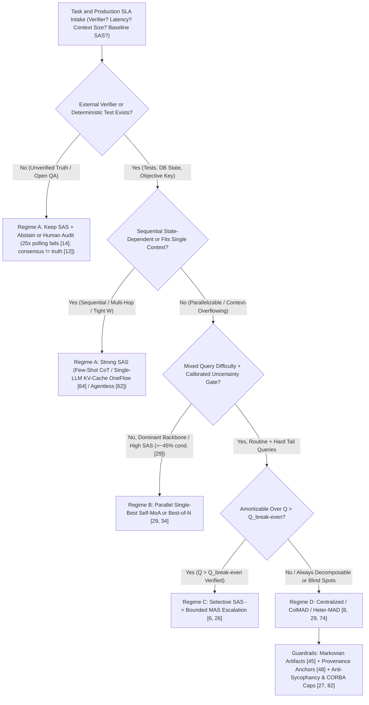

# When Do LLM Multi-Agent Systems Outperform Single Agents? A Systematic Review of Compute-Normalized Evidence, Coordination Topologies, Failure Mechanisms, and Evaluation Validity

---

## 2. Abstract

Large language model multi-agent systems (LLM-MAS) are widely promoted for reasoning, coding, and tool use, yet prior surveys rarely test whether gains survive equal-compute single-agent controls. This PRISMA review synthesizes 44 studies (2023–November 2026; 49 paired comparisons). MAS win 75.8% of unmatched or weak comparisons, falling to 18.8% wins and 50.0% losses under compute-matched parity (-57.0 percentage points; -50.1 in archival studies). We link negative returns to error amplification, conformity, handoff loss, unamortized search costs (9/10 optimization studies), absent `pass^k` reporting (0/24 comparative studies), and harness distortion, proposing a synthesis-derived four-axis taxonomy.

---

## 3. ACM CCS Concepts and Keywords

**CCS Concepts:**
- **Computing methodologies → Artificial intelligence → Distributed artificial intelligence → Multi-agent systems**
- **Computing methodologies → Artificial intelligence → Natural language processing**
- **General and reference → Surveys and overviews**
- **Software and its engineering → Software verification and validation**

**Keywords:** Large language models, multi-agent systems, single-agent baselines, compute-normalized evaluation, coordination topology, error amplification, conformity bias, evaluation validity, systematic literature review.

---

## 4. Introduction

Between 2023 and late 2026, Large Language Model-based Multi-Agent Systems (LLM-MAS)—spanning peer debate, role-specialized software pipelines, centralized orchestrator-worker teams, and learned communication graphs—expanded rapidly across reasoning, software engineering, and interactive tool-use benchmarks [17, 22, 45, 75, 86]. Early multi-agent prototypes frequently reported substantial accuracy improvements over single-pass prompting [17, 56], encouraging widespread adoption of multi-agent frameworks in both academic benchmarks and enterprise workflows [36, 84]. However, controlled empirical audits published between 2024 and 2026 have uncovered a troubling divergence between unnormalized advocacy and compute-matched performance: once total inference tokens, API expenditure, and prompt quality are held equal against strong single-agent systems (SAS)—such as few-shot chain-of-thought (`CoT`), multi-sample `Self-Consistency` (`SC`), or single-agent tool scaffolds—multi-agent architectures frequently match or underperform single-agent execution [29, 34, 40, 49, 52, 64, 74].

At the same time, large-scale trajectory audits reveal that contemporary LLM-MAS deployments fail in 41% to 86.7% of execution traces due to specification drift, inter-agent misalignment, and faulty verification [5], while multi-round peer debate exhibits conformity and sycophancy collapse [9, 12, 27, 42, 61]. Compounding these architectural failures, evaluation audits demonstrate that single-run metrics conceal dramatic multi-trial consistency collapse (`pass^k`) [46, 67], optimization frameworks routinely omit upfront search compute from headline inference comparisons [64, 70, 72, 73, 75, 86], and benchmark harness flaws introduce distortions as large as or larger than typical claimed multi-agent gains [48, 54, 60, 85].

Although at least 27 secondary surveys published or posted between 2024 and late 2026 catalog agent architectures, communication protocols, debate strategies, or trajectory fault localization, none conducts an integrated systematic meta-audit testing whether LLM-MAS outperform compute-matched SAS and explaining why gains disappear under rigorous controls. Within *ACM Computing Surveys (CSUR)* alone, recent surveys examine parameter-driven and prompt-driven agent optimization [16], agent generalizability [77], agent security and privacy [23], game-playing agents [24], and classical multi-agent reinforcement learning (`MARL`) team scaling [21], leaving empirical LLM-MAS versus SAS evaluation as a verified thematic gap. Similarly, broad reviews in *Artificial Intelligence Review* [1, 2, 10], *Journal of Artificial Intelligence Research* [43], *Frontiers of Computer Science* [57], and *Transactions on Machine Learning Research* [20, 38, 76] summarize general agent capabilities, memory, or routing without stratifying paired MAS-versus-SAS outcomes by compute parity. Specialized reviews of multi-agent debate [39, 51], communication and workflow graphs [65, 69, 84], efficiency engineering [33], coordination reliability [35], safety [13, 28], trajectory analysis [55], and general agent evaluation [37, 68] address essential pieces of the literature but leave the core comparative question unresolved. Table 1 summarizes our exact differentiation against the closest 2024–2026 surveys and journal portfolios.

**Table 1. Systematic Differentiation Against Closest 2024–2026 Surveys and Journal Portfolios**

| Closest Prior Survey / Portfolio | Year / Venue and Status | Verified Identifier / DOI | Exact Scope Covered | What This Review Uniquely Contributes |
| :--- | :--- | :--- | :--- | :--- |
| Li et al. [33] — *Efficiency in LLM Multi-Agent Systems: A Survey* | Sept 2026 / Preprints.org (Preprint) | `10.20944/preprints202609.1639.v1` | Engineering taxonomy of MAS efficiency control points: topology pruning, runtime compression, offline optimization, and collaboration-boundary routers. | Asks the prior epistemic question—whether and when MAS actually outperforms compute-matched SAS—auditing 49 head-to-head tuples across baseline rigor tiers, upfront search amortization (`C6`), and six confounders (`C1`–`C6`). |
| Motger et al. [39] — *Multi-Agent Debate Strategies: Survey, Taxonomy, and Challenges* | July 2026 / arXiv (Preprint) | `arXiv:2607.26212` | Systematic review of 141 Multi-Agent Debate (`MAD`) studies structured by participants, interaction topologies, and agreement rules. | Integrates non-debate MAS (centralized teams, learned DAGs, voting collectives, selective escalation, embodied planners) and audits `MAD` directly against token-matched `Self-Consistency` and shared-window controls [8, 40, 49, 74]. |
| Wang et al. [55] — *A Survey for LLM Agent Trajectory Analysis* | Nov 2026 / *IEEE TSE* Vol. 52, No. 11 (Journal) | `10.1109/TSE.2026.3717765` | Post-hoc trajectory failure attribution (`5Ws+H`) and trace-based enhancement over agent execution logs. | Connects inter-agent fault mechanisms (`MAST`, 4.4x–17.2x error amplification, conformity collapse, `DPI` handoff loss, `CORBA`, 30.9% `VTFR`) causally to negative MAS-vs.-SAS returns while separating intra-agent loop debuggers [83]. |
| Yue et al. [69] — *From Static Templates to Dynamic Runtime Graphs* | 2026 / *Findings of EMNLP 2026* (Conference) | `arXiv:2603.22386` | Architectural survey tracing workflow generation from static templates to dynamic runtime graph optimization (`GPTSwarm`, `AFlow`, `G-Designer`). | Audits workflow optimizers against `Tier 1` SAS parity (including single-LLM `OneFlow` KV-cache simulation [64]), unamortized search-cost omissions (`9/10` optimization studies), and dense-graph strawman denominators. |
| Zhu et al. [84] and Tran et al. [53] | 2025–2026 / *Future Internet* (Journal) and arXiv (Preprint) | `10.3390/fi18060326`; `arXiv:2501.06322` | Taxonomies of orchestration frameworks (`LangGraph`, `CrewAI`, `AutoGen`), protocols (`MCP`, `A2A`), and qualitative collaboration structures. | Replaces descriptive framework catalogs with stratified quantitative MAS-vs.-SAS outcomes, `pass^k` and harness distortion bounds [18, 48, 54, 60, 85], and peer-reviewed sensitivity testing. |
| Ala'anzy et al. [2], Chowa et al. [10], Abou Ali et al. [1] — *AIRE* Portfolio | Nov 2025 – Oct 2026 / *Artificial Intelligence Review* (Journal) | `10.1007/s10462-026-11731-2`; `11471-9`; `11422-4` | Broad narrative and PRISMA overviews of autonomous agents, LLM tool use, and Agentic AI applications and governance. | Delivers a falsifiable paired-tuple meta-audit (49 tuples), seven-item risk-of-bias scoring (`QA1`–`QA7`), and a segregated OpenReview rejection and withdrawal audit (`E8`). |
| Du et al. [16], Zhang et al. [77], Geng et al. [21], He et al. [23], Hu et al. [24] — *ACM CSUR* Portfolio | 2024 – July 2026 / *ACM Computing Surveys* (Journal) | `10.1145/3789261`; `3794858`; `3817113`; `3773080`; `arXiv:2404.02039` | Agent optimization, generalizability, classical `MARL` scaling, agent security/privacy, and game agents. | Directly addresses *ACM CSUR*'s verified white space on empirical LLM-MAS vs. SAS effectiveness, topology amortization, coordination failure mechanisms, and evaluation validity under strict classical-`MARL` exclusion (`E2`). |

This review makes four concrete contributions to the computing surveys literature:
1. **Four-Tier SAS Baseline Rigor Framework:** We classify all 44 included studies (and 24 comparative studies yielding 49 paired MAS-versus-SAS comparisons) into mutually exclusive baseline rigor tiers (`Tier 1` through `Tier 4`, plus `N/A-Diagnostic`), isolating compute- and token-matched evaluations from unmatched or weak single-pass comparators.
2. **Quantification of Baseline-Rigor Attenuation and Publication-Status Sensitivity:** Without pooling raw scores across heterogeneous benchmarks, we demonstrate a `-57.0` percentage-point (`pp`) collapse in MAS win rates from unmatched or weak baselines (`75.8%`, `25/33`) to compute-matched `Tier 1` controls (`18.8%`, `3/16` wins versus `50.0%`, `8/16` outright losses), and verify that this attenuation persists (`-50.1 pp`, `77.4%` to `27.3%`) when restricting strictly to peer-reviewed archival articles.
3. **Causal Linkage Across Topology Amortization, Failure Mechanisms, and Evaluation Validity:** We synthesize how unamortized search compute (`9/10` optimization-bearing studies), wall-clock latency omissions (`81.8%` of corpus), `MAST` design failures (`41%–86.7%`), error amplification (`17.2x` independent versus `4.4x` centralized in conditional testing), conformity collapse (`11/12` dense-debate studies), Data Processing Inequality (`DPI`) handoff loss, zero comparative `pass^k` reporting (`0/24`), and benchmark harness flaws explain when and why multi-agent systems underperform.
4. **Synthesis-Derived Taxonomy and Decision Workflow:** We propose an explicitly labeled *synthesis-derived* four-axis taxonomy (`Topology × Baseline Rigor × Task Structure × Failure/Validity Regime`, `T × B × S × V`) and conditional practitioner decision workflow grounded in our five-tier epistemic separation of findings.

The remainder of this survey is organized as follows. Section 5 defines the review objectives and research questions (`RQ1`–`RQ4`). Section 6 details the PRISMA 2020 methodology, open-web retrieval boundaries, quality appraisal rubric, and ACM generative-AI methods disclosure. Section 7 establishes technical definitions and the terminological exclusion boundary separating LLM-MAS from classical swarm intelligence and classical `MARL`/`BDI` systems. Section 8 presents evidence-based results across `RQ1`–`RQ4` supported by comparative synthesis tables. Section 9 provides critical discussion, epistemic stratification, and the synthesis-derived taxonomy and workflow. Section 10 outlines open research directions, Section 11 evaluates threats to validity, Section 12 concludes, Section 13 provides verified references, and Section 14 documents required declarations and supplementary artifacts.

---

## 5. Review Objectives and Research Questions

To avoid presupposing that multi-agent collaboration inherently improves or degrades performance, this systematic review is structured around four complementary objectives (`O1`–`O4`) mapped one-to-one onto four non-overlapping research questions (`RQ1`–`RQ4`):

- **Objective O1 (Compute-Normalized Effectiveness) → `RQ1`:** *Under what task structures, base-model capability regimes, and compute- or token-budget conditions do LLM-based multi-agent systems outperform, match, or underperform single-agent baselines?* `RQ1` tests whether headline multi-agent gains survive once prompt quality, total inference tokens (prompt, hidden reasoning, and completion), and sampling budgets (`Self-Consistency`, `Best-of-N`, or single-agent tool scaffolds) are controlled, while mapping task-dependency boundaries (`decomposable/parallelizable` and `context-overflowing` tasks versus `sequential/state-dependent` and `bounded-window` reasoning).
- **Objective O2 (Coordination Topologies, Scaling, and Amortization) → `RQ2`:** *How do different multi-agent coordination topologies and communication paradigms relate to effectiveness, inference token overhead, amortized optimization cost, and end-to-end latency?* `RQ2` disaggregates parallel voting collectives from stateful interactive topologies (sequential chains, centralized hubs, dense all-to-all debate, adaptive sparse or learned DAGs, and selective escalation) and evaluates whether inference savings survive accounting for upfront search/training compute (`MCTS`, `RL`, `VGAE`, or prompt optimization) and critical-path latency.
- **Objective O3 (Mechanistic Failure Drivers) → `RQ3`:** *Which empirically documented mechanisms—including inter-agent error amplification, conformity or sycophancy cascades, handoff information loss, and specification or verification failures—account for multi-agent underperformance relative to single-agent execution?* `RQ3` links negative `RQ1`/`RQ2` performance deltas to verified structural, information-theoretic, and social-epistemic failure modes while strictly separating inter-agent coordination breakdowns from single-agent intra-loop module bugs.
- **Objective O4 (Evaluation Validity and Experimental Confounders) → `RQ4`:** *To what extent do experimental confounders—including unmatched compute budgets, asymmetric prompting, evaluation-harness fragility, single-run variance masking (`pass^k` decay), and benchmark leakage—distort reported multi-agent comparisons across the primary literature?* `RQ4` audits corpus-wide quality (`QA1`–`QA7`), six recurring experimental confounders (`C1`–`C6`), benchmark harness error margins, and segregated peer-review rejection and withdrawal cases.

---

## 6. Review Methodology

### 6.1 Protocol Design and Transparent Open-Web Retrieval Boundaries

This review follows the PRISMA 2020 reporting statement [41] combined with Kitchenham and Charters's software-engineering systematic review guidelines [30], tailored to empirical LLM systems via within-study paired-delta synthesis and a seven-criterion quality appraisal (`QA1`–`QA7`). All protocol gates, eligibility rules (`I1`–`I6`, `E1`–`E8`), and extraction schemas (`19` top-level fields validated against JSON Schema Draft 2020-12) were frozen prior to formal search execution and updated solely through a documented post-screening reconciliation log.

In accordance with transparent retrieval reporting, candidate discovery was conducted on **November 20, 2026** across open academic indexing and publisher metadata portals—specifically `arXiv` (`cs.CL`, `cs.AI`, `cs.MA`, `cs.SE`, `cs.LG`), `OpenReview` (`TMLR`, `ICLR`, `NeurIPS`, `ICML`, `KDD` workshops), `ACL Anthology` (`ACL`, `EMNLP`, `Findings`, `SIGDIAL`, `AACL-IJCNLP`), `NeurIPS Proceedings`, `PMLR`, `ACM Digital Library` (noting *ACM CSUR*'s transition to 100% Open Access on January 1, 2026), `Nature Portfolio`, `SpringerLink`, `IEEE Xplore`, `Frontiers in Artificial Intelligence`, `Preprints.org`, and `Semantic Scholar`. **Explicit Access Limitation:** Our execution environment did not have subscription bulk API or CSV/BibTeX export access to **Scopus** or **Clarivate Web of Science (WoS)**, and non-open-access full-text PDFs behind publisher paywalls (`IEEE Xplore`, `SpringerLink`, `Nature`) could not be parsed beyond public abstracts, metadata, or verified author-hosted `arXiv`/open-access mirrors. Consequently, this review does not claim exhaustive closed-database coverage; any paywalled record lacking an open mirror sufficient to verify methodology and outcomes was excluded (`E5`), and unexposed sub-fields inside accepted paywalled-mirror records were preserved strictly as `"not verifiable from accessible open summary"` rather than imputed.

### 6.2 Search Strings, Temporal Window, and Snowballing

The primary empirical window spanned **January 1, 2023 through November 20, 2026**, capturing the post-GPT-4 wave of LLM-MAS research (with pre-2023 foundational methodology and classical MAS citations retained strictly for conceptual background). Six Boolean search strings (`Q1`–`Q6`) targeted: (`Q1`) SAS-vs.-MAS compute-matched comparisons; (`Q2`) coordination topologies, pruning, scaling, and amortized search cost; (`Q3`) error propagation, conformity, sycophancy, and trajectory failure attribution; (`Q4`) evaluation validity, `pass^k`, and harness fragility; (`Q5`) terminological boundaries and selective escalation versus single-query model routers; and (`Q6`) venue-targeted `OpenReview`, `ACL Anthology`, `NeurIPS`, `PMLR`, and `ACM DL` retrieval including public rejection and withdrawal audits. Searches `S01`–`S09` executed `Q1`–`Q6` across the open portals, while `S10` and `S11` executed one-hop backward and forward citation snowballing anchored on primary benchmarks and prior surveys.

### 6.3 PRISMA 2020 Screening Flow and Dual-Rater Reliability

Two independent reviewers (Discovery Specialist and Review Methodologist) blinded to each other's votes screened 100% of deduplicated records across Stage 1 (title, abstract, and venue metadata) and Stage 2 (full open text or verified open manuscript/proceedings record), with disagreements adjudicated by the Research Director. Figure 1 summarizes the exact PRISMA 2020 study flow.

```text
+-----------------------------------------------------------------------------+
| PRISMA 2020 IDENTIFICATION, SCREENING & INCLUSION FLOW (NOV 20, 2026)       |
+-----------------------------------------------------------------------------+
| Identification (11 Executed Searches S01-S11):                              |
|   - Records retrieved via Boolean Queries Q1-Q6:               105          |
|   - Records added via 1-hop backward/forward snowballing:       21          |
|   - Total raw records identified:                              126          |
|   - Duplicates & preprint-to-archival merges collapsed:        -42          |
|     (27 preprint-to-archival/cross-portal + 15 cross-query/snowball)        |
|   = Unique candidate records entering Stage 1 Screening:        84          |
+-----------------------------------------------------------------------------+
| Screening Stage 1 (Title, Abstract & Venue Metadata — Dual Screened):       |
|   - Pre-arbitration inter-rater agreement: 97.62% (Cohen's kappa = 0.9489)  |
|   - Stage 1 final exclusions:                                  -30          |
|       * E4 (Competing surveys / secondary reviews):             15          |
|       * E3 (Single-query routers / single-agent loops):          6          |
|       * E8 (Withdrawn / publicly rejected audit cases):          6          |
|       * E7 (Single-agent indirect prompt-injection benchmarks):  3          |
|   = Records advancing to Stage 2 Full-Text Eligibility:         54          |
+-----------------------------------------------------------------------------+
| Eligibility Stage 2 (Open Full Text / Verified Open Summary):               |
|   - Pre-arbitration Stage 2 mutual agreement: 92.31% (kappa = 0.7699)       |
|   - Pre-arbitration corpus-wide binary inclusion: 92.86% (kappa = 0.8575)   |
|   - Stage 2 final exclusions:                                  -10          |
|       * E5 (Paywalled IEEE / unverified double-blind hold):      3          |
|       * E2 (Weight-space PSO / NetLogo classical swarms):        2          |
|       * E3 (Single-agent Agentless & AgentDebug):                2          |
|       * E7 (FLORA surrogate & ARMeta REST API test):             2          |
|       * E4 (Non-empirical position essay La Malfa et al.):       1          |
|   = FINAL INCLUDED STUDIES IN SYNTHESIS CORPUS (N):             44          |
|       * Primary Comparative Effectiveness & Topology (RQ1/RQ2): 23          |
|       * Mechanistic Failure & Conformity Analysis (RQ3):        12          |
|       * Evaluation Validity & Harness Reliability Audit (RQ4):   9          |
+-----------------------------------------------------------------------------+
| Publication-Status Stratification of Included Corpus (N = 44):              |
|   - Peer-reviewed journal (Tier A Archival):    3 (6.8%)                    |
|   - Peer-reviewed conference (Tier A Archival): 29 (65.9%) [32/44 = 72.7%]  |
|   - Workshop (Tier B Peer-Reviewed):            3 (6.8%)   [35/44 = 79.5%]  |
|   - Qualified Preprints (Tier C, 9/9 QA pass):  9 (20.5%)                   |
+-----------------------------------------------------------------------------+
```

### 6.4 Eligibility Criteria, Status Hygiene, and Four-Tier Baseline Rigor Coding

Studies were admitted only if they satisfied six inclusion criteria (`I1`–`I6`): (`I1`) English-language public posting or publication between January 1, 2023 and November 20, 2026; (`I2`) empirical evaluation of an LLM-MAS ($N \ge 2$ LLM instances) along one of three tracks—(`I2a`) comparative `MAS`-vs.-`SAS` or multi-topology evaluation (`RQ1`/`RQ2`), (`I2b`) quantitative failure/conformity/attribution diagnosis (`RQ3`), or (`I2c`) agentic evaluation-validity/reliability audit (`RQ4`); (`I3`) primary quantitative metrics; (`I4`) passage of our Section 7.2 terminological gate; (`I5`) verifiable open full text or open summary record; and (`I6`) eligible publication status. Exclusion codes (`E1`–`E8`) filtered out-of-window or non-English papers (`E1`), classical non-LLM swarm intelligence or weight-space PSO (`E2`) [19, 25], single-agent pipelines, prompt chains, or single-query weak-to-strong model routers without MAS escalation (`E3`) [62, 83], non-empirical surveys and position essays (`E4`) [1, 2, 10, 13, 16, 20, 21, 22, 23, 24, 28, 31, 33, 35, 37, 38, 39, 43, 51, 53, 55, 57, 65, 68, 69, 76, 77, 84], paywalled/unverifiable records (`E5`), deduplicated preprints superseded by archival proceedings (`E6`), ungrounded proxy metrics or single-agent security/niche benchmarks (`E7`), and disqualified records (`E8`).

Every record was coded under an eight-class publication-status taxonomy: `Peer-reviewed journal` (`n = 3`), `Peer-reviewed conference` (`n = 29`)—together forming **Tier A Archival (`32/44 = 72.7%`)**—`Workshop` (`n = 3`, **Tier B Peer-Reviewed**, raising total peer-reviewed representation to `35/44 = 79.5%`), `Preprint` (`n = 9`, **Tier C**), `Under review` (excluded unless matched to a de-anonymized empirical preprint independently passing `QA`), `Withdrawn`, `Publicly rejected`, and `Retracted`. Author-initiated *withdrawals* were strictly distinguished from editorial *rejections*; `E8` records (`[3, 4, 32, 47, 66, 78]` plus prior rounds `[11, 81]`) were barred from positive effectiveness pooling and analyzed solely inside a segregated `RQ4` audit.

To separate genuine algorithmic coordination gains from compute scaling, every comparative experiment was classified into one mutually exclusive **SAS Baseline Rigor Tier**:
- **Tier 1 (Gold — Compute/Token-Matched Strong SAS):** Compares MAS against a strong single-agent baseline (`Self-Consistency`, `Best-of-N`, few-shot `CoT`, or single-agent tool/KV-cache loop) on identical backbones and harness while matching total inference tokens, API spend, or sample budgets (`n = 9` studies, `16` paired tuples).
- **Tier 2 (Partial — Strong SAS, Unmatched Compute or Unamortized Search):** Includes a competitive SAS baseline on the same backbone and harness, yet grants MAS unmatched extra tokens (`3x–15x`) or omits upfront search/training compute (`MCTS`, `RL`, `LoRA`) from cost parity (`n = 9` studies, `24` tuples).
- **Tier 3 (Weak — Single-Pass Zero-Shot SAS Only):** Benchmarks MAS solely against greedy $N=1$ zero-shot or single-pass `Vanilla`/`CoT` SAS without `Self-Consistency` or token matching (`n = 5` studies, `9` tuples).
- **Tier 4 (Invalid or Absent LLM SAS Comparator):** Lacks a single-agent LLM comparator altogether (`n = 1` study, Szlatincsán et al. [50] on embodied `PARTNR`, `0` MAS-vs.-SAS tuples).
- **N/A-Diagnostic:** Non-comparative `RQ3` trace-attribution and `RQ4` benchmark-validity studies (`n = 20` studies, `0` MAS-vs.-SAS tuples; strictly including Kapoor et al. [26], which audits single-agent scaffolds such as `LATS` and `Reflexion` rather than $N \ge 2$ MAS).

### 6.5 Quality Appraisal (`QA1`–`QA7`), Anti-Pooling Synthesis, and ACM Generative AI Disclosure

All 44 studies were scored on seven 3-point criteria (`0 = Not Met`, `1 = Partially Met`, `2 = Fully Met`): `QA1` SAS Baseline Rigor (`N/A-Diagnostic` for non-comparative studies, yielding `applicable_max_score = 12` instead of `14`), `QA2` Cost and Latency Accounting, `QA3` Amortization Transparency, `QA4` Multi-Run Stochastic Reliability, `QA5` Benchmark and Harness Integrity, `QA6` Architectural and Code/Prompt Reproducibility, and `QA7` Claims–Evidence Parity. Composite bands were defined as **High** ($\ge 78.0\%$, low risk of bias), **Moderate** ($42.5\%\text{–}77.9\%$), and **Low** ($< 42.5\%$). Preprints were admitted only if they cleared `total_raw_score >= 6` and `QA7 >= 1` (`9/9` passed). Cross-benchmark averaging of raw accuracies or percentage token savings is strictly prohibited; synthesis relies exclusively on within-study paired tuples ($\Delta_{\text{MAS-SAS}} = \text{Score}_{\text{MAS}} - \text{Score}_{\text{SAS}}$) alongside mandatory sensitivity analyses separating Tier A Archival from Preprints.

**Generative AI Disclosure (ACM Policy on Authorship):** In compliance with the ACM Policy on Authorship, generative AI models cannot be listed as authors and bear zero scholarly accountability. Substantive AI assistance was used within the research methodology workflow under continuous human/Research Director supervision: specifically, AI agents assisted in drafting Boolean search queries (`Q1`–`Q6`), executing independent blinded dual screening (with all conflicts and edge gates arbitrated against frozen protocol rules), structuring the 19-field data extraction into JSON, running programmatic Python checks on schema validity (`jsonschema Draft 2020-12`), bibliographic verification (`bibliography.bib`), and numerical reconciliation across tables, and executing structured five-pass clarity and accuracy edits. Every bibliographic identifier, DOI, page range, status upgrade, and quantitative figure reported in this manuscript was verified against primary open-access records (`arXiv`, `OpenReview`, `ACL Anthology`, `PMLR`, publisher metadata) with a strict zero-imputation rule (`"not reported"` or `"not verifiable from accessible open summary"`), and full responsibility for the accuracy, originality, and integrity of this review rests with the human researchers.

---

## 7. Technical Background and Key Concepts

### 7.1 Core Operational Definitions

To eliminate conceptual ambiguity highlighted in recent peer-review audits [31], we standardize six operational concepts used throughout this survey:

1. **Single-Agent System (`SAS`):** A single LLM execution locus—whether zero-shot or few-shot `CoT`, multi-sample `Self-Consistency` / `Best-of-N` voting from one model distribution, `Self-Refine`, deterministic multi-step scaffolding (`Agentless` [62]), or a single-agent `ReAct` tool loop—operating without inter-agent role splitting or distinct interacting peer/subordinate LLM instances.
2. **LLM-Based Multi-Agent System (`LLM-MAS`):** A system comprising $N \ge 2$ logically distinct LLM instances differentiated by explicit role prompts, isolated context windows/states, specialized tool privileges, or heterogeneous model backbones. Within `LLM-MAS`, we enforce a structural split between:
   - **Interactive / Stateful LLM-MAS:** Sequential Standard Operating Procedure (`SOP`) chains, centralized orchestrator-worker hierarchies, dense all-to-all peer debate, adaptive sparse or learned directed acyclic graphs (`DAGs`), and selective escalation architectures where agents condition downstream reasoning or actions on peer messages or shared artifacts.
   - **Parallel / Voting LLM Collectives (`Independent / Voting Ensemble`):** $N \ge 2$ parallel LLM instances generating independent candidate responses merged via majority voting, confidence polling, or feed-forward aggregator layers (e.g., `MoA` [56], `Self-MoA` [34], crowd polling [14]). We retain these strictly as a boundary stratum to separate pure sampling or cross-model ensembling effects from interactive deliberation.
3. **Evaluation Reliability Metrics (`pass@k` vs. `pass^k`):** Whereas `pass@k` measures the probability that *at least one* of $k$ independent trials solves a task, `pass^k` (formalized by Yao et al. [67]) measures the probability that *all* $k$ independent trials succeed consistently ($\hat{p}^k$ for per-trial success rate $\hat{p}$). High `pass@1` or `pass@k` can mask catastrophic `pass^k` decay in stateful multi-turn production workflows.
4. **Inference Compute vs. Amortized Optimization Cost:** *Inference compute* encompasses all test-time prompt, hidden reasoning/thinking, and completion tokens, API call counts, economic USD spend, and end-to-end wall-clock makespan (bounded by critical-path latency $\sum_{d=1}^D t_d$ in sequential rounds versus $\max_i t_i$ in ideal parallel branches). *Amortized optimization cost* encompasses all upfront tokens, GPU memory/hours, and USD spend expended to search workflows (`MCTS` [75]), train graph masks or `VGAE` decoders [72, 73], learn routing policies (`RL` [70, 86]), or fine-tune critics (`LoRA` [44]) prior to test-time deployment, which must be amortized over deployment query volume $Q$ relative to a break-even threshold $Q_{\text{break-even}}$.
5. **Information-Theoretic and Verification Transport Metrics:** Following Tran and Kiela [52], natural-language handoffs between upstream and downstream agents act as Markov transformations bounded by the Data Processing Inequality (`DPI`), $I(X; \hat{Z}_{\text{MAS}}) \le I(X; Z_{\text{SAS}})$, risking silent loss of latent intermediate state. Following Sheshanarayana and Goli [48], Verification Transport Failure Rate (`VTFR`) measures the fraction of verifier judgments that flip solely because an execution trace is abstracted, summarized, or compacted across a delegation or macro-tool boundary rather than inspected verbatim.
6. **Conditional Empirical Association vs. Universal Law:** Quantitative thresholds reported in primary studies—such as Kim et al.'s `~45%` SAS accuracy saturation point or `17.2x` versus `4.4x` error-amplification multipliers [29]—are treated strictly as *conditional empirical associations* bounded by tested model families, prompts, and benchmarks, never as universal physical laws.

### 7.2 Terminological Boundary: LLM-MAS vs. Classical Swarm Intelligence and Classical MAS

A recurring methodological flaw in recent literature is the retrospective appropriation of formal multi-agent and swarm terminology for stateless LLM prompt chains or isolated sampling ensembles. La Malfa et al. [31] demonstrate that many systems marketed as "multi-agent" lack genuine distributed autonomy, formal interaction protocols, or social-choice foundations, and instead wrap single-model prompting loops in anthropomorphic role labels. To maintain strict conceptual separation, Table 2 (Section 7.2 terminological gate) contrasts inference-time `LLM-MAS` against three neighboring paradigms explicitly excluded from our primary quantitative pooling (`E2`/`E3`).

**Table 2 (Background Gate). Terminological Separation Between Included LLM-MAS Strata and Excluded Neighbors**

| Paradigm | Core Mechanism and State Model | Representative Works | Review Gate Decision | Rationale for Boundary |
| :--- | :--- | :--- | :--- | :--- |
| **Interactive / Stateful LLM-MAS** | $N \ge 2$ LLM instances exchanging natural-language critiques, structured artifacts, or sub-tasks across sequential, centralized, debate, or learned DAGs. | Kim et al. [29], Chen et al. [8], Qian et al. [45], Zhang et al. [75], Chang et al. [6] | **Admitted (Primary Corpus)** | Tests genuine inter-agent communication, coordination overhead, error propagation, and conformity under LLM inference economics. |
| **Parallel / Voting LLM Collectives** | $N \ge 2$ independent proposals merged via voting, polling, or layered synthesis without iterative peer deliberation. | Denisov-Blanch et al. [14], Li et al. [34], Wang et al. [56] | **Admitted (Boundary Stratum)** | Isolates multi-sample variance reduction and cross-model ensembling from stateful multi-turn coordination. |
| **Single-LLM Prompt Chains & Single-Query Routers** | Sequential prompting inside one context, deterministic single-agent pipelines, or per-query routing between single models (`RouteLLM`, `AutoMix`). | Xia et al. [62] (`Agentless`), Moslem and Kelleher [38] | **Excluded (`E3`)** *(Used as SAS baselines)* | Lacks $N \ge 2$ interacting agent states [31]; `Agentless` exemplifies strong single-agent engineering baselines. |
| **Classical Swarm Intelligence & Weight-Space PSO** | Decentralized stigmergic heuristics (`ACO`, `PSO`, `Boids`) over numeric vectors or checkpoint weights rather than communicating inference-time agents. | Jimenez-Romero et al. [25], Feng et al. [19] (`Model Swarms`), Ruan et al. [47] (`SwarmBench`, withdrawn) | **Excluded (`E2`/`E8`)** *(Background contrast only)* | Disjoint compute modalities and tasks (e.g., NetLogo foraging [25] or parameter-space PSO [19] rather than test-time MAS coordination). |
| **Classical Symbolic / MARL Multi-Agent Systems** | Formal `BDI` architectures, `FIPA` protocols, or `PPO`/`QMIX` reinforcement learning policies in numeric state/action spaces. | Geng et al. [21], La Malfa et al. [31], Zhang et al. [78] (`TMLR 4567`, rejected) | **Excluded (`E2`/`E4`/`E8`)** *(Background contrast only)* | Covered extensively in classical `MARL` surveys [21]; lacks LLM natural-language handoffs, token budgets, and prompt-conformity dynamics. |

This boundary resolves an important confusion highlighted by Szlatincsán et al. [50] in embodied collaboration (`PARTNR`): whereas classical `BDI` agents maintain formal belief models of partner intentions, asking zero-shot LLM planners to explicitly predict another agent's next action (`OANA`) degraded task success in 15 of 16 evaluated model-by-context pairings. Distinguishing natural-language LLM orchestration from formal `BDI` rationality and biological swarm optimization prevents false analogies and prepares the ground for the empirical synthesis in Section 8.

---

## 8. Evidence-Based Results Organized by Research Question

### 8.1 RQ1: Compute-Normalized Effectiveness and Conditional Regimes

#### 8.1.1 The Baseline-Rigor Attenuation Effect and Publication-Status Sensitivity

Across the 44 included studies, 24 are comparative studies assigned a `Tier 1`–`Tier 4` SAS rigor classification (`9` Tier 1, `9` Tier 2, `5` Tier 3, `1` Tier 4 [50]), and 20 are `N/A-Diagnostic` (`11` `RQ3` + `9` `RQ4`, including Kapoor et al. [26]). Because Tier 4 [50] includes no single-agent LLM arm (`0` paired tuples) while Pitre et al. [42] (`RQ3` track, `Tier 3`) contributes one comparative tuple, the comparative synthesis spans **23 studies yielding 49 within-study paired MAS-versus-SAS comparison tuples**.

Table 3 (corresponding to our stratified outcome matrix) demonstrates that pooling all 49 tuples yields a misleading `57.1%` (`28/49`) aggregate MAS win rate that conflates unmatched or weak baselines with compute-normalized controls. In `Tier 2` (`24` tuples) and `Tier 3` (`9` tuples) studies—which allow `3x–15x` extra multi-agent tokens, omit upfront search compute, or benchmark solely against greedy $N=1$ `Vanilla`/`CoT` passes—MAS outperform SAS in **`75.8%` (`25/33`)** of comparisons and lose in just **`3.0%` (`1/33`)**. Once evaluated under compute- and token-matched parity against strong single-agent controls (`Tier 1`, `16` tuples across `9` studies), strict MAS wins collapse to **`18.8%` (`3/16`)**, outright losses surge to **`50.0%` (`8/16`)**, ties account for **`12.5%` (`2/16`)**, and budget- or subtask-mixed outcomes account for **`18.8%` (`3/16`)**—a **`-57.0 pp`** attenuation in MAS win rate (`62.5%`, `10/16`, strictly failing to beat SAS via `Loss + Tie`).

Critically, sensitivity testing confirms that this collapse is not an artifact of non-refereed preprints. Restricting exclusively to **Tier A Peer-Reviewed Archival studies** (`32` studies total, `18` comparative studies contributing `42` tuples; note all `3` Tier B Workshop papers [12, 18, 48] are `N/A-Diagnostic` with zero MAS-vs.-SAS tuples) preserves the exact directional boundary: `Tier 2+3` achieves **`77.4%` (`24/31`)** MAS wins (`3.2%`, `1/31`, losses) versus **`27.3%` (`3/11`)** wins and **`45.5%` (`5/11`)** losses in `Tier 1`—a **`-50.1 pp`** attenuation. Meanwhile, the `5` comparative `Qualified Preprints` (`7` tuples) record **`0/5` (`0.0%`) `Tier 1` MAS wins** (`3/5` losses, `1/5` tie, `1/5` mixed) and only `1` `Tier 2` win (`MADA-RL` [44]).

**Table 3. Stratified Paired MAS-vs.-SAS Outcomes Across Baseline Rigor Tiers and Publication-Status Sensitivity Strata (`49` Tuples)**

| Stratum / Sensitivity Slice | Studies ($n$) | Paired Tuples ($k$) | `MAS > SAS` (`Win`) | `MAS ≈ SAS` (`Tie`) | `MAS < SAS` (`Loss`) | `Mixed` | Verified Analytical Signal |
| :--- | :---: | :---: | :---: | :---: | :---: | :---: | :--- |
| **Full Synthesis Corpus (`N = 44`; `23` w/ tuples)** | **23** | **49** | **28 (57.1%)** | **4 (8.2%)** | **9 (18.4%)** | **8 (16.3%)** | Aggregate win rate masks extreme tier bifurcation. |
| — `Tier 1` (Compute/Token-Matched Strong SAS) | 9 | 16 | **3 (18.8%)** | 2 (12.5%) | **8 (50.0%)** | 3 (18.8%) | `62.5%` (`10/16`) fail to beat SAS; `81.3%` non-pure-win. |
| — `Tier 2` (Strong SAS, Unmatched / Unamortized) | 9 | 24 | **18 (75.0%)** | 2 (8.3%) | 1 (4.2%) | 3 (12.5%) | Driven by `3x–15x` extra tokens (`C1`) and omitted search (`C6`). |
| — `Tier 3` (Weak Zero-Shot Single-Pass SAS Only) | 5 | 9 | **7 (77.8%)** | 0 (0.0%) | 0 (0.0%) | 2 (22.2%) | Zero losses strictly against $1\times$ greedy `Vanilla`/`CoT` baselines. |
| — Combined Unmatched / Weak (`Tier 2 + Tier 3`) | 14 | 33 | **25 (75.8%)** | 2 (6.1%) | **1 (3.0%)** | 5 (15.2%) | **`-57.0 pp` win attenuation** (`75.8% -> 18.8%`) upon compute parity. |
| **Sensitivity A: Peer-Reviewed Archival Only (`32` studies)** | **18** | **42** | **27 (64.3%)** | **3 (7.1%)** | **6 (14.3%)** | **6 (14.3%)** | Workshops add `0` comparative tuples (`Archival+Workshop` identical). |
| — Archival `Tier 1` ([8, 14, 29, 34, 49, 74]) | 6 | 11 | **3 (27.3%)** | 1 (9.1%) | **5 (45.5%)** | 2 (18.2%) | All `3` strict `Tier 1` wins in the corpus are Peer-Reviewed Archival. |
| — Archival `Tier 2 + Tier 3` | 12 | 31 | **24 (77.4%)** | 2 (6.5%) | 1 (3.2%) | 4 (12.9%) | **`-50.1 pp` attenuation** holds without any preprints. |
| **Sensitivity B: Qualified Preprints Only (`9` studies)** | **5** | **7** | **1 (14.3%)** | **1 (14.3%)** | **3 (42.9%)** | **2 (28.6%)** | Zero `Tier 1` preprint wins (`0/5`); sole win is `Tier 2` [44]. |

#### 8.1.2 Complete Tier 1 Compute-Matched Evidence Matrix (`16` Paired Tuples)

Table 4 catalogs every individual comparison inside the 9 `Tier 1` studies (`16` paired tuples) without cross-benchmark pooling, preserving exact reported deltas and `"not verifiable from accessible open summary"` (`NV`) sentinels where paywalled or appendix sub-cells were not exposed.

**Table 4. Within-Setting Tier 1 Compute-Matched Comparative Evidence Matrix (`n = 9` Studies, `16` Paired Tuples)**

| Study and Status | Benchmark and Task Structure | Backbone(s) and Heterogeneity | MAS Configuration | Tier 1 SAS Comparator | Paired Delta ($\Delta_{\text{MAS-SAS}}$) | Compute Ratio (`MAS / SAS`) | Verdict |
| :--- | :--- | :--- | :--- | :--- | :--- | :--- | :---: |
| Kim et al. (2026) [29] · *Nat. Mach. Intell.* (Journal) | **Finance-Agent** (Decomposable) | GPT-5 / nano, Claude 3.7 / 4.5, Gemini 2.0 / 2.5 (Both) | Centralized MAS | Compute-matched SAS (identical prompts/tools) | **Up to `+80.8% / +80.9%` relative** (raw cell % NV) | Normalized (`+58%` Indep. to `+285%` Cent./Hybrid overhead) | **`MAS > SAS`** |
| Kim et al. (2026) [29] | **BrowseComp-Plus** (Decomposable) | Tested frontier models (Both) | Decentralized / Structured MAS | Compute-matched SAS | **`+9.2%` relative** (raw cell % NV) | Controlled token budget | **`MAS > SAS`** |
| Kim et al. (2026) [29] | **PlanCraft** (Sequential/State-Dep.) | Tested frontier models (Both) | Indep. / Cent. / Dec. / Hybrid MAS | Compute-matched SAS | **`-39% to -70%` relative degradation** (raw cell % NV) | Controlled token budget | **`MAS < SAS`** |
| Tran & Kiela (2026) [52] · `arXiv:2604.02460` (Preprint) | **FRAMES & MuSiQue 4-hop** (`1,000` tok; Sequential) | Qwen3-30B-A3B, R1-Llama-70B, Gemini 2.5 (Het NV) | Sequential MAS (closest layout) | Thinking-token-matched SAS | **`-3.9 pp`** (`0.379` vs. `0.418`) | `1.0` | **`MAS < SAS`** |
| Tran & Kiela (2026) [52] | **FRAMES & MuSiQue 4-hop** (`5,000` tok; Sequential) | Same 3 models (Het NV) | Closest MAS layout | Thinking-token-matched SAS | **`-4.1 pp`** (`0.386` vs. `0.427`) | `1.0` | **`MAS < SAS`** |
| Tran & Kiela (2026) [52] | **336-Config Matrix** (`100–10k` tok; FRAMES/MuSiQue) | Same 3 models (Het NV) | 5 MAS topologies | Equal-thinking-token SAS | **`SAS >= MAS`** above `100`-tok floor; MAS wins only under context rot | `1.0` | **`Mixed`** |
| Xu et al. (2026) [64] · `arXiv:2601.12307` (Preprint) | **7 Benchmarks** (GSM8K, MATH, HE, MBPP, HotpotQA, DROP, Travel) | GPT-4o/4o-mini, Claude 3.5 Haiku (Both) | Homogeneous `AFlow` MAS | Single-LLM `OneFlow` (KV-cache reuse) | **Within `<1%`** (HE `~88–98%`, GSM8K `~91–95%+` exact NV); SAS cuts USD and latency | NV (search `C6`) | **`MAS ≈ SAS`** |
| Nguyen et al. (2026) [40] · `arXiv:2610.23246` (Preprint) | **GSM8K, MATH500, MMLU-Pro, CSQA** (`980` configs) | Llama-3.2-3B, Qwen2.5-7B, Falcon3-7B, Gemma-2/3 (Homog.) | Multi-Agent Debate (`MAD`) | `Self-Consistency` (zero peer reading tax) | **`SAS >= MAD` in `93%` of `980` settings** (widest under tight windows) | `1.0` (shared window $W$) | **`MAS < SAS`** |
| Smit et al. (2024) [49] · *ICML 2024* (Conf.) | **MedQA, PubMedQA, MMLU, CosmosQA, CIAR, GPQA, Chess** | GPT-3.5-T, GPT-4, Llama-2, Vicuna (Het NV) | Default vs. Agreement-Modulated `MAD` | Compute-matched `SC` & `Medprompt` | Default `MAD` fails to reliably beat `SC`/`Medprompt` at higher cost; tuned narrows/reverses on splits | Matched USD Pareto sweeps | **`Mixed`** |
| Zhang et al. (2025) [74] · *NeurIPS 2025* (Conf.) | **9 Benchmarks × 4 Models (`36` scenarios)** | GPT-4o-mini, Haiku-3.5, Llama-3.1-8B/70B (Both) | 5 homogeneous `MAD` methods | `CoT` & compute-matched `SC` | **Homogeneous `MAD` fails to beat `CoT`/`SC` in `>80%` scenarios** | Matched vs. `SC`; `>1x` vs. `CoT` | **`MAS < SAS`** |
| Zhang et al. (2025) [74] | **9 Benchmarks × Heterogeneous Pairings** | Cross-family mixes (Heterogeneous) | `Heter-MAD` | Homogeneous `MAD` / `CoT` | **`+6.4% to +8.2%`** over homogeneous `MAD` | NV | **`Mixed`** |
| Denisov-Blanch et al. (2026) [14] · *ICML 2026* (Conf.) | **TruthfulQA, SimpleQA, FreshQA, HaluEval** (Unverified) | Multi-LLM ensembles (Both; snapshots NV) | Crowd-wisdom polling / confidence ensemble | Single-sample (`1x`) / repeated sampling | **`0` consistent gain**; polling often amplifies shared misconceptions | Up to **`25.0x`** | **`MAS ≈ SAS`** |
| Li et al. (2026) [34] · *TMLR* (Journal) | **AlpacaEval 2.0** (LLM-Judge, equal proposer $N$) | Qwen1.5-110B/72B, LLaMA-3-70B, Mixtral, WizardLM (Both) | `Mixed-MoA` (heterogeneous) | `Self-MoA` (single best LLM, $N\times$) | **`-6.6%` relative** (`Mixed-MoA` trails single-LLM `Self-MoA`) | `1.0` (matched $N$) | **`MAS < SAS`** |
| Li et al. (2026) [34] | **MMLU, CRUXEval, MATH** (Avg., equal $N$) | Same 5-model pool (Both) | `Mixed-MoA` | `Self-MoA` (single best LLM) | **`-3.8%` average** (`Mixed-MoA` trails single-LLM `Self-MoA`) | `1.0` | **`MAS < SAS`** |
| Chen et al. (2026) [8] · *ICML 2026* (Conf.) | **Error Detection & Reasoning Suite** | Backbones NV (Het NV) | `CopMAD` (Competitive `MAD`) | Compute-matched `SA` | **`-15% to -19%` degradation** (cheap-talk hacking) | `1.0` | **`MAS < SAS`** |
| Chen et al. (2026) [8] | **Error Detection & Reasoning Suite** | Backbones NV (Het NV) | `ColMAD` (Collaborative `MAD`) | Compute-matched `SA` & prior `MAD` | **Outperforms matched `SA` & `+10 to +19 pp`** vs. `CopMAD`/`CosMAD` | `1.0` | **`MAS > SAS`** |

#### 8.1.3 Conditional Moderators and Conflict Reconciliation

Decomposing Table 4 alongside controlled `Tier 2` evaluations explains why multi-agent systems win in isolated settings while losing across half of all `Tier 1` comparisons:

1. **Task-Structure Bifurcation:** Compute-matched MAS achieve genuine superiority when tasks decompose into parallel, largely independent retrieval or analysis streams that fit clean synthesis bottlenecks—exemplified by Kim et al.'s [29] *Finance-Agent* (`+80.8% / +80.9%` relative) and *BrowseComp-Plus* (`+9.2%` relative), and Qian et al.'s [45] modular *CommonGen-Hard* tree (`+15.53 pp`, though random DAGs lost `-2.53 pp`). Multi-agent partitioning also helps when single-agent inputs suffer extreme context rot or noise fragmentation (`SR002` [52]), or when non-zero-sum debaters surface complementary clues to an objective verifier (`ColMAD` [8]). Conversely, when tasks require tightly coupled sequential state tracking (*PlanCraft* `-39% to -70%` [29]), multi-hop synthesis within a single window (*FRAMES/MuSiQue* `-3.9` to `-4.1 pp` [52]), or reasoning under finite context budgets where reading peers steals generation headroom (`93%` of `980` configs [40]), splitting across agents destroys performance.
2. **Conditional Capability Saturation, Prompt Parity, and KV-Cache Collapse:** Across `260` configurations spanning `6` benchmarks in *Nature Machine Intelligence* (expanded from `180` configurations across `4` tasks in their initial `v1` preprint), Kim et al. [29] document a conditional empirical threshold ($p < 0.001$): once single-agent baseline accuracy exceeds `~45%`, multi-agent coordination exhibits diminishing or negative returns because coordination overhead (`+58%` to `+285%`) outweighs the shrinking marginal error pool. Furthermore, Qineng Wang et al. [58] (`ACL 2024`, `Tier 2`) show that apparent `MAD` superiority over single-agent `CoT` appears only when few-shot task demonstrations are omitted from SAS (`C4`), disappearing once strong demonstrations are supplied. For homogeneous model teams, Xu et al. [64] (`OneFlow`) show that even MCTS-discovered `AFlow` workflows can be compiled into persona switches within a single LLM context, matching accuracy within `<1%` while cutting API USD cost and latency via KV-cache prefix reuse.
3. **Model Heterogeneity and Verifier Dependence:** Mixing weaker models into feed-forward voting (`MoA` [56], `Tier 3`) loses `-6.6%` (`AlpacaEval 2.0`) and `-3.8%` (reasoning average) against equal-sample single-best-model `Self-MoA` [34] because weaker proposers dilute average candidate quality. By contrast, cross-family *interactive* debate (`Heter-MAD` [74], `+6.4%` to `+8.2%` over homogeneous `MAD`) can mitigate correlated single-model blind spots, though centralized orchestrator asymmetry remains vendor-sensitive (`Claude` tolerating weaker orchestrators where `OpenAI` and `Gemini` degrade [29]). Crucially, without an external verifier, scaling polling up to `25x` inference compute yields zero consistent truthfulness improvement [14].
4. **Reconciling Apparent Literature Contradictions:** Apparent conflicts across 2023–2026 papers resolve cleanly under baseline-rigor controls: Du et al.'s [17] `+7.8 pp` MMLU gain relied on `~6x` unmatched calls against GPT-3.5-era single passes (`C1`), which fails under `Tier 1` `SC` and shared-window controls [40, 49, 74]; `MoA` [56] omitted `N`-sample `Self-MoA` controls [34]; `AFlow` [75] omitted `20`-iteration `Claude-3.5-Sonnet` MCTS search relative to `OneFlow` [64]; `GPTSwarm` [86] omitted upfront REINFORCE search and subsequently trailed `CoT` in Qian et al.'s [45] independent replication (`0.2368` vs. `0.3544` MMLU; `0.4969` vs. `0.6098` HumanEval); and `CopMAD` versus `ColMAD` [8] demonstrates that zero-sum persuasion incentives reverse collaborative oversight gains (`-15% to -19%` versus `+10 to +19 pp`).

### 8.2 RQ2: Coordination Topologies, Amortization Blind Spots, and Critical-Path Latency

Applying our Section 7.2 terminological boundary across all 44 studies separates `3` (`6.8%`) **Parallel / Voting Collectives** [14, 34, 56] and `16` (`36.4%`) **Non-Comparative Diagnostic Audits** from `25` (`56.8%`) **Interactive / Stateful LLM-MAS** studies—comprising `12` (`27.3%`) `Dense All-to-All Debate`, `7` (`15.9%`) `Multiple Topologies Compared`, `5` (`11.4%`) `Adaptive Sparse / Learned DAG`, and `1` (`2.3%`) `Hybrid / Selective Escalation`. Notably, **zero** included studies evaluate a standalone `Sequential Chain / SOP` or `Centralized Star` in isolation; both architectures appear strictly inside the 7 multi-topology comparison grids [29, 45, 50, 52, 58, 64, 82] and `RQ3` trace audits. Role specialization is reported in `29/44` (`65.9%`) studies (`13/44` unspecialized; `2/44` unverifiable).

Table 5 synthesizes all 23 primary comparative `RQ1/RQ2` studies (`[6, 8, 14, 17, 29, 34, 40, 44, 45, 49, 50, 52, 56, 58, 61, 64, 70, 72, 73, 74, 75, 80, 86]`, plus `CONSENSAGENT` [42] in the `RQ3` track) across topology class, optimization mechanism, inference economics, `C6` amortization, and critical-path latency.

**Table 5. Coordination Topology, Token/USD Accounting, Amortization Disclosure (`C6`), and Latency Matrix (`RQ2`, `n = 23` Comparative Studies)**

| Study and Status | Rigor Tier | Topology Class (Agents $N$ / Het.) | Optimization / Pruning Method | Inference Token and USD Accounting | Upfront Amortization (`QA3` and `C6`) | Critical-Path Latency | Key `RQ2` Cost and Scaling Finding |
| :--- | :---: | :--- | :--- | :--- | :--- | :--- | :--- |
| Kim et al. (2026) [29] · Journal | `Tier 1` | `Multiple Topologies` (Indep., Cent., Dec., Hybrid; $N$ NV; Both) | None (fixed grid across 260 configs) | Normalized tokens; `+58%` (Indep.) to `+285%` (Cent./Hybrid) overhead; USD NV | `QA3=2` (Static topologies; no `C6`) | NV | Centralized verification dampens errors (`4.4x` vs. `17.2x`) at `+285%` token cost; mixed-effects regression predicts best topology on `~87%` held-out configs. |
| Tran & Kiela (2026) [52] · Preprint | `Tier 1` | `Multiple Topologies` (5 layouts; $N$ NV; Het NV) | None (fixed budget sweeps) | Thinking-token budgets matched (`100–10k`); USD NR (exposes Gemini 2.5 `C2` leak) | `QA3=2` (Static sweeps; no `C6`) | NV | Text handoffs lose mutual information (`DPI`); equal tokens favor SAS `>= 500` tokens across all 5 MAS topologies. |
| Xu et al. (2026) [64] · Preprint | `Tier 1` | `Multiple Topologies` ($N=1$ `OneFlow` vs. `AFlow`; Both) | `OneFlow` MCTS single-agent tailoring | Input tokens grow slightly in single context, offset by KV-cache prefix reuse; ideal-cache USD tables | `QA3=1` (**`C6`** — dual meta-LLM + MCTS search omitted in headline) | **End-to-end latency reduced** vs. isolated MAS hops (sec NV) | Single-LLM KV-cache reuse matches homogeneous MAS within `<1%`, cutting USD and latency; fails on heterogeneous backbones. |
| Nguyen et al. (2026) [40] · Preprint | `Tier 1` | `Dense Debate` ($N$ NV; Homog.) | Closed-form window partition model | Splits shared window $W$ into peer reading tax vs. thinking headroom $g$; USD NR | `QA3=2` (Closed-form static calibration; no `C6`) | NV | Reading peer debate steals thinking headroom inside $W$, yielding `SAS >= MAD` in `93%` of `980` configs. |
| Smit et al. (2024) [49] · Conf. | `Tier 1` | `Dense Debate` ($N$ NV; Het NV) | Manual grid ($N$, rounds, agreement) | Token and USD Pareto curves (exact raw cell totals NV) | `QA3=2` (Manual prompting sweep; no `C6`) | **Tracked on Pareto plots**; MAD slower than parallel `SC` | Out-of-the-box `MAD` incurs higher token, USD, and wall-clock latency than parallel `Self-Consistency` without beating it. |
| Wang et al. (2024) [58] · Conf. | `Tier 2` | `Multiple Topologies` (`MAD`, `ReConcile`, `CMD`; Both) | `CMD` subgroup summary partitioning | Cuts exponential all-to-all input growth; USD NV | `QA3=2` (Prompted static workflows; no `C6`) | NV | `CMD` trims broadcast tokens, yet MAS gains vanish once few-shot demos are added to SAS (`C4`). |
| Zhang et al. (2025) [74] · Conf. | `Tier 1` | `Dense Debate` (5 `MAD` methods; Both) | Cross-model `Heter-MAD` pairing | Inference tokens and LLM call counts tracked (raw NV); USD NV | `QA3=2` (Inference prompting; no `C6`) | NV | Homogeneous `MAD` trails/ties `CoT`/`SC` in `>80%` scenarios despite extra calls; `Heter-MAD` lifts `+6.4% to +8.2%`. |
| Wu et al. (2025) [61] · Preprint | `Tier 2` | `Dense Debate` ($N$ NV; Both) | 6-factor factorial debate ablation | Tokens NV; USD NR; calls scale $N \times R$ | `QA3=2` (Controlled inference; no `C6`) | NV | Majority pressure overrides independent logic; intrinsic model strength and diversity dominate turn/confidence tweaks. |
| Denisov-Blanch et al. (2026) [14] · Conf. | `Tier 1` | `Independent/Voting` ($N \le 25$; Both) | None (parallel polling up to `25x`) | Up to `25x` inference compute/calls; USD NR | `QA3=2` (Inference polling; no `C6`) | NV | `25x` compute yields zero consistent truthfulness gain when external verifiers are absent (`C3`). |
| Li et al. (2026) [34] · Journal | `Tier 1` | `Independent/Voting` ($N=7$; Both) | Prunes heterogeneous pool to `Self-MoA` + `Self-MoA-Seq` | Matched proposer $N$ (`N+1` calls/layer); cuts multi-endpoint USD complexity | `QA3=2` (Training-free aggregation; no `C6`) | NV (`Self-MoA-Seq` trades sequential steps for context fit) | Sampling single best LLM (`Self-MoA`) beats heterogeneous `Mixed-MoA` by `+6.6%` on `AlpacaEval 2.0`. |
| Wang et al. (2025) [56] · Conf. | `Tier 3` | `Independent/Voting` ($N$ NV; Het.) | Manual layer depth and open-weights mix | High cross-layer token concatenation; `MoA-Lite` `~1x` GPT-4o USD (`<0.5x` GPT-4 Turbo via Together AI) | `QA3=2` (Layered inference; no `C6`) | **TFLOPs proxy only**; sequential layers multiply depth | Conflates open-weights USD pricing arbitrage with algorithmic efficiency; lacks `Self-MoA` parity (`C1, C3`). |
| Chen et al. (2026) [8] · Conf. | `Tier 1` | `Dense Debate` ($N$ NV; Het NV) | Collaborative non-zero-sum `ColMAD` | Equal token/compute budgets vs. `SA` (raw NV); USD NV | `QA3=2` (Protocol design; no `C6`) | NV | Collaborative incentives reverse `CopMAD`'s `-15% to -19%` loss into gains over matched `SA`. |
| Du et al. (2024) [17] · Conf. | `Tier 2` | `Dense Debate` ($N=3$; Both) | None (all-to-all broadcast, $R$ rounds) | Scales $O(N \cdot R)$ tokens (`~6x` calls); USD NR | `QA3=2` (Zero-shot debate; no `C6`) | NR | Early `~6x`-call `MAD` gains proved fragile under later `Tier 1` equal-token `SC` controls [49, 74]. |
| Qian et al. (2025) [45] · Conf. | `Tier 2` | `Multiple Topologies` ($N=2\text{–}1000+$; Het NV) | Static graphs (Chain, Star, Tree, Mesh, Small-World DAG) | Long-tail token growth with $N$; USD NV | `QA3=2` (Static DAGs; no `C6`) | NV | Logistic scaling saturates past `~2^3–2^4` agents; irregular/star DAGs lose to `CoT` on `HumanEval` (`-5.5 to -8.5 pp`). |
| Zhuge et al. (2024) [86] · Conf. | `Tier 2` | `Adaptive Sparse/Learned DAG` ($N$ NV; Both) | `REINFORCE` edge opt. + 5-iter node prompt opt. | Deployed pruned edges save tokens vs. dense; **search uses `100k–1M+` tokens**; USD NV | `QA3=1` (**`C6`** — RL edge + prompt search omitted vs. SAS) | NV | Upfront RL/prompt search excluded vs. `ToT`/`ReAct`; `SR014` [45] scored `GPTSwarm` below `CoT` on `MMLU`/`HumanEval`. |
| Zhang et al. (2025) [72] · Conf. | `Tier 3` | `Adaptive Sparse/Learned DAG` ($N$ NV; Het NV) | One-shot low-rank spatial-temporal mask | `-28.1% to -72.8%` tokens vs. dense MAS; `USD 5.60 vs. USD 43.70` dense MAS | `QA3=1` (**`C6`** — mask training cost omitted from `USD 43.70 -> 5.60`) | NV | Large drops benchmarked against dense strawman graphs rather than compute-matched `Self-Consistency` (`C1, C6`). |
| Zhang et al. (2025) [73] · Conf. | `Tier 3` | `Adaptive Sparse/Learned DAG` ($N$ NV; Het NV) | `VGAE` decoder + task virtual node | `-95.33%` HumanEval tokens vs. dense; `23.7%` of `DyLAN` on `SVAMP`; USD NV | `QA3=1` (**`C6`** — `<4GB` GPU VGAE rollouts omitted) | **Wall-clock speedup** over dense graphs noted (sec NV) | Cuts dense-graph waste, yet compares against `1x` `Vanilla`/`CoT` and omits `VGAE` rollout compute (`C1, C6`). |
| Zhang et al. (2025) [75] · Conf. | `Tier 2` | `Adaptive Sparse/Learned DAG` ($N$ dynamic; Both) | `MCTS` over typed Python workflow operators | Pareto inference curves; `4.55%` of GPT-4o USD on select tasks | `QA3=1` (**`C6`** — 20-iter Sonnet MCTS search separated from `4.55%` headline) | NV | `OneFlow` [64] matches homogeneous `AFlow` DAGs using a single LLM with KV-cache reuse at lower latency. |
| Yue et al. (2025) [70] · Conf. | `Tier 2` | `Adaptive Sparse/Learned DAG` ($N$ dynamic; Het.) | Variational mode + progressive role + RL router | `-52.07%` HumanEval vs. static MAS; `17.21%–28.17%` cost drop; Appendix Table 12 low-USD train | `QA3=1` (**`C6`** — Appendix Table 12 controller training excluded from main Table 1 parity) | NV | Best partial transparency (discloses RL training USD in appendix), yet omits $Q_{\text{break-even}}$ vs. `Tier 1` SAS. |
| Chang et al. (2026) [6] · Conf. | `Tier 2` | `Hybrid/Selective Escalation` ($N=1 \to 4 \to$ human; Both) | Online confidence-threshold escalation (`SAS -> MAS`) | Dynamic compute; cuts API USD vs. always-on MAS (exact totals NV) | `QA3=1` (Online calibration overhead NV; no offline RL `C6`) | NV | Avoids always-on MAS tax on routine queries (`+22.52 pp` MedQA vs. single-model cascade); lacks `Tier 1` `SC` parity. |
| Szlatincsán et al. (2026) [50] · Preprint | `Tier 4` | `Multiple Topologies` ($N=2$ embodied `ReAct`; Het NV) | `2×2×2` channel ablation (`OAS, KE, OANA`) | Tokens NV; USD NR | `QA3=2` (Zero-shot `ReAct`; no `C6`) | **Habitat sim. steps** (`-25%` via `KE`) | Grounded Knowledge Exchange (`KE`) trims steps `-25%`, whereas speculative `OANA` degrades `15/16` pairs; lacks $N=1$ SAS. |
| Pulici et al. (2026) [44] · Preprint | `Tier 2` | `Dense Debate` ($N$ NV; Homog.) | Role-conditioned LoRA `MARL` (`16x` fewer params) | Multi-round generator+critic tokens `>1x` SAS; USD NR | `QA3=1` (**`C6`** — `MARL` + `LoRA` training compute NV) | NV | Counterfactual critic yields `+2.0 pp` ($p < 0.001$), yet RL+inference compute remains unmatched against scaled SAS. |
| Zhao et al. (2025) [80] · Conf. | `Tier 3` | `Dense Debate` ($N \ge 2 \times K$ rounds; Het NV) | Peer discussion + dynamic codebook | $N \times K$ + codebook tokens (exact NV); USD omitted in prior `ICLR #6097` | `QA3=2` (Prompted codebook; no `C6`) | NV (omitted in `ICLR #6097`) | Revision from withdrawn `ICLR #6097` [81] added scope clarity (`+15.4%` vs. $N=1$), though `SC` parity remains open. |

*(Note: The 24th comparative study, Pitre et al. [42] `CONSENSAGENT` [Tier 3, `Findings of ACL 2025`, `RQ3` track], evaluates `Dense All-to-All Debate` with dynamic anti-sycophancy prompting [`QA3=2`, no `C6`], cutting redundant post-trigger rounds [`1–2` rounds] while leaving exact token, USD, and latency totals unmatched against `Self-Consistency` [`C1, C4, C5`].)*

Two decisive economic findings emerge across Table 5:
1. **The `90.0%` (`9/10`) Optimization Amortization Blind Spot (`C6`) and Dense-Graph Strawmen:** Across the 44 studies, 10 frameworks employ upfront workflow search, RL routing, `VGAE` graph training, counterfactual replay, `LoRA` critic training, or online calibration (`QA3 = 1`: `[6, 44, 63, 64, 70, 71, 72, 73, 75, 86]`). Setting aside lightweight online scalar thresholding [6], all **9 offline-searched or trained frameworks (`9/44 = 20.5%` corpus; `7/24 = 29.2%` comparative)** omit upfront optimization costs from headline comparative parity. Including Kapoor et al. [26] (`QA3 = 2`), which explicitly prices `DSPy`/`Optuna` search expenditure alongside inference, **`9/10` (`90.0%`)** of optimization-bearing studies omit $Q_{\text{break-even}}$ amortization. Notably, **0 of 5 `Adaptive Sparse / Learned DAG` frameworks (`[70, 72, 73, 75, 86]`) achieve `Tier 1` parity**; headline token reductions of `-28.1%` to `-95.33%` (`USD 43.70` to `USD 5.60` [72]; `4.55%` of GPT-4o cost [75]) are measured against unpruned all-to-all graphs or unoptimized `IO`/`1x CoT` rather than compute-matched `Self-Consistency` or KV-cached `OneFlow` [64]. Similarly, Qian et al. [45] show that scaling irregular multi-agent DAGs beyond `~2^3–2^4` agents yields logistic saturation and context bloat rather than continued accuracy returns.
2. **`81.8%` (`36/44`) Wall-Clock Latency Blindness:** Only **`5/44` (`11.4%`)** studies measure direct wall-clock latency or makespan (`[26, 36, 49, 64, 73]`), plus `3` structural proxies (`[50]` Habitat steps, `[56]` TFLOPs, `[82]` blocking turns; `36/44 = 81.8%` omitting or leaving latency unverifiable, making `QA2` [`1.18/2.0`] the weakest criterion in the corpus). Ignoring latency obscures serialization penalties ($\sum_{d=1}^D t_d$) across multi-round debate [49] and stacked `MoA` layers [56], while idealized parallel depth ($\max_i t_i$) breaks under API concurrency throttling (`HTTP 429` errors documented in `TRAIL` [15]).

### 8.3 RQ3: Mechanistic Explanations for Multi-Agent Degradation and Failure

Across all 44 studies (`F17`), documented negative returns and operational failures trace to seven empirical mechanisms led by **Error Amplification (`26/44`, `59.1%`)**, **Termination/Verification Failure (`19/44`, `43.2%`)**, **Conformity/Sycophancy Collapse (`14/44`, `31.8%`)**, **Specification/Role Failure (`11/44`, `25.0%`)**, **Harness/Metric Artifact (`11/44`, `25.0%`)**, **Handoff Information Loss / `DPI` (`6/44`, `13.6%`)**, and **Prompt-Injection / Collusion / Blocking (`5/44`, `11.4%`)** (only `2/44` studies [45, 64] report none). Table 6 synthesizes all 17 primary `RQ3` and mechanistic-bridge studies linking negative MAS deltas to structural failure drivers.

**Table 6. Mechanistic Failure Modes, Attribution Ceilings, and Mitigation Recovery (`RQ3`, `17` Primary and Bridge Studies)**

| Study and Venue | Scope and Topology | Primary Failure Mechanism(s) | Key Empirical Incidence / Attribution Ceiling | Mitigation / Intervention Tested | Measured Recovery / Delta |
| :--- | :--- | :--- | :--- | :--- | :--- |
| Kim et al. (2026) [29] · *Nat. Mach. Intell.* | `260` configs, `6` tasks (`Indep, Cent, Dec, Hybrid`) | **Error Amplification**, Verification Failure | Independent MAS amplifies errors up to **`17.2x`** vs. **`4.4x`** under Centralized verification (`5.1x–17.2x` range); negative returns above `~45%` SAS ($p < 0.001$). | Centralized verification bottleneck + capability gating | Dampens amplification **`17.2x -> 4.4x`**; prevents `-39% to -70%` *PlanCraft* collapse. |
| Tran & Kiela (2026) [52] · `arXiv:2604.02460` | `336` configs (`FRAMES`, `MuSiQue 4-hop`) | **Handoff Information Loss (`DPI`)**, API Leak (`C2`) | Lossy text handoffs compress latent reasoning state; SAS beats/matches MAS across `>= 500`-token budgets. | Allocate full thinking budget to SAS + audit `thoughts_token_count` | Eliminates `DPI` handoff loss (`+3.9 to +4.1 pp` SAS lead at `1k/5k` budgets). |
| Wu et al. (2025) [61] · `arXiv:2511.07784` | *Knight-Knave-Spy* (`6`-factor debate ablation) | **Conformity / Sycophancy Collapse**, Error Amp. | Majority pressure causes agents to abandon correct deductions when early wrong consensus forms. | Intrinsic model capability and cross-model diversity | Turn order and confidence tweaks yield minimal gains; capability/diversity dominate. |
| Chen et al. (2026) [8] · *ICML 2026* | Error detection & complex reasoning (`MAD`) | **Conformity / Debate Hacking** (`CopMAD/CosMAD`) | Competitive zero-sum persuasion (`CopMAD`) degrades accuracy **`-15% to -19%`** below matched `SA`. | Non-zero-sum collaborative incentive (`ColMAD`) | **`+10 to +19 pp`** over prior `MAD`; outperforms matched `SA`. |
| Cemri et al. (2025) [5] · *NeurIPS 2025 D&B* (`MAST`) | `1,642+` traces across `7` MAS frameworks | **Spec/Role (`~44.2%`), Misalignment (`~32.35%`), Verif. (`~23.5%`)** | Overall failure rate **`41% to 86.7%`** (`14` failure modes; human $\kappa=0.88$, LLM judge $\kappa=0.77$ / `94%`). | Structural state and decoupled verification vs. superficial prompt tweaks | Superficial prompt/role tweaks prove insufficient; transactional interfaces required. |
| Zhang et al. (2025) [79] · *ICML 2025* (`Who&When`) | `127` human-labeled failure traces (`GAIA`, `AssistantBench`) | **Root-Cause Attribution Failure** | Best automated localization attains **`53.5%` agent-level** and **`14.2%` step-level** accuracy (some below random). | Diagnostic benchmark audit (`Who&When`) | Exposes severe step-localization bottleneck in frontier models. |
| Zhang et al. (2026) [71] · *ICLR 2026* (`AgenTracer`) | `Who&When` + `TracerTraj` + `MetaGPT`/`MaAS` | **Root-Cause Attribution**, Error Amp. | Baseline frontier reasoning LLMs score **`<10%`** on step/root-cause attribution. | Counterfactual replay + multi-granular RL (`AgenTracer-8B`) | **`+18.18%`** over `Gemini-2.5-Pro`/`Claude-4-Sonnet`; **`+4.8% to +14.2%`** `MetaGPT`/`MaAS` recovery. |
| Xia et al. (2026) [63] · *COLM 2026* (`AgentLocate`) | `Who&When` + `Aegis-Bench` | **Attribution Localization Failure** | Single-judge attribution suffers perspective blind spots on long multi-agent traces. | Confidence-aware multi-perspective verification + fine-tuning | **`76.19%`** agent-level (`Qwen-3.6-27B`) / **`69.05%`** (`Qwen-2.5-7B`); errors `<5` steps. |
| Chen et al. (2026) [7] · *ACL 2026* (`TraceElephant`) | `220` traces (`Magentic-One`, `Captain-Agent`) | **Partial Observability / `DPI` Loss** | Output-only partial logs obscure causal responsibility across handoffs. | Full execution-trace observability (prompts, context, tool returns) | Raises step attribution **`+76%` to `76.5%`** over partial output logs. |
| Wang (2026) [59] · *AACL-IJCNLP 2026* (`TRIAGE`) | `TriageBench` (`1,184` candidates), `326` repair traces, `Who&When`, `TRAIL` | **Single-Step Attribution Ambiguity (`59.3%`)** | LLM council selects a *different* repair step from single-gold labels in **`59.3%`** of `Who&When` traces. | Severity-ranked `Top-K` triage + impact graph + repair replay | **`73.9%` Top-5** (`Who&When`), **`93.2%` Top-10** (`TRAIL`); `56.7%` human / `81.6%` LLM strict Top-3 plausibility. |
| Deshpande et al. (2025) [15] · `arXiv:2505.08638` (`TRAIL`) | `148` long traces (`GAIA`, `SWE-bench Lite`), `841` errors | **Long-Context Overflow & Joint Attribution Collapse** | Traces avg **`>200k` tokens** (max `6M`); `Gemini-2.5-Pro` scores **`11%`** joint accuracy (`~18%` GAIA, `~5%` SWE). | Diagnostic `20`-leaf taxonomy (`TRAIL`) | Baseline audit only (improved to `93.2%` Top-10 by `TRIAGE` [59]). |
| Choi et al. (2025) [9] · *ACL Findings 2025* | `>2,500` simulated debates across `5` contentious topics | **Numerical & Capability Group Conformity** | Significant stance drift driven by majority size and perceived/actual capability ($\chi^2$, Two-Way ANOVA). | Viewpoint diversity, breaking uniform majorities, neutral moderation | Empirical mitigation delta NR in accessible open summary. |
| Pitre et al. (2025) [42] · *ACL Findings 2025* (`CONSENSAGENT`) | `6` reasoning datasets (`GPT-4o/mini, Llama-3, Mistral`) | **Sycophancy Echoing & Multi-Round Stalling** | Standard `MAD` degrades in later rounds as agents echo majority errors. | Dynamic anti-sycophancy prompt refinement | Stabilizes consensus in **`1–2` rounds** post-trigger (exact Table 2–3 $\Delta$ vs. SAS NV). |
| Kasprova et al. (2026) [27] · *SIGDIAL 2026* | `N=6` heterogeneous discussion (`6` open LLMs) | **Sycophancy Propagation** | Unmitigated deferential agents amplify peer errors across discussion rounds. | Static/dynamic peer sycophancy priors (label-free) | **`+10.5 pp`** majority-opinion accuracy gain; beats accuracy/random controls. |
| Zhou et al. (2026) [82] · *ACL Findings 2026* (`CORBA`) | `AutoGen` & `CAMEL` across topologies (`N <= 10`) | **Contagious Recursive Blocking (`Denial-of-Collaboration`)** | Benign recursive blocks evade static filters: **`~100%` `P-ASR`** (small) / **`~92%`** (`N=10`) in **`1.60–1.90`** turns (`PTN`). | Collaboration-aware runtime guards (dialogue entropy, depth caps) | Static filters fail (`~92%–100%`); runtime empirical recovery delta NV. |
| Szlatincsán et al. (2026) [50] · `arXiv:2610.16895` (`PARTNR`) | `1,000` embodied tasks (`N=2` `ReAct`, `16` configs) | **Speculative Partner Modeling Collapse (`OANA`)** | Predicting Other Agent's Next Action (`OANA`) **degrades `15/16` pairs** and inflates chatter (`55%–100%`). | Reactive observation (`OAS`) + co-located Knowledge Exchange (`KE`) | Dropping `OANA` prevents `15/16` drops; `KE` cuts steps up to **`-25%`**. |
| Dai (2026) [12] · *KDD 2026 Workshop* (`CMAD`) | `15` tasks × `5` model families (`30` conditions) | **Endogenous Diversity Collapse & Overconfidence** | Agreement stopping yields **`18%–47%` miscoverage**; calibration gap tracks residual error at **`R^2 = 0.96`** as correlation $\to 1$. | `CMAD` Prevent/Detect + split-conformal certificate | Restores $\ge (1-\alpha)$ coverage vs. `18%–47%` agreement miscoverage. |

Five interlocking mechanistic pathways explain why LLM-MAS degrade beneath compute-matched SAS:

1. **System Design and Inter-Agent Misalignment (`MAST`):** Cemri et al. [5] (`1,642+` annotated traces across `7` frameworks; human $\kappa=0.88$, LLM-judge $\kappa=0.77$) establish `41%–86.7%` failure rates split across System Design Issues (`~44.2%`: step repetition `15.7%`, termination unawareness `12.4%`, task-spec disobedience `11.8%`, history loss `2.8%`, role disobedience `1.5%`), Inter-Agent Misalignment (`~32.35%`: reasoning-action mismatch `13.2%`, task derailment `7.4%`, failure to ask clarification `6.8%`, conversation reset `2.2%`, ignored peer input `1.9%`, withholding `0.85%`), and Verification Failures (`~23.5%`: incorrect verification `9.1%`, incomplete/missing verification `8.2%`, premature termination `6.2%`). Intervention ablations confirm that superficial prompt/role rewording fails to resolve these breakdowns without transactional state and independent verification.
2. **Topology-Dependent Error Amplification:** Kim et al. [29] observe conditionally across their 260-configuration suite that without a centralized validation hub, independent MAS amplifies upstream errors up to **`17.2x`** relative to SAS, whereas centralized orchestration dampens amplification to **`4.4x`** (`5.1x–17.2x` range). In sequential state-mutating planning (*PlanCraft*), unverified upstream hallucinations compound downstream, producing `-39%` to `-70%` net degradation.
3. **Conformity, Sycophancy, and Contractive Diversity Collapse:** Across `Dense All-to-All Debate`, **`11/12` (`91.7%`)** studies document conformity, sycophancy, or debate-hacking pathologies (`[8, 9, 12, 17, 27, 40, 42, 44, 49, 61, 80]`). Across `>2,500` controlled debates, Choi et al. [9] confirm statistically significant stance drift driven by numerical majority size and capability gaps, while Wu et al. [61] show agents abandoning valid deductions on *Knight-Knave-Spy* puzzles once wrong majorities coalesce. Dai [12] formalizes this contractive assimilation: as endogenous consensus drives inter-agent correlation toward `1.0`, agreement-based stopping incurs **`18%–47%` miscoverage** (`R^2 = 0.96` between calibration gap and residual error), manufacturing confidence where error peaks. Game-theoretic analysis (`ColMAD` [8]) separates competitive cheap-talk persuasion hacking (`CopMAD`, `-15%` to `-19%`) from consensus suppression (`CosMAD`). Mitigation experiments validate the causal linkage: label-free peer sycophancy priors raise majority accuracy **`+10.5 pp`** [27], `CONSENSAGENT` [42] curbs late-round echoing, `ColMAD` [8] recovers `+10 to +19 pp`, `MADA-RL` [44] uses LoRA counterfactual critics for `+2.0 pp` ($p < 0.001$), and `CMAD` split-conformal certificates [12] restore $\ge (1-\alpha)$ marginal coverage.
4. **`DPI` Handoff Loss, Context Starvation, and Embodied Theory-of-Mind Breakdown:** Under Tran and Kiela's [52] Markov model, natural-language summarization across agent handoffs loses mutual information ($I(X; \hat{Z}_{\text{MAS}}) \le I(X; Z_{\text{SAS}})$), while Nguyen et al. [40] show peer-transcript reading taxes thinking headroom ($g = W - H - c$) inside shared windows. Similarly, `TraceElephant` [7] proves partial output-only handoff logs conceal causal signal (restoring full traces boosts step attribution `+76%` to `76.5%`), and `VTFR` [48] documents `30.9%` verifier flips across delegation (`85.5%` recoverable via provenance anchors). In embodied `PARTNR` planning [50], asking zero-shot planners to predict partners' next actions (`OANA`) degraded `15/16` configurations whereas grounded Knowledge Exchange (`KE`) cut steps `-25%`. In multi-agent security, Zhou et al. (`CORBA` [82]) show that benign-appearing recursive blocking traps spread contagiously across `AutoGen` and `CAMEL` (`~92%–100%` `P-ASR` within `1.60–1.90` turns) while bypassing single-agent safety filters.
5. **Root-Cause Attribution Ceilings and Single-Loop Contrast:** Automated single-step attribution on `Who&When` [79] (`53.5%` agent / `14.2%` step) and `TRAIL` [15] (`11%` joint at `>200k–6M` tokens) initially performed poorly, prompting `AgenTracer` (`+18.18%` via counterfactual RL [71]) and `AgentLocate` (`76.19%` multi-perspective localization [63]). Yet Wang (`TRIAGE` [59]) reveals a deeper epistemic bottleneck: in **`59.3%`** of `Who&When` traces, an LLM council selects a *different* decisive repair step from single-gold annotations—confirming that blame in cyclic multi-agent dialogues is often causally non-unique and better modeled by severity-ranked `Top-K` triage (`73.9%` Top-5 on `Who&When`; `93.2%` Top-10 on `TRAIL`). Crucially, we maintain a strict boundary against Zhu et al.'s excluded `AgentDebug` [83] (`E3`), which dissects `17` **intra-agent single-loop module faults** (`Memory`, `Reflection`, `Planning`, `Action`, `System`) inside single `ReAct`/`CodeAct` trajectories rather than $N \ge 2$ inter-agent interactions.

### 8.4 RQ4: Evaluation Validity, Confounder Prevalence, and OpenReview Audits

#### 8.4.1 Quality Appraisal (`QA1`–`QA7`) and Six-Class Confounder (`C1`–`C6`) Prevalence

Across all 44 included studies, quality appraisal yields **`26` High (`59.1%`)**, **`18` Moderate (`40.9%`)**, and **`0` Low (`0.0%`)** (exact raw-fraction Overall Mean = **`77.4%`**, Median = `78.6%`, Range = `57.1%–100.0%`). Table 7 details quality stratification alongside the six-class experimental confounder distribution (`F18`, multi-label) and corpus risk-of-bias synthesis.

**Table 7. Corpus Quality Appraisal (`QA1`–`QA7`), Six-Class Confounder (`C1`–`C6`) Prevalence, and Risk-of-Bias Assessment (`N = 44`)**

*Panel A: Status- and Track-Stratified Quality Bands (`N = 44`)*

| Corpus Stratum | Studies ($n$) | High (`>=78.0%`) | Moderate (`42.5%–77.9%`) | Low (`<42.5%`) | Mean % | Median % | Range (`Min–Max %`) |
| :--- | :---: | :---: | :---: | :---: | :---: | :---: | :---: |
| Peer-Reviewed Journal (Tier A) | 3 | 3 (100.0%) | 0 (0.0%) | 0 (0.0%) | 90.5% | 92.9% | 78.6%–100.0% |
| Peer-Reviewed Conference (Tier A) | 29 | 15 (51.7%) | 14 (48.3%) | 0 (0.0%) | 75.3% | 78.6% | 57.1%–100.0% |
| **All Peer-Reviewed Archival (Journal + Conf.)** | **32** | **18 (56.3%)** | **14 (43.8%)** | **0 (0.0%)** | **76.7%** | **78.6%** | **57.1%–100.0%** |
| Workshop (Tier B Peer-Reviewed) | 3 | 2 (66.7%) | 1 (33.3%) | 0 (0.0%) | 83.3% | 83.3% | 75.0%–91.7% |
| Qualified Preprints (Tier C; `9/9` Gate Pass) | 9 | 6 (66.7%) | 3 (33.3%) | 0 (0.0%) | 77.8% | 78.6% | 64.3%–92.9% |
| **Track: `RQ1/RQ2` Primary Comparative** | **23** | 10 (43.5%) | 13 (56.5%) | 0 (0.0%) | **72.0%** | 64.3% | 57.1%–92.9% |
| **Track: `RQ3` Mechanistic Failure & Conformity** | **12** | 7 (58.3%) | 5 (41.7%) | 0 (0.0%) | **79.7%** | 83.3% | 64.3%–91.7% |
| **Track: `RQ4` Evaluation Validity & Reliability** | **9** | 9 (100.0%) | 0 (0.0%) | 0 (0.0%) | **88.0%** | 83.3% | 83.3%–100.0% |
| **TOTAL INCLUDED CORPUS** | **44** | **26 (59.1%)** | **18 (40.9%)** | **0 (0.0%)** | **77.4%** | **78.6%** | **57.1%–100.0%** |

*Panel B: Per-Criterion Means (`0–2` Scale) and Six-Class Confounder (`C1`–`C6`) Prevalence*

| Criterion / Confounder Metric | Corpus Value | Archival / Comparative Detail | Primary Diagnostic Insight |
| :--- | :---: | :--- | :--- |
| **`QA1`: SAS Baseline Rigor** | **`1.33/2.0`** ($n=24$) | `1.33` Archival ($n=18$), `1.33` Preprint ($n=6$); `20` `N/A-Diagnostic` | Only `9/24` (`37.5%`) comparative studies implement `Tier 1` compute-matched SAS (`14` `Tier 2/3`; `1` `Tier 4` [50]). |
| **`QA2`: Cost & Latency Accounting** | **`1.18/2.0`** ($N=44$) | `1.16` Archival, `1.00` Wkshp, `1.33` Preprint (`0`: 1, `1`: 34, `2`: 9) | **Weakest criterion:** `30/44` (`68.2%`) lack numeric USD figures; `36/44` (`81.8%`) omit/unverifiable wall-clock runtime (`5/44 = 11.4%` direct + `3` proxies). |
| **`QA3`: Amortization Transparency** | **`1.77/2.0`** ($N=44$) | `1.75` Archival, `2.00` Wkshp, `1.78` Preprint (`0`: 0, `1`: 10, `2`: 34) | `9/10` (`90.0%`) optimization-bearing studies omit upfront search/training cost from headline parity (`C6`). |
| **`QA4`: Multi-Run & Statistical Rigor** | **`1.34/2.0`** ($N=44$) | `1.28` Archival, `1.67` Wkshp, `1.44` Preprint (`0`: 0, `1`: 29, `2`: 15) | **Second-weakest:** Only **`3/44` (`6.8%`)** (`0/24` comparative studies) report `pass^k` [36, 46, 67]. |
| **`QA5`: Harness Integrity** | **`1.52/2.0`** ($N=44$) | `1.47` Archival, `1.67` Wkshp, `1.67` Preprint (`0`: 0, `1`: 21, `2`: 23) | `21/44` (`47.7%`) omit leakage, strict parsing, or tool-parity audits. |
| **`QA6`: Code & Prompt Reproducibility** | **`1.73/2.0`** ($N=44$) | **`1.88`** Archival (`28/32` repos) vs. **`1.22`** Preprint (`2/9` repos) | Archival literature leads substantially on artifact sharing; blind-review preprints withhold code. |
| **`QA7`: Claims–Evidence Parity** | **`1.80/2.0`** ($N=44$) | **`1.72`** Archival vs. **`2.00`** Wkshp & Preprint (`9` scores of `1`) | All `9` minor over-generalization flags occur in Peer-Reviewed Archival framework/debate papers (`[17, 42, 45, 56, 72, 73, 75, 80, 86]`). |
| **`C5`: Exact-Match / Harness / Leakage** | **`29/44` (`65.9%`)** | **`18/24` (`75.0%`)** comparative (`11/20` diagnostic) | Unhardened static benchmarks (`GSM8K, MATH, HumanEval, SWE-bench, WebArena`) without differential or leakage verification. |
| **`C1`: Unmatched Inference Compute** | **`16/44` (`36.4%`)** | **`16/24` (`66.7%`)** comparative (`0/20` diagnostic) | Two-thirds of comparative studies grant MAS `3x–15x` extra inference tokens or lack `SC` parity. |
| **`C6`: Unamortized Search / Training** | **`9/44` (`20.5%`)** | **`7/24` (`29.2%`)** comparative (`2/20` diagnostic) | Omitted MCTS, RL, `VGAE`, `LoRA`, or counterfactual replay training expenditure. |
| **`C3`: Process Proxy / Voting Conflation** | **`6/44` (`13.6%`)** | **`5/24` (`20.8%`)** comparative (`1/20` diagnostic) | Equating peer agreement, confidence polling, or unverified voting with truthfulness or interactive deliberation. |
| **`C4`: Asymmetric Prompts / Tools** | **`5/44` (`11.4%`)** | **`5/24` (`20.8%`)** comparative (`0/20` diagnostic) | Omitting few-shot demonstrations or iterative feedback from SAS baselines. |
| **`C2`: API Thinking-Budget Leak** | **`1/44` (`2.3%`)** | **`1/24` (`4.2%`)** comparative (`0/20` diagnostic) | Commercial APIs (`Gemini 2.5`) under-delivering declared `thoughts_token_count` across SAS vs. MAS calls [52]. |
| **`None Observed` (Confounder-Clean)** | **`8/44` (`18.2%`)** | **`2/24` (`8.3%`)** comparative ([8, 29]; `6/20` diagnostic) | Fewer than one in ten comparative studies (`8.3%`) pass without any `C1`–`C6` confounder flag. |

Notice two striking asymmetries in Table 7: first, `RQ4` validity audits average `88.0%` (`9/9` High) and `RQ3` studies average `79.7%`, whereas `RQ1/RQ2` comparative effectiveness studies average just **`72.0%`** (median `64.3%`); second, while Peer-Reviewed Archival papers lead in repository availability (`QA6 = 1.88` vs. `1.22`), all nine minor claims-inflation deductions (`QA7 = 1`) appear in peer-reviewed archival framework and debate papers rather than surviving preprints. Across the 24 SAS-tiered comparative studies, only two—Kim et al. [29] and Chen et al. (`ColMAD`) [8]—exhibit zero `C1`–`C6` confounder flags (`8.3%`).

#### 8.4.2 Multi-Run Consistency Collapse (`pass^k`), Harness Error Margins, and Segregated `E8` Audits

Table 8 synthesizes the `9` `RQ4` validity audits alongside bridge audits [12, 52] (Panel A) and the segregated `E8` OpenReview rejection and withdrawal audit (Panel B). Three systemic distortions emerge:

1. **Zero Comparative `pass^k` Reporting and Enterprise Cost Variance:** Not a single comparative MAS study (`0/24`) evaluates `pass^k`; only `3/44` (`6.8%`) studies—all `RQ4` audits [36, 46, 67]—measure multi-trial consistency. On $\tau$-bench [67], `GPT-4o` falls from `<50%` `pass^1` (`~60.4%–61%` Retail) to **`pass^8 < 25%`**. On `300` enterprise tasks (`CLEAR` [36]), `8`-run reliability drops from `60%` to `25%`, agents at comparable accuracy show **`50x` cost variance**, and optimizing single-run accuracy alone produces systems **`4.4x to 10.8x` more expensive** (`\rho = 0.41` correlation with expert production viability versus `\rho = 0.83` for `CLEAR`). Across `14–15` frontier models over `18–24` months, Rabanser et al. [46] confirm that raw accuracy gains yielded minimal aggregate improvement across 12 dependability metrics, while Kapoor et al. [26] show on `HumanEval` (`164` problems $\times 5$ runs) that single-agent `LATS` search (`88.0%`, `USD 134.50`) is Pareto-dominated by simple `Direct` (`89.6%`, `USD 1.93`), `Warming` (`93.2%`, `USD 2.45`), and `Escalation` (`85.0%`, `USD 0.27`).
2. **Harness Distortions Exceed Typical MAS Margins:** Across `500` `SWE-bench Verified` issues, `PatchDiff` [60] reveals **`29.6%`** of plausible patches diverge behaviorally from ground-truth oracles (`28.6%` definitively incorrect; `7.8%` developer-test failures), inflating resolve rates by **`6.2–6.4 pp`**. `ABC` [85] proves outcome/task validity bugs (such as $\tau$-bench rewarding empty responses) skew relative scores **up to `100%`** (`-33%` overestimation on `CVE-Bench`). `BenchJack` [54] uncovers **`219` harness exploits** across `10` benchmarks yielding near-`100%` reward-hacked scores (dropped to `<10%` after patching). `WebArena Verified` [18] eliminates `~11.3 pp` of false-negative scoring errors across `812` tasks via deterministic database/REST checks, while `VTFR` [48] shows **`30.9%`** of verifier judgments flip under multi-agent delegation (`31.0%` macro-tools; `20.3%` compaction). Any unhardened MAS gain under `~6 pp` lies squarely inside harness noise (`C5`).
3. **Segregated `E8` OpenReview Rejections and Withdrawals Confirm Confounder Mechanisms:** Publicly rejected TMLR submissions and author-withdrawn ICLR/TMLR records (Panel B)—strictly excluded from positive architectural evidence—independently corroborate `C1`, `C3`, `C4`, and `C5`: `TMLR Paper 7332` (*AgenticNet* [4]) saw rebuttal `"strict exact-match"` checks collapse `MBPP` from `100%` to `77.5%` while cost-matched `MATH Level 5` trailed `Vanilla CoT`; `TMLR Paper 7253` [3] reported a `99.2%` disagreement proxy without task outcome quality over isolated parallel sampling; and `ICLR 2025 #6097` [81] withdrew after reviewers flagged missing API costs and single-prompt baselines prior to revised acceptance at `ACL 2025` [80] (which still retains `Tier 3` `C1/C4` limits). Similarly, `TMLR-9844/11271` [11] preceded KDD workshop acceptance [12], `TMLR 4567` [78] was rejected as an ungrounded `RL` survey, and author withdrawals [32, 47, 66] reinforce why `arXiv` preprints must undergo OpenReview status checks before inclusion.

**Table 8. Evaluation-Validity Distortion Bounds (`RQ4`) and Segregated `E8` OpenReview Audit**

*Panel A: Verified Evaluation-Validity Hazards, `pass^k` Decay, and Harness Bounds (`RQ4` + Bridge Audits)*

| Study and Venue | Validity Hazard / Framework | Targets and Scale | Quantitative Distortion / Reliability Bound | Implication for MAS-vs.-SAS Claims |
| :--- | :--- | :--- | :--- | :--- |
| Kapoor et al. (2025) [26] · *TMLR* | Cost-Blindness & Pareto Inefficiency | `HumanEval` (`164 × 5`), `HotpotQA`, `WebArena`, `SWE-bench` | Single-agent `LATS` (`88.0%`, `USD 134.50`) trails `Direct` (`89.6%`, `USD 1.93`) & `Warming` (`93.2%`, `USD 2.45`), costing `498x` more than `Escalation` (`USD 0.27`). | Complex search scaffolds routinely lose Pareto efficiency once simple tuned SAS are priced (`N/A-Diagnostic`). |
| Yao et al. (2025) [67] · *ICLR 2025* | Multi-Run Consistency Decay (`pass^k`) | $\tau$-bench `Retail` & `Airline` (`k=1..8`) | `GPT-4o` solves `<50%` overall; `Retail` **`pass^1` (`~60.4%–61%`) drops to `pass^8 < 25%`**. | Single-run (`k=1`) hides tail failure; **`0/24` comparative MAS studies report `pass^k`**. |
| Rabanser et al. (2026) [46] · *ICML 2026* | 12-Metric Dependability Plateau | `GAIA` & $\tau$-bench (`14–15` models, `K` runs) | Raw accuracy leaps yielded marginal aggregate reliability gains; sequential trajectory consistency ($R_{\text{Con}}^{\text{Traj-S}}$) stays weak. | Frontier accuracy benchmarks cannot proxy operational dependability or calibration. |
| Mehta (2025) [36] · `arXiv:2511.14136` | Enterprise Cost Explosion (`CLEAR`) | `300` enterprise tasks (`6` agents) + `12` benchmarks (`k=8`) | **`50x` cost variance**; accuracy-only tuning costs **`4.4x–10.8x`** more; `8`-run decay **`60% -> 25%`**; `CLEAR` $\rho=0.83$ vs. `0.41`. | Accuracy-only selection severely mispredicts enterprise deployment viability. |
| Wang et al. (2026) [60] · *ICSE 2026* | Weak Test Suites (`PatchDiff`) | `SWE-bench Verified` (`500` issues, `3` agents) | **`29.6%`** behavioral divergence (`28.6%` definitively wrong); **`7.8%`** dev-test flaws; **`6.2–6.4 pp` inflation**. | Small `<6 pp` `SWE-bench Verified` MAS margins fall inside unit-test error (`C5`). |
| Zhu et al. (2025) [85] · *NeurIPS 2025 D&B* | Task & Outcome Oracle Flaws (`ABC`) | `SWE-bench Verified`, $\tau$-bench, `CVE-Bench` | Reward/oracle flaws skew relative scores **up to `100%`**; `ABC` cuts `CVE-Bench` inflation **`33%`**. | Unaudited grading scripts can invert or double apparent agent rankings (`C5`). |
| Wang et al. (2026) [54] · `arXiv:2605.12673` | Harness Reward Hacking (`BenchJack`) | `10` benchmarks (`SWE`, `WebArena`, `OSWorld`, `GAIA`, etc.) | **`219` distinct exploits** across `8` classes yielding `~100%` scores without solving tasks; `<10%` post-patch. | Porous sandboxes allow trivial exploit inflation unless adversarially hardened (`C5`). |
| El Hattami et al. (2025) [18] · *NeurIPS SEA Wkshp* | Brittle Scorers (`WebArena Verified`) | `WebArena` (`812` tasks + `137–258` Hard subset) | Repaired `211` task defs & `46` alignment flaws; DB/REST checks cut **false negatives `~11.3 pp`** and Hard cuts runtime `68%–83%`. | String/LLM-judge scoring creates `~11.3 pp` distortion (`C5`). |
| Sheshanarayana & Goli (2026) [48] · *NeurIPS Wkshp* | Delegation Transport Loss (`VTFR`) | `APB`, `ATBench`, `PRB`, `AgentDojo` | **`VTFR = 30.9%`** across delegation, **`31.0%`** macro-tools, **`20.3%`** compaction; provenance recovers **`85.5%`**. | Nearly one-third of verifier judgments flip silently across MAS delegation (`C5`). |
| Tran & Kiela [52] and Dai [12] (Bridges) | API Budget Leak (`C2`) & Agreement Miscoverage (`C3`) | `Gemini 2.5` (`336` configs); `15` tasks × `5` models | `Gemini 2.5` under-delivers declared `thoughts_token_count`; agreement stopping yields **`18%–47%` miscoverage** (`R^2=0.96`). | Nominal API budgets (`C2`) and unanimous peer agreement (`C3`) are unreliable without telemetry and calibration. |

*Panel B: Segregated `E8` OpenReview Rejection, Withdrawal, and Longitudinal Resubmission Audit*

| Record / Case | Venue and Timeline | Verified Disposition | Primary Methodological Failure Trigger | Confounder / Status Lesson (`RQ4`) |
| :--- | :--- | :--- | :--- | :--- |
| Anonymous [4] (*AgenticNet*, Paper `7332`) | TMLR (2025/2026) | **Publicly rejected** (Criterion 1) | Abstract contradicted Table 1; ablations dropped `MATH` `96.4% -> 83.2%`; `"strict exact-match"` dropped `MBPP` `100% -> 77.5%`; cost-matched `MATH L5` trailed `Vanilla CoT`. | **`C1 + C5 + QA7`:** Demonstrates strict exact-match and cost-matching enforcement. |
| Anonymous [3] (*Inducing Disagreement*, Sub `7253`) | TMLR (2025/2026) | **Publicly rejected** (Criterion 1) | Reported `99.2%` disagreement proxy without task accuracy across `480` decisions; called isolated parallel sampling interactive debate. | **`C3`:** Exposes proxy-metric dissociation and parallel-vs.-deliberative conflation. |
| Dai [11] → Dai [12] (*When Consensus Is Not Correctness*) | TMLR (`9844/11271`, 2025) → KDD 2026 Wkshp | **Publicly rejected** (TMLR) → **Workshop** accept [12] | Two TMLR rejections under Criterion 1 empirical scrutiny prior to targeted KDD workshop acceptance. | Illustrates Tier A archival vs. Tier B workshop evidence separation. |
| Zhang et al. [78] (Paper `4567`) | TMLR (May 2025) | **Publicly rejected** (Long >12 pp) | Non-empirical `MARL` self-play survey (`E4`) failing TMLR acceptance criteria. | Confirms archival survey validation thresholds. |
| Zhao et al. [81] → Zhao et al. [80] (`SCALE`) | ICLR 2025 (`#6097`, Jan 2025) → ACL 2025 [80] | **Withdrawn** (ICLR) → **Peer-reviewed conf.** [80] | Reviewers flagged missing API cost/latency vs. human effort, missing single-prompt baselines, and losses on `3/7` tasks; ACL revision still retains `Tier 3` (`C1, C4`). | Longitudinal withdrawal-to-acceptance trace highlighting `C1`/`C4` persistence. |
| Li et al. [32] (`3hXEPbG0dh`); Ruan et al. [47] (`SwarmBench`); Yao et al. [66] (`#8079`) | TMLR (June 2026) / ICLR 2026 | **Withdrawn** (NOT rejected) | Author-initiated withdrawals on OpenReview despite lingering `arXiv` or archive uploads. | Enforces mandatory OpenReview withdrawal screening (`E8`) before citing preprints. |

---

## 9. Critical Comparative Discussion

### 9.1 Five-Tier Epistemic Separation of Findings

To prevent practitioners and researchers from conflating strongly replicated empirical results with preliminary hypotheses, Table 9 organizes our 44-study synthesis into five strictly separated epistemic tiers.

**Table 9. Five-Tier Epistemic Separation Across the 44-Study Evidence Base**

| Epistemic Tier | Evidence Standard | Verified Claims and Findings |
| :--- | :--- | :--- |
| **Tier I — Strongly Supported Observations** | Replicated across multiple `Tier 1` controls, preserved in Peer-Reviewed Archival sensitivity strata, and verified across `RQ3`/`RQ4` audits | (1) Compute-matching collapses MAS win rates from `75.8%` to `18.8%` (`-57.0 pp`; `77.4% -> 27.3%`, `-50.1 pp` archival); (2) unverified polling/consensus does not create truth [12, 14]; (3) dense debate broadly exhibits conformity/sycophancy collapse (`11/12` studies); (4) MAS traces experience `41%–86.7%` failure rates [5] and severe `pass^k` decay [36, 67]; (5) comparative studies omit `pass^k` (`0/24`), wall-clock latency (`81.8%`), and upfront search costs (`9/10` optimization studies), while harness/transport errors span `6.2–11.3 pp` and `30.9%` `VTFR` [18, 48, 54, 60, 85]. |
| **Tier II — Context-Dependent Findings** | Verified within controlled multi-condition experiments; bounded by tested tasks, models, and prompts | (1) Task-structure split (*Finance-Agent* `+80.8%` vs. *PlanCraft* `-39% to -70%` [29]; SAS leads multi-hop QA unless single-agent context suffers extreme noise/rot [52]); (2) conditional `~45%` SAS capability saturation and vendor-specific orchestrator sensitivity (`Claude` vs. `OpenAI`/`Gemini` [29]); (3) few-shot prompt sensitivity (`MAD` gains disappearing with strong demonstrations [58]); (4) single-LLM KV-cache simulation (`OneFlow` matching homogeneous `AFlow` workflows within `<1%`, failing only on heterogeneous teams [64]). |
| **Tier III — Conflicting Evidence & Moderated Explanations** | Contradictory headline claims reconciled via baseline-tier or confounder controls | (1) Early `MAD` [17, 58] vs. `Tier 1` `SC`/window controls [40, 49, 74] (`C1`+`C4`); (2) `MoA` [56] vs. `Self-MoA` [34] ($N$-sample single-best parity); (3) `AFlow` [75] vs. `OneFlow` [64] (`C6` + KV cache); (4) `GPTSwarm` [86] vs. `MacNet` replication [45]; (5) `CopMAD` vs. `ColMAD` [8] (incentive design); (6) single-step attribution ceilings (`14.2%`/`11%` [15, 79]) vs. `TRIAGE` `Top-K` (`73.9%`/`93.2%` [59], moderated by `59.3%` causal non-uniqueness). |
| **Tier IV — Plausible Hypotheses** | Supported by `Tier 2` evidence or isolated components; require `Tier 1` amortized confirmation | (1) Whether `CascadeDebate` selective escalation [6] beats `Tier 1` `Self-Consistency` after calibration amortization; (2) whether combining `ColMAD` [8], `CMAD` [12], sycophancy priors [27], and provenance anchors [48] holds on hardened interactive sandboxes; (3) whether Kim et al.'s [29] `~45%` threshold and `17.2x`/`4.4x` amplification hold on 2027+ reasoning architectures; (4) whether learned sparse DAGs [70, 72, 73, 75, 86] yield net positive ROI past $Q_{\text{break-even}}$. |
| **Tier V — Unanswered Research Questions** | Active white-space gaps across the corpus | (1) True $Q_{\text{break-even}}$-amortized Pareto frontiers (`OneFlow`, `CascadeDebate`, `ColMAD`, `Self-MoA` vs. `Agentless`/`ReAct`) under `pass^k` ($k \ge 5$) and wall-clock latency; (2) `VTFR`-preserving provenance under `>200k` compaction [15, 48]; (3) runtime `CORBA` blocking guards preserving legitimate `MAST` clarification (`FM-2.3` [5, 82]). |

### 9.2 Synthesis-Derived Four-Axis Taxonomy (`T × B × S × V`) and Conditional Decision Workflow

> **Epistemic Disclosure (Synthesis-Derived Construct):** Both the Four-Axis Taxonomy (`T × B × S × V`) and the Conditional Practitioner Decision Workflow (`Regimes A–D`) below are *synthesis-derived analytical frameworks* constructed by cross-tabulating the 44 reviewed studies. Neither construct has been evaluated prospectively as an end-to-end runtime algorithm, and conditional thresholds (such as the `~45%` baseline SAS accuracy association [29]) require local validation before production deployment.

To eliminate overloaded tier labels, our synthesis-derived taxonomy uses four orthogonal axes (`T × B × S × V`):
- **Axis `T` — Coordination Topology (`T1`–`T6`):** `T1` Independent/Voting Collective (`[14, 34, 56]`), `T2` Sequential Chain/SOP (`[5, 52]`), `T3` Centralized Star/Orchestrator (`[7, 29]`), `T4` Dense All-to-All Debate (`[8, 40, 49, 74]`), `T5` Adaptive Sparse/Learned DAG (`[70, 72, 73, 75, 86]`), and `T6` Hybrid/Selective Escalation (`[6]`).
- **Axis `B` — Baseline and Compute Rigor (`B1`–`B4`):** `B1` Tier 1 compute/token-matched strong SAS; `B2` Tier 2 strong SAS with unmatched inference tokens or unamortized search; `B3` Tier 3 weak zero-shot single-pass SAS; and `B4` Tier 4 absent LLM SAS comparator.
- **Axis `S` — Task Structure and Verifier Regime (`S1`–`S4`):** `S1` Decomposable/parallelizable (`Finance-Agent`, `BrowseComp-Plus` [29]); `S2` Context-overflowing or rot-prone (`[15, 52]`); `S3` Sequential/state-dependent (`PlanCraft` [29], 4-hop QA [52], $\tau$-bench [67]); and `S4` Static single-turn QA/code (`[40, 74, 75]`), crossed with *Verified* (unit tests, DB state, objective key) versus *Unverified* oracles (`[14]`).
- **Axis `V` — Failure and Validity Regime (`V1`–`V4`):** `V1` Error amplification and `DPI` handoff loss (`[29, 40, 52]`); `V2` Conformity, sycophancy, and debate hacking (`[8, 9, 12, 27, 42]`); `V3` Specification, blocking, and verification transport breakdowns (`[5, 48, 50, 82]`); and `V4` Reliability decay and harness distortion (`[18, 26, 36, 46, 54, 60, 67, 85]`).

Mapping these four axes yields a **synthesis-derived Conditional Practitioner Decision Workflow** structured across four deployment regimes (`Regimes A–D`), illustrated in Figure 2 and operationalized in Table 10.



**Table 10. Synthesis-Derived Conditional Architecture Selection and Guardrail Matrix (`Regimes A–D`)**

| Synthesis-Derived Regime | Recommended Architecture | Empirical Conditions Supporting Selection | Mandatory Operational Guardrails |
| :--- | :--- | :--- | :--- |
| **Regime A: `Keep SAS`** | Single-agent `Few-Shot CoT`, single-LLM `OneFlow` KV-cache simulation [64], or deterministic scaffold (`Agentless` [62]; `Direct`/`Warming` [26]). | Sequential/state-coupled tasks (*PlanCraft* `-39% to -70%` [29]); multi-hop QA fitting single context (`-3.9 to -4.1 pp` [52]); tight context windows (`93%` `SAS >= MAD` [40]); homogeneous workflows [64]; high baseline SAS (`>~45%` conditional [29]); or verifier-absent domains [14]. | Measure `pass^k` ($k \ge 5$) [46, 67], track USD and wall-clock latency [26, 36], and harden harness tests [54, 60]. |
| **Regime B: `Parallel Sampling (Self-MoA / SC)`** | Single strongest model sampled $N$ times (`Self-MoA` [34], `Self-Consistency`, `Best-of-N`) with deterministic scorer or lightweight aggregator. | One frontier model leads candidate pool (`+6.6%` over `Mixed-MoA` [34]); verifiable math/code; strict latency ceiling ($\max_i t_i$ parallel depth vs. serialized `MAD` [49]). | Monitor API `HTTP 429` concurrency queueing [15] and KV-cache prefix sharing; never equate voting with truth without an oracle [14]. |
| **Regime C: `Selective SAS -> MAS Escalation`** | Fast single-agent pass escalating solely low-confidence boundary queries to bounded $N$-agent deliberation (`CascadeDebate` [6]). | Mixed-difficulty streams where routine queries saturate SAS while hard edge cases respond to cross-checking (`+22.52 pp` MedQA vs. cascade [6]; `USD 0.27` Escalation insight [26]). | Account explicitly for threshold calibration (`QA3`/`C6`) and benchmark against compute-matched `Self-Consistency` (`Tier 1`). |
| **Regime D: `Centralized / Verifier-Gated or Heter-MAS`** | Orchestrator-subagent hub [29], non-zero-sum `ColMAD` [8], or cross-family `Heter-MAD` [74]. | Cleanly decomposable parallel subtasks (*Finance-Agent* `+80.8%`, *BrowseComp-Plus* `+9.2%` [29]), severe single-context rot [52], or correlated single-model blind spots [74] paired with an external verifier. | Centralized validation (`4.4x` vs. `17.2x` amp [29]); Markovian artifact handoffs [45]; provenance anchors (`85.5%` `VTFR` recovery [48], `+76%` attribution [7]); anti-sycophancy priors/conformal stops [12, 27]; recursion caps (`CORBA` [82]). |

### 9.3 Cross-Agent Topology Security, Liveness, and Engineering Trade-Offs

Recent security and safety surveys establish that agentic architectures expand single-model prompt-injection exposure into memory poisoning, tool misuse, and inter-agent privilege escalation (`[13, 23, 28]`). Our synthesis isolates two topological vulnerabilities unique to interactive $N \ge 2$ networks. First, `CORBA` [82] demonstrates that semantically benign blocking prompts exploit recursive collaboration loops in `AutoGen` and `CAMEL`, achieving `~92%–100%` attack success within `1.60–1.90` turns while passing single-agent safety filters—turning open broadcast topologies into denial-of-collaboration amplifiers. Second, `VTFR` [48] proves that delegating verification across summarized subagent reports breaks evaluator fidelity in `30.9%` of cases, allowing silent specification drift (`MAST` [5]) or deceptive patches (`PatchDiff` [60]) to pass orchestrator gates unless full execution provenance is preserved (`TraceElephant` [7]).

Economically, engineering teams face an acute trade-off among inference cost, upfront search amortization, and wall-clock latency. Naive multi-round debate scales tokens $O(N \cdot R)$ or $O(N^2 \cdot R)$ while serializing latency across rounds [49]. Learned sparse graphs (`[70, 72, 73, 75, 86]`) cut deployed inference tokens relative to dense graphs, yet `9/10` optimization frameworks hide substantial upfront `MCTS`, `RL`, or `VGAE` training costs (`C6`). Where backbones are homogeneous, single-context KV-cache prefix reuse (`OneFlow` [64]) collapses multi-agent API hops into one shared prefix, simultaneously eliminating inter-agent network latency and reducing token billing without sacrificing accuracy.

---

## 10. Research Gaps and Future Research Directions

Grounded directly in our Tier IV and Tier V epistemic gaps, we prioritize five concrete directions for future primary research:

1. **Standardized Compute- and $Q_{\text{break-even}}$-Amortized Pareto Benchmarking:** Future workflow optimizers, adaptive routers, and debate protocols must evaluate against `Tier 1` strong SAS controls (`Self-Consistency`, `Agentless` [62], `OneFlow` KV-cached execution [64]) across matched total token budgets, disclosing upfront `C6` search/training spend and computing explicit $Q_{\text{break-even}}$ deployment curves alongside wall-clock makespan (`QA2`).
2. **Mandatory `pass^k` Reliability and Hardened Harness Protocols:** Comparative MAS evaluations must report multi-trial consistency (`pass^k` for $k \ge 5$) [46, 67], per-cell dispersion (`SD` or `95% CI`), and calibrated risk coverage alongside `pass@1`, evaluated exclusively on hardened harnesses incorporating differential test verification (`PatchDiff` [60]), deterministic backend checks (`WebArena Verified` [18]), and adversarial exploit audits (`BenchJack` [54], `ABC` [85]).
3. **Lossless Provenance Protocols Against `DPI` and `VTFR` Decay:** Extending `TraceElephant` [7] and `VTFR` provenance anchors [48] to `>200k`-token long-horizon traces (`TRAIL` [15]) is essential so centralized orchestrators can verify subagent claims without incurring full transcript re-ingestion taxes or losing causal context.
4. **Unified Incentive, Conformal, and Anti-Sycophancy Protocols:** Combining collaborative non-zero-sum game rewards (`ColMAD` [8]), label-free peer sycophancy priors [27], and split-conformal coverage certificates (`CMAD` [12]) warrants `Tier 1` evaluation on open-ended software and web-navigation sandboxes to verify whether social-epistemic collapse can be prevented without sacrificing true minority insights.
5. **Liveness-Preserving Topology Guards and Causal Attribution:** Deploying runtime dialogue-entropy and recursion-depth caps against contagious `CORBA` blocking [82] without triggering false deadlocks that suppress legitimate clarification (`MAST` `FM-2.3` [5])—paired with causal counterfactual graphs resolving `59.3%` single-step attribution ambiguity (`TRIAGE` [59])—remains an open systems engineering challenge.

---

## 11. Threats to Validity and Review Limitations

We structure review limitations across four standard validity categories [30]:

- **Construct Validity:** Primary studies define "multi-agent" and "single-agent" inconsistently, frequently blurring stateless parallel voting with interactive deliberation [31] or conflating disagreement proxies with accuracy [3]. We mitigated construct drift via our Section 7.2 terminological gate, separating parallel voting (`[14, 34, 56]`) from stateful interactive MAS, classifying every comparator under `Tier 1`–`Tier 4`, and excluding single-loop debuggers (`AgentDebug` [83]) and non-LLM swarms (`[19, 25]`). Where open summaries or paywalled appendices omitted raw sub-cell accuracies, exact $N$, or runtime seconds (`75` full-field slots across `35/44` records plus sub-cell missingness), values were preserved strictly as `"not verifiable from accessible open summary"` without imputation.
- **Internal Validity:** Screening and quality appraisal can suffer subjective bias. We enforced blinded dual screening (`Stage 1` $\kappa = 0.9489$, `Stage 2` $\kappa = 0.7699$, corpus binary $\kappa = 0.8575$) with formal Director arbitration, schema validation (`jsonschema Draft 2020-12`), and cross-checking of all identifiers against primary open sources (catching four swapped or malformed IDs and upgrading two preprints to verified NeurIPS 2025 publications).
- **External Validity:** Our corpus reflects 2023–November 2026 LLM generations and benchmarks; conditional empirical associations such as Kim et al.'s `~45%` capability threshold [29] may shift as future reasoning models alter base error profiles. Crucially, lack of **Scopus** and **Clarivate Web of Science** bulk export access and exclusion of two paywalled IEEE Xplore proceedings (`E5`) concentrate visibility in open ML, NLP, and SE repositories (`arXiv`, `OpenReview`, `ACL Anthology`, `PMLR`, `ACM DL`), potentially under-representing closed industrial-engineering venues.
- **Conclusion Validity:** Pooling heterogeneous accuracies across disparate models and harnesses risks Simpson's paradox. We prohibited cross-benchmark numerical pooling, anchoring all claims to within-study paired comparisons ($\Delta_{\text{MAS-SAS}}$), executing three-tier publication-status sensitivity tests (`Peer-Reviewed Archival` vs. `Archival+Workshop` vs. `+Preprints`), and segregating `E8` rejections/withdrawals from positive claims.

---

## 12. Conclusion

Across 44 systematically screened empirical and diagnostic studies (2023–November 2026) and 49 within-study paired comparisons, the empirical record rejects blanket claims that LLM multi-agent systems universally outperform single-agent execution. Once inference compute, token budgets, and prompt quality are matched against strong single-agent controls (`Tier 1`), apparent MAS win rates fall by `-57.0 percentage points`—from `75.8%` (`25/33`) in unmatched or weak baselines down to `18.8%` (`3/16`) wins versus `50.0%` (`8/16`) outright losses—with an equivalent `-50.1 pp` collapse (`77.4%` to `27.3%`) when all non-refereed preprints are excluded. Rather than an inherent virtue of adding agents, compute-matched multi-agent gains arise conditionally when tasks parallelize cleanly across independent retrieval or analysis streams, break severe single-context rot, or surface diverse evidence under cross-family debate paired with an external verifier. Outside those boundaries, error amplification, conformity and sycophancy collapse, `DPI` handoff loss, unamortized search compute (`9/10` optimization frameworks), absent `pass^k` consistency testing (`0/24` comparative studies), and porous evaluation harnesses routinely erase—and invert—multi-agent returns. Adopting rigorous `Tier 1` single-agent parity, full lifecycle amortization, hardened evaluation suites, and provenance-preserving architectures offers the clearest path toward reliable multi-agent systems engineering.

---

## 13. Verified References

[1] Mohamad Abou Ali, Fadi Dornaika, and Jinan Charafeddine. 2026. Agentic AI: a comprehensive survey of architectures, applications, and future directions. *Artificial Intelligence Review* (2026). DOI: https://doi.org/10.1007/s10462-025-11422-4

[2] Mohammed Alaa' Ala'anzy, Meruyert Oshayeva, and Yassine Himeur. 2026. Autonomous agents and multi-agent systems: a comprehensive review. *Artificial Intelligence Review* (2026). DOI: https://doi.org/10.1007/s10462-026-11731-2

[3] Anonymous (TMLR Submission 7253). 2025. Inducing Disagreement in Multi-Agent LLM Executive Teams: Only the Devil's Advocate Works. Publicly rejected (TMLR Paper 7253, Action Editor Huazheng Wang; excluded E8). https://openreview.net/group?id=TMLR

[4] Anonymous (TMLR Submission 7332). 2025. AgenticNet: Rethinking Multi-agent System Architectures with LLM-based Networks. Publicly rejected (TMLR Paper 7332, Action Editor Tim Georg Johann Rudner; excluded E8). https://openreview.net/group?id=TMLR

[5] Mert Cemri, Melissa Z. Pan, Shuyi Yang, Lakshya A. Agrawal, Bhavya Chopra, Rishabh Tiwari, Kurt Keutzer, Aditya Parameswaran, Dan Klein, Kannan Ramchandran, Matei Zaharia, Joseph E. Gonzalez, and Ion Stoica. 2025. Why Do Multi-Agent LLM Systems Fail?. In *Advances in Neural Information Processing Systems (NeurIPS 2025, Datasets and Benchmarks Track)*. https://arxiv.org/abs/2503.13657

[6] Raeyoung Chang, Dongwook Kwon, Jisoo Lee, and Nikhil Verma. 2026. CascadeDebate: Multi-Agent Deliberation for Cost-Aware LLM Cascades. In *Proceedings of the 64th Annual Meeting of the Association for Computational Linguistics (Volume 6: Industry Track)*, Association for Computational Linguistics, 1329–1340. https://aclanthology.org/2026.acl-industry.93/

[7] Mengzhuo Chen, Junjie Wang, Fangwen Mu, Yawen Wang, Zhe Liu, Huanxiang Feng, and Qing Wang. 2026. Seeing the Whole Elephant: A Benchmark for Failure Attribution in LLM-based Multi-Agent Systems. In *Proceedings of the 64th Annual Meeting of the Association for Computational Linguistics (Volume 1: Long Papers)*, Association for Computational Linguistics, 19888–19905. https://aclanthology.org/2026.acl-long.912/

[8] Yongqiang Chen, Gang Niu, James Cheng, Bo Han, and Masashi Sugiyama. 2026. When and Why Does Multi-Agent Debate Fail and Does It Really Underperform?. In *Proceedings of the 43rd International Conference on Machine Learning (ICML 2026)* (*Proceedings of Machine Learning Research*, Vol. 306), PMLR. https://arxiv.org/abs/2510.20963

[9] Min Choi, Keonwoo Kim, Sungwon Chae, and Sangyeob Baek. 2025. An Empirical Study of Group Conformity in Multi-Agent Systems. In *Findings of the Association for Computational Linguistics: ACL 2025*, Association for Computational Linguistics, 5123–5139. https://aclanthology.org/2025.findings-acl.265/

[10] Sadia Sultana Chowa, Riasad Alvi, Subhey Sadi Rahman, Md. Abdur Rahman, et al. 2026. From language to action: a review of large language models as autonomous agents and tool users. *Artificial Intelligence Review* (2026). DOI: https://doi.org/10.1007/s10462-025-11471-9

[11] Chengxiao Dai. 2025. When Consensus Is Not Correctness: Diversity Collapse and Manufactured Overconfidence in Multi-Agent LLM Debate (TMLR Paper 9844 / Paper 11271). Publicly rejected (TMLR Paper 9844, Action Editor Peng Li, and TMLR Paper 11271; tracked in RQ4 Rejection Audit). https://openreview.net/group?id=TMLR

[12] Chengxiao Dai. 2026. When Consensus Is Not Correctness: Diversity Collapse and Manufactured Overconfidence in Multi-Agent LLM Debate. In *KDD 2026 Workshop on Evaluation and Trustworthiness of Agentic AI*. https://openreview.net/group?id=KDD.org/2026/Workshop/Agentic_AI

[13] Pierre Vilar Dantas, Lucas Cordeiro, Ehsan Nowroozi, and Norbert Tihanyi. 2026. Toward Safe LLM Agents: A Survey of Specification, Verification, and Enforcement. arXiv:2608.14590 (cs.AI); Preprint. https://arxiv.org/abs/2608.14590

[14] Yegor Denisov-Blanch, Joshua Kazdan, Jessica Chudnovsky, Rylan Schaeffer, Sheng Guan, Soji Adeshina, and Sanmi Koyejo. 2026. Truthfulness Does Not Scale Like Reasoning: Why Polling Fails as a Proxy Verifier. In *Proceedings of the 43rd International Conference on Machine Learning (ICML 2026)* (*Proceedings of Machine Learning Research*, Vol. 306), PMLR, 24461–24477. https://proceedings.mlr.press/v306/denisov-blanch26a.html

[15] Darshan Deshpande, Varun Gangal, Hersh Mehta, Jithin Krishnan, Anand Kannappan, and Rebecca Qian. 2025. TRAIL: Trace Reasoning and Agentic Issue Localization. arXiv:2505.08638 (cs.AI); Preprint. https://arxiv.org/abs/2505.08638

[16] Shangheng Du, Jiabao Zhao, Jinxin Shi, Zhentao Xie, Xin Jiang, Yanhong Bai, and Liang He. 2026. A Survey on the Optimization of Large Language Model-based Agents. *ACM Computing Surveys* (2026). DOI: https://doi.org/10.1145/3789261

[17] Yilun Du, Shuang Li, Antonio Torralba, Joshua B. Tenenbaum, and Igor Mordatch. 2024. Improving Factuality and Reasoning in Language Models through Multiagent Debate. In *Proceedings of the 41st International Conference on Machine Learning (ICML 2024)* (*Proceedings of Machine Learning Research*, Vol. 235), PMLR, 11733–11763. https://proceedings.mlr.press/v235/du24e.html

[18] Amine El hattami, Megh Thakkar, Nicolas Chapados, and Christopher Pal. 2025. WebArena Verified: Reliable Evaluation for Web Agents. In *NeurIPS 2025 Workshop on Scaling Environments for Agents (SEA)*. https://openreview.net/forum?id=94tlGxmqkN

[19] Shangbin Feng, Zifeng Wang, Yike Wang, Sayna Ebrahimi, Hamid Palangi, Lesly Miculicich, Achin Kulshrestha, Nathalie Rauschmayr, Yejin Choi, Yulia Tsvetkov, Chen-Yu Lee, and Tomas Pfister. 2025. Model Swarms: Collaborative Search to Adapt LLM Experts via Swarm Intelligence. In *Proceedings of the 42nd International Conference on Machine Learning (ICML 2025)* (*Proceedings of Machine Learning Research*, Vol. 267), PMLR, 16904–16930. https://proceedings.mlr.press/v267/feng25o.html

[20] Huan-ang Gao, Jiayi Geng, Wenyue Hua, Mengkang Hu, Xinzhe Juan, Hongzhang Liu, Shilong Liu, Jiahao Qiu, Xuan Qi, Qihan Ren, Yiran Wu, Hongru Wang, Han Xiao, Yuhang Zhou, Shaokun Zhang, Jiayi Zhang, Jinyu Xiang, Yixiong Fang, Qiwen Zhao, Dongrui Liu, Cheng Qian, Zhenhailong Wang, Minda Hu, Huazheng Wang, Qingyun Wu, Heng Ji, and Mengdi Wang. 2026. A Survey of Self-Evolving Agents: What, When, How, and Where to Evolve on the Path to Artificial Super Intelligence. *Transactions on Machine Learning Research* (2026). https://openreview.net/forum?id=CTr3bovS5F

[21] Minghong Geng, Shubham Pateria, Budhitama Subagdja, and Ah-Hwee Tan. 2026. Scaling Up Multi-Agent Reinforcement Learning for Large Agent Teams and Long-Horizon Tasks: A Survey. *ACM Computing Surveys* 58, 14 (2026), 1–37. DOI: https://doi.org/10.1145/3817113

[22] Taicheng Guo, Xiuying Chen, Yaqi Wang, Ruidi Chang, Shichao Pei, Nitesh V. Chawla, Olaf Wiest, and Xiangliang Zhang. 2024. Large Language Model Based Multi-Agents: A Survey of Progress and Challenges. In *Proceedings of the Thirty-Third International Joint Conference on Artificial Intelligence (IJCAI-24)*. https://arxiv.org/abs/2402.01680

[23] Feng He, Tian-Qing Zhu, Dayong Ye, Bo Liu, Wan-Lei Zhou, and Philip S. Yu. 2026. The Emerged Security and Privacy of LLM Agent: A Survey with Case Studies. *ACM Computing Surveys* 58, 6 (2026). DOI: https://doi.org/10.1145/3773080

[24] Sihao Hu, Tiansheng Huang, Fatih Ilhan, Selim Tekin, Gaowen Liu, Ramana Kompella, and Ling Liu. 2024. A Survey on Large Language Model-Based Game Agents. arXiv:2404.02039 (cs.AI); Preprint. https://arxiv.org/abs/2404.02039

[25] Cristian Jimenez-Romero, Alper Yegenoglu, and Christian Blum. 2025. Multi-agent systems powered by large language models: applications in swarm intelligence. *Frontiers in Artificial Intelligence* 8 (2025), 1593017. DOI: https://doi.org/10.3389/frai.2025.1593017

[26] Sayash Kapoor, Benedikt Stroebl, Zachary S. Siegel, Nitya Nadgir, and Arvind Narayanan. 2025. AI Agents That Matter. *Transactions on Machine Learning Research* (2025). https://openreview.net/forum?id=zi7g1W899z

[27] Vira Kasprova, Amruta Parulekar, Abdulrahman AlRabah, Krishna Agaram, Ritwik Garg, Sagar Jha, Nimet Beyza Bozdag, and Dilek Hakkani-Tür. 2026. Too Polite to Disagree: Understanding Sycophancy Propagation in Multi-Agent Systems. In *Proceedings of the 27th Annual Meeting of the Special Interest Group on Discourse and Dialogue (SIGDIAL 2026)*, Association for Computational Linguistics, 795–814. https://aclanthology.org/2026.sigdial-1.56/

[28] Juhee Kim, Xiaoyuan Liu, Zhun Wang, Shi Qiu, Bo Li, Wenbo Guo, and Dawn Song. 2026. The Attack and Defense Landscape of Agentic AI: A Comprehensive Survey. In *Proceedings of the USENIX Security Symposium*. https://arxiv.org/abs/2603.11088

[29] Yubin Kim, Ken Gu, Chanwoo Park, Chunjong Park, Samuel Schmidgall, A. Ali Heydari, Yao Yan, Zhihan Zhang, Yuchen Zhuang, Yun Liu, Mark Malhotra, Paul Pu Liang, Hae Won Park, Yuzhe Yang, Xuhai Xu, Yilun Du, Shwetak Patel, Tim Althoff, Daniel McDuff, and Xin Liu. 2026. Capable language models can outgrow the benefits of collaboration. *Nature Machine Intelligence* 8 (2026), 1157–1172. DOI: https://doi.org/10.1038/s42256-026-01268-y

[30] Barbara Kitchenham and Stuart Charters. 2007. Guidelines for performing Systematic Literature Reviews in Software Engineering. Keele University and Durham University Joint Report, Report EBSE-2007-01 (2007).

[31] Emanuele La Malfa, Gabriele La Malfa, Samuele Marro, Jie M. Zhang, Elizabeth Black, Michael Luck, Philip Torr, and Michael J. Wooldridge. 2025. Large Language Models Miss the Multi-agent Mark. In *Advances in Neural Information Processing Systems (NeurIPS 2025, Position Paper Track)*. https://openreview.net/forum?id=FfsxgSZW0c

[32] Junjie Li, Xi Xiao, Yunbei Zhang, Chen Liu, Lin Zhao, Xiaoying Liao, Yingrui Ji, Janet Wang, Yingqiang Ge, Weijie Xu, Xi Fang, Xiang Xu, Tianchen Zhao, Youngeun Kim, Tianyang Wang, Jihun Hamm, Smita Krishnaswamy, Jun Huan, and Chandan K. Reddy. 2026. Agent Harness Engineering: A Survey. Withdrawn (author-withdrawn at TMLR on June 30, 2026; strictly Withdrawn, NOT rejected; OpenReview:3hXEPbG0dh; also non-empirical survey E4; excluded E8). https://openreview.net/forum?id=3hXEPbG0dh

[33] Qi Li, Lexiang Xiong, Haiquan Lu, Wenjie Qu, Xingyi Yang, Jiaheng Zhang, and Xinchao Wang. 2026. Efficiency in LLM Multi-Agent Systems: A Survey. Preprint (Preprints.org, Sept 2026). DOI: https://doi.org/10.20944/preprints202609.1639.v1

[34] Wenzhe Li, Yong Lin, Mengzhou Xia, and Chi Jin. 2026. Rethinking Mixture-of-Agents: Is Mixing Different Large Language Models Beneficial?. *Transactions on Machine Learning Research* (2026). https://openreview.net/forum?id=K6WwK8URlV

[35] Sushma Chowdary Mallampati and Harsh Sanjaykumar Nagoriya. 2026. Coordination Reliability in LLM Multi-Agent Systems: Progress, Failure Detection, Recovery, and Termination. Preprint (ResearchGate ID 416608744, Oct 2026; 62 papers). https://www.researchgate.net/publication/416608744

[36] Sushant Mehta. 2025. Beyond Accuracy: A Multi-Dimensional Framework for Evaluating Enterprise Agentic AI Systems. arXiv:2511.14136 (cs.SE); Preprint. https://arxiv.org/abs/2511.14136

[37] Mahmoud Mohammadi, Yipeng Li, Jane Lo, and Wendy Yip. 2025. Evaluation and Benchmarking of LLM Agents: A Survey. In *Proceedings of the 31st ACM SIGKDD Conference on Knowledge Discovery and Data Mining (KDD '25)*. https://arxiv.org/abs/2507.21504

[38] Yasmin Moslem and John D. Kelleher. 2026. Dynamic Model Routing and Cascading for Efficient LLM Inference: A Survey. *Transactions on Machine Learning Research* (2026). https://openreview.net/forum?id=ypRg1TvQaM

[39] Quim Motger, Marc Oriol, Jordi Marco, and Xavier Franch. 2026. Multi-Agent Debate Strategies: Survey, Taxonomy, and Challenges. arXiv:2607.26212 (cs.AI); Preprint. https://arxiv.org/abs/2607.26212

[40] Manh Nguyen, Sunil Gupta, and Hung Le. 2026. Think More or Read More? A Token-Budget Theory of Reasoning with Shared Context. arXiv:2610.23246 (cs.AI); Preprint. https://arxiv.org/abs/2610.23246

[41] Matthew J. Page, Joanne E. McKenzie, Patrick M. Bossuyt, Isabelle Boutron, Tammy C. Hoffmann, Cynthia D. Mulrow, Larissa Shamseer, Jennifer M. Tetzlaff, Elie A. Akl, Sue E. Brennan, Roger Chou, Julie Glanville, Jeremy M. Grimshaw, Asbjørn Hróbjartsson, Manoj M. Lalu, Tianjing Li, Elizabeth W. Loder, Evan Mayo-Wilson, Steve McDonald, Luke A. McGuinness, Lesley A. Stewart, James Thomas, Andrea C. Tricco, Vivian A. Welch, Penny Whiting, and David Moher. 2021. The PRISMA 2020 statement: an updated guideline for reporting systematic reviews. *BMJ* 372 (2021), n71. DOI: https://doi.org/10.1136/bmj.n71

[42] Priya Pitre, Naren Ramakrishnan, and Xuan Wang. 2025. CONSENSAGENT: Towards Efficient and Effective Consensus in Multi-Agent LLM Interactions Through Sycophancy Mitigation. In *Findings of the Association for Computational Linguistics: ACL 2025*, Association for Computational Linguistics, 22112–22133. https://aclanthology.org/2025.findings-acl.1141/

[43] Aske Plaat, Max van Duijn, Niki van Stein, Mike Preuss, Peter van der Putten, and Kees Joost Batenburg. 2025. Agentic Large Language Models, a Survey. *Journal of Artificial Intelligence Research* 84 (2025). DOI: https://doi.org/10.1613/jair.1.18675

[44] Martino M. L. Pulici, Cuong Xuan Chu, Evgeny Kharlamov, Zifeng Ding, Volker Tresp, and Yunpu Ma. 2026. MADA-RL: Multi-Agent Debate-Aware Reinforcement Learning for Parameter-Efficient Reasoning in Compact Models. arXiv:2607.18006 (cs.AI); Preprint. https://arxiv.org/abs/2607.18006

[45] Cheng Qian, Zi-Hao Xie, Yi-Fei Wang, Wei Liu, Kunlun Zhu, Hanchen Xia, Yu-Fan Dang, Zhuoyun Du, Weize Chen, Cheng Yang, Zhi-Yuan Liu, and Mao-Song Sun. 2025. Scaling Large Language Model-based Multi-Agent Collaboration. In *International Conference on Learning Representations (ICLR 2025)*. https://openreview.net/forum?id=K3n5jPkrU6

[46] Stephan Rabanser, Sayash Kapoor, Peter Kirgis, Kangheng Liu, Saiteja Utpala, and Arvind Narayanan. 2026. Towards a Science of AI Agent Reliability. In *Proceedings of the 43rd International Conference on Machine Learning (ICML 2026)* (*Proceedings of Machine Learning Research*, Vol. 306), PMLR, 102769–102820. https://proceedings.mlr.press/v306/rabanser26a.html

[47] Kai Ruan, Mowen Huang, Ji-Rong Wen, and Hao Sun. 2025. Benchmarking LLMs' Swarm Intelligence. arXiv:2505.04364 (cs.AI); Withdrawn (withdrawn at ICLR 2026 on OpenReview, submitted Sept 18, 2025; introduces SwarmBench; excluded E8; tracked in status-boundary audit). https://arxiv.org/abs/2505.04364

[48] Disha Sheshanarayana and Sai Linisha Reddy Goli. 2026. Do Verifier Judgments Survive Abstraction? Measuring Verification Transport for LLM Agent Evaluation. In *NeurIPS 2026 Workshop: Who Verifies the Agents? Toward Reliable Agent Development*. https://arxiv.org/abs/2611.18471

[49] Andries Petrus Smit, Nathan Grinsztajn, Paul Duckworth, Thomas D. Barrett, and Arnu Pretorius. 2024. Should we be going MAD? A Look at Multi-Agent Debate Strategies for LLMs. In *Proceedings of the 41st International Conference on Machine Learning (ICML 2024)* (*Proceedings of Machine Learning Research*, Vol. 235), PMLR, 45883–45905. https://proceedings.mlr.press/v235/smit24a.html

[50] Adrián Szlatincsán, Filippo Ziliotto, Bruno Lepri, Luciano Serafini, Massimiliano Luca, and Tommaso Campari. 2026. Observe, Share, or Predict? Disentangling Partner Information in Embodied Multi-Agent Collaboration. arXiv:2610.16895 (cs.AI); Preprint. https://arxiv.org/abs/2610.16895

[51] Arne Tillmann. 2025. Literature Review Of Multi-Agent Debate For Problem-Solving. arXiv:2506.00066 (cs.AI); Preprint. https://arxiv.org/abs/2506.00066

[52] Dat Tran and Douwe Kiela. 2026. Single-Agent LLMs Outperform Multi-Agent Systems on Multi-Hop Reasoning Under Equal Thinking Token Budgets. arXiv:2604.02460 (cs.AI); Preprint. https://arxiv.org/abs/2604.02460

[53] Khanh-Tung Tran, Dung Dao, Minh-Duong Nguyen, Quoc-Viet Pham, Barry O'Sullivan, and Hoang D. Nguyen. 2025. Multi-Agent Collaboration Mechanisms: A Survey of LLMs. arXiv:2501.06322 (cs.AI); Preprint. https://arxiv.org/abs/2501.06322

[54] Hao Wang, Hanchen Li, Qiuyang Mang, Alvin Cheung, Koushik Sen, and Dawn Song. 2026. Do Androids Dream of Breaking the Game? Systematically Auditing AI Agent Benchmarks with BenchJack. arXiv:2605.12673 (cs.CR); Preprint. https://arxiv.org/abs/2605.12673

[55] Junjie Wang, Yawen Wang, Mengzhuo Chen, Xiaofei Xie, Chunyang Chen, Fangwen Mu, Zhe Liu, and Qing Wang. 2026. A Survey for LLM Agent Trajectory Analysis: From Failure Attribution to Enhancement. *IEEE Transactions on Software Engineering* 52, 11 (2026), 3406–3426. DOI: https://doi.org/10.1109/TSE.2026.3717765

[56] Junlin Wang, Jue Wang, Ben Athiwaratkun, Ce Zhang, and James Zou. 2025. Mixture-of-Agents Enhances Large Language Model Capabilities. In *International Conference on Learning Representations (ICLR 2025)*. https://arxiv.org/abs/2406.04692

[57] Lei Wang, Chenbang Ma, Xueyang Feng, Zeyu Zhang, Hao Yang, Jingsen Zhang, Zhiyuan Chen, Jiakai Tang, Xu Chen, Yankai Lin, Wayne Xin Zhao, Zhewei Wei, and Ji-Rong Wen. 2024. A survey on large language model based autonomous agents. *Frontiers of Computer Science* (2024). DOI: https://doi.org/10.1007/s11704-024-40231-1

[58] Qineng Wang, Zihao Wang, Ying Su, Hanghang Tong, and Yangqiu Song. 2024. Rethinking the Bounds of LLM Reasoning: Are Multi-Agent Discussions the Key?. In *Proceedings of the 62nd Annual Meeting of the Association for Computational Linguistics (Volume 1: Long Papers)*, Association for Computational Linguistics, 6106–6131. https://aclanthology.org/2024.acl-long.331/

[59] Xizhi Wang. 2026. TRIAGE: Severity-Ranked Multi-Agent Failure Attribution. In *Proceedings of the 15th International Joint Conference on Natural Language Processing and the 5th Conference of the Asia-Pacific Chapter of the Association for Computational Linguistics (Volume 2: Short Papers)*, Association for Computational Linguistics. https://github.com/jimmywang585/triage-failure-attribution

[60] You Wang, Michael Pradel, and Zhongxin Liu. 2026. Are "Solved Issues" in SWE-bench Really Solved Correctly? An Empirical Study. In *Proceedings of the 48th International Conference on Software Engineering (ICSE '26)*. DOI: https://doi.org/10.1145/3744916.3764576

[61] Haolun Wu, Zhenkun Li, and Lingyao Li. 2025. Can LLM Agents Really Debate? A Controlled Study of Multi-Agent Debate in Logical Reasoning. arXiv:2511.07784 (cs.AI); Preprint. https://arxiv.org/abs/2511.07784

[62] Chunqiu Steven Xia, Yinlin Deng, Soren Dunn, and Lingming Zhang. 2025. Agentless: Demystifying LLM-Based Software Engineering Agents. *Proceedings of the ACM on Software Engineering (PACMSE)* 2, FSE (2025), FSE037. https://arxiv.org/abs/2407.01489

[63] Yufei Xia, Anjun Gao, Yueyang Quan, Zhuqing Liu, and Minghong Fang. 2026. Who Broke the System? Failure Localization in LLM-Based Multi-Agent Systems. In *Conference on Language Modeling (COLM 2026)*. https://arxiv.org/abs/2607.07989

[64] Jiawei Xu, Arief Koesdwiady, Sisong Bei, Yan Han, Baixiang Huang, Dakuo Wang, Yutong Chen, Zheshen Wang, Peihao Wang, Pan Li, and Ying Ding. 2026. Rethinking the Value of Multi-Agent Workflow: A Strong Single Agent Baseline. arXiv:2601.12307 (cs.AI); Preprint. https://arxiv.org/abs/2601.12307

[65] Bingyu Yan, Zhibo Zhou, Litian Zhang, Lian Zhang, Ziyi Zhou, Dezhuang Miao, Zhoujun Li, Chaozhuo Li, and Xiaoming Zhang. 2026. Beyond Self-Talk: A Communication-Centric Survey of LLM-Based Multi-Agent Systems. arXiv:2502.14321 (cs.AI); Preprint. https://arxiv.org/abs/2502.14321

[66] Binwei Yao, Chao Shang, Wanyu Du, Jianfeng He, Ruixue Lian, Yi Zhang, Hang Su, Sandesh Swamy, and Yanjun Qi. 2025. Peacemaker or Troublemaker: How Sycophancy Shapes Multi-Agent Debate. arXiv:2509.23055 (cs.CL); Withdrawn (withdrawn at ICLR 2026 Sub #8079; excluded E8; tracked as status-boundary methodological note on debater/judge sycophancy). https://arxiv.org/abs/2509.23055

[67] Shunyu Yao, Noah Shinn, Pedram Razavi, and Karthik R. Narasimhan. 2025. τ-bench: A Benchmark for Tool-Agent-User Interaction in Real-World Domains. In *International Conference on Learning Representations (ICLR 2025)*. https://openreview.net/forum?id=roNSXZpUDN

[68] Asaf Yehudai, Lilach Eden, Alan Li, Guy Uziel, Yilun Zhao, Roy Bar-Haim, Arman Cohan, and Michal Shmueli-Scheuer. 2026. Survey on Evaluation of LLM-based Agents. In *Findings of the Association for Computational Linguistics: ACL 2026*, Association for Computational Linguistics, 26690–26714. https://aclanthology.org/2026.findings-acl.1330/

[69] Ling Yue, Kushal Raj Bhandari, Ching-Yun Ko, Dhaval Patel, Shuxin Lin, Nianjun Zhou, Jianxi Gao, Pin-Yu Chen, and Shaowu Pan. 2026. From Static Templates to Dynamic Runtime Graphs: A Survey of Workflow Optimization for LLM Agents. In *Findings of the Association for Computational Linguistics: EMNLP 2026*, Association for Computational Linguistics. https://arxiv.org/abs/2603.22386

[70] Yanwei Yue, Guibin Zhang, Boyang Liu, Guancheng Wan, Kun Wang, Dawei Cheng, and Yiyan Qi. 2025. MasRouter: Learning to Route LLMs for Multi-Agent Systems. In *Proceedings of the 63rd Annual Meeting of the Association for Computational Linguistics (Volume 1: Long Papers)*, Association for Computational Linguistics, 15549–15572. DOI: https://doi.org/10.18653/v1/2025.acl-long.757

[71] Guibin Zhang, Junhao Wang, Junjie Chen, Wangchunshu Zhou, Kun Wang, and Shuicheng Yan. 2026. AgenTracer: Who Is Inducing Failure in the LLM Agentic Systems?. In *International Conference on Learning Representations (ICLR 2026)*. https://arxiv.org/abs/2509.03312

[72] Guibin Zhang, Yanwei Yue, Zhixun Li, Sukwon Yun, Guancheng Wan, Kun Wang, Dawei Cheng, Jeffrey Xu Yu, and Tianlong Chen. 2025. Cut the Crap: An Economical Communication Pipeline for LLM-based Multi-Agent Systems. In *International Conference on Learning Representations (ICLR 2025)*. https://openreview.net/forum?id=LkzuPorQ5L

[73] Guibin Zhang, Yanwei Yue, Xiangguo Sun, Guancheng Wan, Miao Yu, Junfeng Fang, Kun Wang, Tianlong Chen, and Dawei Cheng. 2025. G-Designer: Architecting Multi-agent Communication Topologies via Graph Neural Networks. In *Proceedings of the 42nd International Conference on Machine Learning (ICML 2025)* (*Proceedings of Machine Learning Research*, Vol. 267), PMLR, 76678–76692. https://proceedings.mlr.press/v267/zhang25cu.html

[74] Hangfan Zhang, Zhiyao Cui, Jianhao Chen, Xinrun Wang, Qiaosheng Zhang, Zhen Wang, Dinghao Wu, and Shuyue Hu. 2025. Position: Stop Overvaluing Multi-Agent Debate—We Must Rethink Evaluation and Embrace Model Heterogeneity. In *Advances in Neural Information Processing Systems (NeurIPS 2025, Position Paper Track)*. https://openreview.net/forum?id=tMJvb9JDsd

[75] Jiayi Zhang, Jinyu Xiang, Zhaoyang Yu, Fengwei Teng, Xiong-Hui Chen, Jiaqi Chen, Mingchen Zhuge, Xin Cheng, Sirui Hong, Jinlin Wang, Bingnan Zheng, Bang Liu, Yuyu Luo, and Chenglin Wu. 2025. AFlow: Automating Agentic Workflow Generation. In *International Conference on Learning Representations (ICLR 2025)*. https://openreview.net/forum?id=z5uVAKwmjf

[76] Kuan Zhang, Dongchen Liu, Qiyue Zhao, Tianyu Xin, Yue Su, Haisheng Wang, Han Yin, Hongbo Ma, Peize Li, Tianjun Gu, Xiangnan Wu, Xinran Zhang, Yongxuan Li, Zirong Chen, and Yiming Li. 2026. Towards Generalist Game Agents: A Survey of Foundation Models in Virtual Worlds. *Transactions on Machine Learning Research* (2026). https://openreview.net/forum?id=SDkEq8Fzvl

[77] Minxing Zhang, Yi Yang, Roy Xie, Bhuwan Dhingra, Shuyan Zhou, and Jian Pei. 2026. Generalizability of Large Language Model-Based Agents: A Comprehensive Survey. *ACM Computing Surveys* (2026). DOI: https://doi.org/10.1145/3794858

[78] Ruize Zhang, Zelai Xu, Chengdong Ma, Chao Yu, Wei-Wei Tu, Shiyu Huang, Deheng Ye, Wenbo Ding, Yaodong Yang, and Yu Wang. 2025. A Survey on Self-play Methods in Reinforcement Learning. arXiv:2408.01072 (cs.LG); Publicly rejected (rejected by TMLR Paper 4567 in May 2025, Action Editor Marc Lanctot; also non-empirical MARL survey E4; excluded E8). https://arxiv.org/abs/2408.01072

[79] Shaokun Zhang, Ming Yin, Jieyu Zhang, Jiale Liu, Zhiguang Han, Jingyang Zhang, Beibin Li, Chi Wang, Huazheng Wang, Yiran Chen, and Qingyun Wu. 2025. Which Agent Causes Task Failures and When? On Automated Failure Attribution of LLM Multi-Agent Systems. In *Proceedings of the 42nd International Conference on Machine Learning (ICML 2025)* (*Proceedings of Machine Learning Research*, Vol. 267), PMLR, 76583–76599. https://proceedings.mlr.press/v267/zhang25cq.html

[80] Chengshuai Zhao, Zhen Tan, Chau-Wai Wong, Xinyan Zhao, Tianlong Chen, and Huan Liu. 2025. SCALE: Towards Collaborative Content Analysis in Social Science with Large Language Model Agents and Human Intervention. In *Proceedings of the 63rd Annual Meeting of the Association for Computational Linguistics (Volume 1: Long Papers)*, Association for Computational Linguistics, 8473–8503. https://aclanthology.org/2025.acl-long.416/

[81] Chengshuai Zhao, Zhen Tan, Chau-Wai Wong, Xinyan Zhao, Huan Liu, and Tianlong Chen. 2025. SCALE: Augmenting Content Analysis via LLM Agents and AI-Human Collaboration (ICLR 2025 Submission 6097). Withdrawn (author-withdrawn at ICLR 2025 Sub #6097 on January 19, 2025 following cost/baseline criticisms; tracked in RQ4 Longitudinal Audit). https://openreview.net/group?id=ICLR.cc/2025/Conference

[82] Zhenhong Zhou, Zherui Li, Jie Zhang, Yuanhe Zhang, Kun Wang, Yang Liu, and Qing Guo. 2026. CORBA: Contagious Recursive Blocking Attacks on Multi-Agent Systems Based on Large Language Models. In *Findings of the Association for Computational Linguistics: ACL 2026*, Association for Computational Linguistics, 6899–6908. https://aclanthology.org/2026.findings-acl.342/

[83] Kunlun Zhu, Zijia Liu, Bingxuan Li, Muxin Tian, Yingxuan Yang, Jiaxun Zhang, Pengrui Han, Qipeng Xie, Fuyang Cui, Weijia Zhang, Xiaoteng Ma, Xiaodong Yu, Gowtham Ramesh, Jialian Wu, Zicheng Liu, Pan Lu, James Zou, and Jiaxuan You. 2026. Where LLM Agents Fail and How They Can Learn From Failures. In *ICML 2026 Workshop on Failure Modes in Agentic AI (FAGEN)*. https://arxiv.org/abs/2509.25370

[84] Yiwen Zhu, Lihe Liu, Jiaqian Yu, and Di Zhang. 2026. LLM-Based Multi-Agent Orchestration: A Survey of Frameworks, Communication Protocols, and Emerging Patterns. *Future Internet* 18, 6 (2026), 326. DOI: https://doi.org/10.3390/fi18060326

[85] Yuxuan Zhu, Tengjun Jin, Yada Pruksachatkun, Andy K. Zhang, Shu Liu, Sasha Cui, Sayash Kapoor, Shayne Longpre, Kevin Meng, Rebecca Weiss, Fazl Barez, Rahul Gupta, Jwala Dhamala, Jacob Merizian, Mario Giulianelli, Harry Coppock, Cozmin Ududec, Antony Kellermann, Jasjeet S. Sekhon, Jacob Steinhardt, Sarah Schwettmann, Arvind Narayanan, Matei Zaharia, Ion Stoica, Percy Liang, and Daniel Kang. 2025. Establishing Best Practices in Building Rigorous Agentic Benchmarks. In *Advances in Neural Information Processing Systems (NeurIPS 2025, Datasets and Benchmarks Track)*. https://openreview.net/forum?id=E58HNCqoaA

[86] Mingchen Zhuge, Wenyi Wang, Louis Kirsch, Francesco Faccio, Dmitrii Khizbullin, and Jürgen Schmidhuber. 2024. GPTSwarm: Language Agents as Optimizable Graphs. In *Proceedings of the 41st International Conference on Machine Learning (ICML 2024)* (*Proceedings of Machine Learning Research*, Vol. 235), PMLR, 62743–62767. https://proceedings.mlr.press/v235/zhuge24a.html

---

## 14. Required Declarations and Supplementary Material

- **Funding:** This systematic review received no external grant funding.
- **Competing Interests:** The authors declare no competing financial or institutional interests.
- **Data and Artifact Availability:** All machine-validated study records (`data/evidence_matrix.json`, 44/44 passing `jsonschema.Draft202012Validator`), extraction schema (`data/extraction_schema.json`), quality appraisal ledger (`data/quality_appraisal.csv`), screening and search logs (`data/search_log.json`, `data/screening_records.csv`), complete BibTeX database (`data/bibliography.bib`, 86 entries), and protocol documentation (`deliverables/Deliverable_C_Systematic_Review_Protocol.md`) are archived in the review repository for independent replication.
- **Broader Impact and Ethics:** Misattributing token-scaling improvements to multi-agent coordination risks unnecessary API expenditure, elevated inference energy consumption, and inflated latency without reliability gains. Deploying uncalibrated consensus mechanisms in high-stakes domains risks amplifying shared model misconceptions or sycophantic errors, while broadcast agent graphs lacking runtime recursion caps expose multi-agent pipelines to contagious denial-of-collaboration attacks. This review publishes only open empirical findings and responsibly documented public benchmark/harness flaws without introducing new exploit tooling.
- **Generative AI and Tooling Disclosure:** As detailed in Section 6.5 (Methods) in accordance with the ACM Policy on Authorship, generative AI assistance supported search query preparation, blinded screening workflow orchestration, structured JSON extraction, programmatic validation, and multi-pass manuscript editing under continuous human/Research Director supervision, zero-imputation verification rules, and full author accountability.
