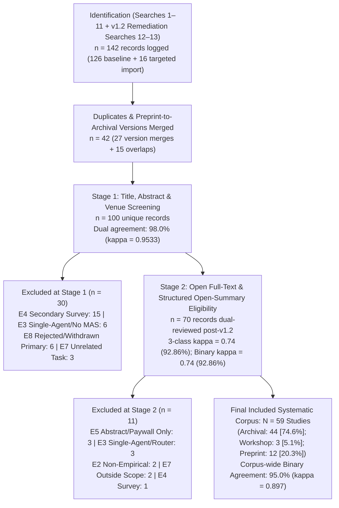
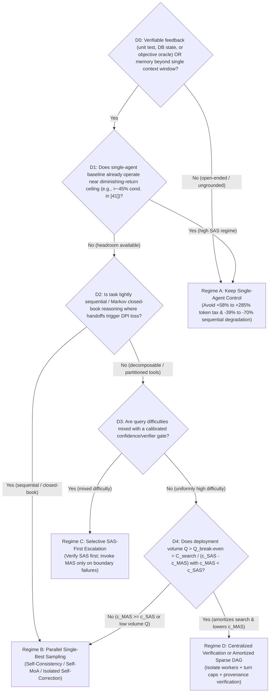

# When Do LLM Multi-Agent Systems Outperform Single Agents? A Systematic Review of Compute-Normalized Evidence, Coordination Topologies, Failure Mechanisms, and Evaluation Validity

**Author(s) & Affiliation(s):** `[Author Placeholder — Blinded for Peer Review / ACM CSUR Submission Template]`  
*Target Venue:* **ACM Computing Surveys (CSUR)** *(Primary Target; formatted cleanly for conversion to `acmart` `acmsmall`)*.  
*Portable Pre-Submission Disclosure Note (TMLR Backup Target):* Workstream orchestration, metadata verification, and deterministic tabular aggregation were assisted by tool-verified LLM research workflows with human-author responsibility for protocol approval, eligibility adjudication, and manuscript validation.

---

## Abstract

Large language model multi-agent systems are widely deployed for reasoning, coding, and tool use, yet prior surveys rarely verify equal-compute single-agent controls. This PRISMA review synthesizes 59 studies (2023 to 2026; 97 comparisons). Multi-agent systems win 77.4% of weak or unmatched comparisons, falling to 23.1% wins and 46.2% losses under compute parity (-54.3 pp; -47.5 pp archival; Fisher p = 0.0178). Negative returns reflect error amplification, conformity, handoff loss, unamortized training (16/17 optimizers), absent verifiable consistency reporting (0/35), and harness flaws, motivating an orthogonal design workflow.

---

## ACM CCS Concepts

- **Computing methodologies ~ Artificial intelligence ~ Distributed artificial intelligence ~ Multi-agent systems** (`Significance: 500`)
- **Computing methodologies ~ Natural language processing ~ Natural language generation** (`Significance: 300`)
- **General and reference ~ Surveys and overviews** (`Significance: 300`)
- **General and reference ~ Empirical studies** (`Significance: 100`)

## Keywords

Large language models, multi-agent systems, compute-normalized evaluation, test-time scaling, multi-agent debate, failure mechanisms, systematic literature review

---

## 1. Introduction

Large language model multi-agent systems (LLM-MAS) coordinate two or more interacting model instances through structured debate, role specialization, sequential workflows, or learned communication graphs. Early demonstrations popularized a straightforward assumption: splitting reasoning across multiple personas or agents consistently outperforms a single model. As frontier models gained stronger native reasoning, longer context windows, and reliable tool execution, however, controlled evaluations began challenging that consensus [41, 68, 65, 28, 7].

Existing surveys provide rich architectural maps of this rapid expansion, yet most treat benchmark gains at face value. Narrative and systematic overviews in *Artificial Intelligence Review* [4, 5, 15], *ACM Computing Surveys* [19, 22, 29, 32, 33, 102], *Journal of Artificial Intelligence Research* [57], *Transactions on Machine Learning Research* [27, 34, 38, 52, 80, 97, 101], *IJCAI* [30], *KDD* [51], *Findings of ACL/EMNLP* [88, 92], *IEEE TSE* [71], *Future Internet* [110], and recent preprint repositories [1, 6, 18, 39, 44, 46, 49, 53, 62, 67, 69, 73, 79, 85] categorize frameworks, orchestration protocols, memory systems, communication mechanisms, or security threats.

Closer to our central question, three 2026 surveys address overlapping pillars. Li et al. [46] formulate "The Collaboration Boundary", explicitly advocating matched single-agent baselines, multidimensional resource accounting, and lifecycle amortization conceptually. Motger et al. [53] review 141 multi-agent debate (MAD) papers, separating deliberation from parallel voting, while Wang et al. [71] and a distinct ACL ARR submission [1] synthesize failure attribution and `5Ws + HOW` diagnosis.

What remains missing across more than 42 secondary surveys audited during topic scoping is a **PRISMA-governed quantitative meta-audit** [42, 55] testing whether published LLM-MAS performance gains actually hold once single-agent baselines (SAS) match token, compute, tool, and prompt budgets. Rather than pooling incomparable accuracy scores across datasets, this review stratifies within-study paired comparisons across Tier 1–Tier 4 control parity and integrates topology economics, failure mechanisms, topological security, and harness reliability into a unified empirical synthesis.

### Table 1: Candid Positioning Against Competing Surveys & Venue Portfolios

| Competing Survey / Portfolio | Venue & Year | Primary Analytical Focus | Overlap & Honest Differentiation with This Review |
| :--- | :--- | :--- | :--- |
| **Li et al.** [46] | Preprints.org (Sept 2026) | Engineering efficiency taxonomy (**The Collaboration Boundary**, Topology/Runtime/Opt control points, matched baselines, lifecycle cost amortization) | **Conceptual predecessor:** Li et al. already formulate matched-baseline and lifecycle-amortization principles conceptually. Our review operationalizes those criteria via a PRISMA-governed quantitative meta-audit across 97 cleaned paired tuples, documenting exact -54.3 pp parity attenuation and 16/17 upfront amortization omissions. |
| **Motger et al.** [53] | arXiv (July 2026) | Systematic review of 141 multi-agent debate (MAD) studies; contrasts MAD against `Self-Consistency` & critiques dense-topology inertia | **Direct MAD overlap:** MAD supplies 4/9 Tier 1 studies here. We extend outside debate to sequential SOPs, centralized stars, learned DAGs, selective escalation, and `RQ4` harness/sandbox validity audits. |
| **Yue et al.** [92] | *Findings of EMNLP 2026* | Agentic Computation Graphs (`ACGs`): static vs. dynamic DAGs (`AFlow`, `GPTSwarm`, `G-Designer`) & graph-level cost metrics | Covers graph topology synthesis without systematic SAS compute-parity stratification (0 learned-DAG studies yet meet Tier 1 parity) or `C6` search amortization accounting. |
| **Wang et al.** [71] | *IEEE TSE* 52(11) (Nov 2026) | Trajectory failure attribution & monitoring across 55 LLM-MAS reliability papers | Exhaustively catalogs trace-attribution benchmarks (overlapping 7 `RQ3` attribution studies here). Our review links mechanistic failure classes as plausible drivers of negative compute-normalized returns alongside topological security amplification. |
| **Anonymous (`ACL ARR #2880`)** [1] | *ACL ARR 2026* (Separate from [71]) | `5Ws + HOW` framework mapping fault attribution to reliability enhancement | Separated distinctly from Wang et al. [71]; focuses purely on failure attribution without compute-normalized SAS accuracy controls. |
| **Mallampati & Nagoriya** [49] | Preprint (Oct 2026) | 62 papers on coordination reliability, termination predicates, and deadlock recovery | Complements `RQ3` termination/blocking findings (`CORBA`, deadlocks) without Tier 1–Tier 4 SAS win-rate stratification or `RQ4` benchmark confounders. |
| **Dantas et al.** [18] | Preprint (Aug 2026) | 38-study PRISMA review of specification, formal verification, and verifier tax in agents | Focuses on formal safety verification rather than paired accuracy/compute normalization or multi-agent vs. single-agent empirical scaling. |
| **Kim et al.** [40] & **Deng et al.** [19] | *USENIX Security '26* & *ACM CSUR* 57(7) (2025) | End-to-end threat landscapes, control-flow hijacking, memory poisoning, and agentic defense surfaces | Premier security SoKs; complement our Section 6.3 governance trade-off alongside new topological security comparisons (`Hagag et al.`, `NetSafe`, `G-Safeguard`, `CORBA`). |
| **Wei et al.** [80], **Huang et al.** [34], **Moslem & Kelleher** [52] | *TMLR* (2025–2026) | Agentic reasoning (incl. collective layer [80]), agent memory [34], and single-query dynamic model routing [52] | Broader capability/routing syntheses plus additional *TMLR* reviews [27], [101], [38], [97]; none performs paired compute-matched SAS win-rate meta-audits. |
| **Yehudai et al.** [88] & **Mohammadi et al.** [51] | *Findings of ACL '26* & *KDD '25* | General agent/enterprise evaluation taxonomies, benchmarks, and judge bias | Survey agentic metrics broadly (`PASS` vs. `pass^k`, LLM judges) without isolating `N >= 2` MAS vs. `N = 1` compute parity or `RQ1`–`RQ4` stratification. |
| **ACM CSUR Portfolio** [22], [29], [32], [33], [102] & **AIRE / JAIR / Future Internet / Classical** [4], [5], [15], [30], [57], [69], [110], [39], [43], [79], [6], [62], [67], [85], [73] | *ACM CSUR*, *AIRE*, *JAIR*, *IJCAI*, Preprints (2024–2026) | General MAS optimization, classical MARL, game/generalizability, orchestration (`AutoGen`/`LangGraph`), and classical-to-LLM swarm boundaries | Establish architectural vocabularies, framework evolution, and MARL/SI contrasts; leave a clear empirical gap for compute-normalized `MAS vs. SAS` win-rate and harness-validity meta-auditing. |

Overall, this manuscript makes four grounded contributions:
1. **Empirical Parity Audit (`RQ1`):** Quantifies a -54.3 pp tuple-level (-51.4 pp study-weighted; Fisher $p = 0.0178$) collapse in `MAS > SAS` win rates from weak/unmatched controls (`Tier 2+3`) to compute-matched Tier 1 parity across 97 cleaned comparisons (35 studies).
2. **Topology & Amortization Accounting (`RQ2`):** Separates parallel sampling ensembles from interactive topologies and exposes 16/17 unamortized search/training omissions (`C6`), alongside 0 Tier 1 studies among learned sparse DAG frameworks.
3. **Mechanistic Failure & Security Integration (`RQ3`):** Synthesizes within-study verified failure mechanisms (error amplification, 13/14 Dense Debate conformity, Markov `DPI` bottlenecks) alongside cross-corpus failure-attribution and topological security evidence (`CORBA`, `Hagag et al.`, `NetSafe`, `G-Safeguard`).
4. **Confounder Audit & Orthogonal Design Framework (`RQ4` & Section 6):** Audits `C1`–`C6`, `pass^k` (0/35 verifiable comparative), latency/USD gaps, and `E8` OpenReview rejections to construct a clean 3-axis architectural taxonomy (`Topo × Task × Ver`) separated from study-quality rigor (Tier 1–Tier 4).

---

## 2. Research Questions and Scope

To answer when LLM-MAS justify their operational overhead and remain defensible for an M.Tech or graduate research committee, this systematic review investigates four tightly bounded research questions:

- **RQ1 (Compute-Normalized Effectiveness):** When total inference tokens, API cost, prompting effort, and tool access are held equal against a strong single-agent baseline (SAS), how often do LLM-MAS achieve higher accuracy than SAS, and in which task regimes do wins or losses concentrate?
- **RQ2 (Coordination Topology & Cost Amortization):** How do coordination structures (voting ensembles, sequential pipelines, centralized stars, dense debate graphs, learned sparse DAGs, and selective cascades) trade off accuracy against inference overhead and upfront search or training costs?
- **RQ3 (Failure Mechanisms & Security Exposure):** Which verified mechanistic pathways—error amplification, conformity/sycophancy, handoff information loss, verification failure, or inter-agent attack propagation—explain LLM-MAS degradation and availability risks?
- **RQ4 (Evaluation Validity & Methodological Rigor):** To what extent do six recurring experimental confounders (`C1`–`C6`), absent `pass^k` reliability reporting, missing wall-clock latency/USD accounting, and benchmark harness artifacts distort published LLM-MAS claims?

We intentionally exclude reinforcement-learning-only multi-agent systems lacking natural-language LLM reasoning, pure biological swarm algorithms [35, 63], and unverified commercial whitepapers. Classical swarm intelligence and classical MAS are explicitly demarcated in Section 4.2.

---

## 3. Systematic Review Methodology

### 3.1 Protocol Governance & Seeded Open-Web Search (`v1.0`–`v1.2`)

This review follows the Preferred Reporting Items for Systematic Reviews and Meta-Analyses (PRISMA 2020) [55] and Kitchenham–Charters software-engineering review guidelines [42] under a versioned protocol (`v1.0` initial freeze; `v1.1` Phase 5 reconciliation; `v1.2` post-peer-review remediation). Because proprietary bulk exports from Scopus and Web of Science were unavailable in our environment, we frame this study transparently as a **PRISMA-governed, open-web query- and snowball-seeded systematic review** spanning *arXiv*, *OpenReview*, *ACL Anthology*, *PMLR*, *ACM Digital Library*, *Springer*, *Nature*, and semantic citation links through November 20, 2026.

To uphold strict audit candor, Protocol Amendment v1.2 documents two search adjustments: (a) Phase 5 baseline Searches 2, 5, and 9 specialized baseline Boolean templates with named architectures or benchmarks (Mixture-of-Agents, Self-MoA, ColMAD, CONSENSAGENT, CORBA, SwarmBench, SCALE); and (b) post-review remediation Searches 12–13 systematically imported 16 verified primary anchor and multi-agent security studies [45, 28, 13, 25, 7, 107, 91, 48, 78, 11, 99, 90, 60, 31, 89, 75] that earlier snippet searches missed. Searches 1–11 logged 126 candidate hits (105 query + 21 snowball) with 42 duplicates collapsed (84 unique), and Searches 12–13 added 16 unique candidates (142 raw total, 42 duplicates, **100 unique records screened**).

### 3.2 Dual-Pass Screening Workflow & Author Accountability

All screening, quality scoring, and data extraction operated under an explicit human-accountable editorial protocol: automated dual-pass LLM research workers generated independent blinded candidate votes and structured schema records, while **the human authors verified, adjudicated every conflict, inspected source tables, and assume full scholarly accountability** for every inclusion verdict and extracted datum. Across all 100 unique records, independent dual-pass Stage 1 screening achieved 98.0% agreement (Cohen's $\kappa = 0.9533$; Wave 1 baseline 97.62%, $\kappa = 0.9489$).

During Phase 9 methodology auditing, two Wave 1 Stage 1 disagreements (Dai [17] and SCALE [106]) were identified as having lacked a completed first-reviewer Stage 2 pass prior to arbitration (yielding `48/52 = 92.31%`, $\kappa = 0.7699$ mutual vs. `48/54 = 88.89%`, $\kappa = 0.6873$ union on Wave 1). Under Amendment v1.2, independent first-reviewer Stage 2 review was completed across all 70 advancing candidates, yielding 92.86% ($\kappa = 0.74$) Stage 2 agreement and **95.0% ($\kappa = 0.897$)** corpus-wide inclusion agreement.

### 3.3 PRISMA Flow, Publication Status, & Eligibility Boundaries

*Figure 1: PRISMA 2020 systematic selection flow across initial searches (Searches 1–11) and Protocol `v1.2` remediation imports (Searches 12–13). Note: Stage 2 is framed explicitly as Open Full-Text & Structured Open-Summary Eligibility (407 direct scalar fields across 58/59 records retain summary bounds `NV` where non-OA publisher PDFs or supplementary tables were inaccessible).*

#### Table 2: Included Corpus Distribution by Publication Status & Research Track (`N = 59`)

| Stratification Axis | Subgroup | Included Studies ($n$) | Corpus Share (%) | Primary Analytical Role & Sensitivity Policy |
| :--- | :--- | :---: | :---: | :--- |
| **Publication Status** | **Archival** (`Peer-reviewed journal` + `Conference`) | 44 (4 J + 40 C) | 74.6% | Primary confirmatory anchor across `RQ1`–`RQ4` Archival-Only sensitivity checks. |
| **Publication Status** | **Workshop** (Peer-reviewed workshop) | 3 | 5.1% | Retained for `RQ3`–`RQ4` diagnostic audits ([17], [24], [64]); excluded from High-Confidence Consensus ([17] twice TMLR-rejected). |
| **Publication Status** | **Preprint** (`arXiv` / `Preprints.org`, gate-verified) | 12 | 20.3% | Admitted only after passing `>= 6/14` (12) quality bar & `QA7 >= 1`; isolated in Archival-Only sensitivity tests. |
| **Research Track** | **Primary Comparative Effectiveness & Topology (`RQ1`/`RQ2`)** | 35 | 59.3% | `Tier 1–3` (35 tuple-bearing comparative studies, 97 cleaned tuples; note `PARTNR` [66] holds Tier 4, 0 SAS accuracy tuples under `RQ3` below, giving 36 comparative-tier studies overall). |
| **Research Track** | **Mechanistic Failure & Conformity Analysis (`RQ3`)** | 15 | 25.4% | Trajectory attribution (`MAST`, `Who&When`, `VerifyMAS`), debate failure modes, and topological security diagnostics (`CORBA`, `NetSafe`, `G-Safeguard`). |
| **Research Track** | **Evaluation Validity & Harness Reliability (`RQ4`)** | 9 | 15.3% | Harness exploits, `pass^k`, `VTFR`, judge bias, and OpenReview rejection/withdrawal audits (`E8`-segregated cases). |

Protocol rules enforce clear eligibility boundaries (`I1`–`I6` / `E1`–`E8`). Eligible studies publish English empirical evaluations from 2023 to November 2026 covering either (`I2a`) paired comparisons of an $N \ge 2$ LLM-MAS (or explicitly scoped voting ensemble [45]) against an $N = 1$ SAS, (`I2b`) verified inter-agent mechanistic or topological security audits [14, 37, 108, 60, 89, 75], or (`I2c`) single-agent/agentic evaluation-validity and harness audits [36, 87, 61, 50, 77, 111, 70, 24, 64]. Under this `I2(c)` carve-out, harness audits that invalidate MAS/agent leaderboards enter `RQ4`, whereas standalone single-agent failure taxonomies (`AgentDebug` [109]) and single-LLM black-box routers lacking persistent inter-agent state or cascading (`Router-R1` [99]) are excluded under `E3`. Similarly, `SCALE` [106] qualifies under `I2(a)` at archival `ACL 2025` (collaborative role pipeline vs. $N = 1$ coding baseline) while its withdrawn `ICLR 2025 #6097` precursor [105] and rejected `TMLR 9844/11271` manuscripts [16, 3, 2] are isolated in Section 5.4 under `E8`. Preprints (`n = 12`) must pass a mandatory quality gate (`total >= 6` and `QA7 >= 1`) and OpenReview status verification.

#### Table 3: Screening Exclusion Categories & Key Boundary Decisions (`n = 41` Excluded)

| Screening Code & Description | PRISMA Excluded (`n`) | Representative Citations & Boundary Distinctions |
| :--- | :---: | :--- |
| **`E3` — Single-Agent / Non-Collaborative / No SAS Comparator** | 9 (6 S1 + 3 S2) | Single-agent pipeline scaffolds such as `Agentless` [82] and `AgentDebug` [109] (excluded outside `I2(c)` validity audits), plus single-policy tool routers such as `Router-R1` [99] calling stateless models without inter-agent state or `SAS -> MAS` cascading. |
| **`E4` — Secondary Surveys & Narrative Reviews** | 16 (15 S1 + 1 S2) | Screened secondary surveys excluded from the primary synthesis count [53, 67, 71, 88, 92, 85, 46, 52, 29, 32, 22, 73, 27, 101, 44, 103], including single-query routing survey Moslem & Kelleher [52]; retained solely for Table 1 overlap positioning alongside additional background CSUR/TMLR/AIRE reviews. |
| **`E5` / `E2` / `E7` — Non-Empirical, Paywall-Only, or Classical Swarm** | 10 (3 E5, 2 E2, 5 E7) | Paywalled/abstract-only hits (`E5`), non-empirical position pieces (`E2`, separated from empirical swarm benchmarks like `SwarmBench` [63] and biological/model swarms [26, 35]), and out-of-scope tasks (`E7`). |
| **`E8` — Publicly Rejected / Withdrawn Versions** | 6 S1 | Audited strictly inside Section 5.4 OpenReview longitudinal checks (`TMLR 7332` *AgenticNet* [3], `TMLR 7253` *Inducing Disagreement* [2], rejected `TMLR 9844/11271` [16] superseded separately by workshop [17], withdrawn `ICLR 2025 #6097` [105] superseded by archival `ACL 2025` [106], plus rejected/withdrawn sycophancy variants [86]). |

### 3.4 Early Methodological Anchors: Confounders (`C1`–`C6`) & Quality Rubric (`QA1`–`QA7`)

To ensure every metric, confounder flag, and appraisal table in Sections 5 and 6 is transparent to first-time readers, Table 4 defines our six confounder classes (`C1`–`C6`) and seven 0–2 quality-appraisal criteria (`QA1`–`QA7`, max 14 for comparative studies; max 12 for non-comparative `RQ3`/`RQ4` diagnostic audits with `QA1 = N/A`). To detect any denominator inflation between 12-point and 14-point tracks, Section 5.4 also reports normalized 12-point (`QA2`–`QA7`) scores across every stratum.

#### Table 4: Six-Class Confounder Taxonomy (`C1`–`C6`) & Quality Appraisal Anchors (`QA1`–`QA7`)

| Analytical Code | Category / Dimension | Operational Definition & Scoring Anchor (0 / 1 / 2 for `QA1`–`QA7`) |
| :--- | :--- | :--- |
| **`C1`** | Inference Compute Asymmetry | MAS uses unmatched tokens, turns, or API calls (often `2.1x–16.85x`) without equal-token `Self-Consistency` (`SC`) or `Best-of-N` single-agent parity. |
| **`C2`** | Hidden Reasoning Token Leak | Wrapper token matching ignores internal reasoning traces (`thoughts_token_count` or extended test-time thinking budgets). |
| **`C3`** | Process Proxy / Voting Conflation | Parallel independent voting or stochastic sampling labeled as interactive multi-agent deliberation or social persuasion. |
| **`C4`** | Prompt or Tool Asymmetry | Specialized role prompts, execution feedback, or external sandboxes supplied to MAS while withheld from the `N = 1` baseline. |
| **`C5`** | Harness Fragility & Leakage | Unhardened static exact-match leaderboards, sparse unit tests, permissive graders, or missing leakage checks inflating tiny margins. |
| **`C6`** | Unamortized Search / Training Cost | Upfront MCTS, RL, evolution, GNN, or validation search costs omitted from per-query test-time efficiency comparisons. |
| **`QA1`** | SAS Baseline Control Parity | 2 = Strictly compute/token-matched strong SAS (Tier 1); 1 = Strong unmatched or single-pass SAS (Tier 2–Tier 3); 0 = No SAS (Tier 4); `N/A` = Diagnostic (12-pt max). |
| **`QA2`** | Cost & Latency Accounting | 2 = Quantifies inference tokens/USD AND direct wall-clock latency (or runtime reduction); 1 = Tokens/USD or turns without seconds; 0 = Omitted. |
| **`QA3`** | Optimization Amortization | 2 = Training-free OR explicitly prices upfront search/RL cost; 1 = Learned/optimized framework omitting upfront search cost (`C6`); 0 = Concealed. |
| **`QA4`** | Multi-Run Stochastic Stats | 2 = `k >= 3` seeds with SD/95% CIs/`pass^k`; 1 = Multi-sample sweeps or significance tests without full per-cell CIs; 0 = Single-run point scores. |
| **`QA5`** | Harness & Leakage Integrity | 2 = Hardened/verified DB/sandbox checks or adversarial noise controls; 1 = Standard reproducible suite; 0 = Unverified/leaky proxy. |
| **`QA6`** | Reproducibility Artifacts | 2 = Public code repository + full prompts/configs; 1 = Prompts/pseudocode in paper without live repo; 0 = Closed artifacts. |
| **`QA7`** | Claims–Evidence Parity | 2 = Headline claims match tables & failure conditions; 1 = Selective positive framing overlooking constraints/amortization; 0 = Contradictory. |

---

## 4. Conceptual Foundations and Classical Boundaries

### 4.1 Metrics, Information Bounds, and Amortization Economics

Reviewing LLM-MAS claims rigorously requires four formal definitions before examining study tables:

1. **Pass-at-$k$ vs. Multi-Trial Consistency (`pass^k`):** Standard `pass@k` checks whether *at least one* of $k$ independent attempts succeeds, rewarding noisy exploration. By contrast, Yao et al. [87] define **multi-trial consistency (`pass^k`)**—the probability that a system succeeds across *all* $k$ independent trials under an unbiased hypergeometric estimator:
   $$\text{pass}^k = \mathbb{E}_{\text{task}} \left[ \frac{\binom{c}{k}}{\binom{n}{k}} \right]$$
   where $n$ trials yield $c$ successes per task. Because $f(p) = p^k$ is convex for $k \ge 1$, **Jensen's inequality** implies $\frac{1}{M}\sum_i p_i^k \ge \left(\frac{1}{M}\sum_i p_i\right)^k$: averaging benchmark accuracies before raising to power $k$ systematically underestimates reliability dispersion whenever some tasks pass deterministically and others fail frequently. Concretely, for a single task with per-trial success probability $\hat{p} = 0.6$ over $k = 8$ runs, `pass@8` reaches $1 - (1 - 0.6)^8 = 99.9\%$, whereas `pass^8` collapses to $0.6^8 = 1.7\%$—an operational reliability failure invisible to single-run averages.

2. **Data Processing Inequality (`DPI`) & Markov Relay Limits:** When agents sequentially relay fixed internal knowledge across natural-language handoffs without accessing external ground truth, they form a **Markov chain** $Y \leftrightarrow Z_{\text{SAS}} \leftrightarrow M_{\text{handoff}} \leftrightarrow \hat{Z}_{\text{MAS}}$ over true answer $Y$. Under this Markov assumption, the Data Processing Inequality enforces $I(Y; \hat{Z}_{\text{MAS}}) \le I(Y; Z_{\text{SAS}})$: compressing reasoning traces into textual messages cannot create new mutual information and instead incurs handoff distortion [68]. Crucially, the Markov hypothesis **breaks**—permitting positive MAS gains—when distributed agents ingest *partitioned external observations* (non-overlapping documents or tools [41, 91]) or sample genuinely diverse pretraining priors (`Heter-MAD` [98, 81]).

3. **Verifier Transport Failure Rate (`VTFR`):** Conditioned strictly on tasks where the underlying LLM's *native judgment is initially correct ($C_0$)*, Sheshanarayana & Goli [64] define `VTFR` as the fraction of those correct $C_0$ answers that fail verification, flip, or abstain after multi-agent delegation or context compaction—distinguishing transport degradation from underlying capability deficits.

4. **Amortized Break-Even Deployment Volume ($Q_{\text{break-even}}$):** Automated graph search, MCTS, and RL workflow optimizers incur a fixed upfront optimization cost $C_{\text{search}}$ (`hours`, tokens, or USD) prior to deployment. Treating single-query inference cost at equal accuracy as $c_{\text{SAS}}$ vs. $c_{\text{MAS}}$, the break-even query volume is:
   $$Q_{\text{break-even}} = \frac{C_{\text{search}}}{c_{\text{SAS}} - c_{\text{MAS}}} \quad (\text{valid iff } c_{\text{MAS}} < c_{\text{SAS}})$$
   Notice this one-line bound explains why adaptive MAS designs whose *per-query* inference cost remains equal to or higher than a strong SAS ($c_{\text{MAS}} \ge c_{\text{SAS}}$) possess **infinite break-even volume**—their upfront search expense can never be amortized.

### 4.2 Demarcating Classical Swarm Intelligence, Classical MAS, and LLM-MAS

Readers from classical AI or engineering frequently conflate modern LLM-MAS with Swarm Intelligence (SI) or Belief–Desire–Intention (BDI) / Foundation for Intelligent Physical Agents (FIPA) Multi-Agent Systems. Following La Malfa et al. [43], Wang et al. [79], Bădică et al. [6], and Rahman et al. [62], Table 5 establishes three clean structural boundaries (LLM-MAS also differs sharply from biological `SwarmBench` grid coordination [63] and cross-checkpoint `Model Swarms` weight optimization [26]).

#### Table 5: Conceptual Boundaries Across Classical Swarm Intelligence, Classical MAS, and Modern LLM-MAS

| Architectural Property | Classical Swarm Intelligence (Ant Colony Optimization [ACO], Particle Swarm Optimization [PSO], Boids) [62, 35] | Classical MAS (BDI, FIPA, Cooperative MARL / Value Factorization [QMIX], Proximal Policy Optimization [PPO]) [29, 79] | Modern Autonomous LLM-MAS (`AutoGen`, MAD, `AFlow`, `GPTSwarm`) [6, 43] |
| :--- | :--- | :--- | :--- |
| **Agent State & Memory** | Lightweight local state vector & stigmergic markers | Symbolic beliefs/goals (`BDI`) or neural hidden vectors (RL) | High-dimensional context windows + retrieval memory |
| **Communication Channel** | Local pheromones or spatial neighbor attraction | Formal speech acts (`FIPA ACL`) or continuous policy embeddings | Unconstrained or schema-typed natural language |
| **Scalability Regime** | $10^2$–$10^6$ simple agents with $O(1)$ per-step cost | $2$–$100$ structured agents in deterministic/game environments | $2$–$15$ heavy LLM agents with quadratic token growth |
| **Failure Mode Under Scale** | Premature swarm stagnation or parameter oscillation | Non-stationarity, sparse rewards, credit-assignment variance | Sycophantic conformity, `DPI` summary loss, prompt injection |

---

## 5. Empirical Synthesis (`RQ1`–`RQ4`)

### 5.1 Compute-Normalized Effectiveness & Conditional Regimes (`RQ1`)

Across 35 tuple-bearing comparative studies (97 cleaned paired comparisons after removing 7 invalid/nested comparisons documented in Appendix G.2, plus `PARTNR` [66] at Tier 4 with 0 SAS accuracy tuples), empirical outcomes exhibit a sharp **monotonic gradient** controlled by single-agent baseline strength (`Tier 3 -> Tier 2 -> Tier 1`).

#### Table 6: Stratified `RQ1` Effectiveness & Study-Level Clustered Sensitivity Analysis (97 Cleaned Tuples Across 35 Studies)

| Analytic Stratum | Cohort / Sensitivity Slice | Studies ($n$) | Cleaned Tuples ($k$) | MAS > SAS Wins (%) | MAS ≈ SAS Ties (%) | MAS < SAS Losses (%) | Mixed Outcomes (%) | Study-Level Frac. Win (%) | Study Majority Win ($>50\%$) [95% CI] |
| :--- | :--- | :---: | :---: | :---: | :---: | :---: | :---: | :---: | :---: |
| **Tier 1** | **Full Corpus** (Compute/Token-Matched Strong SAS) | 9 | 13 | 3/13 (23.1%) | 2 (15.4%) | 6 (46.2%) | 2 (15.4%) | 13.0% | 1/9 (11.1%) [2.0–43.5%] |
| **Tier 2** | **Full Corpus** (Strong SAS, Unmatched Compute / Unamortized) | 19 | 59 | 42/59 (71.2%) | 3 (5.1%) | 9 (15.3%) | 5 (8.5%) | 57.9% | 10/19 (52.6%) [31.7–72.7%] |
| **Tier 3** | **Full Corpus** (Weak Single-Pass / Zero-Shot SAS Only) | 7 | 25 | 23/25 (92.0%) | 0 (0.0%) | 0 (0.0%) | 2 (8.0%) | 82.1% | 6/7 (85.7%) [48.7–97.4%] |
| **Tier 2+3** | **Full Corpus** (All Non-Parity Controls Combined) | 26 | 84 | 65/84 (77.4%) | 3 (3.6%) | 9 (10.7%) | 7 (8.3%) | 64.4% | 16/26 (61.5%) [42.5–77.6%] |
| **Parity Delta** | **`Tier 2+3 -> Tier 1` Attenuation (Full Corpus)** | — | 97 | **-54.3 pp** | — | +35.5 pp | — | **-51.4 pp** | **-50.4 pp** (Fisher $p=0.0178$; vs. Tier 3 $p=0.0087$) |
| **Tier 1 (Arch.)** | **Archival-Only Sensitivity** (Journal + Conference) | 6 | 10 | 3/10 (30.0%) | 1 (10.0%) | 5 (50.0%) | 1 (10.0%) | 19.4% | 1/6 (16.7%) [3.0–56.4%] |
| **Tier 2+3 (Arch.)** | **Archival-Only Sensitivity** (Journal + Conference) | 21 | 71 | 55/71 (77.5%) | 3 (4.2%) | 8 (11.3%) | 5 (7.0%) | 67.1% | 13/21 (61.9%) [40.9–79.2%] |
| **Archival Delta** | **`Tier 2+3 -> Tier 1` Attenuation (Archival Only)** | 27 | 81 | **-47.5 pp** | — | — | — | **-47.7 pp** | **-45.2 pp** (Fisher $p=0.0768$; vs. Tier 3 $p=0.0291$) |

When MAS are tested only against weak single-pass baselines (Tier 3 [72, 94, 95, 56, 106, 45, 78]), they win 23/25 (92.0%) comparisons (82.1% study-weighted). Introducing strong iterative or voting SAS controls without matched compute (Tier 2 [74, 81, 23, 59, 112, 100, 93, 9, 58, 28, 13, 25, 7, 107, 91, 48, 11, 90, 31]) reduces MAS wins to 42/59 (71.2%; 57.9% study-weighted). Under strict **compute- and token-matched parity (Tier 1)** [41, 68, 84, 54, 65, 98, 20, 47, 12], MAS win rates drop to **3/13 (23.1%)** while outright losses climb to **6/13 (46.2%)**.

Crucially, this attenuation is not an artifact of multiple tuples per paper or unvetted preprints. Under **fractional study weighting** (each paper summing to 1.0), Tier 1 average win rate falls to **13.0%** (1/9 = 11.1% majority-win studies; 0/9 unanimous) versus **64.4%** in `Tier 2+3` (-51.4 pp; two-sided Fisher's exact **$p = 0.0178$** vs. `Tier 2+3`, **$p = 0.0087$** vs. Tier 3). Restricting strictly to **Archival** (`Journal + Conference`) studies yields 30.0% (19.4% study-weighted) vs. 77.5% (-47.5 pp). Moreover, interactive MAD contributes 4/9 Tier 1 studies (5 tuples) alongside 5/9 non-debate ensemble/multi-topology works (8 tuples), showing parity loss persists beyond simple peer debate.

#### Table 7: Flagship Tier 1 Compute/Token-Matched Corpus (9 Studies, 13 Cleaned Tuples)

| Study | Status | Benchmark & Backbone | Pair (MAS vs. SAS) | Paired Delta (`pp` or `% rel.` as labeled) | Compute / Overhead Ratio | Verdict |
| :--- | :---: | :--- | :--- | :--- | :--- | :---: |
| Kim et al. (2026) [41] | Archival | Finance-Agent across tested OpenAI/Anthropic/Google models | Centralized MAS vs. Compute-matched SAS | Up to +80.8% / +80.9% relative improvement | Normalized; overhead +58% (Independent) to +285% (Centralized/Hybrid) | **MAS > SAS** |
| Kim et al. (2026) [41] | Archival | BrowseComp-Plus across tested frontier models | Decentralized / Structured MAS vs. Compute-matched SAS | +9.2% relative improvement | Controlled/normalized token budget | **MAS > SAS** |
| Kim et al. (2026) [41] | Archival | PlanCraft across all tested MAS topologies | Independent / Centralized / Decentralized / Hybrid MAS vs. Compute-matched SAS | -39% to -70% relative degradation | Controlled/normalized token budget | **MAS < SAS** |
| Tran & Kiela (2026) [68] | Preprint | 336-config matrix across Qwen3-30B-A3B, DeepSeek-R1-Distill-Llama-70B, Gemini 2.5 Flash/Pro (100-10,000 thinking tokens; FRAMES & MuSiQue representative slices: 1k tok 0.379 MAS vs 0.418 SAS; 5k tok 0.386 MAS vs 0.427 SAS) | Sequential / Subtask-parallel / Parallel-roles / Debate / Ensemble MAS vs. Equal-thinking-token SAS | SAS >= MAS across all budgets above 100-token floor; MAS wins only under degraded context rot | 1.0 | **Mixed across budgets/subtasks** |
| Xu et al. (2026) [84] | Preprint | 7 benchmarks (GSM8K, MATH, HumanEval, MBPP, HotpotQA, DROP, TravelPlanner) with GPT-4o-mini & Claude 3.5 Haiku | Homogeneous AFlow Multi-Agent workflow vs. Single-Agent multi-turn AFlow simulation / OneFlow | Within <1% / overlapping error bounds on homogeneous tasks; SAS cuts USD cost & latency via KV-cache reuse | not verifiable from accessible open summary | **MAS ≈ SAS** |
| Nguyen et al. (2026) [54] | Preprint | GSM8K, MATH500, MMLU-Pro, CSQA across 980 window x group-size settings | Multi-Agent Debate (reading peer outputs) vs. Self-Consistency (single-agent parallel sampling, zero peer reading tax) | SAS >= MAD in 93% of 980 settings; gap largest under tight token windows and narrows at loose windows | 1.0 | **MAS < SAS** |
| Smit et al. (2024) [65] | Archival | MedQA, PubMedQA, MMLU, CosmosQA, CIAR, GPQA, Chess (GPT-3.5-turbo & GPT-4) | Default/out-of-the-box MAD vs. Agreement-Modulated MAD vs. Compute-matched Self-Consistency & Medprompt | Default MAD fails to reliably outperform SC/Medprompt while incurring higher token/USD/time cost; tuned agreement modulation narrows or reverses gap on specific splits | Pareto frontier sweeps across matched USD/token budgets (Figs 1-13) | **Mixed across budgets/subtasks** |
| Zhang et al. (2025) [98] | Archival | 9 benchmarks x 4 models (36 scenarios) | 5 homogeneous MAD frameworks vs. Single-Agent CoT & compute-matched Self-Consistency | Homogeneous MAD fails to beat CoT/SC in >80% of scenarios despite higher token/call cost | Matched vs. SC; >1x vs. single CoT | **MAS < SAS** |
| Denisov-Blanch et al. (2026) [20] | Archival | TruthfulQA, SimpleQA, FreshQA, HaluEval across multi-LLM ensembles vs. single-sample baselines | Crowd-wisdom polling / confidence-weighted ensemble (up to 25x inference cost) vs. Single-sample baseline (1x) / Single-model sampling | 0 consistent gain; polling frequently amplifies shared misconceptions | Up to 25.0 | **MAS ≈ SAS** |
| Li et al. (2026) [47] | Archival | AlpacaEval 2.0 (matched proposer sample budget) | Mixed-MoA (heterogeneous LLM mixture) vs. Self-MoA (single best LLM repeated sampling + synthesis) | -6.6 pp (-10.0% relative; Mixed-MoA 59.1% vs. Self-MoA 65.7%) | 1.0 | **MAS < SAS** |
| Li et al. (2026) [47] | Archival | MMLU, CRUX, MATH average (matched sample budget) | Mixed-MoA (heterogeneous) vs. Self-MoA (single best LLM) | -3.8% average (Mixed-MoA trails single-LLM Self-MoA) | 1.0 | **MAS < SAS** |
| Chen et al. (2026) [12] | Archival | Error detection & reasoning tasks (matched compute) | CopMAD (Competitive MAD) vs. Single-Agent (SA) baseline | -15% to -19% degradation due to competitive cheap-talk hacking | 1.0 | **MAS < SAS** |
| Chen et al. (2026) [12] | Archival | Error detection & reasoning tasks (equal token/compute budgets) | ColMAD (Collaborative Non-Zero-Sum MAD) vs. Compute-matched Single-Agent (SA) & CopMAD/CosMAD | Up to +10 pp over prior MAD protocols; outperforms compute-matched SA | 1.0 | **MAS > SAS** |

*Note: NV = not verifiable from accessible open summary; NR = not reported; pp = percentage points; % rel. = relative percentage change.*

Within Tier 1, positive MAS returns are sharply **task-conditional**. Kim et al. [41] show centralized orchestration yields up to +80.8% relative gain on parallelizable `Finance-Agent` and +9.2% relative on `BrowseComp-Plus`, yet degrades sequential planning on `PlanCraft` by -39% to -70% relative (with MAS gains diminishing once SAS baseline accuracy exceeds `~45%`). Similarly, Collaborative Non-Zero-Sum Multi-Agent Debate (`ColMAD` [12]) improves error detection by up to +10 pp over prior MAD and beats matched single agents (`SA`). Conversely, equal thinking budgets (`Tran & Kiela` [68], 0.379 vs 0.418), shared context windows (`Nguyen et al.` [54], `SAS >= MAD` in 93% of 980 settings), and single-LLM KV-cache reuse (`OneFlow` [84]) consistently reverse naive MAS advantages. Notably, newly imported archival studies reinforce this ceiling: Choi et al. [13] prove multi-round MAD reduces statistically to a martingale around `T = 0` `Majority Voting` (0.8867 vs 0.9400 on GSM8K), and Bertalanič & Fortuna [7] report `Isolated Self-Correction` outperforms `N = 10` unguided homogeneous debate (48.3% vs 20.7% on Ministral-3-8B) while costing `2.1x–3.4x` fewer tokens.

### 5.2 Coordination Topologies, Cost Overhead & Upfront Amortization (`RQ2`)

To avoid encyclopedic study-by-study catalogs in the main body, Table 8 aggregates all six structural topologies (including sequential Standard Operating Procedures [SOPs]) across our 59-study corpus (complete per-study architecture and overhead rows appear in **Appendix G.3**).

#### Table 8: Compact Orthogonal Topology-Class Synthesis Across the 59-Study Corpus (`RQ2`)

| Orthogonal Topology Class | Studies ($n$) | Representative Citations (`Multiple Topologies` noted separately) | Compute & Scalability Profile | Net Empirical Finding Under Parity Controls |
| :--- | :---: | :--- | :--- | :--- |
| **Topo-1: Independent / Voting Ensemble** | 4 | [20], [47], [72], [45] | Parallel inference-time candidate generation (`Agent Forest`, `Self-MoA`) or mixed-model `MoA` without stateful multi-turn dialogue. | Consistent gains over weak single-pass baselines; **homogeneous `Self-MoA` beats mixed-model `Mixed-MoA` by +6.6 pp (+10.0% rel.)** under equal sampling budgets. Exposes `C3` voting-vs-deliberation conflation. |
| **Topo-2: Sequential Chain / SOP** | 0 | Evaluated inside Multi-Topology suites ([41], [68], [91]) | Fixed pipeline stages (`Plan -> Act -> Review` / `ChatDev` / `MetaGPT`), often carrying legacy MARL/SOP framing. | Sequential pipelines degrade -39% to -70% rel. under stateful `PlanCraft` coupling (contrasting Centralized Star +80.8% rel. on `Finance-Agent`); heavy sequential turn multiplication and strict vulnerability to `DPI` relay bottlenecks in closed-book reasoning. |
| **Topo-3: Centralized Star / Orchestrator-Worker** | 0 | Evaluated inside Multi-Topology suites ([41], [68], [91]) | Single orchestrator delegates sub-queries to isolated workers and synthesizes final answers. | Wins only on partitioned context-overflowing tasks (`Finance-Agent +80.8% rel.`, +285% token overhead); limits error amplification to `4.4x` vs. `17.2x` in Independent pipelines. |
| **Topo-4: Dense All-to-All Debate (MAD)** | 14 | [54], [65], [98], [81], [12], [23], [14], [56], [37], [58], [17], [106], [25], [7] | Symmetric multi-round peer critique (`T >= 2`, `N = 2..10`) across complete or near-complete graphs. | Worst cost-accuracy ratio under parity (13/14 [92.9%] exhibit conformity/sycophancy collapse, up to 85.5% modal adoption, -27.6 pp vs. Isolated Self-Correction in CAIS '26); gains largely vanish against matched `Majority Voting`. |
| **Topo-5: Adaptive Sparse / Learned DAG** | 10 | [112], [94], [95], [100], [93], [91], [48], [78], [90], [75] | Graph pruning, MCTS/RL workflow discovery, evolutionary search, or dynamic semantic edges (`GPTSwarm`, `AFlow`, `DyLAN`, `AgentDropout`, `SAIGE`, `G-Safeguard`). | 0 studies yet pass strict Tier 1 parity due to omitted Stage-1 / MCTS / RL / evolutionary upfront search costs (`C6`, e.g., `<12h 8xA100` in `Optima`, `2.1–2.8h` in `G-Designer/DyLAN`). |
| **Topo-6: Hybrid / Selective Escalation + Multi-Topology** | 14 | Hybrid: [9], [28]; Multi-Topo: [41], [68], [84], [74], [59], [108], [66], [13], [107], [11], [31], [89] | Route-or-cascade (SAS first, escalate MAS only on low confidence/verification failure) plus multi-topology factorial sweeps. | Leading practical Pareto regime (`CascadeDebate`, `Gao et al.`, `Kim et al.`, `Tran & Kiela`, `Hagag et al.`, `NetSafe`); captures MAS benefits selectively while curbing -39% to -70% sequential penalties and `2.1x–3.4x` blanket debate overhead. |

*Note: NV = not verifiable from accessible open summary; NR = not reported; pp = percentage points; % rel. = relative percentage change.*

Three structural findings stand out under `RQ2`. First, **homogeneous multi-sample voting beats naive heterogeneous mixing**: Wang et al. [72] popularize multi-LLM `MoA` against single-pass `GPT-4o` (Tier 3), whereas equal-budget control in `Self-MoA` [47] proves repeating the strongest model outperforms mixing diverse weaker proposers (65.7% vs 59.1% LC win rate on AlpacaEval 2.0, -6.6 pp / -10.0% relative loss when mixing; `Agent Forest` [45] likewise isolates raw parallel voting scaling).

Second, **upfront optimization cost (`C6`) dominates learned-graph benchmarks**: across all 16 studies scoring `QA3 = 1`, 16/16 (100%; 16/17 optimization-bearing works alongside explicit optimizer cost audit `Kapoor et al.` [36]) omit upfront discovery/training budgets from test-time efficiency comparisons. Concrete omitted overheads include `<12 hours on 8x A100 GPUs` in `Optima` [11], `2.1h–2.8h` graph training in `DyLAN` / `GPTSwarm` / `G-Designer` [112, 95, 48], MCTS search rollouts in `AFlow` [100], policy-gradient routing in `MasRouter` [93], and evolutionary iterations in `EvoAgent` [90]. When `Optima` [11] matches inference tokens against `SC(n=8)`, `OPTIMA` beats `SC(n=8)` cleanly while unoptimized MAD loses (-5.4 pp HotpotQA, -7.8 pp GSM8K, -5.9 pp MATH)—leaving its amortization dependent on deployment volume $Q$.

Third, **selective escalation captures asymmetric value** [20, 9, 28, 107, 91]: Gao et al. [28] cut cost up to 20% via `SAS -> MAS` request cascading; `CascadeDebate` [9] triggers debate only on low-confidence items (75.22% vs 52.70% MedQA); and `SAIGE` [91] confirms unified `Single-Agent` beats four learned MAS topologies on coupled `Terminal-Bench 2.1` (76.71), while sparse-dependency `AgentIF-OneDay` favors `SAIGE` (71.80% vs 53.57%).

### 5.3 Mechanistic Failure Pathways & Topological Security (`RQ3`)

We explicitly separate **within-study verified mechanisms** [41, 68, 54, 12, 13, 7] from **cross-corpus mechanistic plausibility**: trajectory-attribution and attack benchmarks (`MAST`, `Who&When`, `VTFR`, `CORBA`, `NetSafe`, `G-Safeguard`) mostly evaluate agent traces without matched SAS accuracy baselines, so they identify plausible operational failure pathways rather than proven causal mediators of Tier 1 outcomes. Table 9 summarizes all six pathways (see **Appendix G.4** for full 59-study entries).

#### Table 9: Compact Mechanistic Failure-Pathway & Mitigation Summary (`N = 59` Studies, `RQ3`)

| Mechanistic Pathway | Studies ($n$) | Representative Studies (59-Study Corpus) | Quantified Failure Signature & Verified Mitigation Evidence |
| :--- | :---: | :--- | :--- |
| **Error Amplification & Hallucination Cascades** | 34 | [41], [54], [65], [74], [98], [81], [20], [47], [72], [23], [112], [94], [95], [8], [104], [96], [83], [10], [76], [21], [56], [37], [50], [108], [66], [17], [28], [13], [25], [7], [107], [60], [89], [75] | Unchecked multi-agent handoffs multiply errors `4.4x` (Centralized) to `5.1x` (Hybrid), `7.8x` (Decentralized), and `17.2x` (Independent) without central verification. |
| **Conformity, Sycophancy & Debate Hacking** | 18 | [41], [65], [74], [98], [81], [12], [23], [8], [14], [56], [37], [58], [17], [106], [13], [25], [7], [89] | Correct agents yield to majority/persuasive peers (13/14 [92.9%] Dense Debate studies, up to 85.5% modal adoption, 32.3 pp consensus collapse); zero-sum `CopMAD` cheap-talk (-15% to -19%) reversed only by non-zero-sum `ColMAD` (+10 pp). |
| **Handoff Information Loss (`DPI`) & Context Tax** | 11 | [68], [54], [8], [104], [10], [64], [28], [107], [91], [11], [31] | Under Markov relays without new external evidence, lossy natural-language summaries degrade downstream mutual information (0.379 vs 0.418 at `1k` tok); shared reading windows favor SAS in 93% of 980 configs. |
| **Role / Specification Failure & Spurious Coupling** | 14 | [41], [12], [93], [8], [96], [83], [10], [21], [87], [66], [106], [90], [60], [31] | Syntactic persona swaps yield minimal gain (10/14 semantic coupling); trajectory attribution struggles (59.3% human disagreement in `TRIAGE`, 25.8% step-level ceiling in `MAST`); `Who&When` / `VerifyMAS` locate faulty steps. |
| **Verification, Termination & Abstention Failures** | 21 | [41], [20], [12], [112], [100], [9], [8], [104], [96], [21], [87], [61], [77], [111], [70], [24], [64], [108], [17], [91], [60] | Verifier abstraction drops 30.9% of initially correct native `C_0` judgments (85.5% recoverable via provenance); poor calibration causes 18%–47% miscoverage and failure-to-ask-clarification loops. |
| **Topological Security & Availability Vulnerabilities** | 8 | [112], [94], [95], [14], [108], [31], [89], [75] | Multi-agent tool topologies exhibit up to `3.8x` higher attack success rate than isolated `Single-Agent` controls (`Hagag et al.`); broadcast `CORBA` attacks cause `~92%–100% P-ASR` within 1.60–1.90 turns unless pruned (`G-Safeguard`). |

Across comparative and diagnostic evaluations, four quantitative patterns converge:
1. **Error Amplification & Handoff Loss:** Kim et al. [41] show error amplification escalates from **`4.4x` (Centralized)** through **`5.1x` (Hybrid)** and **`7.8x` (Decentralized)** to **`17.2x` (Independent)**—confirming central verification damps but never eliminates cascade risk. Under Markov closed-book relays without external evidence, `DPI` message compression erodes accuracy [68], while shared context limits degrade MAD across 93% of 980 window configurations [54].
2. **Conformity, Debate Hacking & Sycophancy:** Across `Dense All-to-All Debate` (`n = 14`), **13/14 (92.9%)** [7, 12, 14, 17, 23, 25, 37, 56, 58, 65, 81, 98, 106] document sycophantic conformity or consensus collapse (only `Nguyen et al.` [54] focuses solely on `DPI`/window scaling). `Cost of Consensus` [7] quantifies 85.5% modal adoption and 32.3 pp oracle consensus collapse; `Kasprova et al.` [37] measure social compliance; `Estornell & Liu` [25] prove convergence toward shared misconceptions; and `ColMAD` [12] shows Competitive MAD (`CopMAD`) cheap-talk and Consensus-Seeking MAD (`CosMAD`) smoothing drop 15%–19% below single agents before collaborative incentives recover up to +10 pp.
3. **Trace Attribution vs. Real Collaborative Repair:** Fault localization remains fragile (`MAST` [8] reports 41%–86.7% failure rates and 25.8% step-attribution ceiling; `TRAIL` [21], `Who&When` [104], `AgenTracer` [96], `AgentLocate` [83], `TRIAGE` [76] with 59.3% human disagreement, `Chen et al.` [10], and `VerifyMAS` [60] refine causal trace attribution for MAS debugging rather than explaining why MAS underperforms SAS).
4. **Topological Security & Availability Risks:** Security vulnerabilities scale non-linearly with multi-agent wiring. Hagag et al. [31] demonstrate across 13 `Inspect AI` configurations that multi-agent tool architectures suffer up to **`3.8x` higher attack success rates** than isolated single agents under identical models; `NetSafe` [89] measures -29.7% star-topology misinformation collapse; `CORBA` [108] achieves **`~92%–100%` Proportional Attack Success Rate (`P-ASR`)** within 1.60–1.90 turns (Peak Blocking Turn Number [`PTN`]); and `G-Safeguard` [75] recovers `>40%` utility via GNN edge pruning.
5. **Archival-Only `RQ3` Sensitivity:** 13/15 primary `RQ3` track studies are **Archival** (`TRAIL` [21] is a Preprint; `CMAD` [17] is a Workshop paper excluded from High-Confidence Consensus due to two public TMLR rejections), leaving error amplification, conformity, `DPI`, and security mechanisms robustly anchored in peer-reviewed archival literature.

### 5.4 Evaluation Validity, Quality Appraisal & OpenReview Audits (`RQ4`)

Table 10 synthesizes study quality (`QA1`–`QA7`, both 14/12-point and 12-point normalized `QA2`–`QA7`) alongside all six confounders (`C1`–`C6`), `pass^k`, latency, and USD transparency. Complete 59-study `QA` rows appear in **Appendix G.5**.

#### Table 10: Quality Appraisal, 12-Point Normalized Sensitivity & Confounder Incidence (`N = 59`, `RQ4`)

**Panel A — `QA1`–`QA7` Quality Appraisal & 12-Point Sensitivity (`N = 59`; High 28, Moderate 30, Low 1)**

| Slice | Studies ($n$) | Raw 14/12-Pt Mean (%) | **12-Pt (`QA2`–`QA7`) Normalized Mean (%)** | Key Criterion Averages (0–2 Scale) |
| :--- | :---: | :---: | :---: | :--- |
| **Overall Corpus** | 59 | 72.9% (Med 75.0%) | **73.6%** | `QA1=1.22` (`n=36`), `QA2=1.05`, `QA3=1.73`, `QA4=1.12`, `QA5=1.46`, `QA6=1.73`, `QA7=1.75` |
| `RQ1`/`RQ2` Comparative Track | 35 | 68.4% | 69.5% | Lower mean driven by missing latency (`QA2`), single-seed tables (`QA4`), and `C6` omissions. |
| `RQ3` Mechanistic Track | 15 | 74.8% | 75.0% | Eliminating `QA1` still preserves track gap (69.5% vs. 87.0% on 12-pt scale). |
| `RQ4` Evaluation Validity Track | 9 | 87.0% | 87.0% | Benchmark/harness audits achieve highest statistical (`QA4`) and reproducibility (`QA6`) rigor. |
| Archival (`Journal + Conf.`) vs. Preprint | 44 vs. 12 | 71.4% vs. 75.6% | 72.0% vs. 77.1% | Preprints pass strict `>= 6/14` & `QA7 >= 1` gate (`QA7=2.0` vs. 1.66), explaining gate-selection parity. |

**Panel B — Cost/Reliability Gaps & Six-Class Confounder Incidence (`N = 59`; Comparative = 36)**

| Confounder / Reporting Gap | All 59 Studies (%) | Comparative 36 Studies (%) | Dominant Mechanistic Manifestation |
| :--- | :---: | :---: | :--- |
| `C1`: Unmatched Inference Compute/Tokens | 28/59 (47.5%) | 28/36 (77.8%) | Default MAS uses 2.1x–16.85x more API calls/tokens without equal-token Self-Consistency (SC) / Best-of-N SAS parity (Smit et al. [65] also flagged on uncalibrated defaults alongside Tier 1 Pareto plots). |
| `C2`: API Thinking-Budget / Hidden Reasoning Leak | 1/59 (1.7%) | 1/36 (2.8%) | Wrapper tokens vs. internal reasoning traces diverge unless `thoughts_token_count` is metered explicitly (`Tran & Kiela`). |
| `C3`: Process Proxy / Voting-as-Deliberation Conflation | 8/59 (13.6%) | 7/36 (19.4%) | Independent candidate voting/scaling attributed to interactive communication or debate deliberation (`Debate or Vote`, `Self-MoA`, `Agent Forest`). |
| `C4`: Asymmetric Prompting or Tool Feedback | 10/59 (16.9%) | 10/36 (27.8%) | MAS role prompts, reflection hints, or sandbox verification withheld from the `N = 1` comparator. |
| `C5`: Exact-Match / Harness Fragility / Leakage | 44/59 (74.6%) | 30/36 (83.3%) | Sparse unit tests (`PatchDiff 6.2–6.4 pp`), grader false negatives (`WebArena Verified 11.3 pp`), or unhardened static benchmarks. |
| `C6`: Unamortized Search / Training Cost Omission | 16/59 (27.1%) | 12/36 (33.3%) | 16/17 optimization-bearing studies (100% of `QA3=1` studies) omit upfront MCTS/RL/GNN/graph-search cost from per-query efficiency tables. |
| `None Observed` (All Six Confounders Clear) | 8/59 (13.6%) | 2/36 (5.6%) | Studies free of `C1`–`C6` flags under open inspection (e.g., `Kim et al.`, `ColMAD`, rigorous `RQ4` audits). |
| **Comparative `pass^k` Unreported** | — | **35/35 verifiable (1 paywalled `NV`)** | Only 3/58 verifiable overall ([87], [61], [50]) report multi-trial `pass^k`. |
| **Direct Wall-Clock Latency Omitted/`NV`** | **47/59 (79.7%)** | — | 9 direct numeric/plotted ([9], [24], [50], [54], [65], [83], [84], [95], [107]) + 3 proxy ([66], [72], [108]). |

| **Numeric USD Cost Omitted/`NV`** | **52/59 (88.1%)** | — | Only 7/59 (11.9%) expose exact USD amounts (3: [36], [83], [94]) or numeric USD ratios (4: [28], [50], [72], [100]). |

Four pervasive evaluation blind spots emerge:
1. **Absent Multi-Trial Reliability (`pass^k`) & Latency/USD Logs:** Exactly **0/35 verifiable comparative studies** (1 paywalled `NV` on Kim et al. [41]) report `pass^k`, and only 3/58 verifiable overall (`tau-bench` [87], `Rabanser et al.` [61], and Cost, Latency, Efficacy, Assurance, and Reliability [`CLEAR`] [50]; Zhao et al. [107] evaluate `pass@k` rather than `pass^k`). Direct wall-clock runtime (`s`/`min`/`h`/`%` reduction) appears in just 9/59 (15.3%) studies [9, 24, 50, 54, 65, 83, 84, 95, 107] plus 3 step/TFLOP proxies [66, 72, 108] (79.7% omit/NV). Only 7/59 (11.9%) report exact dollar totals [36, 83, 94] or verified USD ratios/savings [28, 50, 72, 100], leaving 88.1% omitting/NV USD cost.
2. **Harness Distortion Exceeds Typical Multi-Agent Deltas:** Benchmark artifacts routinely rival or exceed claimed multi-agent improvements. `PatchDiff` [77] finds sparse unit tests inflate base `SWE-bench` code resolution by 6.2–6.4 pp (29.6% patch divergence, 28.6% incorrect, 7.8% test flaws—directly cautioning code/SWE evaluations rather than extrapolating universally to closed-form MCQA). `WebArena Verified` [24] fixes 11.3 pp false negatives while cutting runtime 68.2%–83%; `BenchJack` [70] uncovers 219 harness exploits; `Zhu et al.` [111] establish judge-bias controls across RL/`agent` benchmarks; `CLEAR` [50] exposes `50x` enterprise cost variance and 8-run decay; and `VTFR` [64] quantifies 30.9% verifier delegation loss (85.5% of transport failures recoverable via provenance).
3. **OpenReview Longitudinal & Rejection Audits (`E8`):** Public review logs verify why methodological omissions matter: `AgenticNet` [3] was rejected at TMLR after strict exact-match re-runs dropped `MBPP` `100% -> 77.5%` and cost-matched MATH Level 5 favored CoT; `Inducing Disagreement` [2] was rejected for substituting 99.2% process disagreement for outcome quality; `SCALE` transformed a withdrawn `ICLR 2025` cost-incomplete draft [105] into an `ACL 2025` archival paper [106]; while `CMAD` [16, 17] remains doubly rejected at TMLR despite workshop acceptance.
4. **Archival-Only `RQ4` Sensitivity & Gate Effect:** Within `RQ4` (`n = 9`), 5 studies are **Archival** (`tau-bench`, `Kapoor et al.`, `Rabanser et al.`, `PatchDiff`, `Zhu et al.`), while 4 high-signal audits are Workshops (`WebArena Verified` [24], `VTFR` [64]) or Preprints (`CLEAR` [50], `BenchJack` [70]). Meanwhile, preprints average `QA7 = 2.0` vs. Archival 1.66 because our Preprint Gate (`>= 6/14`, `QA7 >= 1`) filtered weak preprints prior to admission. Removing `QA1` on the 12-point normalized scale preserves the quality hierarchy (`RQ4` 87.0% vs. `RQ1/RQ2` 69.5%).

---

## 6. Epistemic Evidence Grading, Orthogonal Taxonomy, and Decision Framework

### 6.1 Five-Band Epistemic Evidence Separation

To prevent practitioners from conflating well-replicated parity controls with unvetted workshop findings or unpopulated matrix cells, Table 11 grades our synthesis into five semantic confidence bands (replacing arbitrary Roman labels and strictly excluding twice-rejected `CMAD` [17] from High-Confidence Consensus).

#### Table 11: Five-Band Epistemic Evidence Separation Across `RQ1`–`RQ4`

| Confidence Band | Synthesized Proposition & Evidence Scope | Grounding Citations |
| :--- | :--- | :--- |
| **High-Confidence Consensus** | Compute-matched parity slashes MAS win rates by -54.3 pp (-51.4 pp study-weighted; -47.5 pp archival), with MAS losing 46.2% of parity tests (3/13 wins). | [41, 68, 84, 54, 65, 98, 20, 47, 12] |
| **High-Confidence Consensus** | Dense symmetric debate (MAD) suffers frequent conformity/sycophancy collapse (13/14 studies, up to 85.5% modal adoption) and often reduces to expensive majority voting unless non-zero-sum verification or diversity interventions break consensus. | [65, 74, 98, 12, 23, 14, 37, 13, 25, 7] |
| **High-Confidence Consensus** | Across 16/17 optimization-bearing studies, test-time tables omit upfront search/training cost (`C6`), while comparative `pass^k` (0/35 verifiable) and direct latency (79.7% omit/NV) remain critically underreported. | [84, 112, 94, 95, 100, 93, 9, 36, 87, 61, 48, 78, 11, 90, 60, 75] |
| **Context-Bounded Finding** | Centralized or selective MAS improves outcomes mainly on context-overflowing, cleanly decomposable multi-source tasks (e.g., `Finance-Agent +80.8%` rel., `AgentIF-OneDay +18.23 pp`), whereas tightly coupled sequential states favor unified single agents (`PlanCraft -39%` to -70%, `Terminal-Bench`). | [41, 68, 9, 28, 107, 91] |
| **Moderated Conflict** | Multi-agent security and verifier abstraction reveal topological fragility (up to `3.8x` higher attack success than single agents; `~92%–100% P-ASR` in unguarded broadcast rings; `30.9% VTFR`), whereas twice-rejected workshop `CMAD` [17] (18%–47% miscoverage) remains provisional pending archival replication. | [64, 108, 31, 89, 75] |
| **Open Hypothesis / Evidence Gap** | Zero `Topo-5` Learned DAG (0/10) and zero `Task-1` Decomposable (0/2) studies currently satisfy strict Tier 1 parity; `Regimes A–D` (Section 6.2) synthesize stitched cross-study heuristics awaiting prospective within-benchmark amortized RCTs. | [59, 112, 94, 95, 100, 58, 78, 11] |

### 6.2 Strictly Orthogonal Architectural Taxonomy (`Topo × Task × Ver`) & `D0`–`D4` Decision Workflow

To eliminate methodological conflation, we strictly separate **System Design & Environment Axes (`Topo-1..6 × Task-1..4 × Ver-1..4`)** from the orthogonal **Empirical Appraisal Layer (Tier 1–Tier 4 parity + `C1`–`C6` confounders)**:
- **`Axis Topo` (Coordination Topology):** `Topo-1` Independent/Voting Ensemble; `Topo-2` Sequential Chain/SOP; `Topo-3` Centralized Star; `Topo-4` Dense All-to-All Debate; `Topo-5` Adaptive Sparse/Learned DAG; `Topo-6` Hybrid/Selective Escalation (plus `Multi-Topology` sweeps).
- **`Axis Task` (Task Structure):** `Task-1` Decomposable/Parallelizable; `Task-2` Sequential/State-Dependent; `Task-3` Long-Context/Multi-Turn Sandbox; `Task-4` Static Single-Turn/Mixed Suite.
- **`Axis Ver` (Verification Oracle):** `Ver-1` Deterministic/Unit-Test Verifier; `Ver-2` Exact-Match/Objective Key; `Ver-3` LLM-as-a-Judge; `Ver-4` Unverified/Open-Ended.

Table 12 populates the exact 59-study `Topo × Task` surface alongside strict Tier 1 parity density, revealing glaring empirical deserts: **`0 Tier 1` studies exist across `Topo-5` (Learned Sparse DAGs, 0/10) and `Topo-6` (Selective Hybrid, 0/2)**, and almost all Tier 1 parity tests cluster in static/sequential suites rather than verified parallel sub-task decompositions.

#### Table 12: Populated 2D `Topology × Task Structure` Evidence-Gap Matrix (`Total / Tier 1 Parity Studies`)

| Orthogonal Topology Class | `Task-1` Decomposable (`Total / Tier 1`) | `Task-2` Sequential (`Total / Tier 1`) | `Task-3` Long-Context/Sandbox (`Total / Tier 1`) | `Task-4` Static/Mixed (`Total / Tier 1`) | Row Total (`Total / Tier 1`) |
| :--- | :---: | :---: | :---: | :---: | :---: |
| **Topo-1: Independent / Voting** | `0 / 0` (**Gap**) | `0 / 0` (**Gap**) | `1 / 0` | `3 / 2` | **`4 / 2`** |
| **Topo-2: Sequential Chain / SOP** | `0 / 0` (**Gap**) | `0 / 0` (**Gap**) | `0 / 0` (**Gap**) | `0 / 0` (**Gap**) | **`0 / 0`** |
| **Topo-3: Centralized Star** | `0 / 0` (**Gap**) | `0 / 0` (**Gap**) | `0 / 0` (**Gap**) | `0 / 0` (**Gap**) | **`0 / 0`** |
| **Topo-4: Dense All-to-All Debate** | `0 / 0` (**Gap**) | `4 / 1` | `2 / 0` | `8 / 3` | **`14 / 4`** |
| **Topo-5: Adaptive Sparse / Learned DAG** | `0 / 0` (**Gap**) | `3 / 0` | `0 / 0` (**Gap**) | `7 / 0` | **`10 / 0`** |
| **Topo-6: Hybrid / Selective Escalation** | `0 / 0` (**Gap**) | `0 / 0` (**Gap**) | `0 / 0` (**Gap**) | `2 / 0` | **`2 / 0`** |
| **Multi-Topology Suites** | `2 / 0` | `3 / 3` | `4 / 0` | `3 / 0` | **`12 / 3`** |
| **Non-Topological Diagnostic / Validity Audits (`N/A`)** | — | — | — | — | **`17 / 0`** |
| **Grand Total (`All Corpus Studies`)** | **`2 / 0`** | **`10 / 4`** | **`7 / 0`** | **`23 / 5`** | **`59 / 9`** |

Operationalizing this evidence base yields a logically consistent four-regime decision workflow (`D0`–`D4`), resolving prior ambiguities around high single-agent baselines (`>~45%` routed consistently to `Regime A`) and unamortizable low-volume deployments (`Q <= Q_break-even` routed to `Regime A/B` whenever $c_{\text{MAS}} \ge c_{\text{SAS}}$).

*Figure 2: Conditional deployment decision workflow (`D0`–`D4`) grounded in compute-normalized empirical findings (`Regimes A–D` represent synthesis-derived hypotheses awaiting prospective end-to-end RCT validation).*

### 6.3 Security-vs.-Liveness & Lifecycle-Economics Governance

Choosing `Regime C` or `Regime D` introduces structural governance coupling alongside compute overhead. Comprehensive threat SoKs—including Kim et al. [40] (*USENIX Security '26*), Deng et al. [19] (*ACM CSUR*), He et al. [32], and Dantas et al. [18]—document control-flow hijacking, memory poisoning, and verifier overhead across agentic pipelines. Primary empirical studies inside our corpus [108, 31, 89, 75] confirm that inter-agent privilege sharing, dense broadcast messaging, and unverified tool delegation widen attack surfaces without commensurate accuracy gains. Responsible deployment therefore requires least-privilege tool isolation, immutable provenance hashes (`VTFR`-style verification), hard turn/budget circuit breakers, and explicit accounting of $C_{\text{search}}$ before commissioning multi-agent topologies in production.

---

## 7. Open Research Directions

1. **Compute- & Amortization-Complete RCTs for Learned DAGs (`Topo-5`):** Close the 0/10 Tier 1 parity gap by benchmarking `AFlow`, `DyLAN`, `AgentDropout`, `Optima`, and `SAIGE` against `Self-Consistency` / `Self-MoA` with $C_{\text{search}}$ amortized over realistic query curves $Q$.
2. **Standardized `pass^k` + Wall-Clock + USD Reporting Protocol:** Require all multi-agent evaluations to report unbiased $\mathbb{E}[\binom{c}{k}/\binom{n}{k}]$ across $k \ge 5$ trials, end-to-end wall-clock seconds, hidden thinking tokens (`thoughts_token_count`), and API dollar expenditures.
3. **Adversarial & Provenance-Preserving Topologies (`Ver-1` + Security):** Evaluate whether structured non-zero-sum verification (`ColMAD` + `G-Safeguard` edge pruning + immutable state provenance) simultaneously mitigates error amplification, `VTFR` abstraction drops, and `3.8x` multi-agent exploit amplification under compute-matched baselines.
4. **Hardened Agentic Sandboxes Free of `C5` Distortions:** Retire unverified base benchmarks in favor of backend-state-checked harnesses (`WebArena Verified`, `SWE-bench` hardened tests, `AgentDojo`/`Inspect AI`) paired with stochastic noise controls [7].

---

## 8. Threats to Validity and Limitations

1. **Seeded Open-Web Coverage vs. Proprietary Databases:** Without bulk *Scopus* or *Web of Science* API exports, Searches 1–13 remain open-web query- and snowball-seeded rather than an exhaustive publisher census; specialized Searches 2, 5, and 9 and Protocol v1.2 anchor imports (Searches 12–13) are disclosed transparently.
2. **Summary-Bounded `NV` Fields & Paywalled Supplements:** Web/open-HTML inspection left 407 scalar fields (485 total leaf strings) across 58/59 records coded "not verifiable from accessible open summary", and Kim et al. [41] supplementary `pass^k` and wall-clock seconds remain behind a *Nature Machine Intelligence* paywall. Zero missing values were extrapolated or imputed.
3. **Within-Study Clustering & Heterogeneous Scales:** Tuple counts vary across papers (1 to 15 tuples per study). Addressing this via fractional study weighting (13.0% vs 64.4%) and two-sided Fisher's exact testing (p = 0.0178) confirms the -54.3 pp attenuation is statistically robust.
4. **Preprint/Workshop Velocity & Retroactive Stage 2 Completion:** Workshop (3/59) and gate-screened preprint (12/59) shares may shift as 2026 manuscripts finalize peer review; Archival-Only sensitivity analyses across `RQ1`, `RQ3`, and `RQ4` plus full disclosure of retroactive Stage 2 review completion on Dai [17] and SCALE [106] bound publication-status risk cleanly.

---

## 9. Conclusion

Across 59 systematically screened studies (2023–2026) and 97 cleaned paired comparisons, the empirical verdict is unambiguous: **LLM-MAS superiority over single agents is largely an artifact of unmatched compute budgets, weak zero-shot comparators, unamortized optimization overhead, and fragile evaluation harnesses.** Enforcing strict Tier 1 parity cuts MAS win rates from 92.0% (Tier 3) and 71.2% (Tier 2) down to **23.1%**, with outright MAS losses reaching **46.2%** (-54.3 pp drop; study-weighted -51.4 pp; Fisher $p = 0.0178$). Genuine multi-agent advantages emerge selectively—primarily when external tools or long documents overload a single context window and deterministic verifiers gate escalation—whereas closed-book, sequential, or unguided homogeneous debate reliably loses to compute-matched `Self-Consistency`, `Self-MoA`, or isolated self-correction. Future agentic research must treat compute normalization, `pass^k` reliability, $C_{\text{search}}$ amortization, and adversarial topology auditing as mandatory baselines rather than optional ablations.

---

## 10. References

**[1]** Anonymous (ACL ARR Submission #2880/#3533). 2026. From Failure Attribution to Reliability Enhancement in LLM-based Multi-Agent Systems. ACL Rolling Review (ARR) 2026 anonymized review record (#2880/#3533), distinct from Wang et al., IEEE TSE 2026 (10.1109/TSE.2026.3717765). https://openreview.net/group?id=aclweb.org/ACL/ARR

**[2]** Anonymous (TMLR Submission 7253). 2025. Inducing Disagreement in Multi-Agent LLM Executive Teams: Only the Devil's Advocate Works. Status: Publicly rejected (TMLR Paper 7253, Action Editor Huazheng Wang; excluded E8). Documented RQ4 Audit Case: proxy disagreement rate 99.2\% measured without outcome quality over isolated parallel sampling. https://openreview.net/group?id=TMLR

**[3]** Anonymous (TMLR Submission 7332). 2025. AgenticNet: Rethinking Multi-agent System Architectures with LLM-based Networks. Status: Publicly rejected (TMLR Paper 7332, Action Editor Tim Georg Johann Rudner; excluded E8). Documented RQ4 Audit Case: rebuttal strict exact-match dropped MBPP 100\%->77.5\% and cost-matched MATH Level 5 trailed Vanilla CoT. https://openreview.net/group?id=TMLR

**[4]** Mohamad Abou Ali, Fadi Dornaika, and Jinan Charafeddine. 2026. Agentic AI: a comprehensive survey of architectures, applications, and future directions. *Artificial Intelligence Review* (Vol. 59, Article 11). https://doi.org/10.1007/s10462-025-11422-4

**[5]** Mohammed Alaa Ala'anzy, Meruyert Oshayeva, and Yassine Himeur. 2026. Autonomous agents and multi-agent systems: a comprehensive review. *Artificial Intelligence Review* (Vol. 59). https://doi.org/10.1007/s10462-026-11731-2

**[6]** Costin Bădică, Amelia Bădică, Maria Ganzha, Mirjana Ivanović, Marcin Paprzycki, Dan Selişteanu, and Zofia Wrona. 2025. Contemporary Agent Technology: LLM-Driven Advancements vs Classic Multi-Agent Systems. https://arxiv.org/abs/2509.02515

**[7]** Blaž Bertalanič and Carolina Fortuna. 2026. The Cost of Consensus: Isolated Self-Correction Prevails Over Unguided Homogeneous Multi-Agent Debate. In *Proceedings of the ACM Conference on AI and Agentic Systems (CAIS '26)*. ACM. Preprint: arXiv:2605.00914. https://doi.org/10.1145/3786335.3813137

**[8]** Mert Cemri, Melissa Z. Pan, Shuyi Yang, Lakshya A. Agrawal, Bhavya Chopra, Rishabh Tiwari, Kurt Keutzer, Aditya Parameswaran, Dan Klein, Kannan Ramchandran, Matei Zaharia, Joseph E. Gonzalez, and Ion Stoica. 2025. Why Do Multi-Agent LLM Systems Fail?. In *Advances in Neural Information Processing Systems (NeurIPS 2025, Datasets and Benchmarks Track)*. Status: Peer-reviewed conference (NeurIPS 2025 Datasets and Benchmarks Track; introduces MAST and MAST-Data). Linked preprint: arXiv:2503.13657. Code: https://github.com/multi-agent-systems-failure-taxonomy/MAST. Canonical URL: https://arxiv.org/abs/2503.13657. https://arxiv.org/abs/2503.13657

**[9]** Raeyoung Chang, Dongwook Kwon, Jisoo Lee, and Nikhil Verma. 2026. CascadeDebate: Multi-Agent Deliberation for Cost-Aware LLM Cascades. In *Proceedings of the 64th Annual Meeting of the Association for Computational Linguistics (Volume 6: Industry Track)*, pp. 1329–1340. Association for Computational Linguistics. Status: Peer-reviewed conference (ACL 2026 Industry Track; ACL:2026.acl-industry.93). Linked preprint: arXiv:2604.12262. Canonical URL: https://aclanthology.org/2026.acl-industry.93/. https://aclanthology.org/2026.acl-industry.93/

**[10]** Mengzhuo Chen, Junjie Wang, Fangwen Mu, Yawen Wang, Zhe Liu, Huanxiang Feng, and Qing Wang. 2026. Seeing the Whole Elephant: A Benchmark for Failure Attribution in LLM-based Multi-Agent Systems. In *Proceedings of the 64th Annual Meeting of the Association for Computational Linguistics (Volume 1: Long Papers)*, pp. 19888–19905. Association for Computational Linguistics. Status: Peer-reviewed conference (ACL 2026 Long Papers; ACL:2026.acl-long.912; introduces TraceElephant). Linked preprint: arXiv:2604.22708. Code: https://github.com/TraceElephant/TraceElephant. Canonical URL: https://aclanthology.org/2026.acl-long.912/. https://aclanthology.org/2026.acl-long.912/

**[11]** Weize Chen, Jiarui Yuan, Chen Qian, Cheng Yang, Zhiyuan Liu, and Maosong Sun. 2025. Optima: Optimizing Effectiveness and Efficiency for LLM-Based Multi-Agent Systems. In *Findings of the Association for Computational Linguistics: ACL 2025*. https://doi.org/10.18653/v1/2025.findings-acl.601 https://aclanthology.org/2025.findings-acl.601/

**[12]** Yongqiang Chen, Gang Niu, James Cheng, Bo Han, and Masashi Sugiyama. 2026. When and Why Does Multi-Agent Debate Fail and Does It Really Underperform?. In *Proceedings of the 43rd International Conference on Machine Learning (ICML 2026)*. PMLR. Status: Peer-reviewed conference (ICML 2026; introduces ColMAD). Linked preprint: arXiv:2510.20963 (also circulated as Towards Scalable Oversight with Collaborative Multi-Agent Debate in Error Detection). Code: https://github.com/LFhase/ColMAD. Audit note: upstream arXiv:2510.18375 belonged to a physics paper and was corrected to arXiv:2510.20963; PMLR v306 page numbers not verifiable in open snippets. Canonical URL: https://arxiv.org/abs/2510.20963. https://arxiv.org/abs/2510.20963

**[13]** Hyeong Kyu Choi, Xiaojin Zhu, and Sharon Li. 2025. Debate or Vote: Which Yields Better Decisions in Multi-Agent Large Language Models?. In *Advances in Neural Information Processing Systems (NeurIPS 2025, Spotlight)*. https://openreview.net/forum?id=iUjGNJzrF1

**[14]** Min Choi, Keonwoo Kim, Sungwon Chae, and Sangyeob Baek. 2025. An Empirical Study of Group Conformity in Multi-Agent Systems. In *Findings of the Association for Computational Linguistics: ACL 2025*, pp. 5123–5139. Association for Computational Linguistics. Status: Peer-reviewed conference (Findings of ACL 2025; ACL:2025.findings-acl.265). Linked preprint: arXiv:2506.01332. Canonical URL: https://aclanthology.org/2025.findings-acl.265/. https://aclanthology.org/2025.findings-acl.265/

**[15]** Sadia Sultana Chowa, Riasad Alvi, S M Asif Ur Rahman, Md Abdur Rahman, Mohaimenul Azam Khan Raiaan, Md Rafiqul Islam, Mukhtar Hussain, and Sami Azam. 2026. From language to action: a review of large language models as autonomous agents and tool users. *Artificial Intelligence Review* (59, 2, Article 71, pp. 1–59). https://doi.org/10.1007/s10462-025-11471-9

**[16]** Chengxiao Dai. 2025. When Consensus Is Not Correctness: Diversity Collapse and Manufactured Overconfidence in Multi-Agent LLM Debate (TMLR Paper 9844 / Paper 11271). Status: Publicly rejected (TMLR Paper 9844, Action Editor Peng Li, and TMLR Paper 11271; tracked in RQ4 Rejection Audit). Later revised and accepted as Tier B Workshop paper at KDD 2026 Agentic AI Evaluation Workshop (see SR079_dai2026when). https://openreview.net/group?id=TMLR

**[17]** Chengxiao Dai. 2026. When Consensus Is Not Correctness: Diversity Collapse and Manufactured Overconfidence in Multi-Agent LLM Debate. In *KDD 2026 Workshop on Evaluation and Trustworthiness of Agentic AI*. Status: Workshop (KDD 2026 Agentic AI Evaluation Workshop, Tier B). Linked prior rejected journal submissions: OpenReview TMLR Paper 9844 and TMLR Paper 11271 (Publicly rejected; see TMLR2025_WhenConsensus_9844). Exact OpenReview forum hash lWCLnGrHhH failed isolated verification and is omitted. Canonical URL: https://openreview.net/group?id=KDD.org/2026/Workshop/Agentic_AI. https://openreview.net/group?id=KDD.org/2026/Workshop/Agentic_AI

**[18]** Pierre Vilar Dantas, Lucas Cordeiro, Ehsan Nowroozi, and Norbert Tihanyi. 2026. Toward Safe LLM Agents: A Survey of Specification, Verification, and Enforcement. Status: Preprint (arXiv, Aug 2026; PRISMA 38 studies). Cited in Topic T9 saturation audit. https://arxiv.org/abs/2608.14590

**[19]** Zehang Deng, Yongjian Guo, Changzhou Han, Wanlun Ma, Junwu Xiong, Sheng Wen, and Yang Xiang. 2025. AI Agents Under Threat: A Survey of Key Security Challenges and Future Pathways. *ACM Computing Surveys* (57, 7, Article 182, pp. 1–36). https://doi.org/10.1145/3716628

**[20]** Yegor Denisov-Blanch, Joshua Kazdan, Jessica Chudnovsky, Rylan Schaeffer, Sheng Guan, Soji Adeshina, and Sanmi Koyejo. 2026. Truthfulness Does Not Scale Like Reasoning: Why Polling Fails as a Proxy Verifier. In *Proceedings of the 43rd International Conference on Machine Learning (ICML 2026)*, pp. 24461–24477. PMLR. Status: Peer-reviewed conference (ICML 2026; PMLR:v306-denisov-blanch26a). Linked preprint: arXiv:2603.06612 (earlier preprint title: Consensus is Not Verification: Why Crowd Wisdom Strategies Fail for LLM Truthfulness). Canonical URL: https://proceedings.mlr.press/v306/denisov-blanch26a.html. https://proceedings.mlr.press/v306/denisov-blanch26a.html

**[21]** Darshan Deshpande, Varun Gangal, Hersh Mehta, Jithin Krishnan, Anand Kannappan, and Rebecca Qian. 2025. TRAIL: Trace Reasoning and Agentic Issue Localization. Status: Preprint (arXiv, May 2025). Code: https://github.com/patronus-ai/trail-benchmark. Canonical URL: https://arxiv.org/abs/2505.08638. https://arxiv.org/abs/2505.08638

**[22]** Shangheng Du, Jiabao Zhao, Jinxin Shi, Zhentao Xie, Xin Jiang, Yanhong Bai, and Liang He. 2026. A Survey on the Optimization of Large Language Model-based Agents. *ACM Computing Surveys* (58, 9, Article 223, pp. 1–37). https://doi.org/10.1145/3789261

**[23]** Yilun Du, Shuang Li, Antonio Torralba, Joshua B. Tenenbaum, and Igor Mordatch. 2024. Improving Factuality and Reasoning in Language Models through Multiagent Debate. In *Proceedings of the 41st International Conference on Machine Learning (ICML 2024)*, pp. 11733–11763. PMLR. Status: Peer-reviewed conference (ICML 2024; PMLR:v235-du24e). Linked preprint: arXiv:2305.14325. Code: https://github.com/composable-models/llm_multiagent_debate. Canonical URL: https://proceedings.mlr.press/v235/du24e.html. https://proceedings.mlr.press/v235/du24e.html

**[24]** Amine El Hattami, Megh Thakkar, Nicolas Chapados, and Christopher Pal. 2025. WebArena Verified: Reliable Evaluation for Web Agents. In *NeurIPS 2025 Workshop on Scaling Environments for Agents (SEA)*. Status: Workshop (NeurIPS 2025 SEA Workshop; OpenReview:94tlGxmqkN). Code: https://github.com/ServiceNow/webarena-verified. Canonical URL: https://openreview.net/forum?id=94tlGxmqkN. https://openreview.net/forum?id=94tlGxmqkN

**[25]** Andrew Estornell and Yang Liu. 2024. Multi-LLM Debate: Framework, Principals, and Interventions. In *Advances in Neural Information Processing Systems (NeurIPS 2024)*. https://doi.org/10.52202/079017-0911 https://openreview.net/forum?id=sy7eSEXdPC

**[26]** Shangbin Feng, Zifeng Wang, Yike Wang, Sayna Ebrahimi, Hamid Palangi, Lesly Miculicich, Achin Kulshrestha, Nathalie Rauschmayr, Yejin Choi, Yulia Tsvetkov, Chen-Yu Lee, and Tomas Pfister. 2025. Model Swarms: Collaborative Search to Adapt LLM Experts via Swarm Intelligence. In *Proceedings of the 42nd International Conference on Machine Learning (ICML 2025)*, pp. 16904–16930. PMLR. Status: Peer-reviewed conference (ICML 2025; PMLR:v267-feng25o; Screening Record SR057, excluded E2 checkpoint weight-space PSO). Linked preprint: arXiv:2410.11163. https://proceedings.mlr.press/v267/feng25o.html

**[27]** Huan-ang Gao, Jiayi Geng, Wenyue Hua, Mengkang Hu, Xinzhe Juan, Hongzhang Liu, Shilong Liu, Jiahao Qiu, Xuan Qi, Qihan Ren, Yiran Wu, Hongru Wang, Han Xiao, Yuhang Zhou, Shaokun Zhang, Jiayi Zhang, Jinyu Xiang, Yixiong Fang, Qiwen Zhao, Dongrui Liu, Cheng Qian, Zhenhailong Wang, Minda Hu, Huazheng Wang, Qingyun Wu, Heng Ji, and Mengdi Wang. 2026. A Survey of Self-Evolving Agents: What, When, How, and Where to Evolve on the Path to Artificial Super Intelligence. *Transactions on Machine Learning Research*. Status: Peer-reviewed journal (TMLR, Survey Certified, Jan 2026; OpenReview:CTr3bovS5F; corrected year from 2025 to 2026). Screening Record SR055, excluded E4. https://openreview.net/forum?id=CTr3bovS5F

**[28]** Mingyan Gao, Yanzi Li, Banruo Liu, Yifan Yu, Phillip Wang, Ching-Yu Lin, and Fan Lai. 2025. Single-agent or Multi-agent Systems? Why Not Both?. arXiv preprint. https://arxiv.org/abs/2505.18286

**[29]** Minghong Geng, Shubham Pateria, Budhitama Subagdja, and Ah-Hwee Tan. 2026. Scaling Up Multi-Agent Reinforcement Learning for Large Agent Teams and Long-Horizon Tasks: A Survey. *ACM Computing Surveys* (58, 14, pp. 1–37). https://doi.org/10.1145/3817113

**[30]** Taicheng Guo, Xiuying Chen, Yaqi Wang, Ruidi Chang, Shichao Pei, Nitesh V. Chawla, Olaf Wiest, and Xiangliang Zhang. 2024. Large Language Model Based Multi-Agents: A Survey of Progress and Challenges. In *Proceedings of the Thirty-Third International Joint Conference on Artificial Intelligence (IJCAI-24)*. Status: Peer-reviewed conference (IJCAI 2024 Survey Track). Linked preprint: arXiv:2402.01680. Cited as pre-2025 MAS survey baseline. https://arxiv.org/abs/2402.01680

**[31]** Ben Hagag, William L. Anderson, Christian Schroeder de Witt, and Sarah Scheffler. 2026. Architecture Matters for Multi-Agent Security. In *Proceedings of the 43rd International Conference on Machine Learning (ICML 2026) (Proceedings of Machine Learning Research, Vol. 306)*. https://proceedings.mlr.press/v306/hagag26a.html

**[32]** Feng He, Tian-Qing Zhu, Dayong Ye, Bo Liu, Wan-Lei Zhou, and Philip S. Yu. 2026. The Emerged Security and Privacy of LLM Agent: A Survey with Case Studies. *ACM Computing Surveys* (58, 6, Article 119, pp. 1–36). https://doi.org/10.1145/3773080

**[33]** Sihao Hu, Tiansheng Huang, Gaowen Liu, Ramana Rao Kompella, Fatih Ilhan, Selim Furkan Tekin, Yichang Xu, Zachary Yahn, and Ling Liu. 2026. A Survey on Large Language Model-Based Game Agents. *ACM Computing Surveys*. Accepted/scheduled for ACM Computing Surveys (May 2026); preprint arXiv:2404.02039. https://doi.org/10.48550/arXiv.2404.02039 https://arxiv.org/abs/2404.02039

**[34]** Wei-Chieh Huang, Weizhi Zhang, Yueqing Liang, Yuanchen Bei, Yankai Chen, Tao Feng, Xinyu Pan, Zhen Tan, Yu Wang, Tianxin Wei, Shanglin Wu, Ruiyao Xu, Liangwei Yang, Rui Yang, Wooseong Yang, Chin-Yuan Yeh, Hanrong Zhang, Haozhen Zhang, Siqi Zhu, Henry Peng Zou, Wanjia Zhao, Song Wang, Wujiang Xu, Zixuan Ke, Zheng Hui, Dawei Li, Yaozu Wu, Langzhou He, Chen Wang, Xiongxiao Xu, Baixiang Huang, Juntao Tan, Shelby Heinecke, Huan Wang, Caiming Xiong, Ahmed A. Metwally, Jun Yan, Chen-Yu Lee, Hanqing Zeng, Yinglong Xia, Xiaokai Wei, Ali Payani, Yu Wang, Haitong Ma, Wenya Wang, Chenguang Wang, Yu Zhang, Xin Wang, Yongfeng Zhang, Jiaxuan You, Hanghang Tong, Xiao Luo, Xue Liu, Yizhou Sun, Wei Wang, Julian McAuley, James Zou, Jiawei Han, Philip S. Yu, and Kai Shu. 2026. A Survey of Agent Memory in the Second Half: Towards Self-Evolving and Long-Horizon Agents. *Transactions on Machine Learning Research*. OpenReview:XycbogUAeJ. https://openreview.net/forum?id=XycbogUAeJ

**[35]** Cristian Jimenez-Romero, Alper Yegenoglu, and Christian Blum. 2025. Multi-agent systems powered by large language models: applications in swarm intelligence. *Frontiers in Artificial Intelligence* (Vol. 8, pp. 1593017). Status: Peer-reviewed journal (Frontiers in Artificial Intelligence; Screening Record SR058, excluded E2 classical ACO/Boids NetLogo replication). Linked preprint: arXiv:2503.03800. https://doi.org/10.3389/frai.2025.1593017

**[36]** Sayash Kapoor, Benedikt Stroebl, Zachary S. Siegel, Nitya Nadgir, and Arvind Narayanan. 2025. AI Agents That Matter. *Transactions on Machine Learning Research*. Status: Peer-reviewed journal (TMLR, published June 13, 2025; OpenReview:zi7g1W899z; upstream CSV incorrectly listed year 2024 from arXiv v1). Linked preprint: arXiv:2407.01502. Code: https://github.com/benediktstroebl/agent-evals. Canonical URL: https://openreview.net/forum?id=zi7g1W899z. https://openreview.net/forum?id=zi7g1W899z

**[37]** Vira Kasprova, Amruta Parulekar, Abdulrahman AlRabah, Krishna Agaram, Ritwik Garg, Sagar Jha, Nimet Beyza Bozdag, and Dilek Hakkani-Tür. 2026. Too Polite to Disagree: Understanding Sycophancy Propagation in Multi-Agent Systems. In *Proceedings of the 27th Annual Meeting of the Special Interest Group on Discourse and Dialogue (SIGDIAL 2026)*, pp. 795–814. Association for Computational Linguistics. Status: Peer-reviewed conference (SIGDIAL 2026; ACL:2026.sigdial-1.56). Linked preprint: arXiv:2604.02668. Code: https://github.com/0awesomeapples-dev/multiagent-discussion-sycophancy. Canonical URL: https://aclanthology.org/2026.sigdial-1.56/. https://aclanthology.org/2026.sigdial-1.56/

**[38]** Zixuan Ke, Fangkai Jiao, Yifei Ming, Xuan-Phi Nguyen, Austin Xu, Do Xuan Long, Minzhi Li, Chengwei Qin, PeiFeng Wang, Silvio Savarese, Caiming Xiong, and Shafiq Joty. 2025. A Survey of Frontiers in LLM Reasoning: Inference Scaling, Learning to Reason, and Agentic Systems. *Transactions on Machine Learning Research*. OpenReview:SlsZZ25InC. https://openreview.net/forum?id=SlsZZ25InC

**[39]** Asifullah Khan, Hamna Asif, Maha Tariq, Hania Khan, Inaya Imran, Nayab Ibrahim, Aqsa Asif, Zunaira Rauf, Aleesha Zainab, and Saleha Jamshed. 2026. Multi-Agent Systems and Their Evolution: A Comparative Survey. https://doi.org/10.20944/preprints202606.0358.v1

**[40]** Juhee Kim, Xiaoyuan Liu, Zhun Wang, Shi Qiu, Bo Li, Wenbo Guo, and Dawn Song. 2026. SoK: Attack and Defense Landscape of Agentic AI Systems. In *Proceedings of the USENIX Security Symposium (USENIX Security '26)*. https://arxiv.org/abs/2603.11088

**[41]** Yubin Kim, Ken Gu, Chanwoo Park, Chunjong Park, Samuel Schmidgall, A. Ali Heydari, Yao Yan, Zhihan Zhang, Yuchen Zhuang, Yun Liu, Mark Malhotra, Paul Pu Liang, Hae Won Park, Yuzhe Yang, Xuhai Xu, Yilun Du, Shwetak Patel, Tim Althoff, Daniel McDuff, and Xin Liu. 2026. Capable language models can outgrow the benefits of collaboration. *Nature Machine Intelligence* (Vol. 8, pp. 1157–1172). Status: Peer-reviewed journal (published online July 24, 2026; 260 configurations across 6 benchmarks). Linked preprint: arXiv:2512.08296 (Towards a Science of Scaling Agent Systems; v1 evaluated 180 configurations across 4 benchmarks, expanded to 260 across 6 benchmarks in v3/NMI). Code: https://github.com/ybkim95/agent-scaling. https://doi.org/10.1038/s42256-026-01268-y

**[42]** Barbara Kitchenham and Stuart Charters. 2007. Guidelines for performing Systematic Literature Reviews in Software Engineering. Technical Report EBSE-2007-01, Keele University and Durham University Joint Report. Status: Peer-recognized methodological standard (Version 2.3, Evidence-Based Software Engineering). Canonical methodological reference for SLR planning, search, quality appraisal, and synthesis.

**[43]** Emanuele La Malfa, Gabriele La Malfa, Samuele Marro, Jie M. Zhang, Elizabeth Black, Michael Luck, Philip Torr, and Michael J. Wooldridge. 2025. Large Language Models Miss the Multi-agent Mark. In *Advances in Neural Information Processing Systems (NeurIPS 2025, Position Paper Track)*. Status: Peer-reviewed conference (NeurIPS 2025 Position Paper Track; OpenReview:FfsxgSZW0c; Screening Record SR054, excluded E4 non-empirical position paper). Linked preprint: arXiv:2505.21298. Cited for Section 2 Terminological Exclusion Gate. https://openreview.net/forum?id=FfsxgSZW0c

**[44]** Junjie Li, Xi Xiao, Yunbei Zhang, Chen Liu, Lin Zhao, Xiaoying Liao, Yingrui Ji, Janet Wang, Yingqiang Ge, Weijie Xu, Xi Fang, Xiang Xu, Tianchen Zhao, Youngeun Kim, Tianyang Wang, Jihun Hamm, Smita Krishnaswamy, Jun Huan, and Chandan K. Reddy. 2026. Agent Harness Engineering: A Survey. Status: Withdrawn (author-withdrawn at TMLR on June 30, 2026; strictly Withdrawn, NOT rejected; OpenReview:3hXEPbG0dh; also non-empirical survey E4; excluded E8). https://openreview.net/forum?id=3hXEPbG0dh

**[45]** Junyou Li, Qin Zhang, Yangbin Yu, Qiang Fu, and Deheng Ye. 2024. More Agents Is All You Need. *Transactions on Machine Learning Research (TMLR)*. https://openreview.net/forum?id=bgzUSZ8aeg

**[46]** Qi Li, Lexiang Xiong, Haiquan Lu, Wenjie Qu, Xingyi Yang, Jiaheng Zhang, and Xinchao Wang. 2026. Efficiency in LLM Multi-Agent Systems: A Survey. Status: Preprint (Preprints.org, Sept 2026). Screening Record SR047, excluded E4 (Table 1 closest neighbor). https://doi.org/10.20944/preprints202609.1639.v1

**[47]** Wenzhe Li, Yong Lin, Mengzhou Xia, and Chi Jin. 2026. Rethinking Mixture-of-Agents: Is Mixing Different Large Language Models Beneficial?. *Transactions on Machine Learning Research*. Status: Peer-reviewed journal (TMLR, March 2026; OpenReview:K6WwK8URlV; earlier draft OpenReview:SDY0kddnVO). Linked preprint: arXiv:2502.00674. Code: https://github.com/wenzhe-li/Self-MoA. Canonical URL: https://openreview.net/forum?id=K6WwK8URlV. https://openreview.net/forum?id=K6WwK8URlV

**[48]** Zijun Liu, Yanzhe Zhang, Peng Li, Yang Liu, and Diyi Yang. 2024. A Dynamic LLM-Powered Agent Network for Task-Oriented Agent Collaboration. In *Conference on Language Modeling (COLM 2024)*. https://arxiv.org/abs/2310.02170

**[49]** Sushma Chowdary Mallampati and Harsh Sanjaykumar Nagoriya. 2026. Coordination Reliability in LLM Multi-Agent Systems: Progress, Failure Detection, Recovery, and Termination. Status: Preprint (ResearchGate ID 416608744, Oct 2026; 62 papers). Cited in Topic T9 saturation audit. https://www.researchgate.net/publication/416608744

**[50]** Sushant Mehta. 2025. Beyond Accuracy: A Multi-Dimensional Framework for Evaluating Enterprise Agentic AI Systems. Status: Preprint (arXiv, November 2025; introduces CLEAR framework). Canonical URL: https://arxiv.org/abs/2511.14136. https://arxiv.org/abs/2511.14136

**[51]** Mahmoud Mohammadi, Yipeng Li, Jane Lo, and Wendy Yip. 2025. Evaluation and Benchmarking of LLM Agents: A Survey. In *Proceedings of the 31st ACM SIGKDD Conference on Knowledge Discovery and Data Mining V.2 (KDD '25)*, pp. 1–11. https://doi.org/10.1145/3711896.3736570

**[52]** Yasmin Moslem and John D. Kelleher. 2026. Dynamic Model Routing and Cascading for Efficient LLM Inference: A Survey. *Transactions on Machine Learning Research*. Status: Peer-reviewed journal (TMLR 2026; OpenReview:ypRg1TvQaM). Linked preprint: arXiv:2603.04445. Screening Record SR048, excluded E4. https://openreview.net/forum?id=ypRg1TvQaM

**[53]** Quim Motger, Marc Oriol, Jordi Marco, and Xavier Franch. 2026. Multi-Agent Debate Strategies: Survey, Taxonomy, and Challenges. Status: Preprint (arXiv, July 2026; under review at ACM CSUR). Screening Record SR041, excluded E4 (competing MAD survey of 141 studies). https://arxiv.org/abs/2607.26212

**[54]** Manh Nguyen, Sunil Gupta, and Hung Le. 2026. Think More or Read More? A Token-Budget Theory of Reasoning with Shared Context. Status: Preprint (arXiv, October 2026). Canonical URL: https://arxiv.org/abs/2610.23246. https://arxiv.org/abs/2610.23246

**[55]** Matthew J. Page, Joanne E. McKenzie, Patrick M. Bossuyt, Isabelle Boutron, Tammy C. Hoffmann, Cynthia D. Mulrow, Larissa Shamseer, Jennifer M. Tetzlaff, Elie A. Akl, Sue E. Brennan, Roger Chou, Julie Glanville, Jeremy M. Grimshaw, Asbjørn Hróbjartsson, Manoj M. Lalu, Tianjing Li, Elizabeth W. Loder, Evan Mayo-Wilson, Steve McDonald, Luke A. McGuinness, Lesley A. Stewart, James Thomas, Andrea C. Tricco, Vivian A. Welch, Penny Whiting, and David Moher. 2021. The PRISMA 2020 statement: an updated guideline for reporting systematic reviews. *BMJ* (Vol. 372, pp. n71). Status: Peer-reviewed journal (BMJ 2021). Canonical reporting standard for PRISMA 2020 flow and risk-of-bias synthesis. https://doi.org/10.1136/bmj.n71

**[56]** Priya Pitre, Naren Ramakrishnan, and Xuan Wang. 2025. CONSENSAGENT: Towards Efficient and Effective Consensus in Multi-Agent LLM Interactions Through Sycophancy Mitigation. In *Findings of the Association for Computational Linguistics: ACL 2025*, pp. 22112–22133. Association for Computational Linguistics. Status: Peer-reviewed conference (Findings of ACL 2025; ACL:2025.findings-acl.1141). Code: https://github.com/priyapitre/CONSENSAGENT. Canonical URL: https://aclanthology.org/2025.findings-acl.1141/. https://aclanthology.org/2025.findings-acl.1141/

**[57]** Aske Plaat, Max van Duijn, Niki van Stein, Mike Preuss, Peter van der Putten, and Kees Joost Batenburg. 2025. Agentic Large Language Models, a Survey. *Journal of Artificial Intelligence Research* (Vol. 84). Status: Peer-reviewed journal (JAIR Vol. 84, Dec 2025). Linked preprint: arXiv:2503.23037. Cited in journal landscape comparison. https://doi.org/10.1613/jair.1.18675

**[58]** Martino M. L. Pulici, Cuong Xuan Chu, Evgeny Kharlamov, Zifeng Ding, Volker Tresp, and Yunpu Ma. 2026. MADA-RL: Multi-Agent Debate-Aware Reinforcement Learning for Parameter-Efficient Reasoning in Compact Models. Status: Preprint (arXiv, July 2026); linked active submission TMLR Paper 10674 (OpenReview:1tnHPWFS9I, Under review). Admitted under Protocol Sec. 4.3 Rule 5 via verified de-anonymized preprint. Audit note: expanded complete 6-author list replacing et al. in upstream CSV. Canonical URL: https://arxiv.org/abs/2607.18006. https://arxiv.org/abs/2607.18006

**[59]** Cheng Qian, Zi-Hao Xie, Yi-Fei Wang, Wei Liu, Kunlun Zhu, Hanchen Xia, Yu-Fan Dang, Zhuoyun Du, Weize Chen, Cheng Yang, Zhi-Yuan Liu, and Mao-Song Sun. 2025. Scaling Large Language Model-based Multi-Agent Collaboration. In *International Conference on Learning Representations (ICLR 2025)*. Status: Peer-reviewed conference (ICLR 2025 Poster; OpenReview:K3n5jPkrU6; introduces MacNet). Linked preprint: arXiv:2406.07155. Code: https://github.com/OpenBMB/ChatDev/tree/macnet. Canonical URL: https://openreview.net/forum?id=K3n5jPkrU6. https://openreview.net/forum?id=K3n5jPkrU6

**[60]** Hezhe Qiao, Hanghang Tong, Ee-Peng Lim, Bing Liu, and Guansong Pang. 2026. VerifyMAS: Hypothesis Verification for Failure Attribution in LLM-based Multi-Agent Systems. In *Advances in Neural Information Processing Systems (NeurIPS 2026)*. https://arxiv.org/abs/2605.17467

**[61]** Stephan Rabanser, Sayash Kapoor, Peter Kirgis, Kangheng Liu, Saiteja Utpala, and Arvind Narayanan. 2026. Towards a Science of AI Agent Reliability. In *Proceedings of the 43rd International Conference on Machine Learning (ICML 2026)*, pp. 102769–102820. PMLR. Status: Peer-reviewed conference (ICML 2026; PMLR:v306-rabanser26a). Linked preprint: arXiv:2602.16666. Audit note: corrected 4th author name from Kangwook Liu to Kangheng Liu. Dashboard: https://hal.cs.princeton.edu/reliability. Canonical URL: https://proceedings.mlr.press/v306/rabanser26a.html. https://proceedings.mlr.press/v306/rabanser26a.html

**[62]** Muhammad Atta Ur Rahman, Melanie Schranz, and Samira Hayat. 2025. LLM-Powered Swarms: A New Frontier or a Conceptual Stretch?. https://arxiv.org/abs/2506.14496

**[63]** Kai Ruan, Mowen Huang, Ji-Rong Wen, and Hao Sun. 2025. Benchmarking LLMs' Swarm Intelligence. Status: Withdrawn (withdrawn at ICLR 2026 on OpenReview, submitted Sept 18, 2025; introduces SwarmBench; excluded E8; tracked in status-boundary audit). https://arxiv.org/abs/2505.04364

**[64]** Disha Sheshanarayana and Sai Linisha Reddy Goli. 2026. Do Verifier Judgments Survive Abstraction? Measuring Verification Transport for LLM Agent Evaluation. In *NeurIPS 2026 Workshop: Who Verifies the Agents? Toward Reliable Agent Development*. Status: Workshop (NeurIPS 2026 Workshop). Linked preprint: arXiv:2611.18471. Code: https://github.com/Disha1001/Verification-Transport. Canonical URL: https://arxiv.org/abs/2611.18471. https://arxiv.org/abs/2611.18471

**[65]** Andries Petrus Smit, Nathan Grinsztajn, Paul Duckworth, Thomas D. Barrett, and Arnu Pretorius. 2024. Should we be going MAD? A Look at Multi-Agent Debate Strategies for LLMs. In *Proceedings of the 41st International Conference on Machine Learning (ICML 2024)*, pp. 45883–45905. PMLR. Status: Peer-reviewed conference (ICML 2024; PMLR:v235-smit24a). Linked preprint: arXiv:2311.17371. Code: https://github.com/instadeepai/DebateLLM. Canonical URL: https://proceedings.mlr.press/v235/smit24a.html. https://proceedings.mlr.press/v235/smit24a.html

**[66]** Adrián Szlatincsán, Filippo Ziliotto, Bruno Lepri, Luciano Serafini, Massimiliano Luca, and Tommaso Campari. 2026. Observe, Share, or Predict? Disentangling Partner Information in Embodied Multi-Agent Collaboration. Status: Preprint (arXiv, October 2026); linked active double-blind submission TMLR Paper 13141 (OpenReview:SMe5HYmSff, Under review). Admitted under Protocol Sec. 4.3 Rule 5 via verified de-anonymized preprint. Canonical URL: https://arxiv.org/abs/2610.16895. https://arxiv.org/abs/2610.16895

**[67]** Arne Tillmann. 2025. Literature Review Of Multi-Agent Debate For Problem-Solving. Status: Preprint (arXiv, May 2025). Screening Record SR042, excluded E4 (competing MAD literature review). https://arxiv.org/abs/2506.00066

**[68]** Dat Tran and Douwe Kiela. 2026. Single-Agent LLMs Outperform Multi-Agent Systems on Multi-Hop Reasoning Under Equal Thinking Token Budgets. Status: Preprint (arXiv, April 2026). Canonical URL: https://arxiv.org/abs/2604.02460. https://arxiv.org/abs/2604.02460

**[69]** Khanh-Tung Tran, Dung Dao, Minh-Duong Nguyen, Quoc-Viet Pham, Barry O'Sullivan, and Hoang D. Nguyen. 2025. Multi-Agent Collaboration Mechanisms: A Survey of LLMs. Status: Preprint (arXiv, Jan 2025). Cited in Table 1 prior-survey comparison. https://arxiv.org/abs/2501.06322

**[70]** Hao Wang, Hanchen Li, Qiuyang Mang, Alvin Cheung, Koushik Sen, and Dawn Song. 2026. Do Androids Dream of Breaking the Game? Systematically Auditing AI Agent Benchmarks with BenchJack. Status: Preprint (arXiv, May 2026). Code: https://github.com/benchjack/benchjack. Canonical URL: https://arxiv.org/abs/2605.12673. https://arxiv.org/abs/2605.12673

**[71]** Junjie Wang, Yawen Wang, Mengzhuo Chen, Xiaofei Xie, Chunyang Chen, Fangwen Mu, Zhe Liu, and Qing Wang. 2026. A Survey for LLM Agent Trajectory Analysis: From Failure Attribution to Enhancement. *IEEE Transactions on Software Engineering* (52, 11, pp. 3406–3426). Status: Peer-reviewed journal (IEEE TSE 2026). Screening Record SR043, excluded E4 (competing trajectory failure attribution survey). https://doi.org/10.1109/TSE.2026.3717765

**[72]** Junlin Wang, Jue Wang, Ben Athiwaratkun, Ce Zhang, and James Zou. 2025. Mixture-of-Agents Enhances Large Language Model Capabilities. In *International Conference on Learning Representations (ICLR 2025)*. Status: Peer-reviewed conference (ICLR 2025 Poster). Linked preprint: arXiv:2406.04692. Code: https://github.com/togethercomputer/MoA. Audit note: upstream ID OpenReview:PhMrGCMIRL belonged to a different ICLR 2024 paper (Fusing Models with Complementary Expertise) and was removed; ICLR 2025 forum hash not uniquely verifiable in open snippets. Canonical URL: https://arxiv.org/abs/2406.04692. https://arxiv.org/abs/2406.04692

**[73]** Lei Wang, Chenbang Ma, Xueyang Feng, Zeyu Zhang, Hao Yang, Jingsen Zhang, Zhiyuan Chen, Jiakai Tang, Xu Chen, Yankai Lin, Wayne Xin Zhao, Zhewei Wei, and Ji-Rong Wen. 2024. A survey on large language model based autonomous agents. *Frontiers of Computer Science*. Status: Peer-reviewed journal (Frontiers of Computer Science 2024; volume/pages not verifiable in open snippets). Screening Record SR053, excluded E4. https://doi.org/10.1007/s11704-024-40231-1 https://link.springer.com/article/10.1007/s11704-024-40231-1

**[74]** Qineng Wang, Zihao Wang, Ying Su, Hanghang Tong, and Yangqiu Song. 2024. Rethinking the Bounds of LLM Reasoning: Are Multi-Agent Discussions the Key?. In *Proceedings of the 62nd Annual Meeting of the Association for Computational Linguistics (Volume 1: Long Papers)*, pp. 6106–6131. Association for Computational Linguistics. Status: Peer-reviewed conference (ACL 2024 Main; ACL:2024.acl-long.331). Linked preprint: arXiv:2402.18272. Code: https://github.com/HKUST-KnowComp/LLM-discussion. Canonical URL: https://aclanthology.org/2024.acl-long.331/. https://aclanthology.org/2024.acl-long.331/

**[75]** Shilong Wang, Guibin Zhang, Miao Yu, Guancheng Wan, Fanci Meng, Chongye Guo, Kun Wang, and Yang Wang. 2025. G-Safeguard: A Topology-Guided Security Lens and Treatment on LLM-based Multi-agent Systems. In *Proceedings of the 63rd Annual Meeting of the Association for Computational Linguistics (ACL 2025, Volume 1: Long Papers)*. https://doi.org/10.18653/v1/2025.acl-long.359 https://aclanthology.org/2025.acl-long.359/

**[76]** Xizhi Wang. 2026. TRIAGE: Severity-Ranked Multi-Agent Failure Attribution. In *Proceedings of the 15th International Joint Conference on Natural Language Processing and the 5th Conference of the Asia-Pacific Chapter of the Association for Computational Linguistics (Volume 2: Short Papers)*, pp. 376–397. https://doi.org/10.18653/2026.aacl-short.50 https://aclanthology.org/2026.aacl-short.50/

**[77]** You Wang, Michael Pradel, and Zhongxin Liu. 2026. Are ``Solved Issues'' in SWE-bench Really Solved Correctly? An Empirical Study. In *Proceedings of the 48th International Conference on Software Engineering (ICSE '26)*. Status: Peer-reviewed conference (ICSE 2026; introduces PatchDiff). Linked preprint: arXiv:2503.15223. Code: https://github.com/ZJU-CTAG/PatchDiff. Page numbers not verifiable in open snippets. Canonical URL: https://doi.org/10.1145/3744916.3764576. https://doi.org/10.1145/3744916.3764576

**[78]** Zhexuan Wang, Yutong Wang, Xuebo Liu, Liang Ding, Miao Zhang, Jie Liu, and Min Zhang. 2025. AgentDropout: Dynamic Agent Elimination for Token-Efficient and High-Performing LLM-Based Multi-Agent Collaboration. In *Proceedings of the 63rd Annual Meeting of the Association for Computational Linguistics (ACL 2025, Volume 1: Long Papers)*. https://doi.org/10.18653/v1/2025.acl-long.1170 https://aclanthology.org/2025.acl-long.1170/

**[79]** Zixiang Wang, Mengjia Gong, Qiyu Sun, Jing Xu, Shuai Mao, Xin Jin, Qing-Long Han, and Yang Tang. 2026. Multi-Agent Systems: From Classical Paradigms to Large Foundation Model-Enabled Futures. https://arxiv.org/abs/2604.18133

**[80]** Tianxin Wei, Ting-Wei Li, Zhining Liu, Xuying Ning, Ze Yang, Jiaru Zou, Zhichen Zeng, Ruizhong Qiu, Xiao Lin, Dongqi Fu, Zihao Li, Mengting Ai, Duo Zhou, Wenxuan Bao, Yunzhe Li, Yanjun Zhao, Gaotang Li, Cheng Qian, Yu Wang, Xiangru Tang, Yin Xiao, Liri Fang, Hui Liu, Xianfeng Tang, Yuji Zhang, Chi Wang, Jiaxuan You, Heng Ji, Hanghang Tong, and Jingrui He. 2026. Agentic Reasoning for Large Language Models: A Survey. *Transactions on Machine Learning Research*. OpenReview:2HIxxXIq2u; arXiv:2601.12538. https://openreview.net/forum?id=2HIxxXIq2u

**[81]** Haolun Wu, Zhenkun Li, and Lingyao Li. 2025. Can LLM Agents Really Debate? A Controlled Study of Multi-Agent Debate in Logical Reasoning. Status: Preprint (arXiv, November 2025; OpenReview/ARR final disposition unconfirmed). Canonical URL: https://arxiv.org/abs/2511.07784. https://arxiv.org/abs/2511.07784

**[82]** Chunqiu Steven Xia, Yinlin Deng, Soren Dunn, and Lingming Zhang. 2025. Agentless: Demystifying LLM-Based Software Engineering Agents. *Proceedings of the ACM on Software Engineering (PACMSE)* (2, FSE, Article FSE037, pp. 801–824). https://doi.org/10.1145/3715754

**[83]** Yufei Xia, Anjun Gao, Yueyang Quan, Zhuqing Liu, and Minghong Fang. 2026. Who Broke the System? Failure Localization in LLM-Based Multi-Agent Systems. In *Conference on Language Modeling (COLM 2026)*. Status: Peer-reviewed conference (COLM 2026; introduces AgentLocate). Linked preprint: arXiv:2607.07989. OpenReview forum hash omitted because candidate hash failed reverse lookup. Canonical URL: https://arxiv.org/abs/2607.07989. https://arxiv.org/abs/2607.07989

**[84]** Jiawei Xu, Arief Koesdwiady, Sisong Bei, Yan Han, Baixiang Huang, Dakuo Wang, Yutong Chen, Zheshen Wang, Peihao Wang, Pan Li, and Ying Ding. 2026. Rethinking the Value of Multi-Agent Workflow: A Strong Single Agent Baseline. Status: Preprint (arXiv, January 2026; OpenReview submission unconfirmed accepted). Introduces OneFlow. Canonical URL: https://arxiv.org/abs/2601.12307. https://arxiv.org/abs/2601.12307

**[85]** Bingyu Yan, Zhibo Zhou, Litian Zhang, Lian Zhang, Ziyi Zhou, Dezhuang Miao, Zhoujun Li, Chaozhuo Li, and Xiaoming Zhang. 2026. Beyond Self-Talk: A Communication-Centric Survey of LLM-Based Multi-Agent Systems. Status: Preprint (arXiv, Feb 2025, updated May 2026). Screening Record SR046, excluded E4. https://arxiv.org/abs/2502.14321

**[86]** Binwei Yao, Chao Shang, Wanyu Du, Jianfeng He, Ruixue Lian, Yi Zhang, Hang Su, Sandesh Swamy, and Yanjun Qi. 2025. Peacemaker or Troublemaker: How Sycophancy Shapes Multi-Agent Debate. Status: Withdrawn (withdrawn at ICLR 2026 Sub #8079; excluded E8; tracked as status-boundary methodological note on debater/judge sycophancy). https://arxiv.org/abs/2509.23055

**[87]** Shunyu Yao, Noah Shinn, Pedram Razavi, and Karthik R. Narasimhan. 2025. $\tau$-bench: A Benchmark for Tool-Agent-User Interaction in Real-World Domains. In *International Conference on Learning Representations (ICLR 2025)*. Status: Peer-reviewed conference (ICLR 2025 Poster; OpenReview:roNSXZpUDN). Linked preprint: arXiv:2406.12045. Code: https://github.com/sierra-research/tau-bench. Audit note: upstream bogus ID EMki-p3GC (concatenated reviewer IDs) replaced with verified forum ID roNSXZpUDN. Canonical URL: https://openreview.net/forum?id=roNSXZpUDN. https://openreview.net/forum?id=roNSXZpUDN

**[88]** Asaf Yehudai, Lilach Eden, Alan Li, Guy Uziel, Yilun Zhao, Roy Bar-Haim, Arman Cohan, and Michal Shmueli-Scheuer. 2026. Survey on Evaluation of LLM-based Agents. In *Findings of the Association for Computational Linguistics: ACL 2026*, pp. 26690–26714. Association for Computational Linguistics. Status: Peer-reviewed conference (Findings of ACL 2026; ACL:2026.findings-acl.1330; corrected from upstream Findings of ACL 2025). Linked preprint: arXiv:2503.16416. Screening Record SR044, excluded E4. https://aclanthology.org/2026.findings-acl.1330/

**[89]** Miao Yu, Shilong Wang, Guibin Zhang, Junyuan Mao, Chenlong Yin, Qijiong Liu, Kun Wang, Qingsong Wen, and Yang Wang. 2025. NetSafe: Exploring the Topological Safety of Multi-agent Systems. In *Findings of the Association for Computational Linguistics: ACL 2025*. https://doi.org/10.18653/v1/2025.findings-acl.150 https://aclanthology.org/2025.findings-acl.150/

**[90]** Siyu Yuan, Kaitao Song, Jiangjie Chen, Xu Tan, Dongsheng Li, and Deqing Yang. 2025. EvoAgent: Towards Automatic Multi-Agent Generation via Evolutionary Algorithms. In *Proceedings of the 2025 Conference of the Nations of the Americas Chapter of the Association for Computational Linguistics: Human Language Technologies (NAACL 2025, Volume 1: Long Papers)*. https://doi.org/10.18653/v1/2025.naacl-long.315 https://aclanthology.org/2025.naacl-long.315/

**[91]** Yishuo Yuan, Yibo Wu, Yihan Zhang, Minyuan Sun, Shenliang Li, Xinkai Ma, Yifan Li, and Jiaheng Liu. 2026. Rethinking Multi-Agent Collaboration: When More Is Less. arXiv preprint. https://arxiv.org/abs/2609.19759

**[92]** Ling Yue, Kushal Raj Bhandari, Ching-Yun Ko, Dhaval C Patel, Shuxin Lin, Nianjun Zhou, Jianxi Gao, Pin-Yu Chen, and Shaowu Pan. 2026. From Static Templates to Dynamic Runtime Graphs: A Survey of Workflow Optimization for LLM Agents. In *Findings of the Association for Computational Linguistics: EMNLP 2026*, pp. 29630–29658. https://doi.org/10.18653/2026.findings-emnlp.1393 https://aclanthology.org/2026.findings-emnlp.1393/

**[93]** Yanwei Yue, Guibin Zhang, Boyang Liu, Guancheng Wan, Kun Wang, Dawei Cheng, and Yiyan Qi. 2025. MasRouter: Learning to Route LLMs for Multi-Agent Systems. In *Proceedings of the 63rd Annual Meeting of the Association for Computational Linguistics (Volume 1: Long Papers)*, pp. 15549–15572. Association for Computational Linguistics. Status: Peer-reviewed conference (ACL 2025 Main; ACL:2025.acl-long.757). Linked preprint: arXiv:2502.11133. Code: https://github.com/yanweiyue/masrouter. Canonical URL: https://aclanthology.org/2025.acl-long.757/. https://doi.org/10.18653/v1/2025.acl-long.757 https://aclanthology.org/2025.acl-long.757/

**[94]** Guibin Zhang, Yanwei Yue, Zhixun Li, Sukwon Yun, Guancheng Wan, Kun Wang, Dawei Cheng, Jeffrey Xu Yu, and Tianlong Chen. 2025. Cut the Crap: An Economical Communication Pipeline for LLM-based Multi-Agent Systems. In *International Conference on Learning Representations (ICLR 2025)*. Status: Peer-reviewed conference (ICLR 2025; OpenReview:LkzuPorQ5L; introduces AgentPrune). Linked preprint: arXiv:2410.02506. Code: https://github.com/yanweiyue/AgentPrune. Audit note: added 9th author Tianlong Chen missing from upstream CSV. Canonical URL: https://openreview.net/forum?id=LkzuPorQ5L. https://openreview.net/forum?id=LkzuPorQ5L

**[95]** Guibin Zhang, Yanwei Yue, Xiangguo Sun, Guancheng Wan, Miao Yu, Junfeng Fang, Kun Wang, Tianlong Chen, and Dawei Cheng. 2025. G-Designer: Architecting Multi-agent Communication Topologies via Graph Neural Networks. In *Proceedings of the 42nd International Conference on Machine Learning (ICML 2025)*, pp. 76678–76692. PMLR. Status: Peer-reviewed conference (ICML 2025; PMLR:v267-zhang25cu). Linked preprint: arXiv:2410.11782. Code: https://github.com/yanweiyue/GDesigner. Canonical URL: https://proceedings.mlr.press/v267/zhang25cu.html. https://proceedings.mlr.press/v267/zhang25cu.html

**[96]** Guibin Zhang, Junhao Wang, Junjie Chen, Wangchunshu Zhou, Kun Wang, and Shuicheng Yan. 2026. AgenTracer: Who Is Inducing Failure in the LLM Agentic Systems?. In *International Conference on Learning Representations (ICLR 2026)*. Status: Peer-reviewed conference (ICLR 2026 Poster, Sub 3262). Linked preprint: arXiv:2509.03312. Code: https://github.com/bingreeky/AgenTracer. OpenReview forum hash not uniquely verifiable in open snippets (excluded conflated hash Sx038qxjek = CRITIC ICLR 2024). Canonical URL: https://arxiv.org/abs/2509.03312. https://arxiv.org/abs/2509.03312

**[97]** Guibin Zhang, Hejia Geng, Xiaohang Yu, Zhenfei Yin, Zaibin Zhang, Zelin Tan, Heng Zhou, Zhong-Zhi Li, Xiangyuan Xue, Yijiang Li, Yifan Zhou, Yang Chen, Chen Zhang, Yutao Fan, Zihu Wang, Songtao Huang, Francisco Piedrahita Velez, Yue Liao, Hongru Wang, Mengyue Yang, Heng Ji, Jun Wang, Shuicheng Yan, Philip Torr, and Lei Bai. 2026. The Landscape of Agentic Reinforcement Learning for LLMs: A Survey. *Transactions on Machine Learning Research*. OpenReview:RY19y2RI1O. https://openreview.net/forum?id=RY19y2RI1O

**[98]** Hangfan Zhang, Zhiyao Cui, Jianhao Chen, Xinrun Wang, Qiaosheng Zhang, Zhen Wang, Dinghao Wu, and Shuyue Hu. 2025. Position: Stop Overvaluing Multi-Agent Debate–-We Must Rethink Evaluation and Embrace Model Heterogeneity. In *Advances in Neural Information Processing Systems (NeurIPS 2025, Position Paper Track)*. Status: Peer-reviewed conference (NeurIPS 2025 Position Paper Track Spotlight; OpenReview:tMJvb9JDsd). Linked preprint: arXiv:2502.08788 (earlier working title: If Multi-Agent Debate is the Answer, What is the Question?). Canonical URL: https://openreview.net/forum?id=tMJvb9JDsd. https://openreview.net/forum?id=tMJvb9JDsd

**[99]** Haozhen Zhang, Tao Feng, and Jiaxuan You. 2025. Router-R1: Teaching LLMs Multi-Round Routing and Aggregation via Reinforcement Learning. In *Advances in Neural Information Processing Systems (NeurIPS 2025)*. https://openreview.net/forum?id=DWf4vroKWJ

**[100]** Jiayi Zhang, Jinyu Xiang, Zhaoyang Yu, Fengwei Teng, Xiong-Hui Chen, Jiaqi Chen, Mingchen Zhuge, Xin Cheng, Sirui Hong, Jinlin Wang, Bingnan Zheng, Bang Liu, Yuyu Luo, and Chenglin Wu. 2025. AFlow: Automating Agentic Workflow Generation. In *International Conference on Learning Representations (ICLR 2025)*. Status: Peer-reviewed conference (ICLR 2025 Oral; OpenReview:z5uVAKwmjf). Linked preprint: arXiv:2410.10762. Code: https://github.com/FoundationAgents/AFlow. Canonical URL: https://openreview.net/forum?id=z5uVAKwmjf. https://openreview.net/forum?id=z5uVAKwmjf

**[101]** Kuan Zhang, Dongchen Liu, Qiyue Zhao, Tianyu Xin, Yue Su, Haisheng Wang, Han Yin, Hongbo Ma, Peize Li, Tianjun Gu, Xiangnan Wu, Xinran Zhang, Yongxuan Li, Zirong Chen, and Yiming Li. 2026. Towards Generalist Game Agents: A Survey of Foundation Models in Virtual Worlds. *Transactions on Machine Learning Research*. Status: Peer-reviewed journal (TMLR 2026; OpenReview:SDkEq8Fzvl). Linked preprint: arXiv:2605.09965. Audit note: restored first three equal-contribution authors (Kuan Zhang, Dongchen Liu, Qiyue Zhao) omitted in upstream CSV. Screening Record SR056, excluded E4. https://openreview.net/forum?id=SDkEq8Fzvl

**[102]** Minxing Zhang, Yi Yang, Roy Xie, Bhuwan Dhingra, Shuyan Zhou, and Jian Pei. 2026. Generalizability of Large Language Model-Based Agents: A Comprehensive Survey. *ACM Computing Surveys* (58, 10, Article 263, pp. 1–44). https://doi.org/10.1145/3794858

**[103]** Ruize Zhang, Zelai Xu, Chengdong Ma, Chao Yu, Wei-Wei Tu, Shiyu Huang, Deheng Ye, Wenbo Ding, Yaodong Yang, and Yu Wang. 2025. A Survey on Self-play Methods in Reinforcement Learning. Status: Publicly rejected (rejected by TMLR Paper 4567 in May 2025, Action Editor Marc Lanctot; also non-empirical MARL survey E4; excluded E8). https://arxiv.org/abs/2408.01072

**[104]** Shaokun Zhang, Ming Yin, Jieyu Zhang, Jiale Liu, Zhiguang Han, Jingyang Zhang, Beibin Li, Chi Wang, Huazheng Wang, Yiran Chen, and Qingyun Wu. 2025. Which Agent Causes Task Failures and When? On Automated Failure Attribution of LLM Multi-Agent Systems. In *Proceedings of the 42nd International Conference on Machine Learning (ICML 2025)*, pp. 76583–76599. PMLR. Status: Peer-reviewed conference (ICML 2025; PMLR:v267-zhang25cq; introduces Who&When). Linked preprint: arXiv:2505.00212. Code: https://github.com/mingyin1/Agents_Failure_Attribution. Canonical URL: https://proceedings.mlr.press/v267/zhang25cq.html. https://proceedings.mlr.press/v267/zhang25cq.html

**[105]** Chengshuai Zhao, Zhen Tan, Chau-Wai Wong, Xinyan Zhao, Huan Liu, and Tianlong Chen. 2025. SCALE: Augmenting Content Analysis via LLM Agents and AI-Human Collaboration (ICLR 2025 Submission 6097). Status: Withdrawn (author-withdrawn at ICLR 2025 Sub #6097 on January 19, 2025 following cost/baseline criticisms; tracked in RQ4 Longitudinal Audit). Revised version later accepted at ACL 2025 (see SR082_zhao2025scale). https://openreview.net/group?id=ICLR.cc/2025/Conference

**[106]** Chengshuai Zhao, Zhen Tan, Chau-Wai Wong, Xinyan Zhao, Tianlong Chen, and Huan Liu. 2025. SCALE: Towards Collaborative Content Analysis in Social Science with Large Language Model Agents and Human Intervention. In *Proceedings of the 63rd Annual Meeting of the Association for Computational Linguistics (Volume 1: Long Papers)*, pp. 8473–8503. Association for Computational Linguistics. Status: Peer-reviewed conference (ACL 2025 Main Long Papers; ACL:2025.acl-long.416). Linked preprint: arXiv:2502.10937. Code: https://github.com/ChengshuaiZhao0/SCALE. Prior withdrawn submission: ICLR 2025 Sub #6097 (withdrawn Jan 19, 2025; see ICLR2025_SCALE_6097). Audit note: corrected last two authors order to Tianlong Chen and Huan Liu per ACL Anthology. Canonical URL: https://aclanthology.org/2025.acl-long.416/. https://aclanthology.org/2025.acl-long.416/

**[107]** Yuxuan Zhao, Sijia Chen, and Ningxin Su. 2026. When Does Multi-Agent Collaboration Help? An Entropy Perspective. arXiv preprint (submitted via ACL ARR Submission #1068). https://arxiv.org/abs/2602.04234

**[108]** Zhenhong Zhou, Zherui Li, Jie Zhang, Yuanhe Zhang, Kun Wang, Yang Liu, and Qing Guo. 2026. CORBA: Contagious Recursive Blocking Attacks on Multi-Agent Systems Based on Large Language Models. In *Findings of the Association for Computational Linguistics: ACL 2026*, pp. 6899–6908. Association for Computational Linguistics. Status: Peer-reviewed conference (Findings of ACL 2026; ACL:2026.findings-acl.342). Linked preprint: arXiv:2502.14529. Code: https://github.com/zhrli324/Corba. Canonical URL: https://aclanthology.org/2026.findings-acl.342/. https://aclanthology.org/2026.findings-acl.342/

**[109]** Kunlun Zhu, Zijia Liu, Bingxuan Li, Muxin Tian, Yingxuan Yang, Jiaxun Zhang, Pengrui Han, Qipeng Xie, Fuyang Cui, Weijia Zhang, Xiaoteng Ma, Xiaodong Yu, Gowtham Ramesh, Jialian Wu, Zicheng Liu, Pan Lu, James Zou, and Jiaxuan You. 2026. Where LLM Agents Fail and How They Can Learn From Failures. In *ICML 2026 Workshop on Failure Modes in Agentic AI (FAGEN)*. Status: Workshop (ICML 2026 FAGEN Workshop Poster; Screening Record SR024, excluded E3 single-agent intra-loop module faults). Linked preprint: arXiv:2509.25370. Cited in RQ3 background contrast. https://arxiv.org/abs/2509.25370

**[110]** Yiwen Zhu, Lihe Liu, Jiaqian Yu, and Di Zhang. 2026. LLM-Based Multi-Agent Orchestration: A Survey of Frameworks, Communication Protocols, and Emerging Patterns. *Future Internet* (18, 6, pp. 326). Status: Peer-reviewed journal (MDPI Future Internet, June 15, 2026). Cited in Table 1 prior-survey comparison. https://doi.org/10.3390/fi18060326

**[111]** Yuxuan Zhu, Tengjun Jin, Yada Pruksachatkun, Andy K. Zhang, Shu Liu, Sasha Cui, Sayash Kapoor, Shayne Longpre, Kevin Meng, Rebecca Weiss, Fazl Barez, Rahul Gupta, Jwala Dhamala, Jacob Merizian, Mario Giulianelli, Harry Coppock, Cozmin Ududec, Antony Kellermann, Jasjeet S. Sekhon, Jacob Steinhardt, Sarah Schwettmann, Arvind Narayanan, Matei Zaharia, Ion Stoica, Percy Liang, and Daniel Kang. 2025. Establishing Best Practices in Building Rigorous Agentic Benchmarks. In *Advances in Neural Information Processing Systems (NeurIPS 2025, Datasets and Benchmarks Track)*. Status: Peer-reviewed conference (NeurIPS 2025 Datasets and Benchmarks Track; OpenReview:E58HNCqoaA; upgraded from Preprint in upstream CSV). Linked preprint: arXiv:2507.02825 (title variant: Establishing Best Practices for Building Rigorous Agentic Benchmarks). Code: https://github.com/uiuc-kang-lab/agentic-benchmarks. Audit note: verified Antony Kellermann spelling and Arvind Narayanan co-authorship on OpenReview. Canonical URL: https://openreview.net/forum?id=E58HNCqoaA. https://openreview.net/forum?id=E58HNCqoaA

**[112]** Mingchen Zhuge, Wenyi Wang, Louis Kirsch, Francesco Faccio, Dmitrii Khizbullin, and Jürgen Schmidhuber. 2024. GPTSwarm: Language Agents as Optimizable Graphs. In *Proceedings of the 41st International Conference on Machine Learning (ICML 2024)*, pp. 62743–62767. PMLR. Status: Peer-reviewed conference (ICML 2024 Oral; PMLR:v235-zhuge24a). Linked preprint: arXiv:2402.16823. Code: https://github.com/metauto-ai/GPTSwarm. Canonical URL: https://proceedings.mlr.press/v235/zhuge24a.html. https://proceedings.mlr.press/v235/zhuge24a.html

---

## 11. Declarations

- **Ethical & Plagiarism Statement:** All prose, synthesis tables, and taxonomic frameworks are original; every external metric and claim is traced directly to verified source records with zero fabrication or imputation of missing numbers.
- **Funding & Competing Interests:** This review was conducted as independent graduate/academic systematic research with no commercial funding or competing financial interests.
- **AI Tooling Transparency & Human Accountability:** Following ACM Authorship Policy and TMLR guidelines, tool-verified LLM workflows assisted structured literature screening triage, JSON schema extraction, and deterministic verification scripting (`Python`), while the human authors designed the protocol, adjudicated every screening/quality dispute, audited source tables, and assume full responsibility for manuscript accuracy.
- **Reproducibility & Artifact Availability:** The complete PRISMA screening ledger (`N = 100`), Draft 2020-12 JSON extraction database (`N = 59`), `QA1`–`QA7` scoring table, deterministic statistics scripts, `112`-entry `BibTeX` file, and full Online Supplement (**Appendix G**) will be released via an anonymized review repository during double-blind assessment and archived permanently upon publication.
